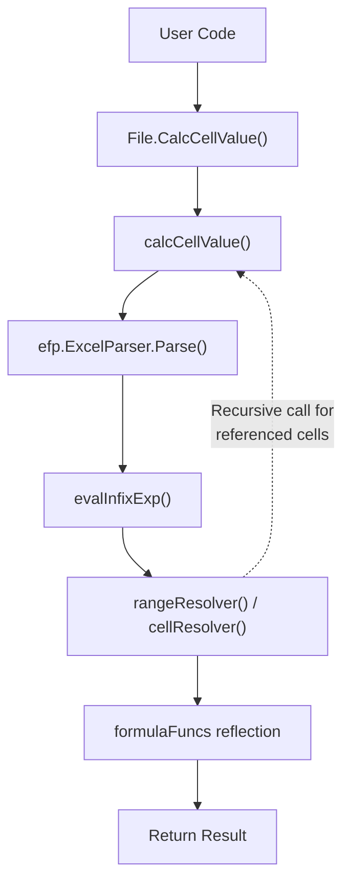
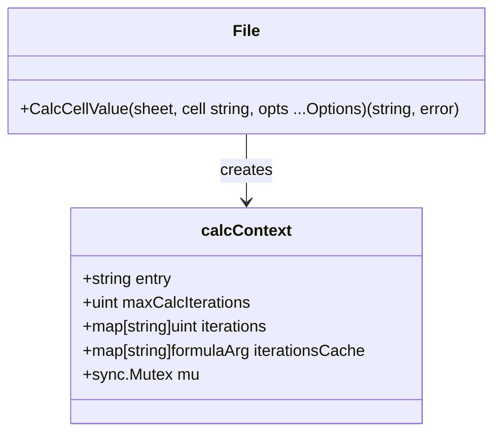
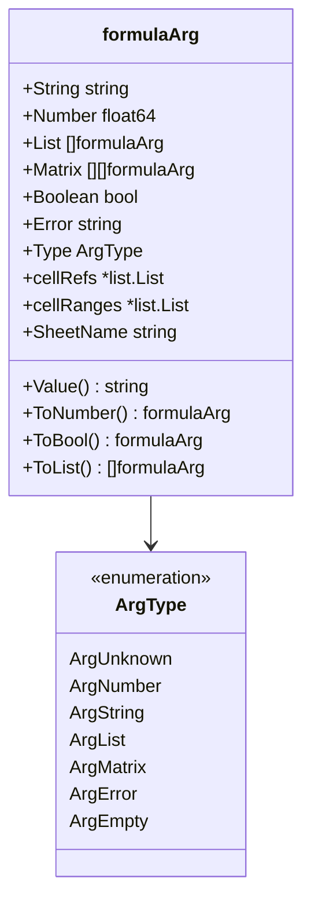
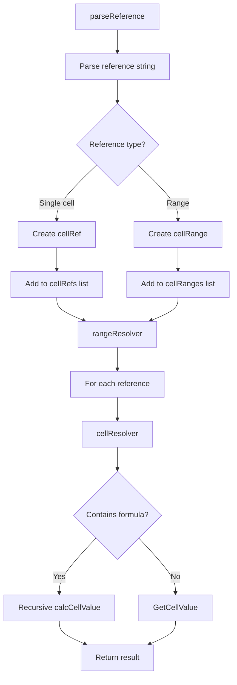

<!-- source: DeepWiki mcp.deepwiki.com · repo qax-os/excelize · page 3.1 Formula Calculation Engine · fetched 2026-10-29 -->

# Formula Calculation Engine

Relevant source files

The following files were used as context for generating this wiki page:

- [calc.go](calc.go)
- [calc_test.go](calc_test.go)
- [calcchain.go](calcchain.go)
- [calcchain_test.go](calcchain_test.go)
- [xmlCalcChain.go](xmlCalcChain.go)

This page provides a comprehensive overview of the Formula Calculation system in the Excelize library. It explains how Excel formulas are parsed, evaluated, and how cell reference resolution works. The system supports over 200 Excel functions, cell references, ranges, and proper error handling.

## Overview

The Formula Calculation system allows Excelize to evaluate Excel formulas in cells. The primary entry point is the `CalcCellValue` function, which takes a worksheet name and cell reference and returns the calculated result.

The Formula Calculation system can handle arithmetic operations, function calls, cell references, and provides proper error handling for standard Excel error types.

Sources: [calc.go:816-848](), [calc.go:933-1062]()

## Architecture Components

### Calculation Context

The core of the formula calculation system is the `calcContext` struct which manages the calculation state:

The calculation context:
- Tracks the entry point cell to detect circular references [calc.go:217-223]()
- Limits calculation iterations to prevent infinite loops [calc.go:219-219]()
- Caches intermediate results for iterative calculations [calc.go:221-221]()

Sources: [calc.go:217-223]()

### Formula Arguments

Formula values are represented by the `formulaArg` struct, which can store different types of data:

This flexible structure allows the system to handle different data types that can appear in Excel formulas.

Sources: [calc.go:244-347]()

## Calculation Process

### Formula Types

Excelize handles three main types of formulas defined in the `xlsxF` structure:
1. **Normal**: A standard formula contained within a single cell.
2. **Shared**: A formula shared across a range of cells to reduce file size. These are identified by a `si` (shared index) attribute [xmlWorksheet.go:990-1015]().
3. **Array**: Formulas that perform multiple calculations on one or more sets of values, often returning multiple results [xmlWorksheet.go:990-1015]().

### Expression Evaluation

The expression evaluator `evalInfixExp` processes formula tokens using multiple stacks to maintain state during evaluation:

| Stack Name | Purpose | File Reference |
|------------|---------|----------------|
| `opdStack` | Operands (values) | [calc.go:936-936]() |
| `optStack` | Operators (+, -, *, /, etc.) | [calc.go:937-937]() |
| `opfStack` | Functions (SUM, IF, etc.) | [calc.go:938-938]() |
| `opfdStack` | Function arguments - operands | [calc.go:939-939]() |
| `opftStack` | Function arguments - operators | [calc.go:940-940]() |
| `argsStack` | Argument lists for functions | [calc.go:941-941]() |

The evaluator follows these rules:
- Handles operator precedence correctly using `tokenPriority` [calc.go:119-132]()
- Processes parentheses for grouping [calc.go:1016-1033]()
- Calls function implementations via reflection in `callFormulaFuncs` [calc.go:1827-1845]()
- Recursively evaluates cell references through `cellResolver` [calc.go:1610-1662]()

Sources: [calc.go:933-1062](), [calc.go:119-132]()

### Reference Resolution

Cell references in formulas are resolved through a multi-step process:

The system supports various reference formats:
- Single cell references (e.g., "A1")
- Range references (e.g., "A1:B10")
- Cross-sheet references (e.g., "Sheet2!A1")
- Named ranges [calc.go:1536-1738]()

Sources: [calc.go:1536-1738](), [calc.go:1610-1662]()

## Calculation Chain and Volatility

Excelize maintains a calculation chain to track dependencies and optimize re-calculation.

- **Calculation Chain**: Managed via `xl/calcChain.xml`. The `xlsxCalcChain` struct maps the root of the calculation chain [xmlCalcChain.go:18-21]().
- **Volatile Dependencies**: Supports Real Time Data (RTD) and CUBE functions through `xl/volatileDependencies.xml`, mapped by `xlsxVolTypes` [xmlCalcChain.go:87-93]().
- **Chain Management**: Functions like `deleteCalcChain` allow removing cell references from the calculation chain when cells are modified [calcchain.go:44-70]().

Sources: [calcchain.go:22-40](), [xmlCalcChain.go:18-85]()

## Supported Functions

The Formula Calculation system supports over 200 Excel functions across multiple categories:

| Category | Example Functions |
|----------|-------------------|
| **Mathematical** | SUM, PRODUCT, POWER, ABS, CEILING, FLOOR [calc.go:1847-2100]() |
| **Statistical** | AVERAGE, COUNT, MAX, MIN, STDEV, VAR [calc.go:2101-2300]() |
| **Logical** | IF, AND, OR, NOT, IFERROR, IFS [calc.go:2301-2400]() |
| **Text** | CONCATENATE, LEFT, RIGHT, MID, TRIM, SUBSTITUTE [calc.go:2401-2600]() |
| **Date/Time** | NOW, DATE, DAY, MONTH, YEAR, WORKDAY [calc.go:2601-2800]() |
| **Lookup** | VLOOKUP, HLOOKUP, INDEX, MATCH, CHOOSE [calc.go:2801-2950]() |
| **Financial** | NPV, IRR, PMT, FV, PV [calc.go:2951-3065]() |
| **Engineering** | BESSELI, BIN2DEC, CONVERT, COMPLEX [calc.go:3066-3200]() |

Functions are implemented as methods on the `formulaFuncs` struct. The engine uses `formulaFnNameReplacer` to normalize function names (e.g., removing `_xlfn.` prefixes) before dispatching [calc.go:210-210]().

Sources: [calc.go:1827-3065](), [calc.go:210-210]()

## Error Handling

The Formula Calculation system handles standard Excel errors using constants:

| Error | Constant | Description |
|-------|----------|-------------|
| #DIV/0! | `formulaErrorDIV` | Division by zero [calc.go:42-42]() |
| #NAME? | `formulaErrorNAME` | Unknown identifier or function name [calc.go:43-43]() |
| #N/A | `formulaErrorNA` | Value not available [calc.go:44-44]() |
| #NUM! | `formulaErrorNUM` | Invalid numeric value [calc.go:45-45]() |
| #VALUE! | `formulaErrorVALUE` | Invalid value type [calc.go:46-46]() |
| #REF! | `formulaErrorREF` | Invalid cell reference [calc.go:47-47]() |
| #NULL! | `formulaErrorNULL` | Null intersection of ranges [calc.go:48-48]() |
| #CALC! | `formulaErrorCALC` | Calculation error [calc.go:50-50]() |

Sources: [calc.go:42-51]()

## Internal Implementation Details

### Circular Reference Handling

Circular references (where a formula refers back to its own cell directly or indirectly) are handled by:
1. Tracking the entry cell in the `calcContext.entry` [calc.go:218-218]().
2. Limiting the number of iterations via `maxCalcIterations` (default is often 128 for financial calculations) [calc.go:87-87]().
3. Using `iterationsCache` to store intermediate values during the iterative process [calc.go:221-221]().

### Criteria Evaluation

Functions like `SUMIF` or `COUNTIF` use a criteria evaluation system. The engine supports various operators:
- `criteriaEq` (=)
- `criteriaLe` (<=)
- `criteriaGe` (>=)
- `criteriaNe` (<>)
- `criteriaRegexp` (wildcards `*` and `?`) [calc.go:54-61]()

Wildcards are converted to regular expressions using `wildcardTokenRE` and `wildcardPatternMap` [calc.go:103-115]().

Sources: [calc.go:54-61](), [calc.go:103-115]()

## Limitations

The current implementation has some limitations:
- Iterative calculation with complex circular references may have minor precision differences from Excel.
- Array formulas are supported but complex multi-cell array results may have limitations.
- External workbook references are not fully supported in the calculation engine.
- Some highly specialized Analysis ToolPak functions may not be implemented.

Sources: [calc.go]()

---

