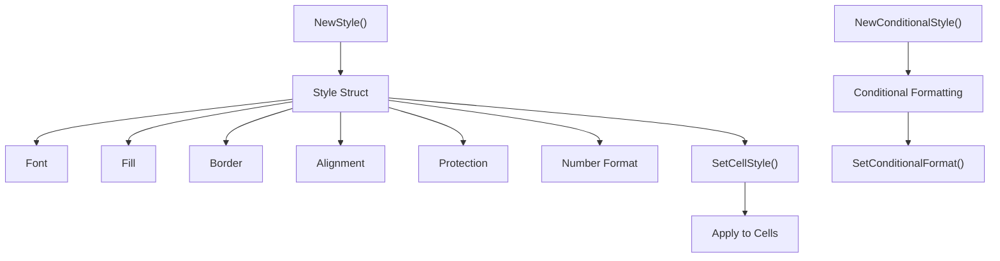
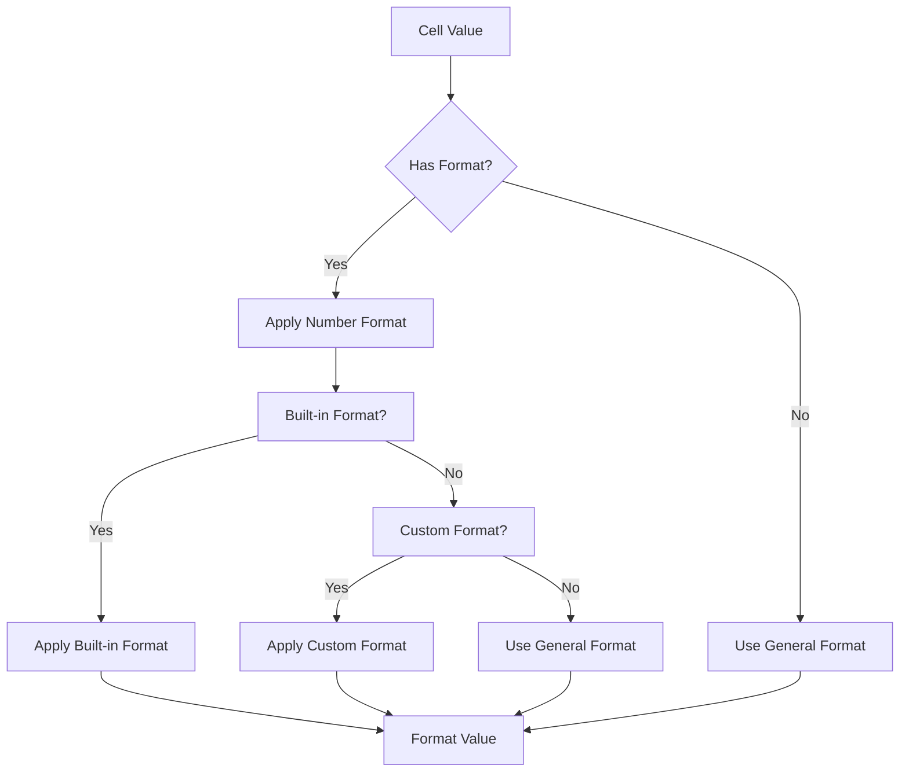
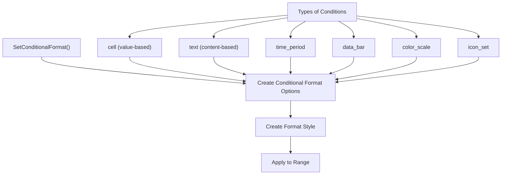
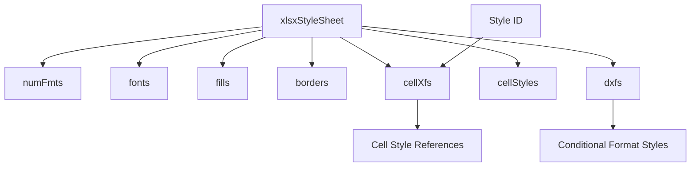

<!-- source: DeepWiki mcp.deepwiki.com · repo qax-os/excelize · page 3.2 Styling and Formatting · fetched 2026-10-29 -->

# Styling and Formatting

<details>
<summary>Relevant source files</summary>

The following files were used as context for generating this wiki page:

- [datavalidation.go](datavalidation.go)
- [datavalidation_test.go](datavalidation_test.go)
- [hsl.go](hsl.go)
- [numfmt.go](numfmt.go)
- [numfmt_test.go](numfmt_test.go)
- [styles.go](styles.go)
- [styles_test.go](styles_test.go)
- [xmlStyles.go](xmlStyles.go)
- [xmlTheme.go](xmlTheme.go)

</details>


This page documents the styling and formatting capabilities of the excelize library, which allows users to customize the appearance of cells, including fonts, colors, borders, and number formats. For information about charts and drawings, see [Charts and Graphs](#3.3).

## Overview of Styling System

The excelize library provides a comprehensive styling system that closely mirrors Microsoft Excel's styling capabilities. The styling system is built around the `Style` struct and related functions for creating and applying styles to cells and ranges.



Sources: [styles.go:162-267](), [styles.go:960-1027]()

## Style Structure

The `Style` struct is the main container for all styling properties and is defined as follows:

```mermaid
classDiagram
    class "Style" {
        Border[] Border
        Fill Fill
        Font* Font
        Alignment* Alignment
        Protection* Protection
        NumFmt int
        DecimalPlaces* int
        CustomNumFmt* string
        NegRed bool
    }
    
    class "Font" {
        Bold bool
        Italic bool
        Underline string
        Family string
        Size float64
        Strike bool
        Color string
        ColorIndexed int
        ColorTheme* int
        ColorTint float64
        VertAlign string
    }
    
    class "Fill" {
        Type string
        Pattern int
        Color[] string
        Shading int
    }
    
    class "Border" {
        Type string
        Color string
        Style int
    }
    
    class "Alignment" {
        Horizontal string
        Indent int
        JustifyLastLine bool
        ReadingOrder uint64
        RelativeIndent int
        ShrinkToFit bool
        TextRotation int
        Vertical string
        WrapText bool
    }
    
    class "Protection" {
        Hidden bool
        Locked bool
    }
    
    "Style" --> "Font"
    "Style" --> "Fill"
    "Style" --> "Border"
    "Style" --> "Alignment"
    "Style" --> "Protection"
```

Sources: [xmlStyles.go:321-380]()

## Creating and Applying Styles

### Creating a New Style

To create a new style, use the `NewStyle` function [styles.go:162](), which returns a style index. The same style index cannot be used across different workbooks. This function is concurrency safe [styles.go:164]().

Example of creating a style with bold, italic font and a pattern fill:

```go
style, err := f.NewStyle(&excelize.Style{
    Font: &excelize.Font{
        Bold:   true,
        Italic: true,
        Color:  "FF0000",
    },
    Fill: excelize.Fill{
        Type:    "pattern",
        Pattern: 1,
        Color:   []string{"FFFF00"},
    },
})
```

Sources: [styles.go:162-267](), [styles.go:960-1027]()

### Applying Styles to Cells

After creating a style, apply it to a cell or range of cells using the `SetCellStyle` function.

## Font Styling

The `Font` struct allows you to customize the appearance of text. Font colors use RGB hexadecimal notation (`RRGGBB`) [styles.go:165]().

Font underline styles include:
- `none`
- `single`
- `double`

Sources: [xmlStyles.go:89-105](), [styles.go:272-280]()

## Fill Styling

The `Fill` struct allows you to customize cell backgrounds using pattern or gradient fills. Pattern fills support solid colors or specific pattern types [styles.go:145-151]().

### Pattern Fill Types

The pattern fill types are indexed from 0 to 18 [styles.go:149]():

| Index | Style           | Index | Style           |
|-------|-----------------|-------|-----------------|
| 0     | None            | 10    | darkTrellis     |
| 1     | solid           | 11    | lightHorizontal |
| 2     | mediumGray      | 12    | lightVertical   |
| 3     | darkGray        | 13    | lightDown       |
| 4     | lightGray       | 14    | lightUp         |
| 5     | darkHorizontal  | 15    | lightGrid       |
| 6     | darkVertical    | 16    | lightTrellis    |
| 7     | darkDown        | 17    | gray125         |
| 8     | darkUp          | 18    | gray0625        |
| 9     | darkGrid        |       |                 |

### Gradient Fill Shading Types

Gradient fills require exactly 2 colors [styles.go:139]() and support shading indices from 0 to 16 [styles.go:142]():

| Index | Style           | Index | Style           |
|-------|-----------------|-------|-----------------|
| 0-2   | Horizontal      | 9-11  | Diagonal down   |
| 3-5   | Vertical        | 12-15 | From corner     |
| 6-8   | Diagonal Up     | 16    | From center     |

Sources: [styles.go:137-155](), [xmlStyles.go:111-149]()

## Border Styling

The `Border` struct allows you to define cell borders with position, color, and style [styles.go:168-199]().

### Border Types

The following border types are supported [styles.go:171-178]():

- `left`
- `top`
- `right`
- `bottom`
- `diagonalDown`
- `diagonalUp`

### Border Styles

Border styles are indexed from 0 to 13 [styles.go:183-199]():

| Index | Name          | Weight | Style         |
|-------|---------------|--------|---------------|
| 0     | None          | 0      |               |
| 1     | Continuous    | 1      | -----------   |
| 2     | Continuous    | 2      | -----------   |
| 3     | Dash          | 1      | - - - - - -   |
| 4     | Dot           | 1      | . . . . . .   |
| 5     | Continuous    | 3      | -----------   |
| 6     | Double        | 3      | ===========   |
| 7     | Continuous    | 0      | -----------   |
| 8     | Dash          | 2      | - - - - - -   |
| 9     | Dash Dot      | 1      | - . - . - .   |
| 10    | Dash Dot      | 2      | - . - . - .   |
| 11    | Dash Dot Dot  | 1      | - . . - . .   |
| 12    | Dash Dot Dot  | 2      | - . . - . .   |
| 13    | SlantDash Dot | 2      | / - . / - .   |

Sources: [styles.go:168-199](), [xmlStyles.go:154-173]()

## Alignment

The `Alignment` struct controls text alignment within cells, including horizontal/vertical positioning, indentation, and rotation [xmlStyles.go:39-49]().

### Alignment Properties

- `WrapText`: Enables text wrapping [xmlStyles.go:48]().
- `TextRotation`: Rotates text (0-180 degrees) [xmlStyles.go:46]().
- `Indent`: Indents text [xmlStyles.go:41]().
- `ShrinkToFit`: Shrinks text to fit in cell [xmlStyles.go:45]().

Sources: [xmlStyles.go:39-49](), [styles.go:219-267]()

## Protection

The `Protection` struct contains properties that only take effect when sheet protection is enabled [xmlStyles.go:53-54]():

- `Hidden`: Hides formulas in the cell [xmlStyles.go:56]().
- `Locked`: Prevents editing of the cell [xmlStyles.go:57]().

Sources: [xmlStyles.go:51-58]()

## Number Formatting

Excelize provides extensive number formatting capabilities through built-in formats or custom formats [numfmt.go:67-103]().

### Number Format Flow



Sources: [numfmt.go:36-49](), [styles.go:289-926]()

### Built-in Number Formats

Common built-in formats identified by index numbers [numfmt.go:70-103]():

| Index | Format String | Example |
|-------|---------------|---------|
| 0     | general       | 1234.56 |
| 2     | 0.00          | 1234.56 |
| 9     | 0%            | 123%    |
| 14    | mm-dd-yy      | 01-15-23|
| 49    | @             | Text    |

Sources: [numfmt.go:70-103]()

### Culture-Specific and Currency Formats

Excelize supports language-specific date/number formats (e.g., `zh-tw`, `ja-jp`, `ko-kr`) [numfmt.go:106-212]() and over 220 currency formats [numfmt.go:214-686]().

Sources: [numfmt.go:106-686](), [styles.go:451-634]()

## Conditional Formatting

Conditional formatting allows applying styles to cells meeting specific criteria [styles_test.go:51]().

### Conditional Formatting Process



Sources: [styles_test.go:51-171](), [styles_test.go:201-230]()

### Types of Conditional Formatting

- **Color Scales**: 2 or 3-color gradients based on values [styles_test.go:58-157]().
- **Data Bars**: Visual bars representing values, supporting solid colors [styles_test.go:172-179]().
- **Icon Sets**: Visual indicators like traffic lights [styles_test.go:197]().

Sources: [styles_test.go:51-241]()

## Internal Representation of Styles

Styles are stored in `xl/styles.xml` [styles.go:28](). The `xlsxStyleSheet` is the root element containing all font, fill, border, and number format definitions [xmlStyles.go:20-34]().



Sources: [xmlStyles.go:20-34](), [styles.go:28-46]()

### Serialization

- `stylesReader()`: Deserializes `xl/styles.xml` into the `xlsxStyleSheet` structure [styles.go:28-37]().
- `styleSheetWriter()`: Serializes and saves the style sheet back to the file [styles.go:41-46]().
- `themeWriter()`: Manages the serialization of the workbook theme (`xl/theme/theme1.xml`) [styles.go:50-114]().

Sources: [styles.go:26-114](), [xmlTheme.go:18-28]()

---

