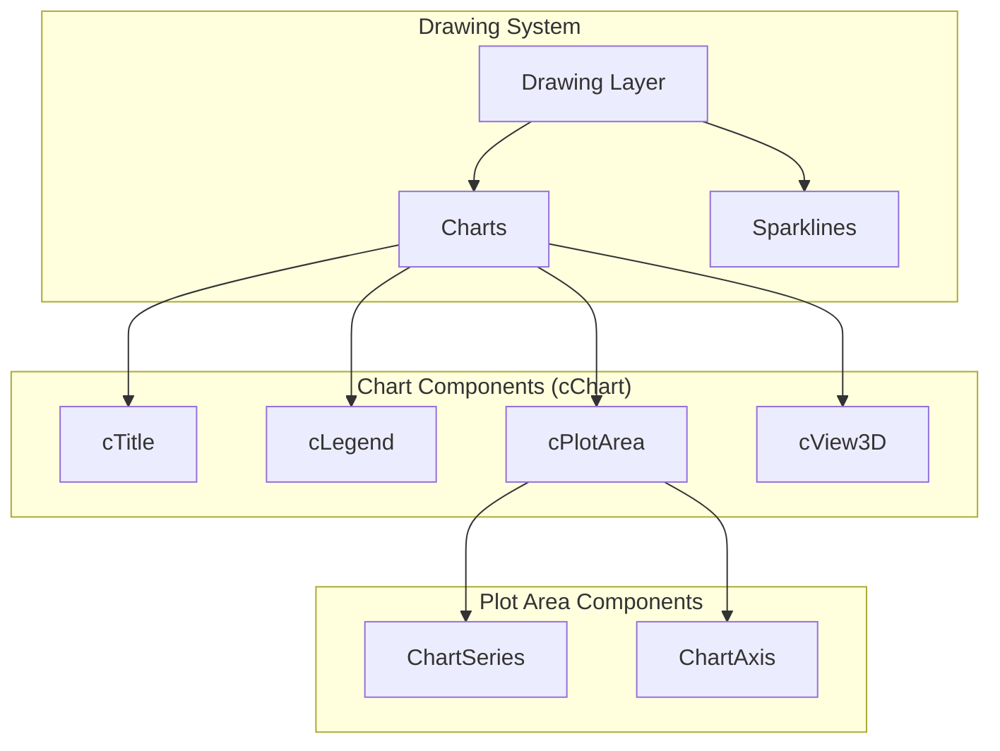
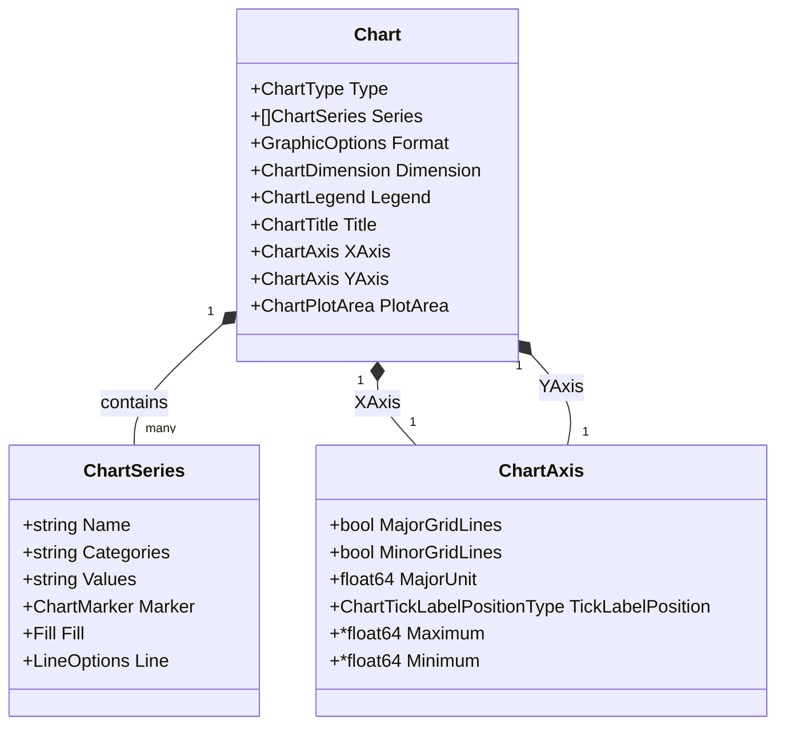
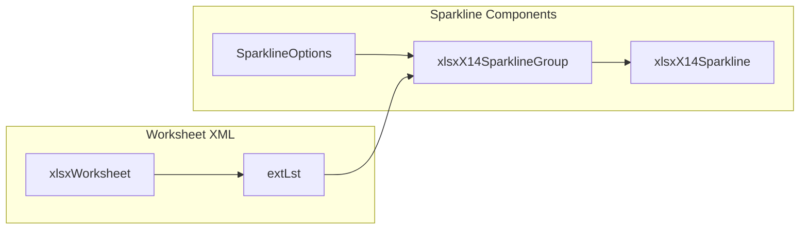
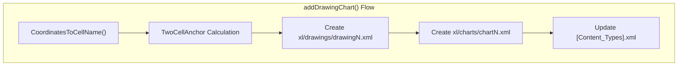

<!-- source: DeepWiki mcp.deepwiki.com · repo qax-os/excelize · page 3.3 Charts and Graphs · fetched 2026-10-29 -->

# Charts and Graphs

<details>
<summary>Relevant source files</summary>

The following files were used as context for generating this wiki page:

- [chart.go](chart.go)
- [chart_test.go](chart_test.go)
- [sparkline.go](sparkline.go)
- [sparkline_test.go](sparkline_test.go)
- [xmlChart.go](xmlChart.go)
- [xmlChartSheet.go](xmlChartSheet.go)

</details>


This document explains how to create and manipulate visual elements like charts and graphs in Excel spreadsheets using the excelize library. It covers the chart creation process, supported types, series configuration, and the underlying XML generation.

## 1. Overview

The excelize library provides comprehensive support for adding visual elements to Excel spreadsheets. Charts are implemented as drawing objects within the Excel XML structure, allowing for rich data visualization. The library supports 83 chart variants across multiple categories.



Sources: [chart.go:25-83](), [xmlChart.go:19-53](), [sparkline.go:21-23]()

## 2. Chart System

The chart system allows you to create various types of charts to visualize data. Excelize supports a wide range of chart types, including column charts, bar charts, line charts, pie charts, and specialized types like radar and surface charts.

### 2.1 Chart Types

Excelize supports 83 different chart types through the `ChartType` enumeration.

| Category | Examples | Description |
|----------|----------|-------------|
| **Area** | `Area`, `AreaStacked`, `Area3D` | Filled area charts, including 3D and stacked variants. |
| **Bar** | `Bar`, `BarStacked`, `Bar3DConeClustered` | Horizontal bars with shape variants (Cylinder, Cone, Pyramid). |
| **Column** | `Col`, `ColStacked`, `Col3D` | Vertical bars, the most common chart type. |
| **Line** | `Line`, `Line3D` | Standard line graphs for trends. |
| **Pie/Doughnut** | `Pie`, `Pie3D`, `Doughnut`, `PieOfPie` | Circular charts showing proportions. |
| **Scatter/Bubble** | `Scatter`, `Bubble`, `Bubble3D` | Charts for plotting X-Y data points and sizes. |
| **Specialized** | `Radar`, `Surface3D`, `StockHighLowClose` | Radar, 3D surface, and financial stock charts. |

Sources: [chart.go:25-83](), [chart.go:130-184]()

### 2.2 Chart Structure and Data Flow

An Excel chart is represented by the `Chart` struct, which maps to the `xlsxChartSpace` XML element.



Sources: [chart.go:604-679](), [xmlChart.go:19-29](), [xmlChart.go:41-53]()

### 2.3 Adding Charts

To add a chart to a worksheet, use the `AddChart` method. This function handles the coordinate conversion, drawing relationship creation, and chart XML serialization.

```go
err := f.AddChart("Sheet1", "E1", &excelize.Chart{
    Type: excelize.Col3DClustered,
    Series: []excelize.ChartSeries{
        {
            Name:       "Sheet1!$A$2",
            Categories: "Sheet1!$B$1:$D$1",
            Values:     "Sheet1!$B$2:$D$2",
        },
    },
    Title: excelize.ChartTitle{
        Paragraph: []excelize.RichTextRun{{Text: "Sample Chart"}},
    },
})
```

Sources: [chart.go:604-679](), [chart_test.go:44-56]()

### 2.4 Combo Charts

Excelize supports combo charts by passing multiple `Chart` configurations to the `AddChart` method. This allows overlaying different chart types (e.g., a Line chart over a Column chart) using the same axes.

Sources: [chart_test.go:290-304]()

## 3. Advanced Configuration

### 3.1 3D View and Perspective

For 3D chart types, Excelize applies default rotation and perspective values defined in internal maps like `chartView3DRotX` and `chartView3DRotY`. These are applied during the XML generation of the `cView3D` element.

Sources: [chart.go:130-184](), [chart.go:185-239](), [xmlChart.go:44]()

### 3.2 Axes and Tick Labels

Axes can be customized using the `ChartAxis` struct. Key properties include:
- `TickLabelPosition`: Controlled by `ChartTickLabelPositionType` (NextToAxis, High, Low, None).
- `MajorUnit`: Specifies the interval between major tick marks.
- `Maximum`/`Minimum`: Hard-coded bounds for the axis scale.

Sources: [chart.go:117-126](), [xmlChart.go:856-877]()

### 3.3 Series Styling

Each series in a chart can have unique styling:
- **Markers**: Configured via `ChartMarker`, including symbols (circle, dash, diamond, etc.) and sizes.
- **Lines**: Configured via `LineOptions`, supporting `LineDashType` (Solid, Dot, Dash) and `LineType`.
- **Fills**: Custom colors and transparency for bar/area charts.

Sources: [chart.go:86-102](), [chart.go:105-113](), [chart_test.go:169-179]()

## 4. Sparklines

Sparklines are miniature charts that fit within a single cell. Unlike standard charts, they are part of the `xlsxX14SparklineGroups` extension list within the worksheet XML.



Excelize provides 12 preset color themes for sparklines. You can add them using `AddSparkline`, specifying the `Location` (destination cells) and `Range` (source data).

Sources: [sparkline.go:21-33](), [sparkline_test.go:31-41]()

## 5. Internal Implementation

### 5.1 XML Generation

The library uses a series of internal structs to map Go configurations to Office Open XML (OOXML) DrawingML and Chart namespaces.

- `xlsxChartSpace`: The root element for a chart file (`xl/charts/chartN.xml`).
- `cPlotArea`: Defines the 2D or 3D area where data is plotted.
- `xlsxWsDr`: The drawing root (`xl/drawings/drawingN.xml`) that anchors the chart to the worksheet.

### 5.2 Anchoring Mechanism

Charts are positioned using "Two-Cell Anchors" (`xdrCellAnchor`). This defines the top-left corner (`from`) and bottom-right corner (`to`) of the chart in terms of column/row indices and offsets in EMUs (English Metric Units).



Sources: [xmlChart.go:19-29](), [xmlDrawing.go:191-204](), [chart_test.go:71-98]()

## 6. Chart Sheets

A Chart Sheet is a special type of sheet that contains only a chart and no cells. This is represented by the `xlsxChartsheet` struct. It has its own page setup, protection, and views, separate from standard worksheets.

Sources: [xmlChartSheet.go:20-34]()

## 7. Summary of Functions

| Function | Purpose |
|----------|---------|
| `AddChart` | Adds a chart to a specific worksheet at a given cell. |
| `AddChartSheet` | Creates a new sheet dedicated entirely to a chart. |
| `DeleteChart` | Removes a chart drawing from a worksheet. |
| `AddSparkline` | Adds a sparkline (mini-chart) to a cell or range of cells. |

Sources: [chart.go:604](), [chart_test.go:100-107](), [sparkline_test.go:11-14]()

---

