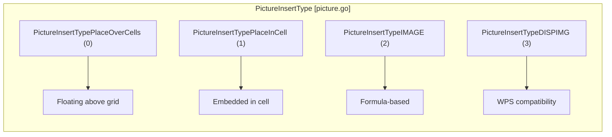
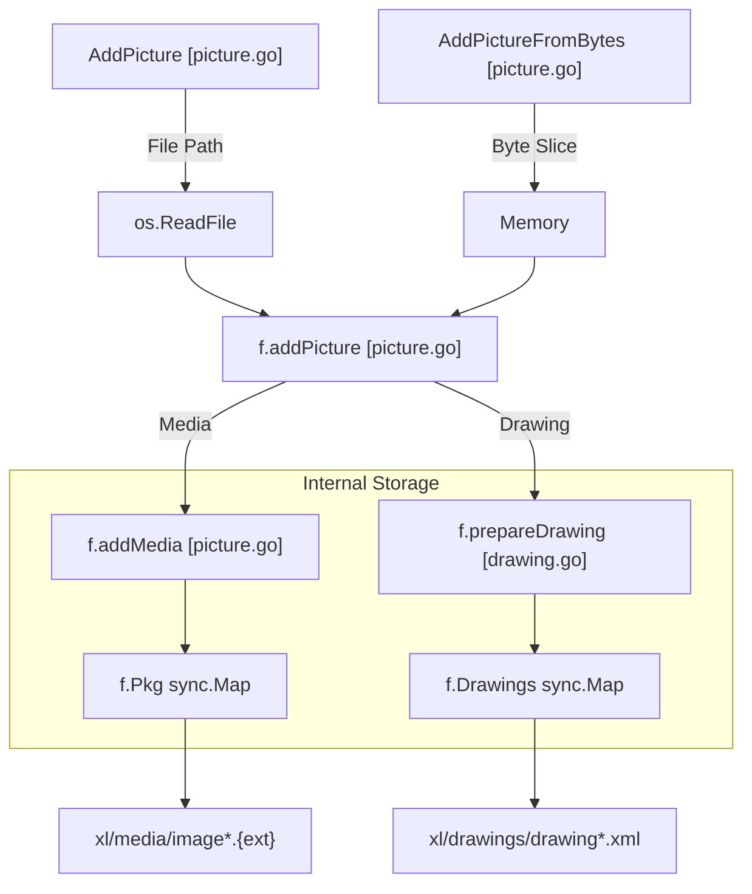
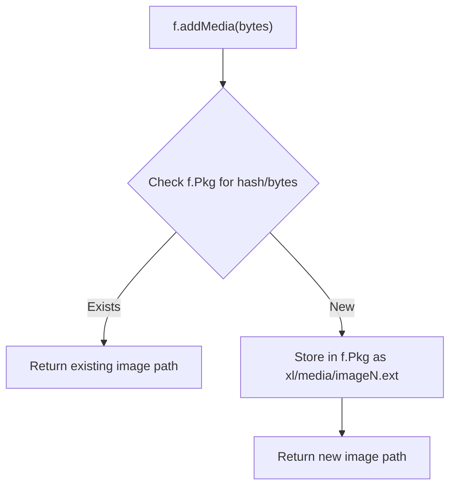

<!-- source: DeepWiki mcp.deepwiki.com · repo qax-os/excelize · page 3.4 Images and Pictures · fetched 2026-10-29 -->

# Images and Pictures

<details>
<summary>Relevant source files</summary>

The following files were used as context for generating this wiki page:

- [drawing.go](drawing.go)
- [drawing_test.go](drawing_test.go)
- [picture.go](picture.go)
- [picture_test.go](picture_test.go)
- [shape.go](shape.go)
- [table.go](table.go)
- [test/images/excel.bmp](test/images/excel.bmp)
- [test/images/excel.gif](test/images/excel.gif)
- [test/images/excel.jpg](test/images/excel.jpg)
- [test/images/excel.png](test/images/excel.png)
- [test/images/excel.tif](test/images/excel.tif)
- [xmlDecodeDrawing.go](xmlDecodeDrawing.go)
- [xmlDrawing.go](xmlDrawing.go)

</details>


This document details the image and picture handling capabilities in the Excelize library. It covers how to add, retrieve, and delete images in Excel worksheets, as well as the various formatting options available. The Excelize library supports embedding pictures in worksheets through multiple approaches, with robust handling for different image formats and positioning types.

For information about charts and other drawing objects, see [Charts and Drawings](3.3). For information about shape operations, see [Coordinate System and Utilities](4.4).

## Supported Image Formats

Excelize supports a wide range of image formats that can be embedded in Excel worksheets:

| Format | Extensions | Notes |
|--------|------------|-------|
| Bitmap | .bmp | Standard bitmap format |
| Enhanced Metafile | .emf, .emz | Vector image format |
| Graphics Interchange Format | .gif | Supports animation |
| Icon | .ico | Windows icon format |
| JPEG | .jpg, .jpeg | Common web format |
| Portable Network Graphics | .png | Lossless compression |
| Scalable Vector Graphics | .svg | Vector format |
| TIFF | .tif, .tiff | High-quality format |
| Windows Metafile | .wmf, .wmz | Vector format |

Sources: [picture.go:83-86](), [picture.go:211-213]()

## Picture Insert Types

Excelize defines several ways to insert images into worksheets using the `PictureInsertType` type:



- **PlaceOverCells** (default): Places the image over cells, floating above the worksheet grid. This is the primary type supported by `AddPicture`.
- **PlaceInCell**: Embeds the image within a cell.
- **IMAGE**: Used with the `IMAGE` formula function.
- **DISPIMG**: Used for compatibility with Kingsoft WPS Office embedded image cells.

Sources: [picture.go:27-37](), [picture.go:87-89]()

## Adding Images to Worksheets

The library provides two main methods for adding pictures to worksheets:



### AddPicture Method

This method adds an image from a file path to a specified cell in a worksheet. It is concurrency-safe.

**Syntax:**
```go
func (f *File) AddPicture(sheet, cell, name string, opts *GraphicOptions) error
```

Sources: [picture.go:83-184]()

### AddPictureFromBytes Method

This method adds an image from a byte slice. This is useful when images are generated dynamically or retrieved from a database/API.

**Syntax:**
```go
func (f *File) AddPictureFromBytes(sheet, cell string, pic *Picture) error
```

Sources: [picture.go:186-218]()

### Format Options (GraphicOptions)

When adding pictures, you can specify various formatting options via the `GraphicOptions` struct. The `parseGraphicOptions` function applies default values if they are not provided.

| Option | Type | Default | Description |
|--------|------|---------|-------------|
| AltText | string | "" | Alternative text (Max length defined by `MaxGraphicAltTextLength`) |
| PrintObject | *bool | true | Whether the object is printed with the sheet |
| Locked | *bool | true | Whether to lock the object (requires sheet protection) |
| LockAspectRatio | bool | false | Whether to maintain the original aspect ratio |
| AutoFit | bool | false | Auto-fits the object to the cell size |
| AutoFitIgnoreAspect | bool | false | Ignores aspect ratio when `AutoFit` is enabled |
| OffsetX | int | 0 | Horizontal offset from the cell corner |
| OffsetY | int | 0 | Vertical offset from the cell corner |
| ScaleX | float64 | 1.0 | Horizontal scale factor |
| ScaleY | float64 | 1.0 | Vertical scale factor |
| Hyperlink | string | "" | Target URL or cell reference |
| HyperlinkType | string | "External" | "External" (URL) or "Location" (Sheet reference) |
| Positioning | string | "twoCell" | "oneCell", "twoCell", or "absolute" |

Sources: [picture.go:39-67](), [picture.go:147-194]()

## Anchoring and Positioning

The `Positioning` option defines how the image behaves when rows or columns are resized:

1. **oneCell**: Move but don't size with cells.
2. **twoCell**: Move and size with cells (default).
3. **absolute**: Don't move or size with cells.

Internally, these map to OOXML drawing structures: `oneCellAnchor` and `twoCellAnchor`.

Sources: [picture.go:190-194](), [xmlDrawing.go:172-194](), [xmlDecodeDrawing.go:16-30]()

## Image Workflow Architecture

When a picture is added, the following data flow occurs:

1. **Validation**: The library parses options and validates the cell reference.
2. **Media Storage**: `addMedia` checks if the image bytes already exist in the package (`f.Pkg`) to perform deduplication.
3. **Drawing Preparation**: `prepareDrawing` checks if the worksheet already has a drawing relationship. If not, it creates a new relationship in `xl/worksheets/_rels/sheet*.xml.rels`.
4. **XML Generation**: The library constructs the `xlsxPic` structure, including `xlsxBlip` (the image reference) and `xlsxSpPr` (shape properties/transform).
5. **Serialization**: The drawing XML is updated in the `f.Drawings` map.

Sources: [drawing.go:25-41](), [picture.go:220-287](), [picture.go:352-426](), [picture.go:427-463]()

## Retrieving and Deleting Images

### GetPictures Method
Retrieves all pictures from a specific cell. It returns a slice of `Picture` objects, which include the raw bytes in the `File` field.

```go
func (f *File) GetPictures(sheet, cell string) ([]Picture, error)
```

Sources: [picture.go:609-648]()

### GetPictureCells Method
Returns all cell coordinates that contain pictures in a given worksheet.

```go
func (f *File) GetPictureCells(sheet string) ([]string, error)
```

Sources: [picture.go:774-815]()

### DeletePicture Method
Removes pictures from a specific cell. Note that this modifies the drawing XML and relationship files.

```go
func (f *File) DeletePicture(sheet, cell string) error
```

Sources: [picture.go:862-921]()

## Performance: Image Deduplication

Excelize automatically deduplicates images to minimize file size. If you add the same byte slice multiple times, the library stores only one physical file in `xl/media/` and creates multiple references to it.



Sources: [picture.go:444-463]()

## Implementation Details: XML Structures

The drawing system relies on several key XML mappings:

- **xlsxBlip**: Specifies the reference to the image data via an `r:embed` ID. [xmlDrawing.go:65-70]()
- **xlsxXfrm**: Defines the 2D transform (offset and extent) for the graphic frame. [xmlDrawing.go:104-107]()
- **xlsxCNvPr**: Non-visual properties, including `Name`, `Title`, and `Descr` (Alt Text). [xmlDrawing.go:22-28]()
- **xlsxHlinkClick**: Stores hyperlink information associated with the drawing object. [xmlDrawing.go:33-43]()

Sources: [xmlDrawing.go:19-170]()

---

