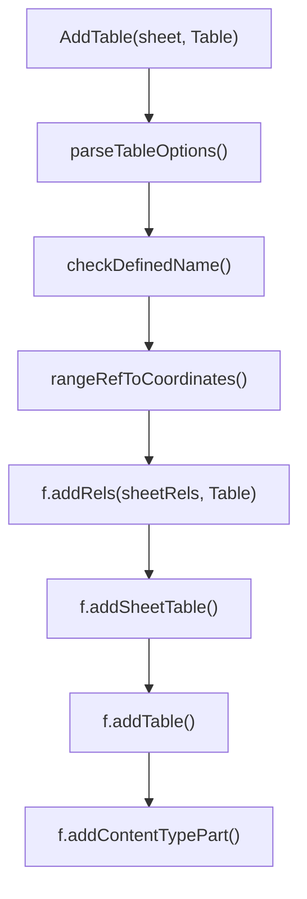
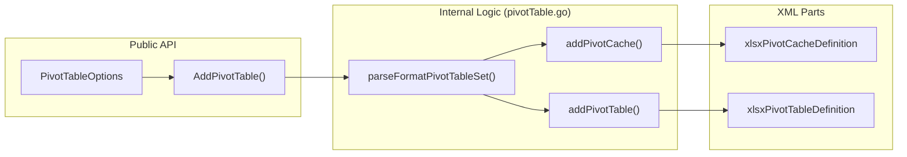
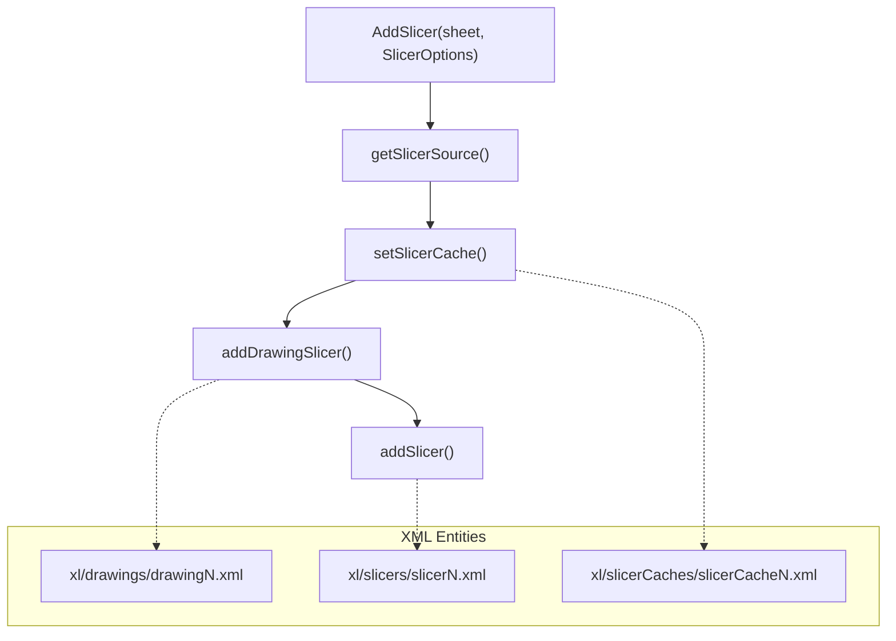

<!-- source: DeepWiki mcp.deepwiki.com · repo qax-os/excelize · page 3.5 Tables, Pivot Tables, and Slicers · fetched 2026-10-29 -->

# Tables, Pivot Tables, and Slicers

Relevant source files

The following files were used as context for generating this wiki page:

- [pivotTable.go](pivotTable.go)
- [pivotTable_test.go](pivotTable_test.go)
- [shape.go](shape.go)
- [shape_test.go](shape_test.go)
- [slicer.go](slicer.go)
- [slicer_test.go](slicer_test.go)
- [table.go](table.go)
- [table_test.go](table_test.go)
- [xmlDrawing.go](xmlDrawing.go)
- [xmlPivotCache.go](xmlPivotCache.go)
- [xmlPivotTable.go](xmlPivotTable.go)
- [xmlSlicers.go](xmlSlicers.go)
- [xmlTable.go](xmlTable.go)

This section documents the implementation and management of structured data components in Excelize. These features allow for advanced data organization, multi-dimensional analysis, and interactive filtering within spreadsheets.

## 1. Excel Tables

Excel Tables (`xlsxTable`) provide a structured way to manage a range of cells, offering built-in filtering, sorting, and styling.

### Implementation Flow
When `AddTable` is called, the library performs coordinate validation, checks for name collisions across the workbook, and generates a new table XML part.

### Key Components
- **`AddTable`**: The primary entry point for creating tables. It requires a worksheet name and a `Table` struct defining the range and style [table.go:80-125]().
- **`xlsxTable`**: The internal XML structure mapping to the `xl/tables/tableN.xml` part [xmlTable.go:21-49]().
- **AutoFilter**: Tables automatically include an `xlsxAutoFilter` element to manage row visibility based on criteria [xmlTable.go:54-58]().

### Sources:
- [table.go:33-45]() (Parsing options)
- [table.go:80-125]() (Table creation logic)
- [xmlTable.go:21-49]() (XML mapping)

---

## 2. Pivot Tables

Pivot Tables enable complex data summarization. Excelize handles the creation of both the **Pivot Cache** (data source definition) and the **Pivot Table Definition** (layout and view).

### Code Entity Mapping: Pivot Table Construction
The following diagram bridges the high-level `PivotTableOptions` to the internal XML generation functions.

### Technical Detail
1.  **Pivot Cache**: Defined via `xlsxPivotCacheDefinition`. It tracks the source data range and field types [xmlPivotCache.go:20-52]().
2.  **Pivot Table**: Defined via `xlsxPivotTableDefinition`. It manages `PivotFields`, `RowFields`, `ColFields`, and `DataFields` to determine the visual layout [xmlPivotTable.go:19-98]().
3.  **Relationships**: Pivot tables require multiple relationship entries:
    - Worksheet to Pivot Table.
    - Pivot Table to Pivot Cache.
    - Workbook to Pivot Cache [pivotTable.go:191-205]().

### Sources:
- [pivotTable.go:35-67]() (Options struct)
- [pivotTable.go:181-206]() (AddPivotTable implementation)
- [xmlPivotTable.go:19-98]() (Table definition XML)
- [xmlPivotCache.go:20-52]() (Cache definition XML)

---

## 3. Slicers

Slicers provide an interactive UI layer for filtering Tables and Pivot Tables. They are visually represented as shapes but backed by a "Slicer Cache".

### Data Flow: Slicer Integration
Slicers bridge the Drawing subsystem with the Table/PivotTable data sources.

### Configuration
- **`SlicerOptions`**: Contains mandatory fields like `Name`, `Cell`, `TableSheet`, and `TableName` [slicer.go:62-81]().
- **Source Resolution**: The function `getSlicerSource` identifies whether the target is a standard Table or a Pivot Table to determine the correct XML namespace and extension URI [slicer.go:186-226]().
- **Visuals**: Slicers are anchored in the worksheet drawing layer using `addDrawingSlicer`, which creates a graphic frame for the slicer UI [slicer.go:121-123]().

### Sources:
- [slicer.go:89-131]() (AddSlicer function)
- [slicer.go:186-226]() (Source resolution)
- [xmlDrawing.go:22-28]() (Non-visual drawing properties used by slicers)

---

## 4. Underlying XML Structures

The following table summarizes the primary XML elements involved in these features:

| Feature | Root Element | File Pattern | Namespace |
| :--- | :--- | :--- | :--- |
| **Table** | `xlsxTable` | `xl/tables/tableN.xml` | `spreadsheetml/2006/main` |
| **Pivot Table** | `xlsxPivotTableDefinition` | `xl/pivotTables/pivotTableN.xml` | `spreadsheetml/2006/main` |
| **Pivot Cache** | `xlsxPivotCacheDefinition` | `xl/pivotCache/pivotCacheDefinitionN.xml` | `spreadsheetml/2006/main` |
| **Slicer** | `xlsxSlicer` | `xl/slicers/slicerN.xml` | `officeDocument/2006/relationships` |

### Sources:
- [xmlTable.go:21-22]()
- [xmlPivotTable.go:19-20]()
- [xmlPivotCache.go:20-21]()
- [slicer.go:124-130]()

---

