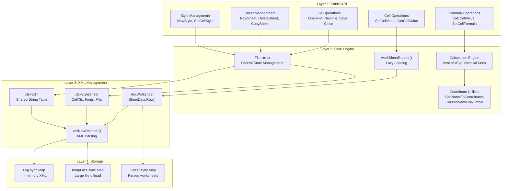
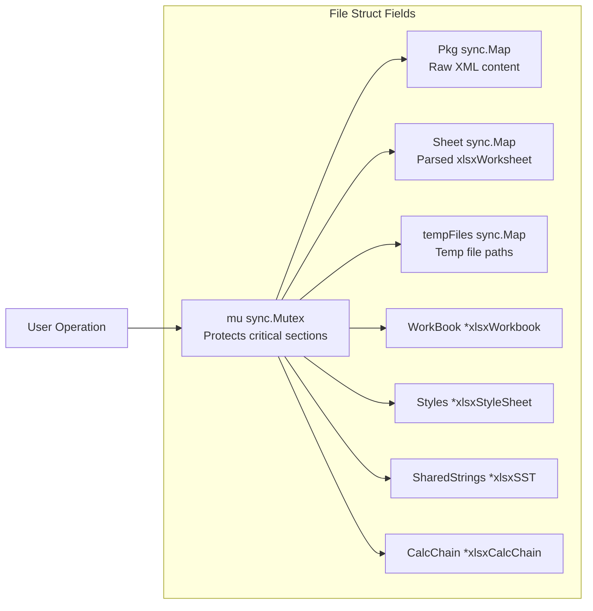
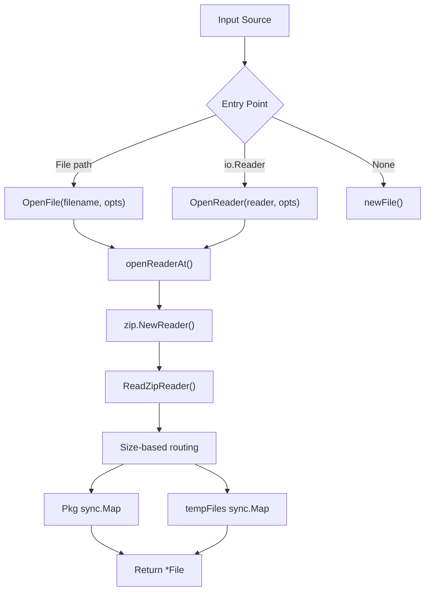
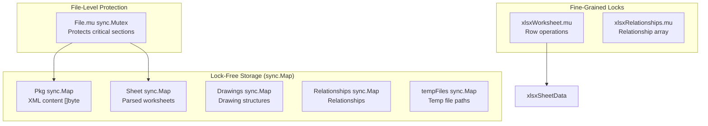
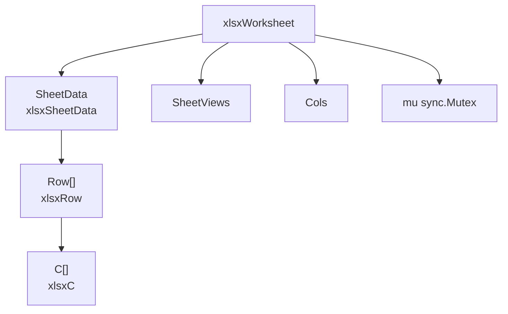
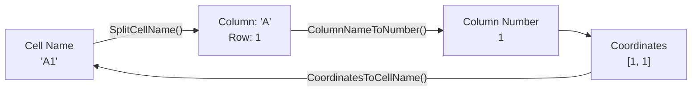

<!-- source: DeepWiki mcp.deepwiki.com · repo qax-os/excelize · page 4 Internal Architecture · fetched 2026-10-29 -->

# Internal Architecture

Relevant source files

The following files were used as context for generating this wiki page:

- [excelize.go](excelize.go)
- [lib.go](lib.go)
- [lib_test.go](lib_test.go)
- [xmlWorkbook.go](xmlWorkbook.go)
- [xmlWorksheet.go](xmlWorksheet.go)

The excelize library implements a four-layer architecture for processing Office Open XML spreadsheet files (XLSX). This page describes the overall architectural design, the central `File` struct, memory management strategies, and concurrency model. For detailed information on specific subsystems, see the subpages:

- [XML Structure and Serialization](#4.1) - XML parsing, namespace management, Office Open XML compliance
- [Data Model and Structures](#4.2) - Core data structures, sync.Map architecture, memory management
- [Streaming API](#4.3) - `Rows` iterator, SAX parsing, temporary file handling
- [Coordinate System and Utilities](#4.4) - Cell reference conversion, coordinate utilities, helper functions

## Architectural Layers

The library is structured in four distinct layers that handle different aspects of spreadsheet processing:

### Four-Layer Architecture Diagram

Sources: [excelize.go:30-66](), [xmlWorksheet.go:19-66]()

**Layer 1: Public API** - User-facing functions organized by domain (cells, sheets, styles, formulas). All operations funnel through the core engine.

**Layer 2: Core Engine** - The `File` struct coordinates operations, `workSheetReader` provides lazy loading of worksheets, calculation engine handles formulas, and coordinate utilities convert cell references.

**Layer 3: XML Management** - Go structs that directly map to Office Open XML elements. These structs use `encoding/xml` tags for serialization/deserialization.

**Layer 4: Storage** - Three-tier storage strategy using `sync.Map` for thread-safe access to in-memory content (`Pkg`), parsed worksheets (`Sheet`), and temporary file paths (`tempFiles`).

### The File Struct - Central State Manager

The `File` struct is the central hub that maintains all workbook state and coordinates operations across subsystems:

Sources: [excelize.go:30-66]()

Key `File` struct fields:

| Field | Type | Purpose |
|-------|------|---------|
| `mu` | `sync.Mutex` | Protects critical sections during structural modifications |
| `Pkg` | `sync.Map` | Stores raw XML content as `[]byte`, keyed by file path |
| `Sheet` | `sync.Map` | Caches parsed `*xlsxWorksheet` structs for fast access |
| `tempFiles` | `sync.Map` | Maps file paths to temp file locations for large XML |
| `WorkBook` | `*xlsxWorkbook` | Workbook structure with sheet references, defined names |
| `Styles` | `*xlsxStyleSheet` | Style definitions: fonts, fills, borders, number formats |
| `SharedStrings` | `*xlsxSST` | Shared string table for cell text deduplication |
| `CalcChain` | `*xlsxCalcChain` | Calculation chain for formula dependency tracking |

Sources: [excelize.go:30-66]()

## Memory Management Strategy

The library employs a sophisticated two-tier memory management strategy to handle files of varying sizes efficiently:

### Size-Based Content Routing

```mermaid
flowchart TB
    ZipFile["ZIP Archive<br/>(XLSX file)"] --> ReadZip["ReadZipReader()"]
    ReadZip --> SizeCheck{"XML Size Check<br/>UnzipXMLSizeLimit"}
    
    SizeCheck -->|"< 16MB"| Memory["Store in Pkg sync.Map<br/>readXML() returns []byte"]
    SizeCheck -->|">= 16MB"| Temp["Write to Temp File<br/>unzipToTemp()"]
    
    Memory --> PkgMap["Pkg sync.Map<br/>Key: file path<br/>Value: []byte"]
    Temp --> TempFilesMap["tempFiles sync.Map<br/>Key: file path<br/>Value: temp path"]
    
    PkgMap --> Access["Fast Access<br/>In-memory"]
    TempFilesMap --> DiskAccess["readTemp()<br/>Disk I/O"]
```

Sources: [lib.go:32-79](), [lib.go:83-99](), [lib.go:129-136]()

**Small Files (< UnzipXMLSizeLimit)**: Stored directly in the `Pkg sync.Map` as `[]byte` for fast access. Default limit is 16MB [excelize.go:154]().

**Large Files (>= UnzipXMLSizeLimit)**: Written to temporary files in the system temp directory. The path is stored in `tempFiles sync.Map`, and content is accessed via `readTemp()` when needed.

Key functions:

- `ReadZipReader()` - Extracts ZIP entries and routes based on size [lib.go:32-79]()
- `unzipToTemp()` - Creates temp file and copies content [lib.go:83-99]()
- `readXML()` - Returns content from `Pkg` sync.Map [lib.go:102-110]()
- `readTemp()` - Opens temp file for reading [lib.go:129-136]()
- `readBytes()` - Unified interface that checks both `Pkg` and `tempFiles` [lib.go:113-126]()

Sources: [lib.go:32-136]()

## File I/O Pipeline

The library implements a bidirectional pipeline for reading and writing XLSX files, with careful handling of ZIP archives and XML content.

### Read Pipeline

Sources: [excelize.go:134-149](), [excelize.go:188-194](), [excelize.go:198-203](), [lib.go:32-79]()

Key functions in read pipeline:

- `OpenFile()` - Opens file from disk, delegates to `openReaderAt()` [excelize.go:134-149]()
- `OpenReader()` - Reads data stream, delegates to `openReaderAt()` [excelize.go:188-194]()
- `ReadZipReader()` - Extracts ZIP entries with size-based routing to `Pkg` or `tempFiles` [lib.go:32-79]()

### Write Pipeline

When saving, the library marshals modified structures back to XML and bundles them into a ZIP archive.

Sources: [lib.go:140-142]()

## Concurrency and Thread Safety

The library implements multiple levels of concurrency control to enable safe parallel operations:

### Thread Safety Architecture

Sources: [excelize.go:31-66](), [xmlWorksheet.go:21-22](), [xmlWorkbook.go:21-22]()

### Concurrency Patterns

| Pattern | Implementation | Purpose |
|---------|---------------|---------|
| **File-Level Mutex** | `File.mu sync.Mutex` | Protects critical sections during structural modifications [excelize.go:32]() |
| **Lock-Free Maps** | `sync.Map` types | Enable concurrent access to `Pkg`, `Sheet`, `Drawings`, etc. [excelize.go:53-58]() |
| **Worksheet Lock** | `xlsxWorksheet.mu sync.Mutex` | Protects modifications within a single worksheet [xmlWorksheet.go:22]() |
| **Relationships Lock** | `xlsxRelationships.mu sync.Mutex` | Protects relationship modifications [xmlWorkbook.go:22]() |

Sources: [excelize.go:31-66](), [xmlWorksheet.go:21-22](), [xmlWorkbook.go:21-22]()

## Worksheet Structure Management

Worksheets are represented by the `xlsxWorksheet` struct, which maps to the Office Open XML worksheet element.

### xlsxWorksheet Structure

Sources: [xmlWorksheet.go:21-66]()

Key worksheet components:

- `SheetData` - Contains all rows and cells in the worksheet [xmlWorksheet.go:30]()
- `xlsxWorksheet.mu` - Mutex for thread-safe sheet operations [xmlWorksheet.go:22]()

## Coordinate System

The library includes utilities for converting between Excel-style cell references (like "A1") and numeric coordinates:

### Coordinate Conversion Functions

Sources: [lib.go:161-175](), [lib.go:178-195](), [lib.go:204-225](), [lib.go:249-251]()

Key coordinate functions:

| Function | Signature | Purpose |
|----------|-----------|---------|
| `SplitCellName` | `(cell string) (string, int, error)` | Split "A1" into "A" and 1 [lib.go:161]() |
| `JoinCellName` | `(col string, row int) (string, error)` | Join "A" and 1 into "A1" [lib.go:178]() |
| `ColumnNameToNumber` | `(name string) (int, error)` | Convert "AK" to 37 [lib.go:204]() |
| `ColumnNumberToName` | `(num int) (string, error)` | Convert 37 to "AK" [lib.go:249]() |

Sources: [lib.go:156-251]()

The library precomputes column names in a lookup table `columnNames` to eliminate allocations during conversion [lib.go:230-247]().

## Conclusion

The excelize library provides a comprehensive set of tools for working with Excel files in Go, with a well-designed internal architecture that balances performance, memory efficiency (via size-based routing to temp files), and thread safety (via `sync.Map` and fine-grained mutexes).

Sources: [excelize.go:5-10](), [lib.go:5-10]()

---

