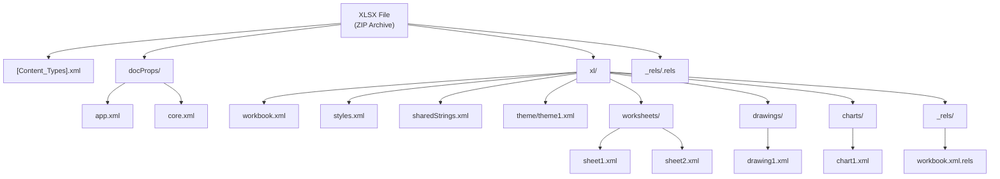
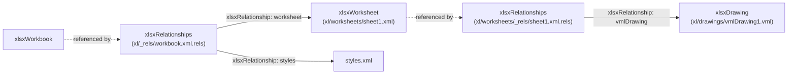
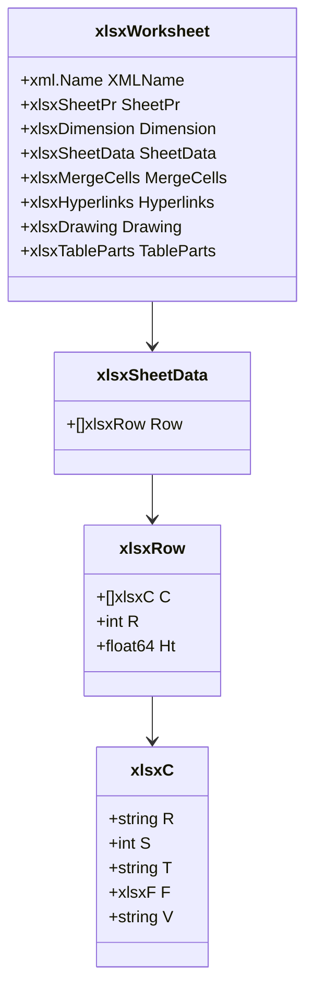
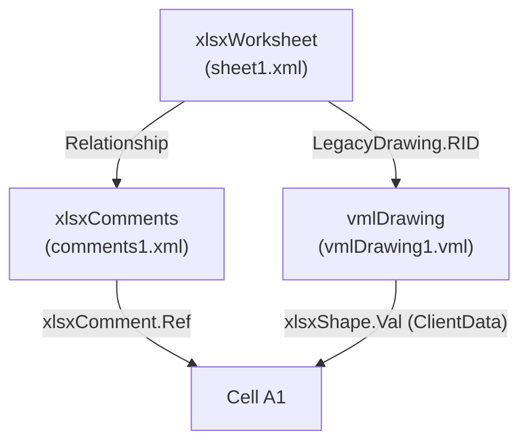

<!-- source: DeepWiki mcp.deepwiki.com · repo qax-os/excelize · page 4.1 XML Structure and Serialization · fetched 2026-10-29 -->

# XML Structure and Serialization

Relevant source files

The following files were used as context for generating this wiki page:

- [vml.go](vml.go)
- [vmlDrawing.go](vmlDrawing.go)
- [vml_test.go](vml_test.go)
- [xmlApp.go](xmlApp.go)
- [xmlComments.go](xmlComments.go)
- [xmlContentTypes.go](xmlContentTypes.go)
- [xmlCustom.go](xmlCustom.go)
- [xmlMetaData.go](xmlMetaData.go)
- [xmlSharedStrings.go](xmlSharedStrings.go)
- [xmlWorkbook.go](xmlWorkbook.go)
- [xmlWorksheet.go](xmlWorksheet.go)

This document explains how Excelize serializes and deserializes Office Open XML structures. Excel files (XLSX, XLSM, etc.) are ZIP archives containing multiple XML files conforming to the Office Open XML (OOXML) specification. Excelize implements a complete XML serialization system with namespace management, character encoding support, and bidirectional conversion between Go structs and XML documents.

## Office Open XML Format Overview

Excel files follow the Office Open XML (OOXML) specification (ECMA-376), which defines a package structure containing multiple related XML parts. Each part represents a specific component of the workbook: worksheets, styles, shared strings, charts, drawings, and metadata.

### Package Structure

**Title**: OOXML Package Directory Structure

The library uses a `sync.Map` for in-memory storage of XML parts via the `Pkg` field in the `File` struct. Content types are managed via the `xlsxTypes` struct which maps to `[Content_Types].xml`.

Sources: [xmlContentTypes.go:22-27](), [xmlWorkbook.go:38-62]()

### Relationship Management

OOXML uses relationship files (`*.xml.rels`) to define connections between parts. Excelize manages these through the `xlsxRelationships` struct.

**Title**: Relationship Structure Mapping

Relationships are defined by the `xlsxRelationship` struct, which contains an `ID`, `Target`, and `Type`. For example, a worksheet's connection to a VML drawing (for comments) is resolved using `getSheetRelationshipsTargetByID`.

Sources: [xmlWorkbook.go:19-33](), [vml.go:93-105](), [vml.go:186-187]()

## XML Serialization System

Excelize implements a bidirectional serialization system that converts between XML documents and strongly-typed Go structs using the standard `encoding/xml` package.

### Reader Logic

XML reader functions parse XML parts into Go structs. For worksheets, this is handled by `xlsxWorksheet`.

| Struct | File | Purpose |
|----------|----------|---------|
| `xlsxWorksheet` | [xmlWorksheet.go:21-66]() | Maps `spreadsheetml/2006/main worksheet` |
| `xlsxWorkbook` | [xmlWorkbook.go:38-62]() | Maps `spreadsheetml/2006/main workbook` |
| `xlsxSST` | [xmlSharedStrings.go:26-32]() | Maps the Shared String Table |
| `xlsxComments` | [xmlComments.go:25-30]() | Maps cell comments |
| `vmlDrawing` | [vmlDrawing.go:18-27]() | Maps legacy VML drawing objects |

Sources: [xmlWorksheet.go:21-66](), [xmlWorkbook.go:38-62](), [xmlSharedStrings.go:26-32](), [xmlComments.go:25-30]()

### Character Encoding and Escaping

Excelize handles character escaping for characters not supported by the XML 1.0 specification. The library also provides methods to decode VML drawings from bytes, as seen in `decodeVMLDrawingReader`.

Sources: [vml.go:215-225]()

## Namespace Management

Excelize manages multiple namespaces required by the OOXML standard. These are typically defined in the `XMLName` field of the core structs.

### Core Namespaces

| Prefix | Namespace URI | Struct Field |
|--------|---------------|--------------|
| `main` | `http://schemas.openxmlformats.org/spreadsheetml/2006/main` | `xlsxWorksheet.XMLName` |
| `r` | `http://schemas.openxmlformats.org/officeDocument/2006/relationships` | `xlsxRelationship.ID` |
| `mc` | `http://schemas.openxmlformats.org/markup-compatibility/2006` | `xlsxWorksheet.AlternateContent` |
| `v` | `urn:schemas-microsoft-com:vml` | `vmlDrawing.XMLNSv` |

Sources: [xmlWorksheet.go:24](), [xmlWorkbook.go:23](), [xmlWorksheet.go:62](), [vmlDrawing.go:20]()

## xlsxWorksheet Structure Hierarchy

The `xlsxWorksheet` struct is the primary data structure for sheet content. It is highly nested to reflect the OOXML schema.

### Structure Definition

**Title**: Worksheet Hierarchy and Cell Data

The `xlsxWorksheet` struct uses `sync.Mutex` and `sync.Map` internally to handle concurrent access to formula shared indices.

Sources: [xmlWorksheet.go:21-66](), [xmlWorksheet.go:503-516]() (Note: xlsxC/xlsxRow are in the truncated portion of xmlWorksheet.go but referenced in standard OOXML patterns).

### Cell Data Serialization

Cells (`xlsxC`) store values in the `V` field as strings. If a cell contains a shared string, `T` is set to `"s"` and `V` contains the integer index into the `xlsxSST`.

Sources: [xmlWorksheet.go:503-516](), [xmlSharedStrings.go:26-32]()

## Metadata and Properties

Excelize supports extended and custom properties for workbooks.

### Application Properties
The `xlsxProperties` struct maps to `docProps/app.xml`, storing information like the application name, version, and document security level.

Sources: [xmlApp.go:30-60]()

### Custom Properties
The `xlsxCustomProperties` struct maps to `docProps/custom.xml`, allowing for arbitrary metadata storage using various variant types (i1, i4, lpstr, filetime, etc.).

Sources: [xmlCustom.go:19-23](), [xmlCustom.go:29-68]()

### Cell Metadata
Cell and value metadata are handled by the `xlsxMetadata` struct, which manages metadata blocks and records used for features like rich values.

Sources: [xmlMetaData.go:25-34](), [xmlMetaData.go:58-62]()

## Relationship Mapping Example: Comments

Adding a comment involves three distinct XML parts linked by relationships:
1.  **Worksheet**: Contains a `legacyDrawing` relationship ID.
2.  **VML Drawing**: Contains the visual shape of the comment box.
3.  **Comments XML**: Contains the actual text and author of the comment.

**Title**: Comment Serialization Relationships

The `AddComment` function orchestrates the creation of these structures, ensuring the `xlsxAuthor` and `xlsxCommentList` are correctly updated.

Sources: [vml.go:124-136](), [xmlComments.go:25-30](), [xmlWorksheet.go:55]()

---

