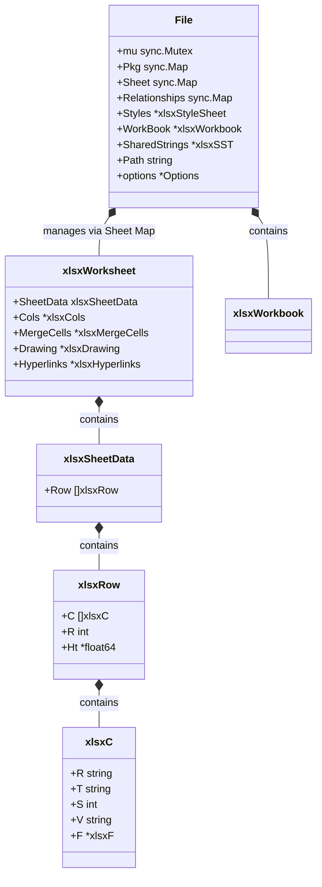
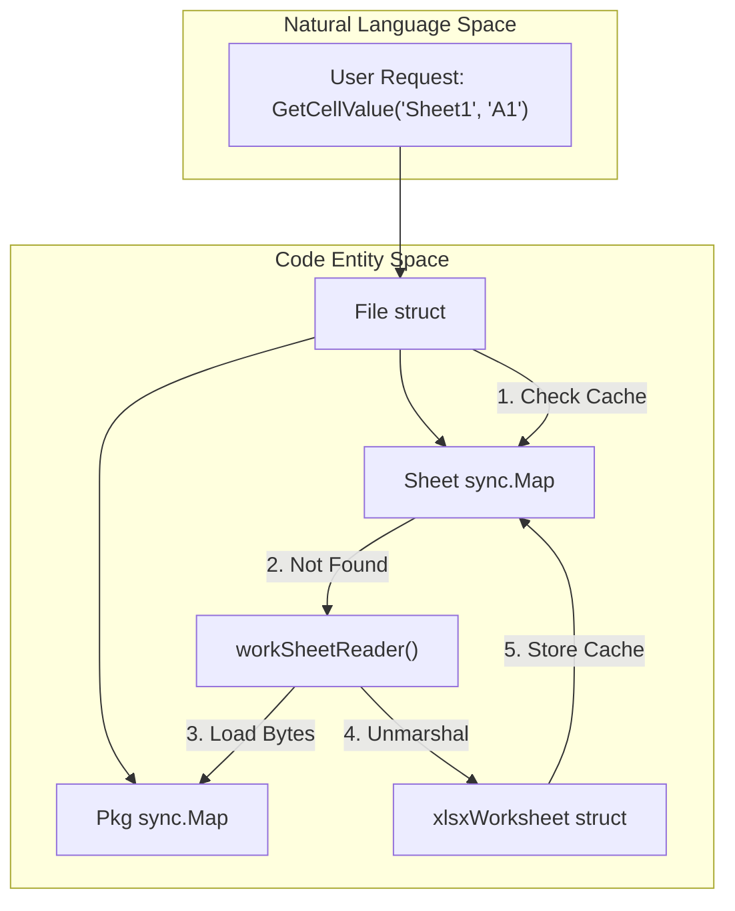
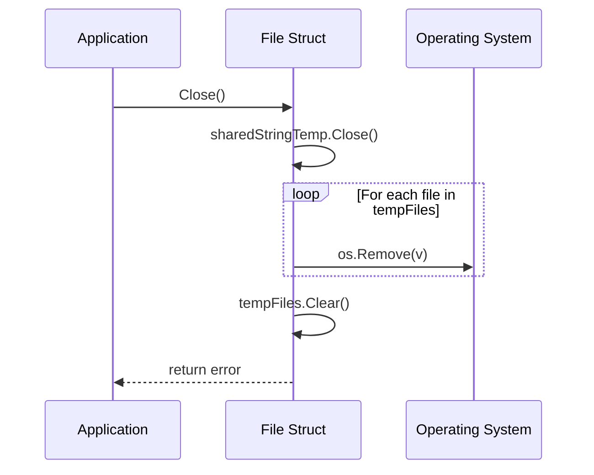

<!-- source: DeepWiki mcp.deepwiki.com · repo qax-os/excelize · page 4.2 Data Model and Structures · fetched 2026-10-29 -->

# Data Model and Structures

Relevant source files

The following files were used as context for generating this wiki page:

- [errors.go](errors.go)
- [excelize.go](excelize.go)
- [file.go](file.go)
- [templates.go](templates.go)
- [xmlCalcChain.go](xmlCalcChain.go)
- [xmlWorkbook.go](xmlWorkbook.go)
- [xmlWorksheet.go](xmlWorksheet.go)

This document describes the internal data models and structural architecture used by the Excelize library to represent Excel spreadsheets. It covers core structures such as `File`, `xlsxWorksheet`, and `xlsxC`, the concurrency-safe `sync.Map` architecture for package management, and memory management strategies.

## Core Data Structures

The foundation of the library is the `File` struct, which acts as the primary container for a spreadsheet's state, including its XML components, relationships, and styles.

### The File Struct
The `File` struct manages the lifecycle of a spreadsheet. It uses `sync.Map` for thread-safe access to various XML parts of the OCP (Open Packaging Conventions) package.
*   `Pkg`: Stores the raw XML content of the package parts [excelize.go:55]().
*   `Sheet`: A cache of unmarshaled worksheet structures [excelize.go:58]().
*   `Relationships`: Manages the `.rels` files that define connections between parts [excelize.go:56]().

Sources: [excelize.go:31-66](), [xmlWorksheet.go:21-66](), [xmlWorkbook.go:38-62]()

## Pkg/Sheet Architecture

Excelize uses a dual-layer storage strategy to balance memory usage and performance. The `Pkg` map stores raw bytes, while the `Sheet` map stores unmarshaled Go structs.

### Synchronization and Concurrency
*   **Mutex Protection**: The `File` struct includes a `mu sync.Mutex` to protect fields like `sharedStringItem` and `streams` [excelize.go:32]().
*   **Thread-Safe Maps**: Subsystems like `Drawings`, `calcCache`, and `formulaArgCache` use `sync.Map` to allow concurrent read/write operations during complex calculations or multi-sheet processing [excelize.go:42-58]().

Sources: [excelize.go:31-66](), [file.go:31-56]()

## Worksheet and Cell Data Model

The `xlsxWorksheet` is the primary structure for data within a tab. It maps directly to the `worksheet` element in the SpreadsheetML namespace [xmlWorksheet.go:19-21]().

### Cell Structure (`xlsxC`)
The `xlsxC` struct represents an individual cell. It is highly optimized to mirror the XML attributes of the OOXML specification.

| Field | Type | Description |
| :--- | :--- | :--- |
| `R` | `string` | Cell reference (e.g., "A1") [xmlWorksheet.go:454]() |
| `T` | `string` | Data type (e.g., "s" for shared string, "b" for boolean) [xmlWorksheet.go:451]() |
| `S` | `int` | Style index referencing the style sheet [xmlWorksheet.go:452]() |
| `V` | `string` | Raw value or index into the Shared String Table [xmlWorksheet.go:455]() |
| `F` | `*xlsxF` | Formula metadata and expression [xmlWorksheet.go:453]() |

### Row Management
Rows are represented by `xlsxRow`, which contains a slice of `xlsxC` cells. Rows can have properties like height (`Ht`) and hidden status [xmlWorksheet.go:313-324]().

Sources: [xmlWorksheet.go:21-66](), [xmlWorksheet.go:313-324](), [xmlWorksheet.go:450-461]()

## Memory Management and Temporary Files

Excelize implements several strategies to handle large files without exhausting system memory.

### Unzip Limits
The `Options` struct allows users to define limits on memory usage during the decompression of Excel files:
*   `UnzipSizeLimit`: Total limit for the entire spreadsheet (default 16GB) [excelize.go:87-90]().
*   `UnzipXMLSizeLimit`: Limit for individual worksheet XMLs (default 16MB). If a worksheet exceeds this, it is extracted to a temporary directory [excelize.go:91-95]().

### Temporary File Cleanup
The `Close()` function is critical for memory management. It performs the following:
1.  Closes the `sharedStringTemp` file if used [file.go:92-95]().
2.  Iterates through `tempFiles` and removes them from the filesystem [file.go:100-106]().
3.  Clears the `streams` map used by the `StreamWriter` [file.go:96-99]().

Sources: [excelize.go:114-125](), [file.go:89-108](), [excelize.go:173-184]()

## Formula and Calculation Structures

Excelize maintains internal caches to speed up formula evaluation and argument parsing.
*   `calcCache`: Stores evaluated results of formulas to avoid redundant calculations [excelize.go:44]().
*   `formulaArgCache`: Stores parsed arguments for formula functions, utilizing `sync.Map` for thread safety [excelize.go:46]().
*   `CalcChain`: A pointer to `xlsxCalcChain`, which tracks the order in which cells must be calculated [excelize.go:47]().

Sources: [excelize.go:44-47](), [xmlCalcChain.go:18-21]()

---

