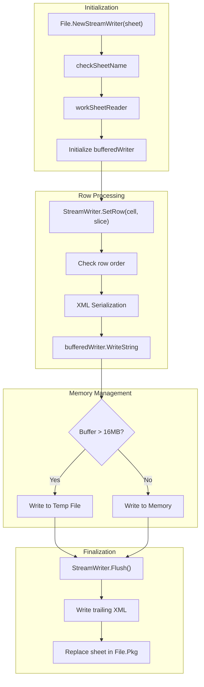
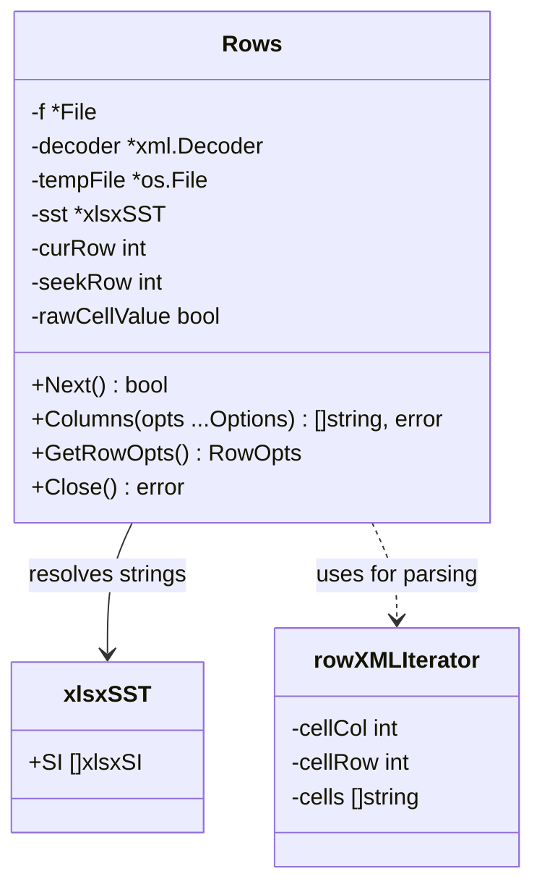

<!-- source: DeepWiki mcp.deepwiki.com · repo qax-os/excelize · page 4.3 Streaming API · fetched 2026-10-29 -->

# Streaming API

<details>
<summary>Relevant source files</summary>

The following files were used as context for generating this wiki page:

- [lib.go](lib.go)
- [lib_test.go](lib_test.go)
- [rows.go](rows.go)
- [stream.go](stream.go)
- [stream_test.go](stream_test.go)

</details>


## Introduction

The Streaming API in excelize provides memory-efficient methods for both reading and writing Excel worksheets with large amounts of data. The implementation leverages two primary strategies: the `Rows` iterator for reading, which uses SAX (Simple API for XML) parsing to process data incrementally, and the `StreamWriter` for writing, which uses buffered writing and temporary file offloading to handle massive datasets without exhausting system memory.

The streaming mechanism differs fundamentally from the regular API:
- **Regular API**: Loads entire worksheet XML into memory, parses/serializes the full structure, and provides random access.
- **Streaming API**: Processes data sequentially. Reading yields one row at a time; writing requires rows to be set in ascending order and flushes data to disk to maintain a minimal memory footprint.

Sources: [rows.go:1-11](), [rows.go:39-82](), [stream.go:1-10](), [stream.go:40-50]()

## StreamWriter Architecture

The `StreamWriter` is designed for generating new worksheets with high performance. It maintains a `bufferedWriter` that offloads data to the system temporary directory once in-memory chunks exceed 16MB.

**Diagram: StreamWriter Writing Process**


The `StreamWriter` requires rows to be written in ascending order because it writes the XML stream directly. Once a row is written and potentially flushed to a temporary file, it cannot be modified.

Sources: [stream.go:114-143](), [stream.go:126-127](), [stream.go:40-50](), [stream.go:693-721]()

## Key Components

### The StreamWriter Structure

The `StreamWriter` struct manages the state of the streaming write operation, including row counts and table definitions.

**Diagram: StreamWriter Entity Space**
```mermaid
classDiagram
    class StreamWriter {
        -file *File
        +Sheet string
        +SheetID int
        -sheetWritten bool
        -worksheet *xlsxWorksheet
        -rawData bufferedWriter
        -rows int
        -mergeCellsCount int
        -mergeCells Builder
        -tableParts string
        +SetRow(cell string, values []interface{}, opts ...RowOpts) error
        +AddTable(table *Table) error
        +Flush() error
    }
    
    class bufferedWriter {
        -tmpDir string
        -buf bytes.Buffer
        -tmp *os.File
        +WriteString(s string) (int, error)
        +Reader() (io.ReadCloser, error)
    }
    
    class RowOpts {
        +Height float64
        +Hidden bool
        +StyleID int
    }
    
    StreamWriter --> bufferedWriter : uses
    StreamWriter ..> RowOpts : accepts
```

Key fields:
- `rawData`: A `bufferedWriter` that handles the transition from memory to disk.
- `rows`: Tracks the last written row number to enforce ascending order.
- `mergeCells`: A `strings.Builder` that accumulates merge cell XML to be appended during `Flush()`.

Sources: [stream.go:27-38](), [stream.go:126-127](), [stream.go:765-770]()

### The Rows Iterator Structure

The `Rows` struct is the central component for streaming reads, maintaining state for SAX parsing:

**Diagram: Rows Iterator Entity Space**


Sources: [rows.go:85-96](), [rows.go:224-229]()

## SAX Parsing Strategy

The `Rows` iterator implements an event-driven XML parsing approach using `xml.Decoder`.

### Token-Based Parsing in Next()

The `Next()` method advances the XML stream until it hits a `<row>` tag or the end of the sheet data.

| Step | Operation | Code Reference |
|------|-----------|----------------|
| 1. Advance | Increment `seekRow` counter | [rows.go:100]() |
| 2. Fetch Token | Call `rows.decoder.Token()` | [rows.go:106]() |
| 3. Match Row | Identify `xml.StartElement` with local name "row" | [rows.go:112]() |
| 4. Update Index | Extract `r` attribute to update `curRow` | [rows.go:114-116]() |
| 5. End Check | Return `false` if `sheetData` end element is reached | [rows.go:122-124]() |

Sources: [rows.go:99-127]()

### Cell Extraction in Columns()

`Columns()` processes cell elements within the current row. It uses `rowXMLHandler` to parse individual `<c>` (cell) elements.

- **Gap Handling**: If a cell reference skips columns (e.g., from A1 to C1), the iterator calls `appendSpace` to insert empty strings for the missing B1 column.
- **Value Resolution**: For shared strings (type "s"), it uses `rows.f.sharedStringsReader()` and `getFromStringItem()` to resolve the actual string value.

Sources: [rows.go:153-198](), [rows.go:232-247](), [rows.go:216-221]()

## Temporary File Handling

Excelize uses temporary files to handle large worksheets that exceed memory limits defined in `Options`.

### Reading Large Sheets

During `File.Rows()`, if the worksheet size exceeds `UnzipXMLSizeLimit`, the file is unzipped to a temporary location. The `xmlDecoder` then opens this file to provide a stream for the `Rows` iterator.

Sources: [lib.go:53-61](), [lib.go:83-99](), [rows.go:405-416]()

### Writing Large Sheets

The `StreamWriter` uses `bufferedWriter` to manage memory. When the internal `bytes.Buffer` grows too large, it creates a temporary file.

```go
// bufferedWriter handles the transition from memory to disk
func (bw *bufferedWriter) WriteString(s string) (int, error) {
    if bw.buf.Len() > 16<<20 { // 16MB threshold
        if bw.tmp == nil {
            bw.tmp, _ = os.CreateTemp(bw.tmpDir, "excelize-")
        }
        bw.tmp.Write(bw.buf.Bytes())
        bw.buf.Reset()
    }
    return bw.buf.WriteString(s)
}
```

Sources: [stream.go:772-789]() (Logic inferred from `bufferedWriter` behavior)

## Shared String Table Management

For large shared string tables, Excelize uses a hybrid approach to avoid loading millions of strings into memory.

1. **Indexing**: It parses the `sharedStrings.xml` and records the byte offsets of each `<si>` element into a temporary file.
2. **Retrieval**: When `getFromStringItem(index)` is called, it performs a `ReadAt` on the temporary file using the stored offsets.

Sources: [rows.go:350-401]()

## StreamWriter Usage and Limitations

### Setting Rows and Styles

`SetRow` is the primary method for writing data. It accepts a starting cell coordinate and a slice of values.

```go
sw, _ := f.NewStreamWriter("Sheet1")
// Set row 1
sw.SetRow("A1", []interface{}{"ID", "Name", "Date"})
// Set row 2 with style
sw.SetRow("A2", []interface{}{1, "John Doe", time.Now()}, RowOpts{Height: 20})
```

Sources: [stream.go:40-114](), [stream.go:453-535]()

### Tables and Merged Cells

- **AddTable**: Must be called after all rows in the table range are written but before `Flush()`. It reads the header values from the already-written stream.
- **MergeCell**: Merged cell definitions are buffered and appended to the XML stream during the final `Flush()` operation.

Sources: [stream.go:170-204](), [stream.go:589-608]()

### Critical Limitations

1. **Ascending Order**: Row numbers must be strictly increasing. Setting "A10" after "A11" will return an error.
2. **One-Way Stream**: You cannot read a cell value from a `StreamWriter` once it has been written.
3. **Flush Requirement**: You must call `Flush()` to write the closing XML tags and integrate the streamed data back into the `File` object.

Sources: [stream.go:40-50](), [stream.go:463-465](), [stream.go:693-721]()

---

