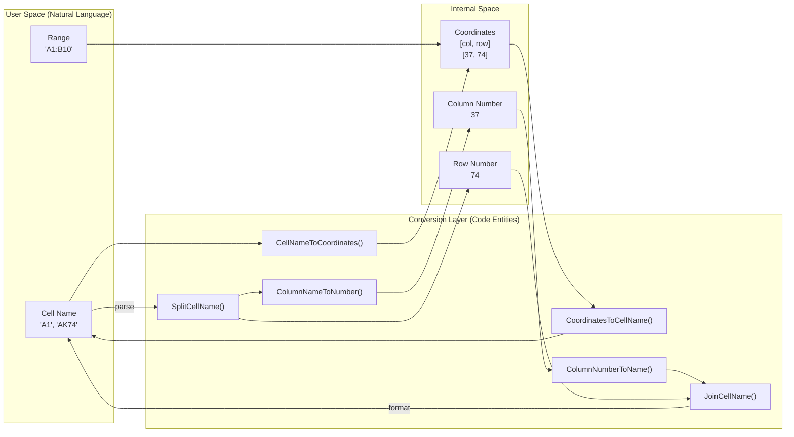
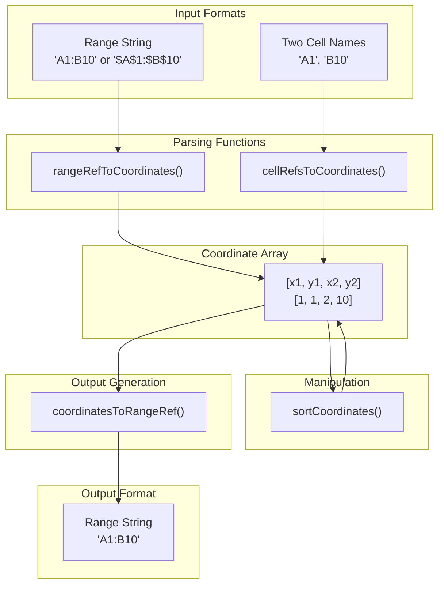
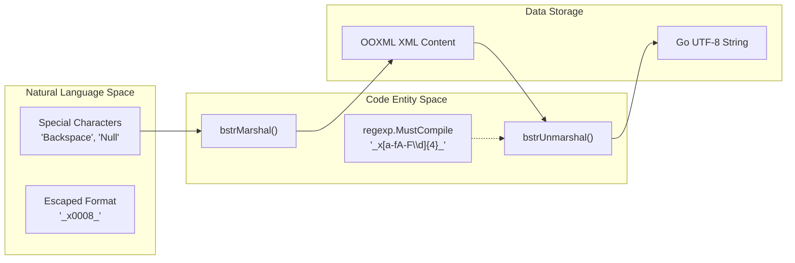

<!-- source: DeepWiki mcp.deepwiki.com · repo qax-os/excelize · page 4.4 Coordinate System and Utilities · fetched 2026-10-29 -->

# Coordinate System and Utilities

Relevant source files

The following files were used as context for generating this wiki page:

- [adjust.go](adjust.go)
- [adjust_test.go](adjust_test.go)
- [date.go](date.go)
- [date_test.go](date_test.go)
- [lib.go](lib.go)
- [lib_test.go](lib_test.go)

This page documents the coordinate system and utility functions used throughout the Excelize library. These functions provide the foundation for converting between Excel's alphanumeric cell references (like "A1", "B2") and numeric coordinates, handling range references, and performing various string encoding operations required for Office Open XML compliance.

---

## Purpose and Scope

The coordinate system in Excelize handles the translation between human-readable Excel cell references and the internal numeric representation used by the library. This translation is required for virtually all cell-level operations, as users work with cell names like "AK74" while the internal data structures use integer coordinates like `[37, 74]`.

This page covers:
- **Cell reference conversion**: Functions that convert between "A1" notation and `[column, row]` coordinates.
- **Column name mapping**: Converting between column letters (A, B, AA) and column numbers (1, 2, 27).
- **Range handling**: Parsing and manipulating cell ranges like "A1:B10".
- **XML string encoding**: Special utilities for handling restricted characters in Office Open XML via `bstrMarshal` and `bstrUnmarshal`.
- **General utilities**: Helper functions and date conversion logic used throughout the codebase.

---

## Coordinate System Overview

Excel uses a mixed alphanumeric coordinate system where:
- **Columns** are identified by letters: A, B, ..., Z, AA, AB, ..., XFD.
- **Rows** are identified by numbers: 1, 2, 3, ..., 1048576.

Excelize translates this to integer coordinates where both columns and rows are represented as positive integers starting from 1.

### Coordinate Conversion Flow

**Sources:** [lib.go:156-292]()

---

## Cell Name Conversion Functions

### SplitCellName
Splits a cell name into its column and row components.

**Function Signature:** `func SplitCellName(cell string) (string, int, error)` [lib.go:161-161]()

**Behavior:**
- Uses `strings.IndexFunc` and `strings.LastIndexFunc` to identify the boundary between letters and digits [lib.go:165-166]().
- Accepts cell names with or without `$` absolute references (e.g., "A1", "$A$1") [lib.go:168-168]().
- Validates that the row number is positive [lib.go:169-169]().

**Sources:** [lib.go:161-175]()

---

### JoinCellName
Constructs a cell name from column and row components.

**Function Signature:** `func JoinCellName(col string, row int) (string, error)` [lib.go:178-178]()

**Behavior:**
- Normalizes column names to uppercase using `strings.Map` [lib.go:179-187]().
- Validates that row number is at least 1 [lib.go:191-193]().

**Sources:** [lib.go:178-195]()

---

### ColumnNameToNumber
Converts Excel column name to column number (case-insensitive).

**Function Signature:** `func ColumnNameToNumber(name string) (int, error)` [lib.go:204-204]()

**Algorithm:**
The function processes the column name from right to left, treating it as a modified base-26 number:
`Column "AK" = (1 × 26) + (11 × 1) = 37` [lib.go:210-220]().
It validates the result against `MaxColumns` [lib.go:221-223]().

**Sources:** [lib.go:204-225]()

---

### ColumnNumberToName
Converts column number to Excel column name.

**Function Signature:** `func ColumnNumberToName(num int) (string, error)` [lib.go:255-255]()

**Implementation:**
The library uses a precomputed lookup table `columnNames` for all valid column numbers (1 to `MaxColumns`) to eliminate per-call allocations [lib.go:230-247]().

**Sources:** [lib.go:230-257]()

---

## Range Reference Handling

Range references specify rectangular regions of cells using start and end cell names separated by a colon (e.g., "A1:B10").

### Range Coordinate Operations

**Sources:** [lib.go:294-347]()

### sortCoordinates
Corrects cell range coordinates to ensure proper ordering (top-left to bottom-right).

**Function Signature:** `func sortCoordinates(coordinates []int) error` [lib.go:317-317]()

**Behavior:**
- Swaps coordinates to ensure `col1 <= col2` and `row1 <= row2` [lib.go:323-328]().
- Returns `ErrCoordinates` if the slice length is not 4 [lib.go:318-320]().

**Sources:** [lib.go:317-330]()

---

## XML String Encoding Utilities

Office Open XML uses a special escape sequence format: `_xHHHH_` where HHHH is a hexadecimal Unicode code point for characters prohibited in XML 1.0.

### Character Encoding Flow

**Sources:** [lib.go:788-857]()

### bstrUnmarshal
Parses and decodes binary basic strings from OOXML format [lib.go:804-824]().
- Decodes `_xHHHH_` to corresponding Unicode characters.
- Handles literal underscores by checking for the `_x005F_` escape [lib.go:807-814]().

### bstrMarshal
Encodes strings to OOXML format with proper escaping [lib.go:826-857]().
- Ensures existing escape-like patterns in text are escaped with `_x005F_` to avoid misinterpretation by Excel [lib.go:830-848]().

---

## Date and Time Utilities

Excelize provides functions to convert between Go `time.Time` and Excel's serial date format (floating point numbers).

### Date Conversion Logic
- **1900 Date System**: Base date is December 30, 1899 [date.go:28]().
- **1904 Date System**: Base date is January 1, 1904 [date.go:29]().
- **Leap Year Bug**: Excel incorrectly treats 1900 as a leap year. Excelize accounts for this by incrementing the result for dates after February 28, 1900, in the 1900 system [date.go:58-60]().

**Key Functions:**
- `timeToExcelTime`: Converts `time.Time` to a `float64` Excel date [date.go:35]().
- `timeFromExcelTime`: Converts an Excel `float64` to `time.Time` [date.go:135]().
- `ExcelDateToTime`: Exported wrapper for converting Excel dates with error handling for negative values [date.go:167-172]().

**Sources:** [date.go:19-172]()

---

## Internal Adjustments

When rows or columns are inserted or deleted, the library must adjust all references (formulas, merged cells, etc.) across the workbook.

### adjustHelper
This internal method coordinates the update of various sheet components when the grid structure changes [adjust.go:73-100]().

**Adjusted Components:**
- Row/Column Dimensions [adjust.go:81-84]()
- Hyperlinks [adjust.go:88-88]()
- Conditional Formats [adjust.go:35-35]()
- Data Validations [adjust.go:38-38]()
- Merged Cells [adjust.go:47-47]()
- Auto Filters [adjust.go:50-50]()

**Sources:** [adjust.go:33-100]()

---

