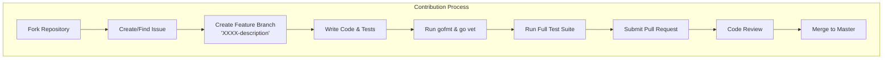
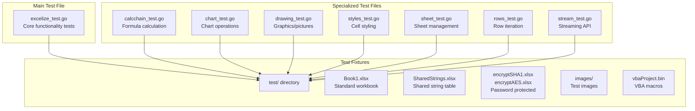

<!-- source: DeepWiki mcp.deepwiki.com · repo qax-os/excelize · page 5 Development Resources · fetched 2026-10-29 -->

# Development Resources

Relevant source files

The following files were used as context for generating this wiki page:

- [.github/CODE_OF_CONDUCT.md](.github/CODE_OF_CONDUCT.md)
- [.github/CONTRIBUTING.md](.github/CONTRIBUTING.md)
- [.github/PULL_REQUEST_TEMPLATE.md](.github/PULL_REQUEST_TEMPLATE.md)
- [.github/workflows/go.yml](.github/workflows/go.yml)
- [excelize_test.go](excelize_test.go)
- [go.mod](go.mod)
- [go.sum](go.sum)

This document provides resources and guidance for developers working on the excelize library or building applications with it. It covers the test infrastructure, contribution guidelines, dependency management, and development workflows used throughout the codebase.

For information about the test suite organization and validation approaches, see [Testing and Validation](#5.1).

---

## Contribution Guidelines

The excelize project welcomes contributions from the community. Detailed guidelines are provided in the repository to ensure high code quality and project consistency.

### Development Workflow

**Key Guidelines:**
- **Issue First**: Significant improvements or features should be discussed in a GitHub issue before implementation [.github/CONTRIBUTING.md:58-59]().
- **Branch Naming**: Use `XXXX-something` where `XXXX` is the issue number [.github/CONTRIBUTING.md:77-83]().
- **Code Quality**: Always run `gofmt -s -w` on changed files [.github/CONTRIBUTING.md:93-94]().
- **Testing**: Submit unit tests for all changes [.github/CONTRIBUTING.md:85-87]().
- **Commit Messages**: Use imperative summary lines (e.g., "Add support for...") [.github/CONTRIBUTING.md:127-131]().

**Sources:** [.github/CONTRIBUTING.md:1-160](), [.github/PULL_REQUEST_TEMPLATE.md:1-46]()

---

## Dependency Management

Excelize manages its dependencies using Go modules. The library aims to remain lean while leveraging specialized packages for complex Excel features like formula parsing and OLE file handling.

### Core Dependencies

| Package | Purpose | Used In |
|---------|---------|---------|
| `github.com/xuri/efp` | Excel Formula Parser | Formula evaluation engine [go.mod:9]() |
| `github.com/xuri/nfp` | Number Format Parser | Cell value formatting [go.mod:10]() |
| `github.com/richardlehane/mscfb` | Microsoft Compound File Binary | Encrypted/OLE file processing [go.mod:6]() |
| `github.com/tiendc/go-deepcopy` | Deep copy utility | Structure cloning [go.mod:8]() |
| `github.com/stretchr/testify` | Testing assertions | Test suite [go.mod:7]() |

**Sources:** [go.mod:1-23](), [go.sum:1-29]()

---

## Test Infrastructure Overview

The excelize project maintains a comprehensive test suite that validates all public APIs, error handling, edge cases, and file format compatibility.

### Test File Organization

**Sources:** [excelize_test.go:1-1748]()

---

## CI/CD and Validation

Excelize uses GitHub Actions to ensure cross-platform compatibility and code quality for every push and pull request.

### Build Matrix

The CI pipeline validates the library across multiple environments:
- **Operating Systems**: Ubuntu, macOS (Intel & Silicon), Windows [.github/workflows/go.yml:9]()
- **Go Versions**: Latest stable releases (e.g., 1.25.x, 1.26.x) [.github/workflows/go.yml:8]()
- **Architectures**: x86, x64, and ARM (including Android) [.github/workflows/go.yml:10,31-38]()

### Quality Checks
- **Race Detection**: Tests are run with `-race` to identify concurrency issues [.github/workflows/go.yml:41]()
- **Coverage**: Coverage reports are generated and uploaded to Codecov [.github/workflows/go.yml:41-50]()
- **Linting**: `go vet` is executed to catch common mistakes [.github/workflows/go.yml:27]()

**Sources:** [.github/workflows/go.yml:1-51]()

---

## Common Testing Patterns

The codebase follows consistent testing patterns that make tests readable and maintainable.

### Pattern: Error Case Testing

Every function tests both success and error paths:

| Test Type | Pattern | Example |
|-----------|---------|---------|
| Invalid Parameters | `assert.EqualError(t, func(invalidParam), expectedError)` | [excelize_test.go:61-64]() |
| Missing Sheet | `assert.EqualError(t, func("SheetN"), "sheet SheetN does not exist")` | [excelize_test.go:80-82]() |
| Invalid Cell Reference | `assert.EqualError(t, func("A"), newInvalidCellNameError)` | [excelize_test.go:99-100]() |
| Invalid Sheet Name | `assert.EqualError(t, err, ErrSheetNameLength.Error())` | [excelize_test.go:76-77]() |

### Pattern: Helper Function Usage

Test helpers follow a consistent signature to prepare complex workbooks:

- **`prepareTestBook1()`** - [excelize_test.go:1620-1655](): Creates a workbook with pictures and hyperlinks.
- **`prepareTestBook5(opts Options)`** - [excelize_test.go:1700-1723](): Creates a workbook with extensive number formatting applied.

**Sources:** [excelize_test.go:27-1735]()

---

## Summary

The development resources for excelize provide a robust framework for contributors:

1. **Structured Contribution**: Clear guidelines on issues, PRs, and coding standards.
2. **Lean Dependencies**: Targeted use of external libraries for specific OOXML complexities.
3. **Multi-Platform CI**: Automated validation across OS and architecture combinations.
4. **Rich Test Infrastructure**: Extensive fixtures and patterns for validating Excel file manipulation.

For details on implementing new tests or understanding the validation logic, see [Testing and Validation](#5.1).

---

