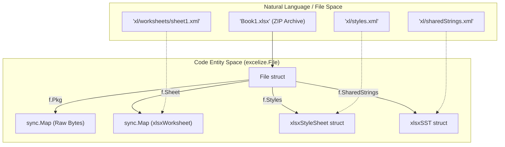
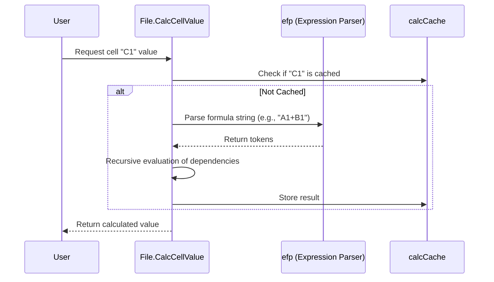

<!-- source: DeepWiki mcp.deepwiki.com · repo qax-os/excelize · page 6 Glossary · fetched 2026-10-29 -->

# Glossary

Relevant source files

The following files were used as context for generating this wiki page:

- [calc.go](calc.go)
- [calc_test.go](calc_test.go)
- [cell.go](cell.go)
- [chart.go](chart.go)
- [excelize.go](excelize.go)
- [lib.go](lib.go)
- [lib_test.go](lib_test.go)
- [picture.go](picture.go)
- [picture_test.go](picture_test.go)
- [rows.go](rows.go)
- [stream.go](stream.go)
- [stream_test.go](stream_test.go)
- [styles.go](styles.go)
- [styles_test.go](styles_test.go)
- [xmlStyles.go](xmlStyles.go)
- [xmlWorkbook.go](xmlWorkbook.go)
- [xmlWorksheet.go](xmlWorksheet.go)

This glossary defines codebase-specific terms, abbreviations, and domain concepts essential for navigating the Excelize library. It covers Office Open XML (OOXML) terminology, internal architecture entities, and Excel-specific logic.

## Core System Entities

### File
The central coordinator for all operations. It represents a populated spreadsheet document in memory and manages the ZIP archive containing various XML parts.
*   **Implementation**: Defined as a `struct` in [excelize.go:31-66]().
*   **Key Fields**:
    *   `Pkg`: A `sync.Map` storing the raw XML content of the document parts [excelize.go:55]().
    *   `Sheet`: A `sync.Map` caching deserialized worksheet structures (`xlsxWorksheet`) [excelize.go:58]().
    *   `Styles`: Pointer to the global stylesheet structure [excelize.go:60]().

### xlsxWorksheet
The internal representation of a single Excel worksheet, mapping directly to the `xl/worksheets/sheet[n].xml` schema.
*   **Source**: [xmlWorksheet.go:21-66]().
*   **Structure**: Contains `SheetData` (the actual cell grid), `MergeCells`, `Hyperlinks`, and `Drawing` references.

### xlsxC
The internal structure representing a single cell within the worksheet XML.
*   **Source**: [xmlWorksheet.go:887-900]().
*   **Attributes**: `R` (reference like "A1"), `S` (style index), `T` (type), and `V` (value) [xmlWorksheet.go:888-895]().

---

## Data Flow: From XML to Code Entity

The following diagram illustrates how the library bridges the gap between the physical file on disk (Natural Language/File Space) and the internal Go structures (Code Entity Space).

**Entity Mapping Diagram**

**Sources**: [excelize.go:31-66](), [xmlWorksheet.go:21-66](), [styles.go:28-37]()

---

## Technical Jargon & Domain Concepts

### Shared Strings (SST)
Excel optimizes file size by storing recurring text strings in a single list (`xl/sharedStrings.xml`) and referencing them by index in the cell.
*   **Internal Type**: `xlsxSST` [xmlStyles.go:565-571]().
*   **Usage**: When a cell has type `s` (`CellTypeSharedString`), the value `V` is the index into this table [cell.go:40]().

### Cell Coordinate System
Excelize uses two primary ways to address cells:
1.  **A1 Reference**: Standard Excel notation (e.g., "AK74").
2.  **Coordinates**: 1-based integer pairs (Col: 37, Row: 74).
*   **Utility Functions**: `ColumnNameToNumber` [lib.go:204-225](), `CoordinatesToCellName` [lib.go:264-275](), and `SplitCellName` [lib.go:161-175]().

### Streaming API
A memory-efficient method for processing massive datasets that avoids loading the entire XML into memory.
*   **StreamWriter**: Used for writing. It uses a `bufferedWriter` and can offload to temporary files [stream.go:27-38]().
*   **Rows (Iterator)**: Used for reading. It utilizes a SAX-based `xml.Decoder` to traverse rows one-by-one [rows.go:85-96]().

---

## Formula & Calculation Engine

### CalcChain
A record of the order in which formulas should be calculated, stored in `xl/calcChain.xml`.
*   **Internal Type**: `xlsxCalcChain` [xmlWorkbook.go:103-109]().

### Calculation Cache
To improve performance during complex formula evaluation, Excelize maintains a `calcCache` in the `File` struct.
*   **Implementation**: `sync.Map` [excelize.go:44]().

**Formula Evaluation Logic**

**Sources**: [calc.go:210-228](), [excelize.go:44-46](), [calc_test.go:25-36]()

---

## Styling & Formatting

### Style Index
A 0-based integer that points to a specific `xf` (cell format) in the global stylesheet.
*   **Default Style**: Index `0` is the default format.
*   **Creation**: `NewStyle` creates a new entry and returns the index [styles.go:162-199]().

### Number Format (numFmt)
Defines how numeric values are displayed (e.g., as currency, dates, or percentages).
*   **Built-in**: Excel has standard IDs (e.g., `14` for `mm-dd-yy`).
*   **Custom**: Defined in `xlsxNumFmts` within the stylesheet [xmlStyles.go:12-16]().

---

## Summary Table of Key Types

| Type | Description | Code Pointer |
| :--- | :--- | :--- |
| `CellType` | Enumeration of data types (Bool, Date, Error, etc.) | [cell.go:29-41]() |
| `xlsxC` | The XML element representing a cell | [xmlWorksheet.go:887]() |
| `xlsxRow` | The XML element representing a row | [xmlWorksheet.go:858]() |
| `xlsxSST` | Shared String Table structure | [xmlStyles.go:565]() |
| `StreamWriter` | Handler for low-memory bulk writing | [stream.go:27]() |
| `Rows` | Iterator for low-memory bulk reading | [rows.go:85]() |

**Sources**: [cell.go:29-41](), [xmlWorksheet.go:887](), [xmlWorksheet.go:858](), [xmlStyles.go:565](), [stream.go:27](), [rows.go:85]()