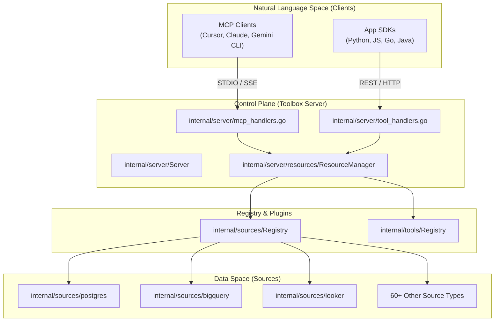
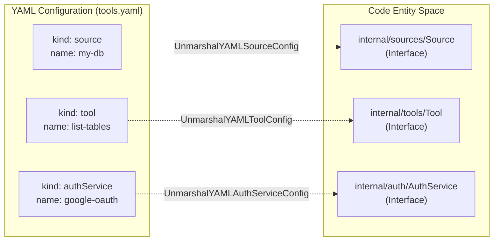

<!-- source: DeepWiki mcp.deepwiki.com · repo googleapis/genai-toolbox · page 1 Overview · fetched 2026-10-29 -->

# Overview

Relevant source files

The following files were used as context for generating this wiki page:

- [.ci/integration.cloudbuild.yaml](.ci/integration.cloudbuild.yaml)
- [CHANGELOG.md](CHANGELOG.md)
- [README.md](README.md)
- [cmd/internal/flags.go](cmd/internal/flags.go)
- [cmd/root.go](cmd/root.go)
- [cmd/root_test.go](cmd/root_test.go)
- [cmd/version.txt](cmd/version.txt)
- [docs/en/documentation/configuration/toolbox_mcp_auth.md](docs/en/documentation/configuration/toolbox_mcp_auth.md)
- [docs/en/documentation/introduction/_index.md](docs/en/documentation/introduction/_index.md)
- [gemini-extension.json](gemini-extension.json)
- [go.mod](go.mod)
- [go.sum](go.sum)
- [internal/prebuiltconfigs/prebuiltconfigs.go](internal/prebuiltconfigs/prebuiltconfigs.go)
- [internal/prebuiltconfigs/prebuiltconfigs_test.go](internal/prebuiltconfigs/prebuiltconfigs_test.go)
- [internal/server/config.go](internal/server/config.go)
- [internal/server/prm.go](internal/server/prm.go)
- [internal/server/server.go](internal/server/server.go)
- [internal/server/server_test.go](internal/server/server_test.go)
- [internal/telemetry/telemetry.go](internal/telemetry/telemetry.go)
- [server.json](server.json)

MCP Toolbox for Databases is an open-source control plane that connects AI applications, IDEs, and agents directly to enterprise databases. It acts as a bridge between AI orchestration frameworks (such as LangChain, LlamaIndex, or Genkit) and database systems (such as PostgreSQL, BigQuery, MySQL, and Spanner), providing a unified interface for tool execution, connection pooling, authentication, and observability.

**Key Capabilities:**
- **Dual-Purpose Connectivity**: Functions as a ready-to-use MCP server for IDEs (Cursor, Claude Desktop) and a robust framework for production AI agents.
- **Connection Management**: Handles complex database connection pooling and lifecycle management across 60+ source types [go.mod:7-78]().
- **Integrated Auth**: Supports IAM, OAuth2, and OpenID Connect (OIDC) to ensure secure data access [internal/server/config.go:190-198]().
- **Observability**: Built-in OpenTelemetry integration for distributed tracing and metrics [internal/server/config.go:61-66]().
- **Hot Reloading**: Dynamically updates tool definitions from configuration files without server restarts [cmd/root.go:134-150]().

This is a high-level parent page. For technical deep-dives, see:
- **System Architecture**: [System Architecture](#1.1)
- **Core Concepts**: [Key Concepts](#1.2)

## Architecture Overview

The Toolbox sits between the "Natural Language Space" (LLMs and AI Clients) and the "Data Space" (Databases and Analytics Engines).

**System Component Map**

**Sources:**
- [internal/server/server.go:50-62]()
- [internal/server/config.go:36-87]()
- [README.md:22-31]()

## Key Components

The system is designed around a modular architecture where every database and operation type is a plugin registered at runtime.

### Server Entry Point
The CLI ([cmd/root.go]()) initializes the `server.Server` ([internal/server/server.go]()) based on flags like `--stdio` for local MCP use or `--address`/`--port` for remote HTTP access. It manages the lifecycle of the `ResourceManager`, which holds the active state of all tools and connections.

### Resource Management
The `ResourceManager` ([internal/server/resources/resources.go]()) is the central authority for:
- **Sources**: Database connection instances (e.g., `*sql.DB` or `*bigquery.Client`).
- **Tools**: Executable logic (e.g., a SQL template or an API call).
- **Toolsets**: Logical groupings of tools exposed to specific clients.
- **AuthServices**: Providers that validate identity (Google OAuth, OIDC).

### Configuration & Discovery
Toolbox uses a declarative approach. Users define resources in a `tools.yaml` file, which the server parses and initializes into live objects via `server.InitializeConfigs` [internal/server/server.go:64-73]().

**Bridge: Config to Code Entities**

**Sources:**
- [internal/server/config.go:149-212]()
- [internal/server/server.go:89-210]()
- [cmd/root.go:96-131]()

## Operational Modes

| Mode | Trigger | Protocol | Use Case |
| :--- | :--- | :--- | :--- |
| **STDIO** | `--stdio` | MCP (JSON-RPC) | Local IDE integration (Cursor, Claude Desktop). |
| **Remote (SSE)** | `--address` | MCP over SSE | Cloud-hosted MCP server for remote agents. |
| **REST API** | (Default) | HTTP/JSON | Custom application integration via SDKs. |
| **Toolbox UI** | `--ui` | Web/HTML | Interactive playground for testing tool configurations. |

**Sources:**
- [internal/server/config.go:67-74]()
- [cmd/root.go:118-121]()
- [server.json:111-142]()

## Where it Sits in the AI Stack

Toolbox acts as the **Data Tooling Layer**. Instead of writing custom database connectors for every agent, developers configure Toolbox once and expose it as a standard set of MCP tools. This allows the same database tools to be shared between a developer's IDE (during build-time) and the production AI agent (during run-time).

**Sources:**
- [README.md:28-31]()
- [README.md:59-67]()

---

