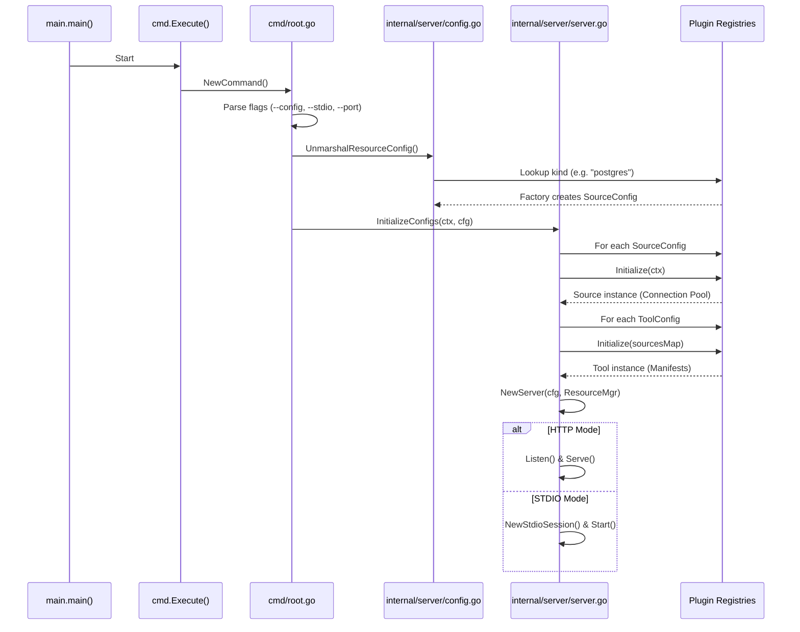
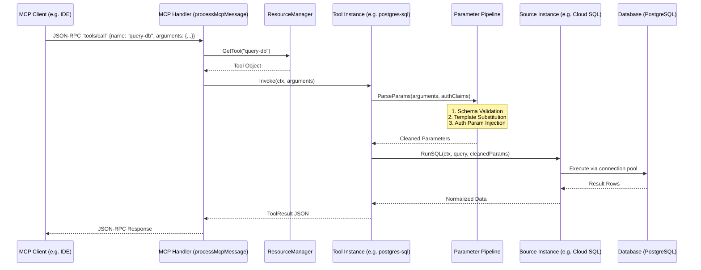
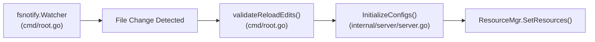

<!-- source: DeepWiki mcp.deepwiki.com · repo googleapis/genai-toolbox · page 1.1 System Architecture · fetched 2026-10-29 -->

# System Architecture

<details>
<summary>Relevant source files</summary>

The following files were used as context for generating this wiki page:

- [.ci/integration.cloudbuild.yaml](.ci/integration.cloudbuild.yaml)
- [cmd/internal/flags.go](cmd/internal/flags.go)
- [cmd/root.go](cmd/root.go)
- [cmd/root_test.go](cmd/root_test.go)
- [docs/en/documentation/configuration/toolbox_mcp_auth.md](docs/en/documentation/configuration/toolbox_mcp_auth.md)
- [go.mod](go.mod)
- [go.sum](go.sum)
- [internal/prebuiltconfigs/prebuiltconfigs.go](internal/prebuiltconfigs/prebuiltconfigs.go)
- [internal/prebuiltconfigs/prebuiltconfigs_test.go](internal/prebuiltconfigs/prebuiltconfigs_test.go)
- [internal/server/api.go](internal/server/api.go)
- [internal/server/api_test.go](internal/server/api_test.go)
- [internal/server/config.go](internal/server/config.go)
- [internal/server/mcp.go](internal/server/mcp.go)
- [internal/server/mcp/jsonrpc/jsonrpc.go](internal/server/mcp/jsonrpc/jsonrpc.go)
- [internal/server/mcp/mcp.go](internal/server/mcp/mcp.go)
- [internal/server/mcp/util/lifecycle.go](internal/server/mcp/util/lifecycle.go)
- [internal/server/mcp/v20241105/method.go](internal/server/mcp/v20241105/method.go)
- [internal/server/mcp/v20241105/types.go](internal/server/mcp/v20241105/types.go)
- [internal/server/mcp/v20250326/method.go](internal/server/mcp/v20250326/method.go)
- [internal/server/mcp/v20250326/types.go](internal/server/mcp/v20250326/types.go)
- [internal/server/mcp/v20250618/method.go](internal/server/mcp/v20250618/method.go)
- [internal/server/mcp/v20250618/types.go](internal/server/mcp/v20250618/types.go)
- [internal/server/mcp/v20251125/method.go](internal/server/mcp/v20251125/method.go)
- [internal/server/mcp_test.go](internal/server/mcp_test.go)
- [internal/server/prm.go](internal/server/prm.go)
- [internal/server/server.go](internal/server/server.go)
- [internal/server/server_test.go](internal/server/server_test.go)
- [internal/sources/sources.go](internal/sources/sources.go)
- [internal/telemetry/instrumentation.go](internal/telemetry/instrumentation.go)
- [internal/telemetry/telemetry.go](internal/telemetry/telemetry.go)
- [internal/tools/looker/lookerconversationalanalytics/lookerconversationalanalytics.go](internal/tools/looker/lookerconversationalanalytics/lookerconversationalanalytics.go)
- [internal/tools/tools.go](internal/tools/tools.go)
- [internal/util/util.go](internal/util/util.go)

</details>


This page describes the high-level architecture of the GenAI Toolbox system, explaining how components are organized, initialized, and interact to provide database tools to AI applications.

## Purpose and Scope

The Toolbox server acts as a **control plane** between AI applications and databases, providing:
- Centralized tool management and distribution via the Model Context Protocol (MCP) or HTTP.
- Connection pooling and authentication handling for various database types.
- Protocol translation (HTTP API ↔ MCP JSON-RPC ↔ STDIO).
- Dynamic configuration reloading without server restarts.
- Telemetry and observability through OpenTelemetry.

The architecture supports extensibility through a plugin-based registry pattern for sources and tools, allowing new database types to be added by implementing standard interfaces.

## High-Level Architecture

```mermaid
graph TB
    subgraph "External Clients"
        IDE["IDEs (Cursor, Claude Desktop)<br/>MCP STDIO Transport"]
        HTTP_SDK["HTTP Clients / SSE<br/>Python/JS/Go SDKs"]
    end
    
    subgraph "CLI Entry Point"
        CLI["cmd/root.go<br/>NewCommand()<br/>Execute()"]
    end
    
    subgraph "Server Layer"
        Server["internal/server/server.go<br/>Server struct<br/>NewServer()"]
        Config["internal/server/config.go<br/>ServerConfig<br/>InitializeConfigs()"]
        Router["chi.Router<br/>HTTP /api endpoints"]
        MCPSession["internal/server/mcp.go<br/>stdioSession / sseSession"]
    end
    
    subgraph "Resource Management"
        ResourceMgr["resources.ResourceManager<br/>GetSource()<br/>GetTool()"]
        SourceMap["map[string]sources.Source"]
        ToolMap["map[string]tools.Tool"]
        AuthMap["map[string]auth.AuthService"]
    end
    
    subgraph "Plugin Registries"
        SourceRegistry["internal/sources/sources.go<br/>sourceRegistry map"]
        ToolRegistry["internal/tools/tools.go<br/>toolRegistry map"]
    end
    
    subgraph "Implementations"
        SourceImpls["internal/sources/*<br/>postgres, bigquery, etc.<br/>init() registration"]
        ToolImpls["internal/tools/*<br/>sql-tools, bigquery-tools, etc.<br/>init() registration"]
    end
    
    IDE -->|JSON-RPC| MCPSession
    HTTP_SDK -->|HTTP POST| Router
    HTTP_SDK -->|SSE| MCPSession
    
    CLI --> Config
    Config --> Server
    
    Server --> Router
    Server --> MCPSession
    
    Router --> ResourceMgr
    MCPSession --> ResourceMgr
    
    ResourceMgr --> SourceMap
    ResourceMgr --> ToolMap
    ResourceMgr --> AuthMap
    
    Config -->|Unmarshal| SourceRegistry
    Config -->|Unmarshal| ToolRegistry
    
    SourceRegistry -->|Initialize()| SourceMap
    ToolRegistry -->|Initialize()| ToolMap
    
    SourceImpls -.->|Register()| SourceRegistry
    ToolImpls -.->|Register()| ToolRegistry
```

**Sources:**
- [internal/server/server.go:51-62]()
- [internal/server/config.go:36-87]()
- [cmd/root.go:96-132]()
- [internal/server/mcp.go:178-185]()

## Server Initialization Flow

The server initialization follows a lifecycle from CLI invocation to the "ready" state, supporting both persistent HTTP/SSE and transient STDIO modes.



**Initialization Sequence:**

1.  **CLI Entry** ([cmd/root.go:85-93]()): The root command is executed, initializing `ToolboxOptions`.
2.  **Configuration Loading** ([internal/server/config.go:149-168]()): YAML documents are unmarshaled. The `kind` field in the YAML determines which registry factory is used to create the specific `SourceConfig` or `ToolConfig`.
3.  **Source Initialization** ([internal/server/server.go:90-110]()): For every configured source, the `Initialize` method is called. This typically sets up database drivers and connection pools (e.g., Cloud SQL connectors).
4.  **Tool Initialization** ([internal/server/server.go:174-194]()): Tools are initialized and linked to their required sources from the `sourcesMap`.
5.  **Server Start** ([internal/server/server.go:331-350]()): The server starts listening on the configured address/port or begins reading from `stdin` if `--stdio` is provided ([internal/server/mcp.go:192-238]()).

**Sources:**
- [cmd/root.go:85-132]()
- [internal/server/config.go:149-225]()
- [internal/server/server.go:64-213]()
- [internal/server/mcp.go:187-189]()

## Component Architecture

### Resource Manager

The `ResourceManager` acts as the central repository for all active entities in the system. It is responsible for the thread-safe storage and retrieval of sources, tools, toolsets, auth services, and prompts.

**Key Responsibilities:**
- **Storage**: Maintains maps of initialized resources ([internal/server/server.go:60]()).
- **Retrieval**: Provides `GetTool`, `GetSource`, and `GetToolset` methods used by both HTTP and MCP handlers ([internal/server/api.go:68-74](), [internal/server/api.go:94-100]()).
- **Dynamic Updates**: Supports atomic replacement of all resources during a configuration reload ([cmd/root.go:147]()).

### HTTP API Handler

The HTTP API provides a REST-like interface for tool discovery and invocation.

| Route | Method | Function | Description |
|---|---|---|---|
| `/api/toolset` | GET | `toolsetHandler` | List all tools in the default toolset ([internal/server/api.go:41]()). |
| `/api/toolset/{name}` | GET | `toolsetHandler` | List tools in a specific named toolset ([internal/server/api.go:42]()). |
| `/api/tool/{name}` | GET | `toolGetHandler` | Get metadata/manifest for a single tool ([internal/server/api.go:45]()). |
| `/api/tool/{name}/invoke` | POST | `toolInvokeHandler` | Execute a tool with provided parameters ([internal/server/api.go:46]()). |

**Sources:**
- [internal/server/api.go:34-49]()
- [internal/server/api.go:113-135]()

### MCP Protocol Handler

The Model Context Protocol (MCP) handler manages JSON-RPC communication over two transports:
1.  **STDIO**: Used for local integrations with IDEs like Cursor ([internal/server/mcp.go:178-185]()).
2.  **SSE (Server-Sent Events)**: Used for remote connections over HTTP ([internal/server/mcp.go:47-53]()).

**Message Processing Loop:**
- Messages are read from the transport (stdin or HTTP body).
- `processMcpMessage` identifies the JSON-RPC method (e.g., `tools/list`, `tools/call`) ([internal/server/mcp.go:251]()).
- For `tools/call`, the handler looks up the tool in the `ResourceMgr` and calls its `Invoke` method ([internal/server/api.go:129-135]()).

**Sources:**
- [internal/server/mcp.go:56-74]()
- [internal/server/mcp.go:192-238]()

## Data Flow: Client Request to Database Query

This diagram traces a tool invocation from an external AI client through the Toolbox layers to the final database execution.



**Data Flow Details:**
1.  **Parameter Processing** ([internal/server/api.go:201-202]()): Incoming JSON data is parsed using `parameters.ParseParams`. This step handles type conversion, default values, and injecting "authenticated parameters" (like a user's email) into the tool's input.
2.  **Authorization** ([internal/server/api.go:183-189]()): Before execution, the tool's `Authorized()` check is performed against verified `AuthServices`.
3.  **Source Execution**: The tool uses the `Source` interface (e.g., `RunSQL`) to interact with the database. Sources manage the complexities of IAM authentication and driver-specific connection logic.

**Sources:**
- [internal/server/api.go:113-202]()
- [internal/server/mcp.go:251]()

## Dynamic Configuration Reloading

The Toolbox supports "Hot Reloading" of the `tools.yaml` file.



- **Watcher**: A background goroutine monitors files/folders for modifications ([cmd/root.go:201-224]()).
- **Validation**: Before applying changes, the server attempts to initialize the new configuration in a temporary space to ensure it's valid ([cmd/root.go:153-190]()).
- **Atomic Swap**: If valid, the `ResourceManager` is updated with the new maps of sources and tools, and the changes are immediately reflected in subsequent API/MCP calls ([cmd/root.go:147]()).

**Sources:**
- [cmd/root.go:134-150]()
- [cmd/root.go:153-190]()
- [cmd/root.go:193-224]()

## Telemetry and Observability

Instrumentation is baked into the server lifecycle using OpenTelemetry.

- **Tracing**: Spans are created for server startup, source initialization, tool initialization, and every tool invocation ([internal/server/server.go:93-99](), [internal/server/api.go:114-115]()).
- **Metrics**: The MCP handler tracks active sessions and session duration ([internal/server/mcp.go:202-222]()).
- **Context Propagation**: Trace context is extracted from MCP metadata (`_meta`) to allow distributed tracing from the AI client through the Toolbox ([internal/server/mcp.go:149-176]()).

**Sources:**
- [internal/server/server.go:93-105]()
- [internal/server/api.go:114-127]()
- [internal/server/mcp.go:149-176]()
- [internal/server/mcp.go:202-222]()

---

