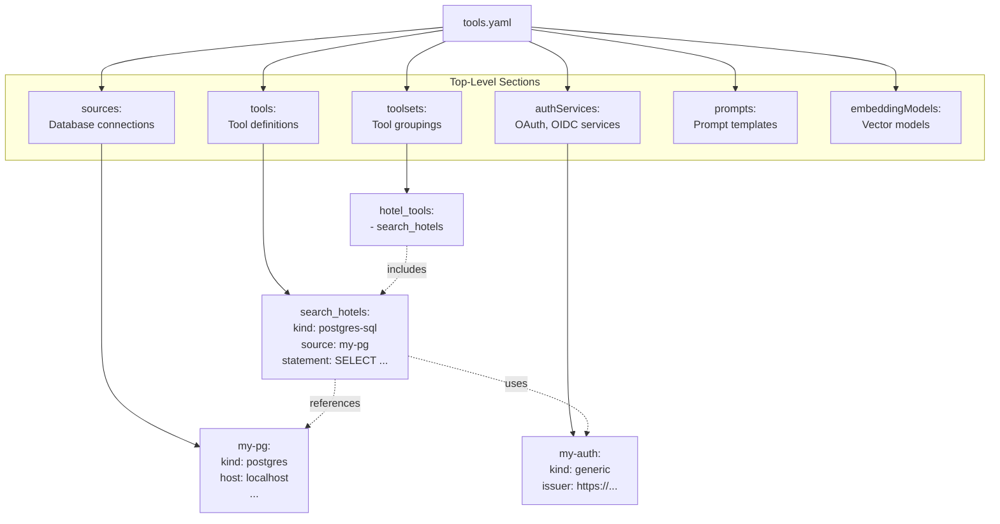
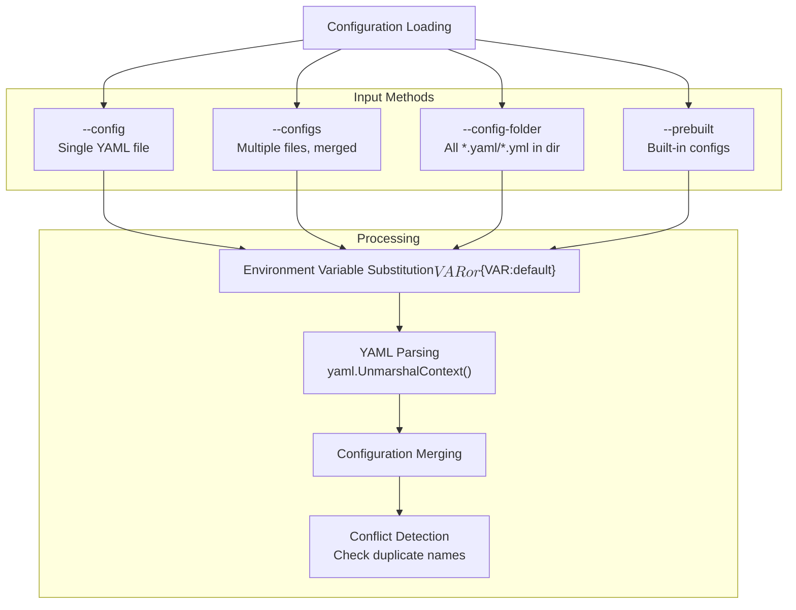
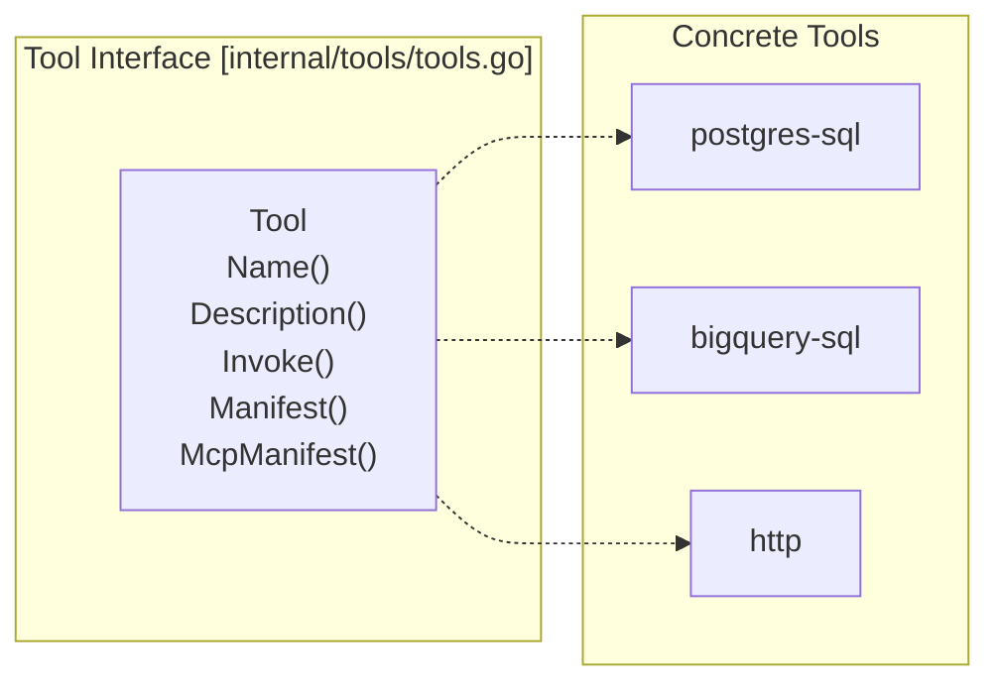
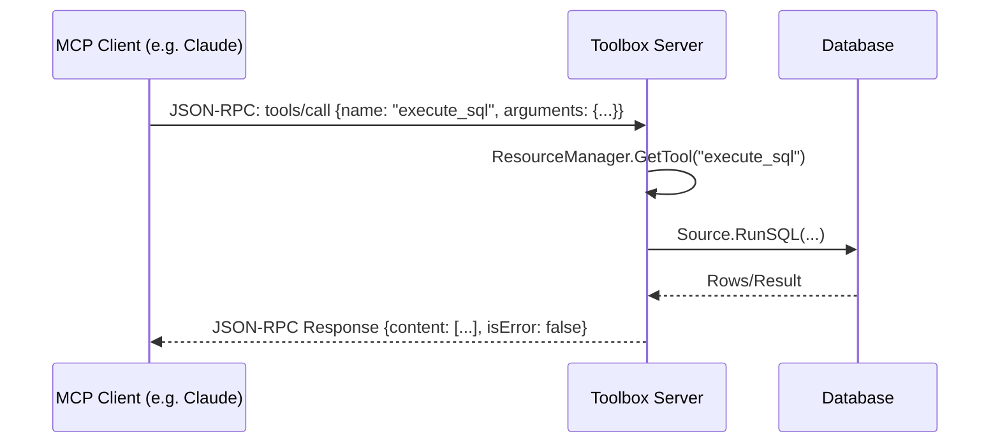

<!-- source: DeepWiki mcp.deepwiki.com · repo googleapis/genai-toolbox · page 1.2 Key Concepts · fetched 2026-10-29 -->

# Key Concepts

Relevant source files

The following files were used as context for generating this wiki page:

- [.gemini/styleguide.md](.gemini/styleguide.md)
- [.gitignore](.gitignore)
- [AGENTS.md](AGENTS.md)
- [CHANGELOG.md](CHANGELOG.md)
- [CLAUDE.md](CLAUDE.md)
- [CONTRIBUTING.md](CONTRIBUTING.md)
- [DEVELOPER.md](DEVELOPER.md)
- [GEMINI.md](GEMINI.md)
- [LICENSE](LICENSE)
- [README.md](README.md)
- [cmd/version.txt](cmd/version.txt)
- [docs/en/documentation/introduction/_index.md](docs/en/documentation/introduction/_index.md)
- [gemini-extension.json](gemini-extension.json)
- [internal/prompts/custom/custom.go](internal/prompts/custom/custom.go)
- [internal/prompts/custom/custom_test.go](internal/prompts/custom/custom_test.go)
- [internal/prompts/prompts.go](internal/prompts/prompts.go)
- [internal/prompts/promptsets.go](internal/prompts/promptsets.go)
- [internal/prompts/promptsets_test.go](internal/prompts/promptsets_test.go)
- [internal/tools/toolsets.go](internal/tools/toolsets.go)
- [server.json](server.json)

This page defines the core concepts in MCP Toolbox for Databases and explains how they relate to each other. Understanding these concepts is essential for configuring and using Toolbox effectively.

For information about the overall system architecture and how these concepts fit into the larger system, see [System Architecture](#1.1).

## Overview of Core Concepts

Toolbox is built around several primary concepts that work together to enable database access for AI agents:

| Concept | Purpose | Configuration Key |
|---------|---------|-------------------|
| **Source** | Define database connections and connection pooling | `sources` |
| **Tool** | Define executable actions (e.g., SQL queries) | `tools` |
| **Toolset** | Group related tools for distribution | `toolsets` |
| **Prompt** | Define reusable natural language templates | `prompts` |
| **AuthService** | Provide authentication and authorization | `authServices` |
| **EmbeddingModel** | Define models for vector search and semantic analysis | `embeddingModels` |
| **ResourceManager** | Runtime registry managing all initialized resources | N/A |

These concepts are declaratively configured in `tools.yaml` files and managed at runtime by the `ResourceManager`.

Sources: [internal/server/config.go:29-60](), [internal/tools/toolsets.go:22-32](), [internal/prompts/prompts.go:21-28]()

## Configuration Structure

### Configuration File Format

All Toolbox resources are defined in YAML configuration files. The system supports a flat configuration format where different resource kinds are defined in top-level sections.

**Configuration File Structure**

Sources: [internal/server/config.go:114-243](), [README.md:124-140]()

### Configuration Loading and Parsing

The Toolbox server supports multiple configuration input methods. It performs environment variable substitution using the pattern `$${VAR}` or `$${VAR:default}` to prevent shell interpolation issues during deployment.

**Configuration Loading Pipeline**

Sources: [server.json:29-45](), [README.md:114-120]()

## Sources

**Sources** represent database connections. Each source defines how to connect to a specific database instance (e.g., host, port, credentials) and manages connection pooling for performance.

### Source Architecture

Sources are implemented by a `SourceConfig` (the YAML definition) and a `Source` (the runtime instance). New sources are registered via an `init()` function in their respective packages.

| Feature | Implementation |
|---------|----------------|
| **Interface** | `sources.Source` [internal/sources/sources.go:37-43]() |
| **Config Interface** | `sources.SourceConfig` [internal/sources/sources.go:27-35]() |
| **GCP Integration** | Utilities for Cloud SQL IAM and ADC [internal/sources/sources.go:132-150]() |

Sources: [DEVELOPER.md:181-191](), [internal/sources/sources.go:1-50]()

## Tools

**Tools** define executable actions, such as running SQL queries or making HTTP requests. Each tool has a `kind` (e.g., `postgres-sql`), a `source` it operates on, and `parameters`.

### Tool Naming Conventions

The codebase enforces specific naming conventions to ensure compatibility with LLMs and the MCP protocol:

*   **Tool Name:** `snake_case` (e.g., `list_tables`). Used by LLMs for invocation. Should NOT include product names. [DEVELOPER.md:95-115]()
*   **Tool Type:** `kebab-case` (e.g., `postgres-sql`). Used in configuration. MUST include the product name. [DEVELOPER.md:116-126]()

### Tool Interface and Implementation

Every tool must implement the `Tool` interface, which includes methods for manifest generation and invocation.

**Tool Interface Mapping**

Sources: [internal/tools/tools.go:50-70](), [DEVELOPER.md:143-162]()

## Toolsets

**Toolsets** are named groups of tools. They are the primary unit of distribution to clients, allowing an agent to load a suite of related capabilities (e.g., "inventory_tools") in one call.

*   **Initialization:** The `Initialize` function validates that all referenced tools exist in the global tool map. [internal/tools/toolsets.go:43-67]()
*   **Manifests:** Toolsets aggregate both standard and MCP manifests for all member tools. [internal/tools/toolsets.go:38-41]()

Sources: [internal/tools/toolsets.go:22-32](), [internal/tools/toolsets.go:43-67]()

## Prompts

**Prompts** (configured via `prompts` or `promptsets`) define reusable natural language templates that can be served to LLMs via the MCP protocol.

*   **PromptConfig:** Defines the prompt name and template. [internal/prompts/prompts.go:21-28]()
*   **Promptset:** Groups multiple prompts, similar to how toolsets group tools. [internal/prompts/promptsets.go:22-32]()

Sources: [internal/prompts/prompts.go:21-28](), [internal/prompts/promptsets.go:22-32]()

## AuthService and EmbeddingModel

### AuthService
`AuthServices` provide a way to handle authentication (e.g., Google OAuth, OIDC) and populate tool parameters from verified tokens.
*   **Generic AuthService:** Supports OIDC and opaque token validation for MCP authorization. [CHANGELOG.md:17-18](), [CHANGELOG.md:74-75]()

### EmbeddingModel
`EmbeddingModels` define configurations for vectorization, used by tools that support semantic search (e.g., `bigquery-sql` with semantic search). [CHANGELOG.md:19-20](), [CHANGELOG.md:36-37]()

## ResourceManager

The `ResourceManager` is the central runtime component that manages the lifecycle of all resources. It handles registration, initialization, and thread-safe retrieval.

*   **Role:** Acts as the "source of truth" for the server, holding maps of all active sources, tools, toolsets, and auth services.
*   **Dynamic Reloading:** When config files change, the `ResourceManager` orchestrates the hot-swapping of resource instances without restarting the server. [server.json:98-102]()

Sources: [internal/server/resource_manager.go:1-50]()

## Prebuilt Configurations

The Toolbox includes **prebuilt configs** for common databases. These are YAML files embedded into the binary at compile time.

*   **Usage:** Enabled via the `--prebuilt=<kind>` flag (e.g., `--prebuilt=postgres`). [server.json:105-108]()
*   **Purpose:** Provides instant access to standard tools like `list_tables` and `execute_sql` without requiring a custom `tools.yaml`. [README.md:97-103]()

Sources: [server.json:105-108](), [README.md:97-103]()

## MCP Protocol

The **Model Context Protocol (MCP)** is the primary communication standard used by the Toolbox.

*   **Transport Modes:** Supports both **Stdio** (for local IDE integration) and **HTTP/SSE** (for remote server deployment). [server.json:111-115](), [server.json:22-25]()
*   **Error Handling:** Toolbox distinguishes between **Agent Errors** (fixable by the LLM, like SQL syntax) and **Server Errors** (infrastructure failures). [DEVELOPER.md:130-140]()

**MCP Tool Call Flow**

Sources: [server.json:1-25](), [DEVELOPER.md:130-140]()

---

