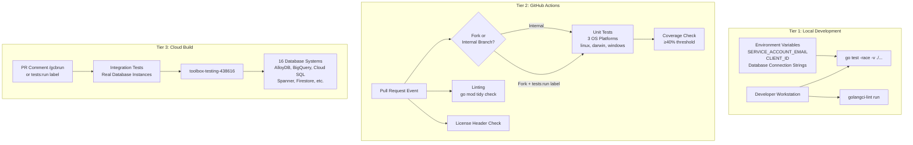
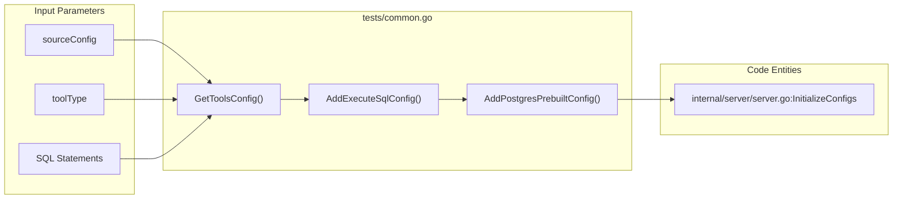
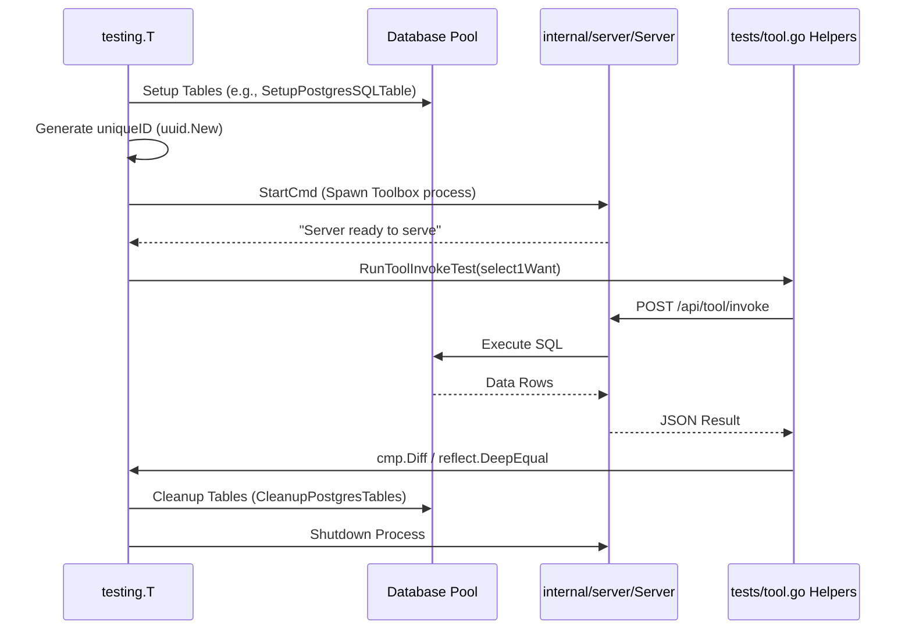

<!-- source: DeepWiki mcp.deepwiki.com · repo googleapis/genai-toolbox · page 10.2 Testing Framework · fetched 2026-10-29 -->

# Testing Framework

Relevant source files

The following files were used as context for generating this wiki page:

- [tests/alloydbpg/alloydb_pg_integration_test.go](tests/alloydbpg/alloydb_pg_integration_test.go)
- [tests/bigtable/bigtable_integration_test.go](tests/bigtable/bigtable_integration_test.go)
- [tests/cloudsqlmssql/cloud_sql_mssql_integration_test.go](tests/cloudsqlmssql/cloud_sql_mssql_integration_test.go)
- [tests/cloudsqlmysql/cloud_sql_mysql_integration_test.go](tests/cloudsqlmysql/cloud_sql_mysql_integration_test.go)
- [tests/cloudsqlpg/cloud_sql_pg_integration_test.go](tests/cloudsqlpg/cloud_sql_pg_integration_test.go)
- [tests/common.go](tests/common.go)
- [tests/http/http_integration_test.go](tests/http/http_integration_test.go)
- [tests/mssql/mssql_integration_test.go](tests/mssql/mssql_integration_test.go)
- [tests/mysql/mysql_integration_test.go](tests/mysql/mysql_integration_test.go)
- [tests/postgres/postgres_integration_test.go](tests/postgres/postgres_integration_test.go)
- [tests/spanner/spanner_integration_test.go](tests/spanner/spanner_integration_test.go)
- [tests/sqlite/sqlite_integration_test.go](tests/sqlite/sqlite_integration_test.go)
- [tests/tool.go](tests/tool.go)

The Testing Framework provides a robust three-tier infrastructure for validating the Toolbox codebase, ensuring that both the HTTP API and MCP protocol handlers function correctly across a wide variety of database systems.

## Three-Tier Testing Architecture

The Toolbox testing system operates at three distinct levels, each serving a specific purpose in the validation pipeline:

Title: Testing Pipeline Architecture

Sources: [tests/common.go:15-18](), [tests/postgres/postgres_integration_test.go:84-182]()

## Test Infrastructure

### Integration Test Environment
Integration tests execute against live database instances. The framework relies on environment variables to provision connection details for different database types.

| Database Type | Source Type Key | Primary Tool Type | Config File |
|--------------|-----------------|-------------------|-------------|
| PostgreSQL | `postgres` | `postgres-sql` | [tests/postgres/postgres_integration_test.go:34-35]() |
| AlloyDB | `alloydb-postgres` | `postgres-sql` | [tests/alloydbpg/alloydb_pg_integration_test.go:35-36]() |
| MySQL | `mysql` | `mysql-sql` | [tests/mysql/mysql_integration_test.go:33-34]() |
| Cloud SQL MySQL | `cloud-sql-mysql` | `mysql-sql` | [tests/cloudsqlmysql/cloud_sql_mysql_integration_test.go:36-37]() |
| SQL Server | `mssql` | `mssql-sql` | [tests/mssql/mssql_integration_test.go:35-36]() |
| SQLite | `sqlite` | `sqlite-sql` | [tests/sqlite/sqlite_integration_test.go:35-36]() |
| Spanner | `spanner` | `spanner-sql` | [tests/spanner/spanner_integration_test.go:40-41]() |

Sources: [tests/postgres/postgres_integration_test.go:33-41](), [tests/alloydbpg/alloydb_pg_integration_test.go:34-44](), [tests/mysql/mysql_integration_test.go:32-40]()

## Core Test Helpers

The `tests` package contains centralized logic for executing tool-based tests.

### Configuration Generation
The `GetToolsConfig` function is the primary helper for generating a mock `tools.yaml` structure used during server initialization in tests.

Title: Test Configuration Builder

Sources: [tests/common.go:39-170](), [tests/common.go:173-193]()

### Test Execution Functions

- **`RunToolGetTest`**: Validates the `GET /api/tool/{name}` endpoint. It checks if the tool manifest (description, parameters, auth requirements) is correctly served. [tests/tool.go:43-88]()
- **`RunToolInvokeTest`**: The primary integration test for tool execution. It handles:
    - Standard tool invocation via HTTP POST. [tests/tool.go:231-250]()
    - Identity token retrieval via `GetGoogleIdToken`. [tests/tool.go:252-256]()
    - Validation of parameterized queries (e.g., `my-tool-by-id`). [tests/tool.go:318-348]()
    - Array parameter testing. [tests/tool.go:351-379]()
- **`RunMCPToolCallMethod`**: Validates the Model Context Protocol (MCP) implementation by performing a full JSON-RPC handshake (`initialize` -> `tools/call`). [tests/tool.go:792-805]()

Sources: [tests/tool.go:43-88](), [tests/tool.go:231-451](), [tests/tool.go:792-1075]()

## Integration Test Lifecycle

Every integration test follows a strict setup/teardown lifecycle to ensure environment isolation.

Title: Integration Test Data Flow

Sources: [tests/postgres/postgres_integration_test.go:84-182](), [tests/alloydbpg/alloydb_pg_integration_test.go:120-205]()

### Database-Specific Implementation
Tests are organized by database type in the `tests/` directory. Each package (e.g., `tests/postgres`, `tests/mysql`) manages its own connection pool initialization:

- **Postgres**: Uses `pgxpool` for connection management. [tests/postgres/postgres_integration_test.go:68-82]()
- **AlloyDB**: Uses the `alloydbconn` dialer with `pgxpool`. [tests/alloydbpg/alloydb_pg_integration_test.go:88-118]()
- **MySQL**: Uses `sql.Open` with the `mysql` driver. [tests/mysql/mysql_integration_test.go:67-76]()
- **Spanner**: Initializes both a `spanner.Client` for data and `database.DatabaseAdminClient` for schema management. [tests/spanner/spanner_integration_test.go:66-83]()

## Advanced Test Scenarios

### Template Parameters
Tests in `RunToolInvokeWithTemplateParameters` verify that Go-style templates in SQL statements (e.g., `SELECT * FROM {{.tableName}}`) are correctly rendered before execution.
Sources: [tests/tool.go:454-607](), [tests/sqlite/sqlite_integration_test.go:105-109]()

### Authentication & Authorization
The framework tests two types of authentication:
1.  **Toolbox Auth**: Verified via `RunToolInvokeTest` using `auth_token` headers. [tests/tool.go:382-416]()
2.  **Generic OIDC Auth**: Verified in the HTTP integration tests by mocking a JWKS server and signing JWTs. [tests/http/http_integration_test.go:116-177]()

### Execute-SQL Tools
Specialized tests for `execute-sql` tool types (e.g., `postgres-execute-sql`) verify that the server can accept and run arbitrary SQL strings passed as parameters.
Sources: [tests/tool.go:609-743](), [tests/common.go:171-193]()

## Test Configuration Options
Execution behavior is controlled via `InvokeTestOption` and `McpTestConfig` structs, allowing tests to toggle support for features like array parameters or optional nulls based on the target database's capabilities.
Sources: [tests/tool.go:234-244](), [tests/tool.go:1078-1090]()

---

