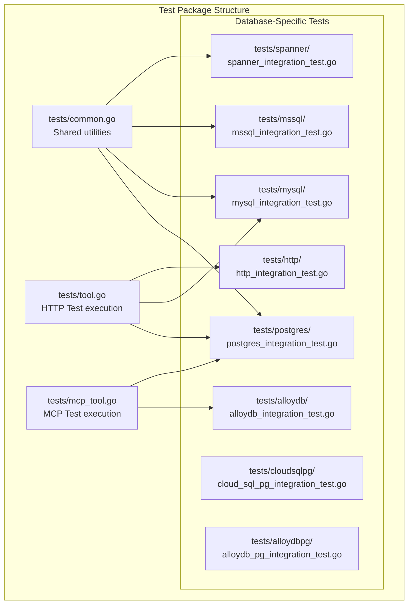
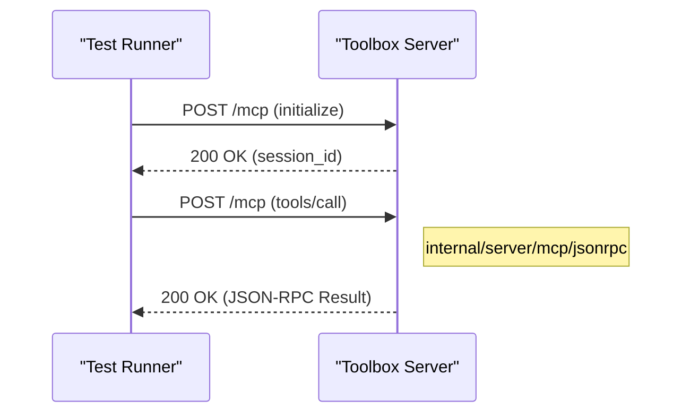

<!-- source: DeepWiki mcp.deepwiki.com · repo googleapis/genai-toolbox · page 10.3 Writing Tests · fetched 2026-10-29 -->

# Writing Tests

<details>
<summary>Relevant source files</summary>

The following files were used as context for generating this wiki page:

- [internal/prebuiltconfigs/tools/alloydb-postgres-admin.yaml](internal/prebuiltconfigs/tools/alloydb-postgres-admin.yaml)
- [tests/alloydb/alloydb_integration_test.go](tests/alloydb/alloydb_integration_test.go)
- [tests/alloydb/alloydb_mcp_test.go](tests/alloydb/alloydb_mcp_test.go)
- [tests/alloydb/alloydb_wait_for_operation_mcp_test.go](tests/alloydb/alloydb_wait_for_operation_mcp_test.go)
- [tests/alloydbainl/alloydb_ai_nl_mcp_test.go](tests/alloydbainl/alloydb_ai_nl_mcp_test.go)
- [tests/alloydbpg/alloydb_pg_integration_test.go](tests/alloydbpg/alloydb_pg_integration_test.go)
- [tests/bigtable/bigtable_integration_test.go](tests/bigtable/bigtable_integration_test.go)
- [tests/cloudsqlmssql/cloud_sql_mssql_integration_test.go](tests/cloudsqlmssql/cloud_sql_mssql_integration_test.go)
- [tests/cloudsqlmysql/cloud_sql_mysql_integration_test.go](tests/cloudsqlmysql/cloud_sql_mysql_integration_test.go)
- [tests/cloudsqlpg/cloud_sql_pg_integration_test.go](tests/cloudsqlpg/cloud_sql_pg_integration_test.go)
- [tests/common.go](tests/common.go)
- [tests/http/http_integration_test.go](tests/http/http_integration_test.go)
- [tests/http/http_mcp_test.go](tests/http/http_mcp_test.go)
- [tests/mcp_tool.go](tests/mcp_tool.go)
- [tests/mssql/mssql_integration_test.go](tests/mssql/mssql_integration_test.go)
- [tests/mysql/mysql_integration_test.go](tests/mysql/mysql_integration_test.go)
- [tests/postgres/postgres_integration_test.go](tests/postgres/postgres_integration_test.go)
- [tests/spanner/spanner_integration_test.go](tests/spanner/spanner_integration_test.go)
- [tests/sqlite/sqlite_integration_test.go](tests/sqlite/sqlite_integration_test.go)
- [tests/tool.go](tests/tool.go)

</details>


This page describes how to write and structure tests in the Toolbox codebase. For information about the overall testing infrastructure and CI/CD pipeline, see [Testing Framework](#10.2) and [CI/CD Pipeline](#10.5).

## Overview

The Toolbox test suite consists of integration tests that verify end-to-end functionality by starting the Toolbox server and making HTTP or MCP requests to its endpoints. Tests are organized by database type, with shared utilities for common operations and assertions. This document covers:

- Test file organization and naming conventions.
- Shared test utilities and helper functions.
- Patterns for writing database-specific integration tests.
- Test data setup and teardown procedures.
- Configuration builders and test options.

## Test Organization Structure



Tests are organized into:

| Component | Purpose | Key Files |
|-----------|---------|-----------|
| **Common Utilities** | Shared configuration builders, table setup/teardown, expected results. | [tests/common.go]() |
| **Test Execution** | Reusable test runners for HTTP API and MCP protocol. | [tests/tool.go](), [tests/mcp_tool.go]() |
| **Database Tests** | Database-specific integration tests in subdirectories. | `tests/{database}/` |

**Sources:** [tests/common.go:15-36](), [tests/tool.go:15-40](), [tests/postgres/postgres_integration_test.go:15-31]()

## Integration Test Lifecycle

Each integration test follows a standardized lifecycle to ensure consistency across different database sources:

1.  **Environment Setup**: Read connection parameters (host, user, password) from environment variables [tests/postgres/postgres_integration_test.go:33-65]().
2.  **Database Initialization**: Initialize a connection pool (e.g., `pgxpool.Pool` or `sql.DB`) [tests/postgres/postgres_integration_test.go:91-94]().
3.  **Cleanup Existing Data**: Remove any leftover tables from previous failed runs using helpers like `CleanupPostgresTables` [tests/postgres/postgres_integration_test.go:100-102]().
4.  **Test Data Setup**: Generate unique table names using UUIDs and populate them with seed data [tests/postgres/postgres_integration_test.go:105-121]().
5.  **Configuration Generation**: Use `GetToolsConfig` to create a `tools.yaml` structure in memory [tests/common.go:39-170]().
6.  **Server Startup**: Start the Toolbox server using `tests.StartCmd` and wait for the "Server ready to serve" log [tests/postgres/postgres_integration_test.go:134-146]().
7.  **Execution**: Run shared test suites like `RunToolInvokeTest` or `RunMCPToolCallMethod` [tests/postgres/postgres_integration_test.go:152-156]().
8.  **Teardown**: Stop the server and drop test tables using `t.Cleanup` or `defer` [tests/postgres/postgres_integration_test.go:100-102]().

**Sources:** [tests/postgres/postgres_integration_test.go:84-182](), [tests/mysql/mysql_integration_test.go:78-148]()

## Common Test Utilities

### Configuration Builders
The [tests/common.go]() file contains functions to programmatically build the `tools.yaml` configuration used by the server during integration tests.

-   **`GetToolsConfig`**: Generates a standard configuration containing a source and several tools (simple, parameterized, array, and authenticated) [tests/common.go:39-170]().
-   **`AddExecuteSqlConfig`**: Adds tools specifically for executing arbitrary SQL [tests/common.go:173-193]().
-   **`AddPostgresPrebuiltConfig`**: Appends prebuilt tool definitions (e.g., `postgres-list-tables`) to the config [tests/common.go:195-213]().

### Table Setup Helpers
To simplify data preparation, the framework provides database-specific setup functions:

| Function | Role | Source |
|----------|------|--------|
| `SetupPostgresSQLTable` | Creates table and inserts rows for PostgreSQL/AlloyDB. | [tests/common.go:480-511]() |
| `SetupMySQLTable` | Creates table and inserts rows for MySQL/Cloud SQL MySQL. | [tests/common.go:513-539]() |
| `SetupMsSQLTable` | Creates table and inserts rows for SQL Server. | [tests/common.go:541-565]() |

**Sources:** [tests/common.go:480-565]()

## Test Execution Functions

### HTTP API Validation
The `RunToolInvokeTest` function is the primary entry point for testing the REST API. It executes a suite of predefined test cases against the `/api/tool/{name}/invoke` endpoint [tests/tool.go:231-488]().

-   **`InvokeTestConfig`**: A struct used to customize expected outputs and enable/disable specific tests (like array support) [tests/tool.go:234-244]().
-   **`InvokeTestOption`**: Functional options to modify the `InvokeTestConfig` [tests/tool.go:440-488]().

### MCP Protocol Validation
The `RunMCPToolCallMethod` function validates the Model Context Protocol implementation. It initializes an MCP session and calls the `tools/call` method [tests/mcp_tool.go:94-118]().



**Sources:** [tests/mcp_tool.go:94-118](), [tests/alloydb/alloydb_integration_test.go:123-234]()

## Writing a New Integration Test

When adding support for a new database or tool type, follow this pattern:

### 1. Define Connection Variables
Read credentials from the environment and package them into a map for the configuration builder [tests/postgres/postgres_integration_test.go:43-65]().

### 2. Initialize the Server
Use `tests.StartCmd` to launch the binary. This function handles writing the temporary `tools.yaml` and managing the process lifecycle [tests/postgres/postgres_integration_test.go:134-138]().

### 3. Invoke Shared Runners
Pass the expected "Success" string (usually the result of `SELECT 1`) to the shared runners [tests/postgres/postgres_integration_test.go:152-156]().

```go
// Example from postgres_integration_test.go
select1Want, mcpMyFailToolWant, createTableStatement, mcpSelect1Want := tests.GetPostgresWants()

tests.RunToolGetTest(t)
tests.RunToolInvokeTest(t, select1Want)
tests.RunMCPToolCallMethod(t, mcpMyFailToolWant, mcpSelect1Want)
```

**Sources:** [tests/postgres/postgres_integration_test.go:149-156](), [tests/mysql/mysql_integration_test.go:131-138]()

## Local vs. Cloud Build

Tests are designed to run in both local environments and automated CI pipelines.

-   **Local**: Requires local database instances (e.g., via Docker) and setting the corresponding environment variables (e.g., `POSTGRES_HOST=127.0.0.1`) [tests/postgres/postgres_integration_test.go:33-41]().
-   **Cloud Build**: Integration tests for Google Cloud sources (AlloyDB, Cloud SQL, Spanner, BigQuery) run in Cloud Build. These tests use `GetGoogleIdToken` to handle IAM-based authentication during the test run [tests/tool.go:252-253]().

**Sources:** [tests/tool.go:252-253](), [tests/alloydbpg/alloydb_pg_integration_test.go:34-44]()

## Advanced Test Scenarios

### Template Parameters
Tests can validate dynamic SQL generation by using `RunToolInvokeWithTemplateParameters`. This ensures that the server correctly substitutes template variables before execution [tests/postgres/postgres_integration_test.go:156]().

### HTTP Tools
The `http` integration tests use `httptest.NewServer` to mock external APIs. This allows testing the `http` tool type without external dependencies [tests/http/http_integration_test.go:51-53]().

### Semantic Search
For databases supporting vector extensions (like `pgvector` in PostgreSQL or AlloyDB), use `RunSemanticSearchToolInvokeTest` to verify embedding-based retrieval [tests/postgres/postgres_integration_test.go:181]().

**Sources:** [tests/http/http_integration_test.go:51-53](), [tests/postgres/postgres_integration_test.go:181](), [tests/tool.go:1152-1200]()

---

