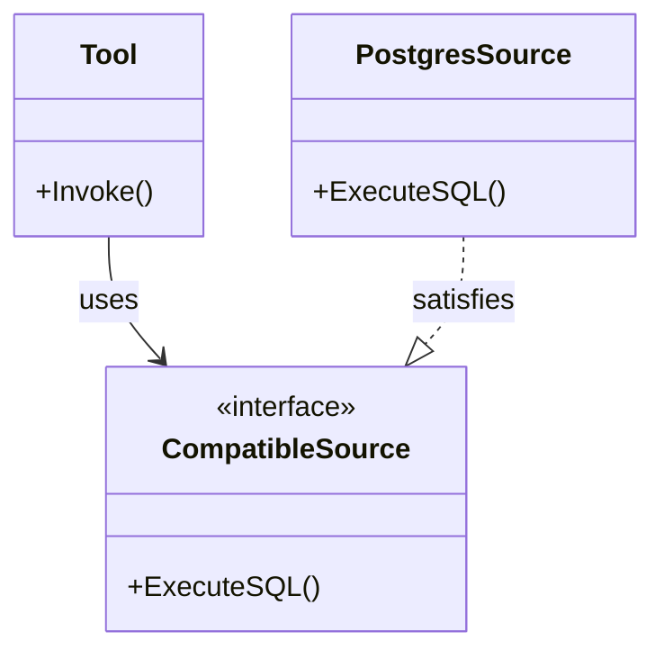
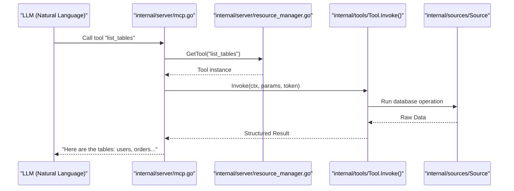
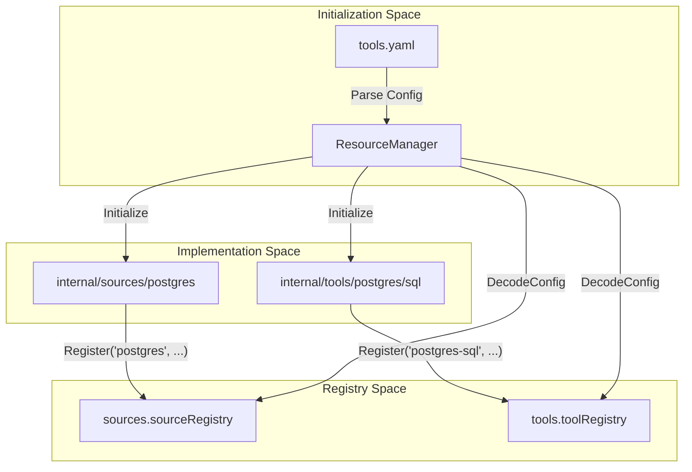

<!-- source: DeepWiki mcp.deepwiki.com · repo googleapis/genai-toolbox · page 10.4 Extending the System · fetched 2026-10-29 -->

# Extending the System

<details>
<summary>Relevant source files</summary>

The following files were used as context for generating this wiki page:

- [.gemini/styleguide.md](.gemini/styleguide.md)
- [.gitignore](.gitignore)
- [AGENTS.md](AGENTS.md)
- [CLAUDE.md](CLAUDE.md)
- [CONTRIBUTING.md](CONTRIBUTING.md)
- [DEVELOPER.md](DEVELOPER.md)
- [GEMINI.md](GEMINI.md)
- [LICENSE](LICENSE)
- [internal/server/api.go](internal/server/api.go)
- [internal/server/api_test.go](internal/server/api_test.go)
- [internal/sources/sources.go](internal/sources/sources.go)
- [internal/tools/looker/lookerconversationalanalytics/lookerconversationalanalytics.go](internal/tools/looker/lookerconversationalanalytics/lookerconversationalanalytics.go)
- [internal/tools/tools.go](internal/tools/tools.go)
- [internal/util/util.go](internal/util/util.go)

</details>


This document provides a technical guide for extending the GenAI Toolbox by adding new data sources and tools. It covers the required interfaces, registration patterns, initialization lifecycle, and error handling requirements.

## Overview

The GenAI Toolbox uses a plugin architecture based on factory registries that enable adding new database types and operations without modifying core server code. Extension points include:

- **Sources**: Database connection implementations that provide data access.
- **Tools**: Operation implementations that perform actions on sources.
- **ToolConfigs**: Configuration schemas for tools.
- **SourceConfigs**: Configuration schemas for sources.

The extension process follows a three-phase lifecycle: registration (via `init()` functions), decoding (via YAML configuration), and initialization (at server startup).

---

## Source Extension Architecture

### Source Interfaces

The source system requires implementing two interfaces defined in `internal/sources/sources.go`.

**SourceConfig Interface** [internal/sources/sources.go:57-60]():
- `SourceConfigType() string`: Returns unique identifier for the source type (e.g., `"postgres"`, `"bigquery"`).
- `Initialize(ctx context.Context, tracer trace.Tracer) (Source, error)`: Creates the database connection pool and returns a `Source` instance.

**Source Interface** [internal/sources/sources.go:63-66]():
- `SourceType() string`: Returns the same identifier as `SourceConfigType`.
- `ToConfig() SourceConfig`: Returns the configuration struct used to create this source.

Sources: [internal/sources/sources.go:57-66]()

---

### Adding a New Source

#### Directory Structure
Create a new package under `internal/sources/` (e.g., `internal/sources/newdb/`).

#### Implementation Steps

**Step 1: Define Configuration and Source Structs**
Define a `Config` struct that implements `SourceConfig` and a `Source` struct that implements `Source`.

**Step 2: Implement Registration**
Use the `init()` function to register a `SourceConfigFactory` with the global `sourceRegistry`.

```go
func init() {
    sources.Register("newdb", newConfig)
}

func newConfig(ctx context.Context, name string, decoder *yaml.Decoder) (sources.SourceConfig, error) {
    actual := Config{Name: name}
    if err := decoder.DecodeContext(ctx, &actual); err != nil {
        return nil, err
    }
    return actual, nil
}
```

**Step 3: Implement Initialization**
The `Initialize` method should establish the connection. Use `sources.InitConnectionSpan` to provide observability.

```go
func (c Config) Initialize(ctx context.Context, tracer trace.Tracer) (sources.Source, error) {
    ctx, span := sources.InitConnectionSpan(ctx, tracer, "newdb", c.Name)
    defer span.End()
    // Connection logic here...
}
```

Sources: [internal/sources/sources.go:27-41](), [internal/sources/sources.go:68-77](), [DEVELOPER.md:181-205]()

---

## Tool Extension Architecture

### Tool Interfaces

The tool system requires implementing two interfaces defined in `internal/tools/tools.go`.

**ToolConfig Interface** [internal/tools/tools.go:66-69]():
- `ToolConfigType() string`: Returns the unique tool type identifier.
- `Initialize(map[string]sources.Source) (Tool, error)`: Validates that the required source exists and is compatible, then returns a `Tool` instance.

**Tool Interface** [internal/tools/tools.go:116-126]():
- `Invoke(...)`: Executes the core logic. Must return `util.ToolboxError` for proper MCP error mapping.
- `Manifest()` / `McpManifest()`: Returns metadata for HTTP and MCP clients.
- `Authorized([]string)`: Checks if the provided auth claims satisfy tool requirements.
- `GetParameters()`: Returns the parameter definitions for validation.

Sources: [internal/tools/tools.go:66-126]()

---

### Tool Naming and Types

Tool names and types follow specific conventions to ensure LLM compatibility and system stability.

| Property | Convention | Example | File Reference |
|----------|-----------|---------|----------------|
| **Tool Name** | `snake_case`, no product name | `list_tables` | [DEVELOPER.md:95-115]() |
| **Tool Type** | `kebab-case`, includes product name | `postgres-sql` | [DEVELOPER.md:116-127]() |

Sources: [DEVELOPER.md:83-127]()

---

### The CompatibleSource Pattern

To ensure type safety while keeping packages decoupled, tools often define a `compatibleSource` interface. This allows the tool to verify that the source provided in `Initialize` has the specific methods it needs.



**Implementation Example** [internal/tools/looker/lookerconversationalanalytics/lookerconversationalanalytics.go:58-65]():
```go
type compatibleSource interface {
    GoogleCloudProject() string
    LookerApiSettings() *rtl.ApiSettings
    // ... other methods
}
```

Sources: [internal/tools/looker/lookerconversationalanalytics/lookerconversationalanalytics.go:58-65](), [internal/tools/tools.go:191-197]()

---

## Error Handling Requirements

Toolbox distinguishes between **Agent Errors** (which an LLM can fix) and **Server Errors** (infrastructure failures).

| Category | Type | Result |
|----------|------|--------|
| **Agent Error** | `util.NewAgentError` | MCP `isError: true`, LLM attempts fix. |
| **Server Error** | `util.NewClientServerError` | MCP JSON-RPC Error, hard stop. |

**Example Implementation** [DEVELOPER.md:155-162]():
```go
func (t *MyTool) Invoke(...) (any, util.ToolboxError) {
    res, err := t.db.Exec(ctx, params.SQL)
    if err != nil {
        // Syntax error is an AgentError
        return nil, util.NewAgentError("error executing SQL query", err)
    }
    return res, nil
}
```

Sources: [DEVELOPER.md:128-162]()

---

## Data Flow: From Registry to Invocation

The following diagram bridges the **Natural Language Space** (where an LLM requests a tool) to the **Code Entity Space** (where the Go implementation resides).



Sources: [internal/server/api.go:113-135](), [internal/tools/tools.go:116-126](), [DEVELOPER.md:155-162]()

---

## System Registration Map

This diagram illustrates how code entities are registered and retrieved via the `ResourceManager`.



Sources: [internal/sources/sources.go:30-41](), [internal/tools/tools.go:36-50](), [internal/tools/looker/lookerconversationalanalytics/lookerconversationalanalytics.go:44-48]()

---

## Checklist for Extensions

### New Source Checklist
- [ ] Create package in `internal/sources/`.
- [ ] Implement `SourceConfig` and `Source` interfaces.
- [ ] Implement `init()` with `sources.Register`.
- [ ] Include unit tests and integration tests [CONTRIBUTING.md:29-30]().
- [ ] Use `sources.InitConnectionSpan` for tracing [internal/sources/sources.go:68-77]().

### New Tool Checklist
- [ ] Create package in `internal/tools/`.
- [ ] Implement `ToolConfig` and `Tool` interfaces.
- [ ] Implement `init()` with `tools.Register`.
- [ ] Define a `compatibleSource` interface for type safety.
- [ ] Ensure `Invoke` returns `util.ToolboxError` [DEVELOPER.md:143-153]().
- [ ] Follow `snake_case` naming for tools and `kebab-case` for types [DEVELOPER.md:83-127]().

Sources: [DEVELOPER.md:166-210](), [CONTRIBUTING.md:69-79]()

---

