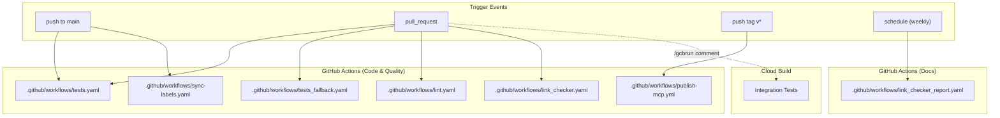
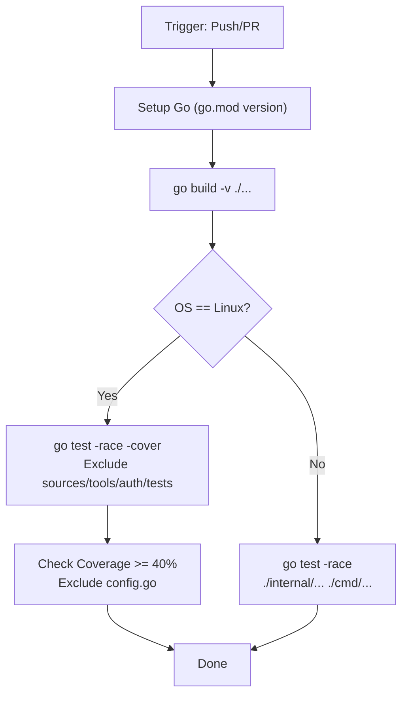
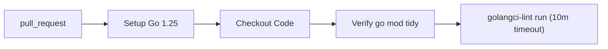

<!-- source: DeepWiki mcp.deepwiki.com · repo googleapis/genai-toolbox · page 10.5 CI/CD Pipeline · fetched 2026-10-29 -->

# CI/CD Pipeline

Relevant source files

The following files were used as context for generating this wiki page:

- [.github/CODEOWNERS](.github/CODEOWNERS)
- [.github/blunderbuss.yml](.github/blunderbuss.yml)
- [.github/labels.yaml](.github/labels.yaml)
- [.github/workflows/link_checker.yaml](.github/workflows/link_checker.yaml)
- [.github/workflows/link_checker_report.yaml](.github/workflows/link_checker_report.yaml)
- [.github/workflows/lint.yaml](.github/workflows/lint.yaml)
- [.github/workflows/publish-mcp.yml](.github/workflows/publish-mcp.yml)
- [.github/workflows/sync-labels.yaml](.github/workflows/sync-labels.yaml)
- [.github/workflows/tests.yaml](.github/workflows/tests.yaml)
- [.github/workflows/tests_fallback.yaml](.github/workflows/tests_fallback.yaml)
- [internal/tools/alloydb/alloydbwaitforoperation/alloydbwaitforoperation_test.go](internal/tools/alloydb/alloydbwaitforoperation/alloydbwaitforoperation_test.go)
- [tests/alloydb/alloydb_wait_for_operation_test.go](tests/alloydb/alloydb_wait_for_operation_test.go)

## Purpose and Scope

This document explains the automated testing and deployment pipeline for the Toolbox project. It covers the GitHub Actions workflows for unit tests, linting, documentation deployment, and link checking, as well as the Cloud Build integration for integration tests against real databases.

## Pipeline Overview

The Toolbox CI/CD pipeline uses a dual-platform approach: GitHub Actions for unit tests, linting, and documentation, and Google Cloud Build for integration tests that require GCP credentials and access to database instances.

**GitHub Actions Workflow Files**

| File | Trigger | Purpose |
|------|---------|---------|
| `.github/workflows/tests.yaml` | push/PR | Unit tests on Linux, macOS, Windows [.github/workflows/tests.yaml:15-32]() |
| `.github/workflows/tests_fallback.yaml` | push/PR (docs-only) | Satisfies status check for non-code changes [.github/workflows/tests_fallback.yaml:17-39]() |
| `.github/workflows/lint.yaml` | PR | `golangci-lint` and `go mod tidy` check [.github/workflows/lint.yaml:15-24]() |
| `.github/workflows/link_checker.yaml` | PR | Checks for broken links in changed Markdown files [.github/workflows/link_checker.yaml:14-17]() |
| `.github/workflows/link_checker_report.yaml` | Schedule | Weekly full-repo link health report [.github/workflows/link_checker_report.yaml:14-18]() |
| `.github/workflows/publish-mcp.yml` | push `v*` tag | Publish server metadata to MCP Registry [.github/workflows/publish-mcp.yml:15-22]() |
| `.github/workflows/sync-labels.yaml` | push to main | Sync GitHub labels from `.github/labels.yaml` [.github/workflows/sync-labels.yaml:15-20]() |

**Overall CI/CD Pipeline Flow**

**Pipeline Architecture**: GitHub Actions handles fast-feedback tasks (unit tests, linting, link checking). Cloud Build handles resource-intensive integration tests requiring GCP credentials. Fallback workflows exist to satisfy required status checks when only docs or config files change.

Sources: [.github/workflows/tests.yaml:15-32](), [.github/workflows/tests_fallback.yaml:17-39](), [.github/workflows/lint.yaml:15-24](), [.github/workflows/link_checker.yaml:14-17](), [.github/workflows/publish-mcp.yml:15-22]()

## GitHub Actions Workflows

### Unit Tests Workflow

The `tests.yaml` workflow runs unit tests across multiple operating systems.

**Unit Test Workflow**: The workflow runs on `push` to `main` and `pull_request` [.github/workflows/tests.yaml:16-32](). It tests on `macos-latest`, `windows-latest`, and `ubuntu-latest` [.github/workflows/tests.yaml:40-43](). 

Key configuration details:
- **Go Version**: Derived from `go-version-file: 'go.mod'` [.github/workflows/tests.yaml:54]().
- **Coverage Strategy**: Only calculated on Linux [.github/workflows/tests.yaml:63](). It excludes specific directories like `internal/sources/*` and `internal/tools/*` from the main coverage profile to focus on core logic [.github/workflows/tests.yaml:67-72](), though those packages are still tested separately [.github/workflows/tests.yaml:74]().
- **Coverage Threshold**: Fails if total coverage is below 40% after excluding `internal/server/config.go` [.github/workflows/tests.yaml:81-93]().

Sources: [.github/workflows/tests.yaml:15-94]()

### Linting Workflow

The `lint.yaml` workflow ensures code quality using `golangci-lint` and verifies module hygiene.

**Lint Workflow Steps**

**Linting Workflow**: Runs on pull requests [.github/workflows/lint.yaml:16-17](). It enforces that `go mod tidy` produces no diff [.github/workflows/lint.yaml:50](). Uses the latest `golangci-lint` version with a 10-minute timeout [.github/workflows/lint.yaml:53-56]().

Sources: [.github/workflows/lint.yaml:1-57]()

### Link Checking Workflows

The repository maintains two link-checking workflows using `lychee`.

1.  **PR Link Checker (`link_checker.yaml`)**: Identifies changed `.md` files in a PR and checks links within them [.github/workflows/link_checker.yaml:31-53](). It excludes specific protocols like `neo4j+` and `bolt://` [.github/workflows/link_checker.yaml:74](). If failures occur, it prepares a detailed report for the GitHub Step Summary [.github/workflows/link_checker.yaml:85-103]().
2.  **Scheduled Link Checker (`link_checker_report.yaml`)**: Runs weekly (Monday at midnight) [.github/workflows/link_checker_report.yaml:17-18](). It scans the entire `README.md` and `docs/` folder [.github/workflows/link_checker_report.yaml:39-40](). If broken links are found, it automatically creates a GitHub issue labeled `priority: p2` and `type: process` [.github/workflows/link_checker_report.yaml:57-66]().

Sources: [.github/workflows/link_checker.yaml:1-105](), [.github/workflows/link_checker_report.yaml:1-75]()

### Fallback Workflows

The `tests_fallback.yaml` workflow exists to satisfy required status checks when a PR only changes documentation, markdown files, or GitHub configuration [.github/workflows/tests_fallback.yaml:21-38](). It mirrors the `unit tests` job name but simply prints a skip message [.github/workflows/tests_fallback.yaml:44-54]().

Sources: [.github/workflows/tests_fallback.yaml:1-54]()

## Integration Tests (Cloud Build)

Integration tests are executed via Google Cloud Build to access real database instances and GCP services.

### Integration Test Logic

Integration tests are defined in the `tests/` directory and use helpers like `tests.StartCmd` to launch the toolbox server [.tests/alloydb/alloydb_wait_for_operation_test.go:140](). These tests verify the full path from HTTP/MCP request to database response.

**Integration Test Example (AlloyDB Wait Tool)**:
The test in `tests/alloydb/alloydb_wait_for_operation_test.go` demonstrates the flow:
1.  **Mock Transport**: Sets up a `waitForOperationTransport` to intercept calls to the AlloyDB API [.tests/alloydb/alloydb_wait_for_operation_test.go:42-53]().
2.  **Server Setup**: Starts a mock HTTP server to simulate AlloyDB operation responses [.tests/alloydb/alloydb_wait_for_operation_test.go:114]().
3.  **Toolbox Invocation**: Starts the toolbox with a configuration containing the `alloydb-wait-for-operation` tool [.tests/alloydb/alloydb_wait_for_operation_test.go:140]().
4.  **API Validation**: Sends a POST request to `/api/tool/{name}/invoke` and validates the JSON response [.tests/alloydb/alloydb_wait_for_operation_test.go:178-226]().

Sources: [tests/alloydb/alloydb_wait_for_operation_test.go:1-246]()

## Automation and Triage

### Blunderbuss Auto-Assignment

The repository uses the `blunderbuss` bot to automatically assign issues and PRs to specific teams based on labels.

| Label | Assigned Team |
|-------|---------------|
| `product: alloydb` | `googleapis/toolbox-alloydb-team` |
| `product: bigquery` | `googleapis/toolbox-bigquery-team` |
| `product: mssql` | `googleapis/toolbox-cloud-sql-mssql-team` |
| `product: postgres` | `googleapis/toolbox-cloud-sql-postgres-team` |

Assignment rules are defined in `.github/blunderbuss.yml` [.github/blunderbuss.yml:21-61]().

### CODEOWNERS

The `.github/CODEOWNERS` file ensures that the correct product teams are tagged for review when files in their domain are modified. For example, any changes in paths containing `alloydb` require approval from `@googleapis/toolbox-alloydb-team` [.github/CODEOWNERS:8]().

Sources: [.github/blunderbuss.yml:1-106](), [.github/CODEOWNERS:1-18]()

## MCP Registry Publishing

The `publish-mcp.yml` workflow automates the publication of the toolbox to the Model Context Protocol registry.

1.  **Image Availability**: It first polls the Google Artifact Registry to ensure the Docker image for the new version exists [.github/workflows/publish-mcp.yml:34-63]().
2.  **Publisher Tool**: It installs the `mcp-publisher` binary [.github/workflows/publish-mcp.yml:65-67]().
3.  **Authentication**: Uses GitHub OIDC via `mcp-publisher login github-oidc` [.github/workflows/publish-mcp.yml:70]().
4.  **Publication**: Executes `mcp-publisher publish` to update the registry [.github/workflows/publish-mcp.yml:73]().

Sources: [.github/workflows/publish-mcp.yml:1-74]()

---

