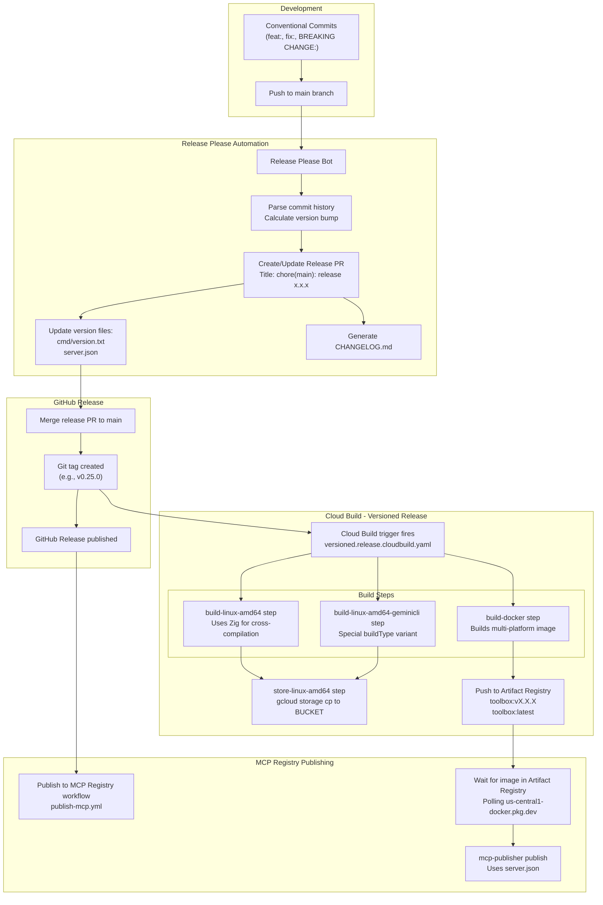
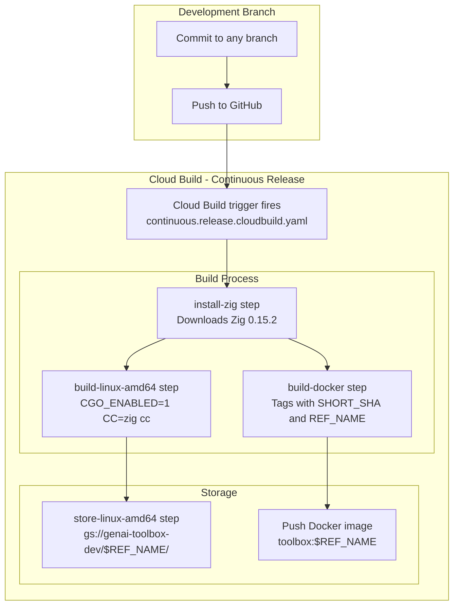

<!-- source: DeepWiki mcp.deepwiki.com · repo googleapis/genai-toolbox · page 10.6 Release Process · fetched 2026-10-29 -->

# Release Process

<details>
<summary>Relevant source files</summary>

The following files were used as context for generating this wiki page:

- [.ci/continuous.release.cloudbuild.yaml](.ci/continuous.release.cloudbuild.yaml)
- [.ci/generate_release_table.sh](.ci/generate_release_table.sh)
- [.ci/versioned.release.cloudbuild.yaml](.ci/versioned.release.cloudbuild.yaml)
- [.github/workflows/link_checker.yaml](.github/workflows/link_checker.yaml)
- [.github/workflows/link_checker_report.yaml](.github/workflows/link_checker_report.yaml)
- [.github/workflows/lint.yaml](.github/workflows/lint.yaml)
- [.github/workflows/publish-mcp.yml](.github/workflows/publish-mcp.yml)
- [.github/workflows/sync-labels.yaml](.github/workflows/sync-labels.yaml)
- [.github/workflows/tests.yaml](.github/workflows/tests.yaml)
- [.github/workflows/tests_fallback.yaml](.github/workflows/tests_fallback.yaml)
- [Dockerfile](Dockerfile)

</details>


This document explains the release process for Toolbox, including versioning strategy, automated workflows, artifact distribution, and manual steps required for maintainers. The system supports two release tracks: versioned releases for production use and continuous releases for testing and development.

For information about the CI/CD pipeline that runs tests and validation, see [CI/CD Pipeline](#10.5). For information about building binaries locally during development, see [Building and Packaging](#9.1).

---

## Release Types

Toolbox implements two distinct release tracks, each serving different purposes and using separate Google Cloud Build configurations.

| Release Type | Purpose | Trigger | Artifacts | Storage Location | GCP Project |
|--------------|---------|---------|-----------|------------------|-------------|
| **Versioned** | Official production releases | Git tag creation (via Release Please) | Binaries, Docker images (tagged with version + `latest`), `geminicli` binaries | `gs://genai-toolbox/`, `us-central1-docker.pkg.dev/database-toolbox/toolbox` | `database-toolbox` |
| **Continuous** | Development builds for testing | Push to any branch | Binaries, Docker images (tagged with branch name) | `gs://genai-toolbox-dev/`, `us-central1-docker.pkg.dev/database-toolbox/toolbox-dev` | `database-toolbox` |

**Sources:** [.ci/versioned.release.cloudbuild.yaml:1-245](), [.ci/continuous.release.cloudbuild.yaml:1-134]()

---

## Versioning Strategy

### Conventional Commits and Release Please

Toolbox uses [Release Please](https://github.com/googleapis/release-please) to automate version management and release PR generation. The system parses commit messages following the [Conventional Commits](https://www.conventionalcommits.org/) specification to determine version bumps and generate changelogs.

**Commit Message Format:**
```
<type>[optional scope]: <description>

[optional body]

[optional footer(s)]
```

**Version Bump Rules:**
- `fix:` commits trigger patch version bumps (0.0.x)
- `feat:` commits trigger minor version bumps (0.x.0)
- `BREAKING CHANGE:` footer or `!` after type/scope triggers major version bumps (x.0.0)
- Other types (`chore:`, `docs:`, `style:`, `refactor:`, `test:`, `ci:`) do not trigger releases

### Version Files

Release Please automatically updates multiple files containing version information:

**Primary Version File:**
- `cmd/version.txt` [cmd/version.txt:1]() - Contains version without `v` prefix (e.g., `0.25.0`). This is read by the build process to inject the version into the binary.

**Secondary Version Files (extraFiles):**
The release-please configuration specifies additional files to update:

| File | Type | Purpose |
|------|------|---------|
| `server.json` | `json` | MCP Registry server manifest version and OCI identifier |
| `README.md` | `generic` | Badge and installation command version |
| `docs/en/**/*.md` | `generic` | Version references in documentation |

**Sources:** [.ci/versioned.release.cloudbuild.yaml:21](), [.ci/versioned.release.cloudbuild.yaml:109](), [.ci/versioned.release.cloudbuild.yaml:140]()

---

## Versioned Release Workflow

This diagram shows the complete flow from conventional commits through Release Please automation to published artifacts.

### Release Automation Flow



**Sources:** [.ci/versioned.release.cloudbuild.yaml:14-143](), [.github/workflows/publish-mcp.yml:1-74]()

---

## Continuous Release Workflow

Continuous releases provide development builds for early feature testing and end-to-end validation.



**Sources:** [.ci/continuous.release.cloudbuild.yaml:15-95]()

---

## MCP Registry Publishing

After each versioned release, Toolbox is automatically published to the [Model Context Protocol (MCP) Registry](https://github.com/modelcontextprotocol/registry).

### Publishing Process Details

The `Publish to MCP Registry` workflow [ .github/workflows/publish-mcp.yml:15-74 ]() performs the following steps:

1.  **Trigger:** Activated on version tags (e.g., `v1.0.0`) or manual `workflow_dispatch` [ .github/workflows/publish-mcp.yml:17-21 ]().
2.  **Wait for Artifact Registry image:** Polling loop checks `us-central1-docker.pkg.dev` for the new manifest version [ .github/workflows/publish-mcp.yml:34-63 ]().
    *   `MAX_ATTEMPTS=10`
    *   Initial sleep of 3 minutes.
    *   Subsequent 2-minute sleep intervals.
3.  **Install MCP Publisher:** Downloads the latest `mcp-publisher` tool [ .github/workflows/publish-mcp.yml:65-67 ]().
4.  **Login:** Authenticates to the MCP Registry using GitHub OIDC [ .github/workflows/publish-mcp.yml:69-70 ]().
5.  **Publish:** Executes `./mcp-publisher publish` using the `server.json` manifest [ .github/workflows/publish-mcp.yml:72-73 ]().

**Sources:** [.github/workflows/publish-mcp.yml:1-74]()

---

## Build Artifacts and Distribution

### Binary Artifacts

Binaries are built with `CGO_ENABLED=1` using Zig for cross-compilation [ .ci/versioned.release.cloudbuild.yaml:89-93 ](). Build metadata is injected via `-ldflags`:

*   `cmd.buildType`: Set to `binary` or `geminicli.binary` [ .ci/versioned.release.cloudbuild.yaml:101 ]().
*   `cmd.commitSha`: Short Git hash of the build [ .ci/versioned.release.cloudbuild.yaml:101 ]().

### Docker Images

The `Dockerfile` [ Dockerfile:1-56 ]() uses a multi-stage build:
1.  **Build Stage:** Uses `golang:1` with Zig installed for CGO cross-compilation [ Dockerfile:14-21 ]().
2.  **Architecture Support:** Detects `TARGETARCH` to set appropriate `ZIG_TARGET` (e.g., `x86_64-linux-gnu` for `amd64`) [ Dockerfile:33-38 ]().
3.  **Final Stage:** Uses `gcr.io/distroless/cc-debian12:nonroot` for a secure, minimal runtime environment [ Dockerfile:47-55 ]().

**Sources:** [Dockerfile:1-56](), [.ci/versioned.release.cloudbuild.yaml:15-40]()

---

## Checksum Table Generation

The `generate_release_table.sh` script [ .ci/generate_release_table.sh:1-58 ]() automates the creation of a checksum table for GitHub release notes.

**Implementation Details:**
1.  **Environment Check:** Ensures `VERSION` is set [ .ci/generate_release_table.sh:5-8 ]().
2.  **Target Platforms:** Processes `linux.amd64`, `darwin.arm64`, `darwin.amd64`, and `windows.amd64` [ .ci/generate_release_table.sh:11 ]().
3.  **Download and Hash:**
    *   Constructs GCS URLs based on the OS and Architecture [ .ci/generate_release_table.sh:39-44 ]().
    *   Downloads the binary using `curl` [ .ci/generate_release_table.sh:46 ]().
    *   Calculates the SHA256 hash using `shasum -a 256` [ .ci/generate_release_table.sh:49 ]().
4.  **Formatting:** Generates a Markdown table with descriptions for each platform [ .ci/generate_release_table.sh:15-25 ]().

**Sources:** [.ci/generate_release_table.sh:1-58]()

---

## CI Validation Workflows

Before release, several GitHub Actions workflows validate the codebase:

| Workflow | File | Purpose |
|----------|------|---------|
| **Tests** | `.github/workflows/tests.yaml` | Runs unit tests on macOS, Windows, and Ubuntu with coverage checks (min 40%) [ .github/workflows/tests.yaml:38-93 ](). |
| **Lint** | `.github/workflows/lint.yaml` | Verifies `go mod tidy` and runs `golangci-lint` [ .github/workflows/lint.yaml:46-57 ](). |
| **Link Checker** | `.github/workflows/link_checker.yaml` | Validates markdown links in PRs using `lychee` [ .github/workflows/link_checker.yaml:63-79 ](). |
| **Sync Labels** | `.github/workflows/sync-labels.yaml` | Synchronizes GitHub labels from `.github/labels.yaml` [ .github/workflows/sync-labels.yaml:32-38 ](). |

**Sources:** [.github/workflows/tests.yaml:15-94](), [.github/workflows/lint.yaml:15-57](), [.github/workflows/link_checker.yaml:14-83](), [.github/workflows/sync-labels.yaml:15-38]()

---

