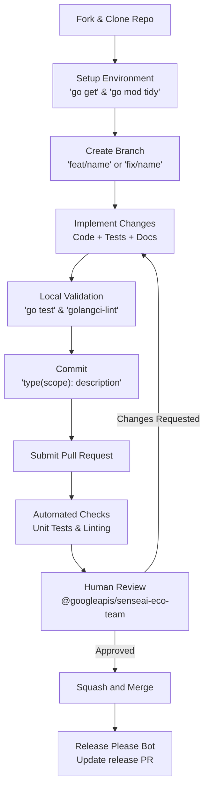
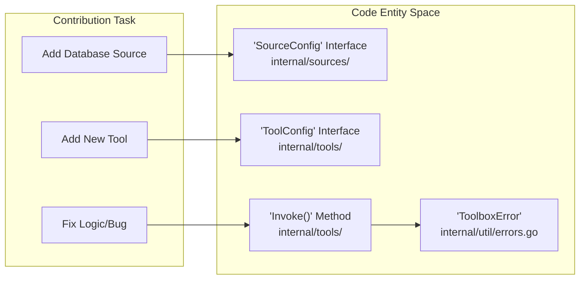

<!-- source: DeepWiki mcp.deepwiki.com · repo googleapis/genai-toolbox · page 11 Contributing · fetched 2026-10-29 -->

# Contributing

Relevant source files

The following files were used as context for generating this wiki page:

- [.gemini/styleguide.md](.gemini/styleguide.md)
- [.github/CODEOWNERS](.github/CODEOWNERS)
- [.github/blunderbuss.yml](.github/blunderbuss.yml)
- [.github/labels.yaml](.github/labels.yaml)
- [.gitignore](.gitignore)
- [AGENTS.md](AGENTS.md)
- [CLAUDE.md](CLAUDE.md)
- [CONTRIBUTING.md](CONTRIBUTING.md)
- [DEVELOPER.md](DEVELOPER.md)
- [GEMINI.md](GEMINI.md)
- [LICENSE](LICENSE)
- [internal/tools/alloydb/alloydbwaitforoperation/alloydbwaitforoperation_test.go](internal/tools/alloydb/alloydbwaitforoperation/alloydbwaitforoperation_test.go)
- [tests/alloydb/alloydb_wait_for_operation_test.go](tests/alloydb/alloydb_wait_for_operation_test.go)

This page guides external contributors through the process of contributing to the GenAI Toolbox project. We welcome contributions of all types including bug fixes, new features, documentation improvements, and issue reports.

For detailed technical information about development workflows, see:
- [Contribution Guidelines](#11.1) — Document the contribution process: conventional commits, PR templates, CLA requirements, code review expectations, the blunderbuss auto-assignment system, and CODEOWNERS structure.
- [Documentation System](#11.2) — Explain the Hugo-based documentation site: include and regionInclude shortcodes, llms.txt generation for LLM consumption, local preview with hugo server, and docs deployment workflows.
- [Code Organization](#11.3) — Describe the repository structure: `cmd/`, `internal/server/`, `internal/sources/`, `internal/tools/`, `internal/prebuiltconfigs/`, `tests/`, `docs/`, how sources and tools are organized by database type, and CODEOWNERS assignments.

## Welcome

We welcome contributions from the community! Whether you're fixing a bug, adding a feature, or improving documentation, your contributions help make the Toolbox better for everyone. 

**Sources:** [CONTRIBUTING.md:1-4]()

## Before You Begin

### Sign the Contributor License Agreement
All contributions to this project must be accompanied by a signed [Contributor License Agreement](https://cla.developers.google.com/about) (CLA). This gives Google permission to use and redistribute your contributions while you retain the copyright.

**Sources:** [CONTRIBUTING.md:7-20]()

### Review Community Guidelines
This project follows [Google's Open Source Community Guidelines](https://opensource.google/conduct/).

**Sources:** [CONTRIBUTING.md:21-24]()

## Types of Contributions

### Code Contributions
- **Bug fixes:** Correcting typos or logic errors.
- **New Features:** Adding new capabilities.
- **New Database Sources:** Integrating additional database types (requires at least one tool type). [DEVELOPER.md:175-180]()
- **New Tools:** Implementing specific tools for existing or new sources.

### Documentation Contributions
- **Fixing errors:** Correcting typos or broken links.
- **Improving clarity:** Enhancing technical explanations or adding examples.

**Sources:** [CONTRIBUTING.md:95-107](), [DEVELOPER.md:166-180]()

## Quick Start for Contributors

### High-Level Contribution Workflow

The following diagram shows the process from local development to merging.

**Contribution Lifecycle**

**Sources:** [CONTRIBUTING.md:31-49](), [DEVELOPER.md:12-18](), [GEMINI.md:91-120]()

### Step-by-Step Guide

1.  **Setup:** Ensure you have Go 1.23+ and dependencies installed. [DEVELOPER.md:12-18]()
2.  **Configuration:** Create a `tools.yaml` to test your changes locally. [DEVELOPER.md:24-26]()
3.  **Development:** Follow naming conventions: `snake_case` for tool names and `kebab-case` for tool types. [DEVELOPER.md:83-126]()
4.  **Testing:** Run unit tests using `go test -race -v ./cmd/... ./internal/...`. [GEMINI.md:47]()
5.  **Linting:** Use `golangci-lint run --fix` to ensure code quality. [GEMINI.md:52]()
6.  **Committing:** Use [Conventional Commits](https://www.conventionalcommits.org/). For example: `feat(source/postgres): add new connection option`. [GEMINI.md:92-94]()

## Code Review Process

### Automated Review
This repository uses **Gemini Code Assist** for immediate feedback on Pull Requests. You can trigger it using commands like `/gemini review` or `/gemini summary`. [CONTRIBUTING.md:51-60]()

### Human Review
Reviewers from the `@googleapis/senseai-eco-team` typically review PRs within 2-5 days. PRs that are inactive for more than 30 days may be closed. [CONTRIBUTING.md:36-49](), [.github/CODEOWNERS:6]()

## Error Handling Standards

When contributing code, specifically in `Invoke()` or `ParseParams()`, you must return a `util.ToolboxError` from `internal/util/errors.go`. [DEVELOPER.md:128-140]()

| Category | Description | MCP Result |
| :--- | :--- | :--- |
| **Agent Error** | `util.NewAgentError`: LLM can fix (e.g., SQL syntax). | `isError: true` |
| **Server Error** | `util.NewClientServerError`: Infrastructure failure (e.g., DB down). | JSON-RPC Error |

**Sources:** [DEVELOPER.md:132-162]()

## Code Entity to Contribution Space

This diagram maps common contribution tasks to the internal code entities and files involved.

**Contribution Entity Mapping**

**Sources:** [DEVELOPER.md:143-162](), [DEVELOPER.md:188-192](), [GEMINI.md:21-22]()

## Getting Help

For technical details on implementing new features, refer to the [Developer Documentation](DEVELOPER.md). If you have questions, reach out on the [Discord](https://discord.gg/Dmm69peqjh) to chat directly with the team. [CONTRIBUTING.md:69-76](), [DEVELOPER.md:172-173]()

**Sources:** [CONTRIBUTING.md:69-76](), [DEVELOPER.md:172-173]()

---

