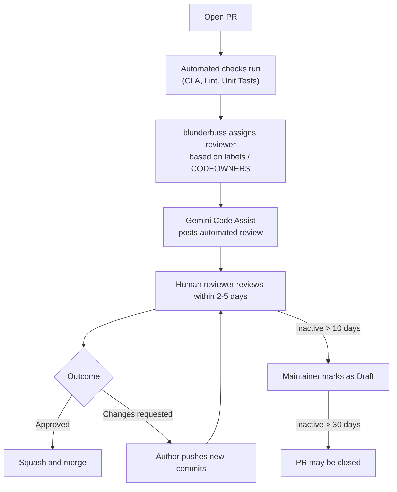
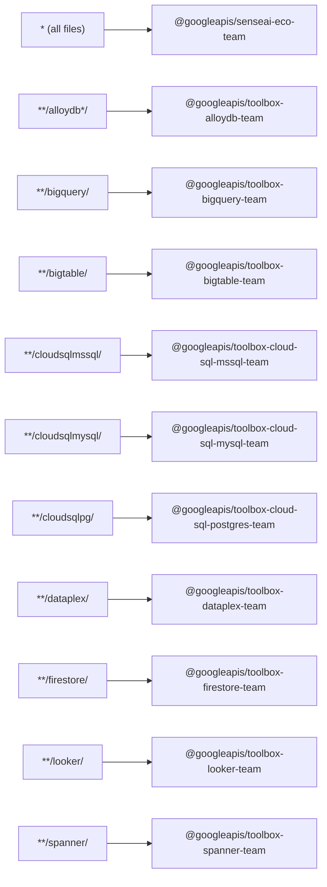
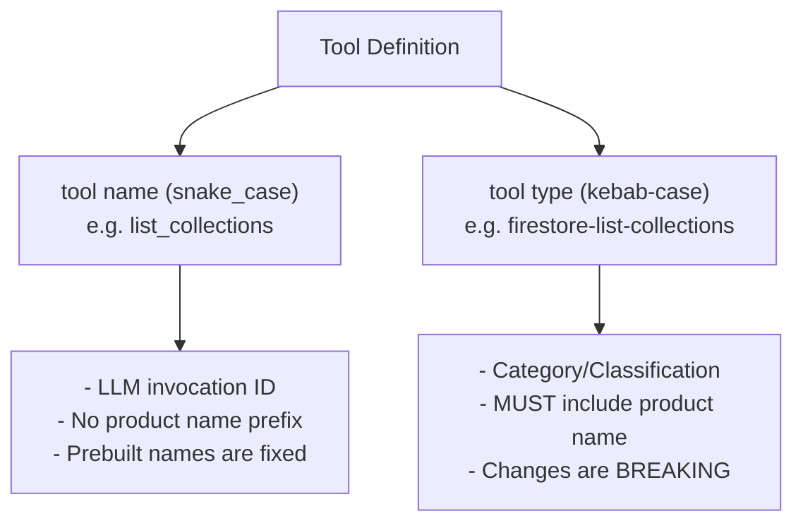
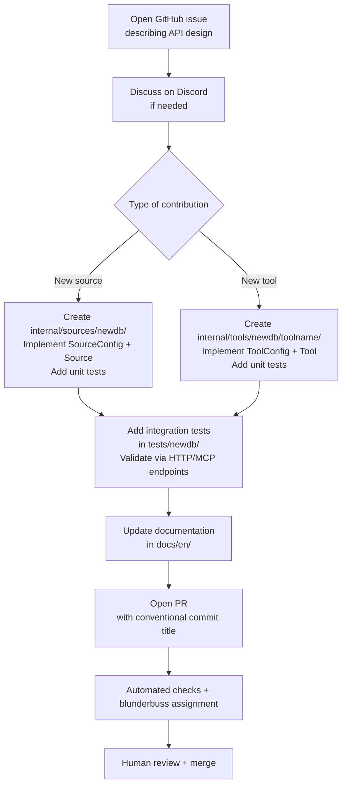

<!-- source: DeepWiki mcp.deepwiki.com · repo googleapis/genai-toolbox · page 11.1 Contribution Guidelines · fetched 2026-10-29 -->

# Contribution Guidelines

Relevant source files

The following files were used as context for generating this wiki page:

- [.gemini/styleguide.md](.gemini/styleguide.md)
- [.github/CODEOWNERS](.github/CODEOWNERS)
- [.github/blunderbuss.yml](.github/blunderbuss.yml)
- [.github/labels.yaml](.github/labels.yaml)
- [.gitignore](.gitignore)
- [AGENTS.md](AGENTS.md)
- [CLAUDE.md](CLAUDE.md)
- [CONTRIBUTING.md](CONTRIBUTING.md)
- [DEVELOPER.md](DEVELOPER.md)
- [GEMINI.md](GEMINI.md)
- [LICENSE](LICENSE)
- [internal/tools/alloydb/alloydbwaitforoperation/alloydbwaitforoperation_test.go](internal/tools/alloydb/alloydbwaitforoperation/alloydbwaitforoperation_test.go)
- [tests/alloydb/alloydb_wait_for_operation_test.go](tests/alloydb/alloydb_wait_for_operation_test.go)

This page covers the process for contributing to the MCP Toolbox for Databases project: signing agreements, formatting commits and pull requests, the code review workflow, automated assignment, and CODEOWNERS structure. For information on setting up a local development environment, see [Development Environment Setup](#10.1). For the technical steps of adding new sources or tools, see [Extending the System](#10.4). For the CI/CD pipeline details, see [CI/CD Pipeline](#10.5).

---

## Before You Begin

### Contributor License Agreement (CLA)

All contributions must be accompanied by a signed [Contributor License Agreement](https://cla.developers.google.com/about). The CLA bot (`CLA/google`) checks each PR automatically. If you or your employer have signed the Google CLA for any other project, no additional signing is required.

### Community Guidelines

This project follows [Google's Open Source Community Guidelines](https://opensource.google/conduct/).

### License Headers

Source files must carry an Apache-2.0 license header. This is enforced by the `license header check` GitHub Action. Allowed copyright holders are `Google LLC` and `Oracle`. The check applies to `.go`, `.yaml`, and `.yml` files.

Sources: [CONTRIBUTING.md:1-25]()

---

## Commit Message Format

This repository uses [Release Please](https://github.com/googleapis/release-please) to automate GitHub releases. It parses git history for [Conventional Commit](https://www.conventionalcommits.org/) messages. All PR titles must conform to this format.

**Format:** `<type>[optional scope]: description`

| `type` | Purpose | Version Change |
|---|---|---|
| `feat` | Adding a new feature | minor |
| `fix` | Fixing a bug or typo (not docs) | patch |
| `test` | Changes to test files | n/a |
| `ci` | Changes to CI/CD configuration | n/a |
| `docs` | Documentation changes | n/a |
| `chore` | Small updates not fitting other types | n/a |
| `refactor` | Source code change with no new tests or coverage loss | n/a |
| `revert` | Reverts a previous commit | n/a |
| `style` | Formatting/whitespace-only changes | n/a |
| `perf` | Improvement of performance metrics | n/a |
| `<type>!` | Any type with a `!` suffix denotes a **breaking change** | major |

**Scope format:** `<scope-resource>/<scope-type>`, e.g. `source/postgres` or `tool/mssql-sql`.

**Examples:**
- `feat(source/postgres): add support for "new-field" field in postgres source` [CONTRIBUTING.md:86-91]()
- `feat(new-db): adding support for new-db source and tool` [CONTRIBUTING.md:115-116]()
- `fix(tool/sql)!: change default parameter value` [GEMINI.md:102-102]()

If a PR spans multiple scopes, separate them with a comma: `feat(source/postgres,source/alloydbpg): ...`. If a PR covers multiple scope types (e.g., adding a new database), the `scope-type` may be omitted. [CONTRIBUTING.md:112-114]()

Sources: [CONTRIBUTING.md:86-122](), [GEMINI.md:92-120]()

---

## Pull Request Guidelines

All submissions, including those from project members, require review via GitHub pull requests. [CONTRIBUTING.md:31-35]()

### Checklist

1. **Keep PRs small.** Smaller PRs enable more thorough review and simpler rollbacks. [CONTRIBUTING.md:64-64]()
2. **Open an issue first** for non-trivial changes. Discuss on [Discord](https://discord.gg/Dmm69peqjh) to ensure no duplicated work. [CONTRIBUTING.md:65-65](), [DEVELOPER.md:168-173]()
3. **Include a PR description** with a concise explanation of the change, its impact, and a summary of the solution. Reference a related issue with `Fixes #<issue-number> 🦕`. [CONTRIBUTING.md:66-66](), [GEMINI.md:149-149]()
4. **Include tests.** All new contributions should include both unit and integration tests. [CONTRIBUTING.md:29-29]()
5. **Clean up test resources.** Properly clean up test instances in code to avoid leaks. [CONTRIBUTING.md:67-68]()

### PR Description Requirements

Every PR must include a description following the repository template:
- **Description:** Concise summary of changes and impact.
- **PR Checklist:** Verification of tests, linter, coverage, and documentation.
- **Issue Reference:** Using `Fixes #<issue_number>`.

Sources: [CONTRIBUTING.md:118-122](), [GEMINI.md:134-150]()

---

## Code Review Process

**Code Review Lifecycle**

### Human Review SLO

| Scenario | Action |
|---|---|
| Reviewer assigned | Within **2–5 days**, reviewer approves or requests changes [CONTRIBUTING.md:38-39]() |
| Changes requested | Reviewer self-assigns PR to track updates [CONTRIBUTING.md:40-41]() |
| Author inactive > 10 days | Maintainers may mark PR as **Draft** [CONTRIBUTING.md:47-49]() |
| PR inactive > 30 days | PR **may be closed** [CONTRIBUTING.md:49-49]() |

Commits are **squashed** on merge. [CONTRIBUTING.md:44-45]()

### Automated Code Review (Gemini Code Assist)

This repository uses **Gemini Code Assist** for immediate feedback. [CONTRIBUTING.md:53-54]() Available commands (post as PR comments):

| Command | Effect |
|---|---|
| `/gemini` | Manually invoke Gemini Code Assist |
| `/gemini review` | Post a code review of the changes |
| `/gemini summary` | Post a summary of the changes |
| `/gemini help` | Overview of available commands |

Sources: [CONTRIBUTING.md:36-61]()

---

## Triggering CI Checks

Maintainers use specific labels and comments to trigger CI/CD pipelines:

| Action | Method |
|---|---|
| Run GitHub Action tests | Add `tests:run` label [.github/labels.yaml:72-74]() |
| Deploy docs preview | Add `docs: deploy-preview` label [.github/labels.yaml:76-78]() |
| Manual Gemini review | Comment `/gemini review` [CONTRIBUTING.md:58-58]() |

Sources: [.github/labels.yaml:72-78](), [CONTRIBUTING.md:55-60]()

---

## CODEOWNERS Structure

The [.github/CODEOWNERS](.github/CODEOWNERS) file maps directory patterns to GitHub teams. All files default to the `@googleapis/senseai-eco-team`. [CODEOWNERS:1-6]()

**Directory to Team Mapping**

Sources: [.github/CODEOWNERS:1-18]()

---

## Blunderbuss Auto-Assignment

The [.github/blunderbuss.yml](.github/blunderbuss.yml) file configures automatic assignment of issues and PRs based on product labels.

**Default assignees:**
- **Issues:** `Yuan325`, `duwenxin99`, `anubhav756`, `twishabansal`, `dishaprakash` [.github/blunderbuss.yml:15-20]()
- **PRs:** `Yuan325`, `duwenxin99` [.github/blunderbuss.yml:62-64]()

**Label-based team assignment:**

| Label | Assigned Team |
|---|---|
| `product: alloydb` | `@googleapis/toolbox-alloydb-team` |
| `product: bigquery` | `@googleapis/toolbox-bigquery-team` |
| `product: bigtable` | `@googleapis/toolbox-bigtable-team` |
| `product: mssql` | `@googleapis/toolbox-cloud-sql-mssql-team` |
| `product: mysql` | `@googleapis/toolbox-cloud-sql-mysql-team` |
| `product: postgres` | `@googleapis/toolbox-cloud-sql-postgres-team` |
| `product: dataplex` | `@googleapis/toolbox-dataplex-team` |
| `product: firestore` | `@googleapis/toolbox-firestore-team` |
| `product: looker` | `@googleapis/toolbox-looker-team` |
| `product: spanner` | `@googleapis/toolbox-spanner-team` |

Sources: [.github/blunderbuss.yml:21-105]()

---

## Tool Naming Conventions

Tool definitions in `tools.yaml` require adherence to specific naming patterns for LLM compatibility.

**Tool Naming Architecture**

| Property | Convention | Breaking Change? |
|---|---|---|
| **Tool Name** | `snake_case`, no product name (e.g., `run_query`) | No for superficial; possibly for parameter changes |
| **Tool Type** | `kebab-case`, includes product name (e.g., `bigquery-sql`) | **Yes, always** |

Sources: [DEVELOPER.md:83-127](), [GEMINI.md:82-88]()

---

## Contribution Workflow for New Features

The following diagram shows the end-to-end workflow when adding a new database source or tool:

Sources: [DEVELOPER.md:166-240](), [CONTRIBUTING.md:69-78](), [GEMINI.md:151-160]()

---

## Automated GitHub Checks

The following checks run automatically on every PR:

| Check | Configuration | Purpose |
|---|---|---|
| `CLA/google` | GitHub App | Verifies CLA signature [CONTRIBUTING.md:9-13]() |
| License header | Action | Verifies Apache-2.0 headers |
| Commit Lint | Release Please | Validates conventional commit format [GEMINI.md:92-96]() |
| Unit tests | GitHub Actions | Runs `go test -race -v ./cmd/... ./internal/...` [GEMINI.md:47-47]() |
| Lint | `golangci-lint` | Enforces code style [GEMINI.md:52-52]() |

Sources: [CONTRIBUTING.md:1-13](), [GEMINI.md:47-52](), [DEVELOPER.md:385-398]()

---

