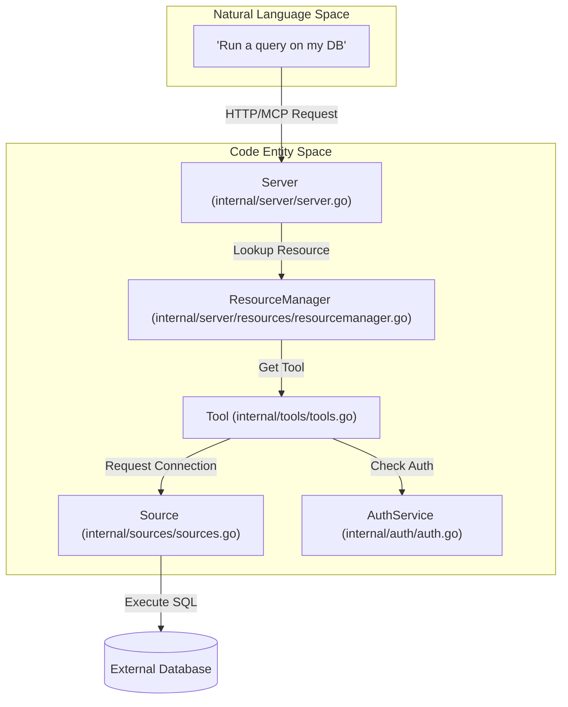
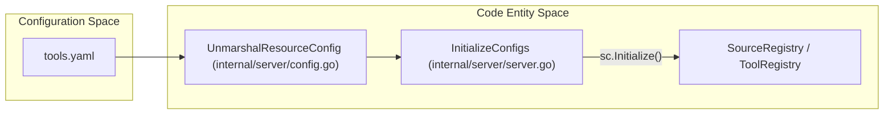

<!-- source: DeepWiki mcp.deepwiki.com · repo googleapis/genai-toolbox · page 12 Glossary · fetched 2026-10-29 -->

# Glossary

Relevant source files

The following files were used as context for generating this wiki page:

- [.ci/integration.cloudbuild.yaml](.ci/integration.cloudbuild.yaml)
- [.gemini/styleguide.md](.gemini/styleguide.md)
- [.gitignore](.gitignore)
- [AGENTS.md](AGENTS.md)
- [CHANGELOG.md](CHANGELOG.md)
- [CLAUDE.md](CLAUDE.md)
- [CONTRIBUTING.md](CONTRIBUTING.md)
- [DEVELOPER.md](DEVELOPER.md)
- [GEMINI.md](GEMINI.md)
- [LICENSE](LICENSE)
- [README.md](README.md)
- [cmd/internal/flags.go](cmd/internal/flags.go)
- [cmd/root.go](cmd/root.go)
- [cmd/root_test.go](cmd/root_test.go)
- [cmd/version.txt](cmd/version.txt)
- [docs/en/documentation/configuration/toolbox_mcp_auth.md](docs/en/documentation/configuration/toolbox_mcp_auth.md)
- [docs/en/documentation/introduction/_index.md](docs/en/documentation/introduction/_index.md)
- [gemini-extension.json](gemini-extension.json)
- [go.mod](go.mod)
- [go.sum](go.sum)
- [internal/prebuiltconfigs/prebuiltconfigs.go](internal/prebuiltconfigs/prebuiltconfigs.go)
- [internal/prebuiltconfigs/prebuiltconfigs_test.go](internal/prebuiltconfigs/prebuiltconfigs_test.go)
- [internal/prebuiltconfigs/tools/bigquery.yaml](internal/prebuiltconfigs/tools/bigquery.yaml)
- [internal/server/api.go](internal/server/api.go)
- [internal/server/api_test.go](internal/server/api_test.go)
- [internal/server/config.go](internal/server/config.go)
- [internal/server/prm.go](internal/server/prm.go)
- [internal/server/server.go](internal/server/server.go)
- [internal/server/server_test.go](internal/server/server_test.go)
- [internal/sources/bigquery/bigquery.go](internal/sources/bigquery/bigquery.go)
- [internal/sources/bigquery/bigquery_test.go](internal/sources/bigquery/bigquery_test.go)
- [internal/sources/sources.go](internal/sources/sources.go)
- [internal/telemetry/telemetry.go](internal/telemetry/telemetry.go)
- [internal/tools/bigquery/bigquerycommon/util.go](internal/tools/bigquery/bigquerycommon/util.go)
- [internal/tools/bigquery/bigqueryconversationalanalytics/bigqueryconversationalanalytics.go](internal/tools/bigquery/bigqueryconversationalanalytics/bigqueryconversationalanalytics.go)
- [internal/tools/bigquery/bigqueryconversationalanalytics/bigqueryconversationalanalytics_test.go](internal/tools/bigquery/bigqueryconversationalanalytics/bigqueryconversationalanalytics_test.go)
- [internal/tools/bigquery/bigqueryexecutesql/bigqueryexecutesql.go](internal/tools/bigquery/bigqueryexecutesql/bigqueryexecutesql.go)
- [internal/tools/bigquery/bigqueryforecast/bigqueryforecast.go](internal/tools/bigquery/bigqueryforecast/bigqueryforecast.go)
- [internal/tools/bigquery/bigquerygetdatasetinfo/bigquerygetdatasetinfo.go](internal/tools/bigquery/bigquerygetdatasetinfo/bigquerygetdatasetinfo.go)
- [internal/tools/bigquery/bigquerygettableinfo/bigquerygettableinfo.go](internal/tools/bigquery/bigquerygettableinfo/bigquerygettableinfo.go)
- [internal/tools/bigquery/bigquerylistdatasetids/bigquerylistdatasetids.go](internal/tools/bigquery/bigquerylistdatasetids/bigquerylistdatasetids.go)
- [internal/tools/bigquery/bigquerylisttableids/bigquerylisttableids.go](internal/tools/bigquery/bigquerylisttableids/bigquerylisttableids.go)
- [internal/tools/bigquery/bigquerysql/bigquerysql.go](internal/tools/bigquery/bigquerysql/bigquerysql.go)
- [internal/tools/looker/lookerconversationalanalytics/lookerconversationalanalytics.go](internal/tools/looker/lookerconversationalanalytics/lookerconversationalanalytics.go)
- [internal/tools/tools.go](internal/tools/tools.go)
- [internal/util/util.go](internal/util/util.go)
- [server.json](server.json)
- [tests/bigquery/bigquery_integration_test.go](tests/bigquery/bigquery_integration_test.go)

This glossary defines codebase-specific terms, jargon, and domain concepts used within the MCP Toolbox. It serves as a technical reference for onboarding engineers to understand the mapping between high-level concepts and their implementation in the Go source code.

## Core Domain Concepts

### MCP (Model Context Protocol)
The open standard that enables AI models to interact with external tools and data sources. The Toolbox implements the MCP server specification, supporting JSON-RPC over both Stdio and SSE transports [internal/server/server.go:67-68](). It supports multiple protocol versions (e.g., `2024-11-05`) to ensure compatibility with various LLM clients [internal/server/server.go:51-62]().

### Source
A configuration and connection factory for an external data system (e.g., PostgreSQL, BigQuery, Looker).
*   **Code Pointer**: `Source` interface [internal/sources/sources.go](), `SourceConfig` interface [internal/sources/sources.go]().
*   **Implementation**: Each database type implements its own `Initialize` method to create connection pools [internal/server/server.go:100-104]().

### Tool
A discrete unit of functionality that can be invoked by an LLM. Tools are often associated with a `Source` to perform operations like executing SQL or fetching metadata.
*   **Code Pointer**: `Tool` interface [internal/tools/tools.go](), `ToolConfig` interface [internal/tools/tools.go]().
*   **Behavior**: Tools define their schema via `Manifest()` and execution logic via `Invoke()` [DEVELOPER.md:155-162]().

### Toolset
A logical grouping of tools, used to expose a subset of functionality to a specific client or agent.
*   **Code Pointer**: `Toolset` struct [internal/tools/tools.go](), `ToolsetConfig` [internal/server/config.go:145]().

### Prompt
A predefined template for LLM interactions, often used to provide context or instructions on how to use specific tools.
*   **Code Pointer**: `Prompt` interface [internal/prompts/prompts.go](), `PromptConfig` [internal/server/config.go:146]().

### AuthService
A component that manages authentication credentials (like OAuth2 tokens or IAM identities) required to access protected sources.
*   **Code Pointer**: `AuthService` interface [internal/auth/auth.go](), `AuthServiceConfig` [internal/server/config.go:142]().
*   **Types**: Includes `google` for IAM/ADC and `generic` for OIDC/OAuth [internal/server/config.go:26-27]().

### EmbeddingModel
A service used to convert text parameters into vector representations, primarily used for semantic search tools.
*   **Code Pointer**: `EmbeddingModel` interface [internal/embeddingmodels/embeddingmodels.go]().
*   **Implementation**: `gemini` is a common provider [internal/server/config.go:29]().

---

## Natural Language to Code Entity Mapping

The following diagrams bridge the gap between conceptual "Natural Language" space (what a user thinks) and "Code Entity" space (what is in the repo).

### System Component Interaction
This diagram shows how a user request flows through the internal Go structures.

**Sources**: [internal/server/server.go:51-62](), [internal/server/resources/resourcemanager.go](), [internal/tools/tools.go](), [internal/sources/sources.go]()

### Resource Initialization Flow
How the `tools.yaml` (Natural Language/Config) is transformed into Go Objects.

**Sources**: [internal/server/config.go:149-160](), [internal/server/server.go:64-73]()

---

## Technical Jargon & Abbreviations

| Term | Definition | Code Pointer |
| :--- | :--- | :--- |
| **ADC** | Application Default Credentials. Used for Google Cloud IAM auth. | [internal/sources/bigquery/bigquery.go:64-67]() |
| **Manifest** | The metadata describing a tool's name, description, and parameters. | [internal/tools/tools.go]() |
| **McpManifest** | MCP-specific metadata extension for tool definitions. | [internal/tools/tools.go]() |
| **PRM** | Protected Resource Metadata. Describes resources for MCP security. | [internal/server/prm.go](), [internal/server/config.go:77-78]() |
| **SSEManager** | Manages Server-Sent Events sessions for MCP over HTTP. | [internal/server/server.go:59](), [internal/server/api.go]() |
| **WriteMode** | Configuration for BigQuery determining if data can be modified. | [internal/sources/bigquery/bigquery.go]() |
| **ToolAnnotations** | Metadata used to categorize tools for specific agent behaviors. | [CHANGELOG.md:34]() |
| **AgentSkill** | A packaged set of tools/prompts ready for Gemini CLI. | [cmd/internal/skills/skills.go]() |

---

## Detailed Component Definitions

### ResourceManager
The central registry within the `Server` that holds the state of all initialized resources. It is responsible for thread-safe access to sources, tools, and toolsets.
*   **Implementation**: `ResourceMgr` field in `Server` [internal/server/server.go:60]().
*   **Key Function**: `SetResources` is called during initialization and dynamic reloading [cmd/root.go:147]().

### ToolConfig & SourceConfig
These are the "Blueprint" structures. They represent the raw YAML data before it is "hydrated" into a functional `Tool` or `Source` object.
*   **Source**: [internal/server/config.go:182-205]()

### AuthorizedInvocation
A pattern where a tool invocation is wrapped with a check against an `AuthService` to ensure the provided `AccessToken` is valid for the operation.
*   **Logic**: Occurs within the `Invoke` handler of the HTTP/MCP API [internal/server/api.go]().

### DynamicReloading
The ability of the Toolbox to watch `tools.yaml` for changes and re-initialize the `ResourceManager` without a process restart.
*   **Implementation**: Controlled by `handleDynamicReload` which uses `fsnotify` [cmd/root.go:134-150]().
*   **Flags**: `--disable-reload` and `--poll-interval` [cmd/root.go:120-121]().

### ToolboxError
A specialized error type that distinguishes between errors an LLM can fix (Agent Errors) and system failures (Server Errors).
*   **Agent Error**: SQL syntax error, missing record. LLM should retry.
*   **Server Error**: Database down, auth failure. Hard stop.
*   **Pointer**: `util.ToolboxError` [DEVELOPER.md:132-140]().

### CompatibleSource
An interface pattern used by tools to verify that the `Source` they are linked to provides the required capabilities (e.g., a `postgres-sql` tool requires a source that implements `RunSQL`).
*   **Pointer**: [internal/tools/tools.go](), [DEVELOPER.md:166-180]()

### PrebuiltConfig
YAML configurations embedded into the binary at compile-time, allowing users to start the server with standard tools for a database without writing a config file.
*   **Pointer**: `internal/prebuiltconfigs` package [internal/prebuiltconfigs/prebuiltconfigs.go]().
*   **Usage**: Triggered by the `--prebuilt` flag [README.md:88]().

---
**Sources**: [internal/server/server.go](), [internal/server/config.go](), [internal/tools/tools.go](), [internal/sources/sources.go](), [cmd/root.go](), [DEVELOPER.md](), [README.md]()