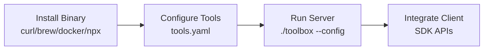
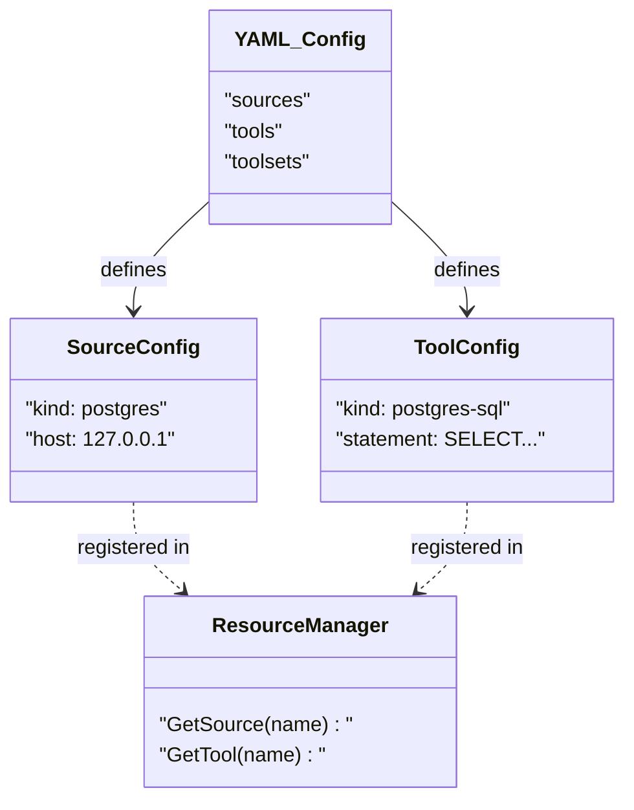
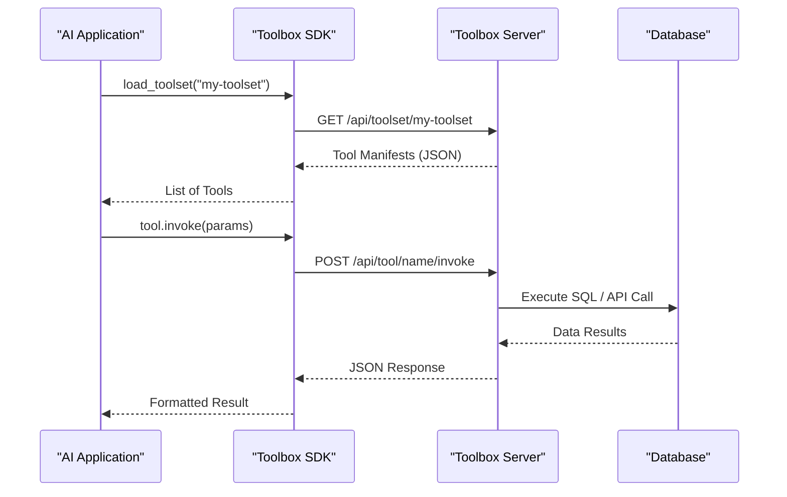

<!-- source: DeepWiki mcp.deepwiki.com · repo googleapis/genai-toolbox · page 2 Getting Started · fetched 2026-10-29 -->

# Getting Started

<details>
<summary>Relevant source files</summary>

The following files were used as context for generating this wiki page:

- [.hugo/assets/scss/_styles_project.scss](.hugo/assets/scss/_styles_project.scss)
- [.hugo/hugo.cloudflare.toml](.hugo/hugo.cloudflare.toml)
- [.hugo/hugo.toml](.hugo/hugo.toml)
- [.hugo/layouts/partials/td/render-heading.html](.hugo/layouts/partials/td/render-heading.html)
- [CHANGELOG.md](CHANGELOG.md)
- [CODE_OF_CONDUCT.md](CODE_OF_CONDUCT.md)
- [README.md](README.md)
- [cmd/version.txt](cmd/version.txt)
- [docs/en/_index.md](docs/en/_index.md)
- [docs/en/documentation/introduction/_index.md](docs/en/documentation/introduction/_index.md)
- [gemini-extension.json](gemini-extension.json)
- [logo.png](logo.png)
- [server.json](server.json)

</details>


This page provides an overview of how to install, configure, and run MCP Toolbox for Databases for the first time. It covers the essential workflow from installation to connecting your first client application.

For detailed installation procedures and platform-specific instructions, see [Installation and Setup](#2.1). For complete working examples in Python, JavaScript, and Go, see [Quick Start Examples](#2.2).

## Overview

MCP Toolbox for Databases operates as a server process that sits between AI applications and database systems. The typical workflow involves four stages:



**Sources:** [README.md:106-120](), [docs/en/documentation/introduction/_index.md:52-97]()

## Installation Methods

The Toolbox server is distributed as a standalone binary for multiple platforms. Current stable version: `1.0.0` ([cmd/version.txt:1]()).

| Method | Use Case | Command |
|--------|----------|---------|
| Binary Download | Production, most flexible | `curl -L -o toolbox https://storage.googleapis.com/mcp-toolbox-for-databases/v1.0.0/linux/amd64/toolbox` |
| Homebrew | macOS/Linux development | `brew install mcp-toolbox` |
| Docker | Containerized deployment | `docker pull us-central1-docker.pkg.dev/database-toolbox/toolbox/toolbox:1.0.0` |
| NPX | Quick experimentation | `npx @toolbox-sdk/server --prebuilt=postgres` |
| Source | Development/customization | `go install github.com/googleapis/mcp-toolbox@v1.0.0` |

For detailed platform-specific instructions and environment setup, see [Installation and Setup](#2.1).

**Sources:** [docs/en/documentation/introduction/_index.md:105-185](), [server.json:17-21]()

## Configuration Workflow

Toolbox operates from YAML configuration files that define database connections (`sources`), operations (`tools`), and groupings (`toolsets`).

### Natural Language to Code Entity Mapping
The following diagram bridges how high-level configuration concepts map to internal code structures.



**Minimal Configuration Example:**

```yaml
sources:
  my-pg-source:
    kind: postgres
    host: 127.0.0.1
    port: 5432
    database: toolbox_db
    user: toolbox_user
    password: ${POSTGRES_PASSWORD}

tools:
  search-hotels:
    kind: postgres-sql
    source: my-pg-source
    description: Search for hotels.
    parameters:
      - name: name
        type: string
    statement: SELECT * FROM hotels WHERE name ILIKE '%' || $1 || '%';

toolsets:
  my-toolset:
    - search-hotels
```

For comprehensive configuration reference including authentication and advanced parameters, see [Configuration](#3).

**Sources:** [README.md:124-143](), [server.json:26-45]()

## Starting the Server

The `toolbox` binary supports two primary modes:

### HTTP Mode (Default)
Start the server to accept HTTP API requests or SSE for MCP:
```bash
./toolbox --config tools.yaml
```
Default endpoint: `http://127.0.0.1:5000/mcp` ([server.json:24-73]()).

### STDIO Mode (MCP Clients)
For MCP-compatible IDE integrations (Cursor, Claude Desktop, Gemini CLI):
```bash
./toolbox --config tools.yaml --stdio
```
This mode accepts JSON-RPC messages on stdin/stdout ([server.json:111-115]()).

### Prebuilt Configurations
Instead of a custom file, use `--prebuilt <name>` to load built-in tools for a specific database:
```bash
./toolbox --prebuilt postgres --stdio
```
Available prebuilt configs cover AlloyDB, BigQuery, Cloud SQL, Spanner, and more ([docs/en/documentation/introduction/_index.md:79-82]()).

**Sources:** [server.json:98-142](), [docs/en/documentation/introduction/_index.md:58-91]()

## Client Integration Patterns

Once the server is running, applications interact with tools via SDKs or direct MCP protocol calls.



### SDK Availability
- **Python**: `toolbox-core`, `toolbox-langchain`, `toolbox-llamaindex` ([README.md:16]())
- **JavaScript/TypeScript**: `@toolbox-sdk/core`, `@toolbox-sdk/adk` ([README.md:17]())
- **Go**: `mcp-toolbox-sdk-go/core` ([README.md:18]())
- **Java**: `mcp-toolbox-sdk-java` ([README.md:19]())

For complete working examples with LangChain, LlamaIndex, and other frameworks, see [Quick Start Examples](#2.2).

**Sources:** [README.md:16-20](), [README.md:48-51]()

## Next Steps

- **[Installation and Setup](#2.1)**: Detailed installation for Binary, Docker, Homebrew, and NPX.
- **[Quick Start Examples](#2.2)**: Concrete code samples for Python, JS, and Go.
- **[Configuration](#3)**: Reference for `tools.yaml`, CLI flags, and Prebuilt configs.
- **[Data Sources](#5)**: Configuration guides for PostgreSQL, BigQuery, MySQL, and others.
- **[Client Integration](#8)**: Framework-specific integration guides and IDE setup.

**Sources:** [README.md:43-55](), [docs/en/documentation/introduction/_index.md:26-40]()

---

