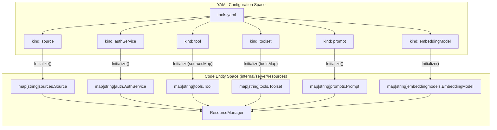
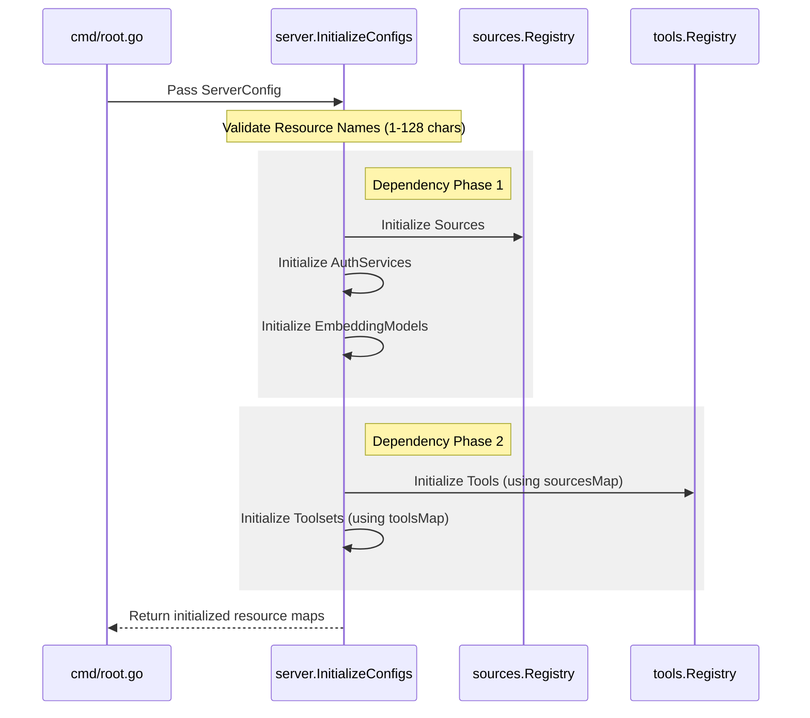

<!-- source: DeepWiki mcp.deepwiki.com · repo googleapis/genai-toolbox · page 3 Configuration · fetched 2026-10-29 -->

# Configuration

Relevant source files

The following files were used as context for generating this wiki page:

- [.ci/integration.cloudbuild.yaml](.ci/integration.cloudbuild.yaml)
- [cmd/internal/config.go](cmd/internal/config.go)
- [cmd/internal/config_test.go](cmd/internal/config_test.go)
- [cmd/internal/flags.go](cmd/internal/flags.go)
- [cmd/internal/imports.go](cmd/internal/imports.go)
- [cmd/root.go](cmd/root.go)
- [cmd/root_test.go](cmd/root_test.go)
- [docs/en/documentation/configuration/toolbox_mcp_auth.md](docs/en/documentation/configuration/toolbox_mcp_auth.md)
- [docs/en/integrations/cloud-sql-pg/tools/vector-assist-apply-spec.md](docs/en/integrations/cloud-sql-pg/tools/vector-assist-apply-spec.md)
- [docs/en/integrations/cloud-sql-pg/tools/vector-assist-define-spec.md](docs/en/integrations/cloud-sql-pg/tools/vector-assist-define-spec.md)
- [docs/en/integrations/cloud-sql-pg/tools/vector-assist-generate-query.md](docs/en/integrations/cloud-sql-pg/tools/vector-assist-generate-query.md)
- [docs/en/integrations/cloud-sql-pg/tools/vector-assist-modify-spec.md](docs/en/integrations/cloud-sql-pg/tools/vector-assist-modify-spec.md)
- [go.mod](go.mod)
- [go.sum](go.sum)
- [internal/prebuiltconfigs/prebuiltconfigs.go](internal/prebuiltconfigs/prebuiltconfigs.go)
- [internal/prebuiltconfigs/prebuiltconfigs_test.go](internal/prebuiltconfigs/prebuiltconfigs_test.go)
- [internal/server/config.go](internal/server/config.go)
- [internal/server/prm.go](internal/server/prm.go)
- [internal/server/server.go](internal/server/server.go)
- [internal/server/server_test.go](internal/server/server_test.go)
- [internal/telemetry/telemetry.go](internal/telemetry/telemetry.go)
- [internal/tools/cloudsqlpg/vectorassistapplyspec/vectorassistapplyspec.go](internal/tools/cloudsqlpg/vectorassistapplyspec/vectorassistapplyspec.go)
- [internal/tools/cloudsqlpg/vectorassistapplyspec/vectorassistapplyspec_test.go](internal/tools/cloudsqlpg/vectorassistapplyspec/vectorassistapplyspec_test.go)
- [internal/tools/cloudsqlpg/vectorassistdefinespec/vectorassistdefinespec.go](internal/tools/cloudsqlpg/vectorassistdefinespec/vectorassistdefinespec.go)

This page provides a high-level overview of the Toolbox configuration system. Configuration defines the data sources, authentication services, embedding models, tools, toolsets, prompts, and promptsets available to client applications.

**Related Pages:**
- [Tools.yaml Format](#3.1) — Complete YAML schema, multi-document streams, and environment variable substitution syntax.
- [Command Line Interface](#3.2) — All CLI flags (`--address`, `--port`, `--config`, etc.) and subcommands.
- [Prebuilt Configurations](#3.3) — Using predefined database configurations via the `--prebuilt` flag.
- [Dynamic Configuration Reloading](#3.4) — How changes are hot-applied without server restart.
- [Toolbox UI](#3.5) — Navigating and testing configurations via the built-in web interface.
- [Pre- and Post-Processing](#3.6) — Intercepting and modifying tool interactions using orchestration hooks.

Sources: [cmd/root.go:96-132](), [internal/server/config.go:36-87]()

## Configuration Methods

The Toolbox server is primarily configured via YAML files. You can provide these files to the CLI using several mutually exclusive flags:

| Method | Flag | Use Case |
|--------|------|----------|
| **Single File** | `--config` (or `--tools-file`) | Standard setup with one YAML configuration. |
| **Multiple Files** | `--tools-files` | Merging several specific YAML files at runtime. |
| **Folder** | `--tools-folder` | Auto-loading all `.yaml` or `.yml` files from a directory. |
| **Prebuilt** | `--prebuilt` | Loading embedded configurations (e.g., `bigquery`, `postgres`). |

The CLI also supports global server settings via flags like `--address`, `--port`, and `--ui`.

Sources: [cmd/root.go:116-123](), [cmd/internal/flags.go:34-110]()

## Configuration Resource Model

Toolbox transforms declarative YAML into a set of runtime resources managed by the `ResourceManager`.

**Key Resource Types:**
- **Sources**: Database connection definitions (e.g., `cloud-sql-postgres`, `bigquery`).
- **AuthServices**: Identity providers for tool parameters (e.g., `google`, `oidc`).
- **Tools**: Executable units of logic, often referencing a `Source`.
- **Toolsets**: Logical groupings of tools for client consumption.
- **Prompts**: Predefined LLM instructions or templates.
- **EmbeddingModels**: Models used for parameter embedding or vector operations.

Sources: [internal/server/config.go:141-147](), [internal/server/resources/resource_manager.go:28-40](), [internal/server/server.go:64-73]()

## Initialization and Validation

When the server starts (or reloads), it executes a strict initialization pipeline to ensure the configuration is valid before accepting requests.

1. **Strict Decoding**: The system uses `yaml.NewDecoder` with strict settings to reject unknown fields in the configuration.
2. **Name Validation**: Resource names must be between 1 and 128 characters and follow alphanumeric/hyphen patterns.
3. **Dependency Resolution**: Tools are initialized after Sources to ensure that `tool.Initialize(sourcesMap)` can resolve its required data connection.
4. **Environment Substitution**: Variables in the format `${VAR}` or `${VAR:default}` are expanded before YAML parsing.

Sources: [internal/server/config.go:159-250](), [internal/server/server.go:89-215](), [cmd/internal/config.go:39-134]()

## Dynamic Reloading

Toolbox features a file watcher that monitors the configuration source. By default, changes to the YAML files are detected and the server re-initializes its `ResourceManager` without dropping active connections.

- **Watcher**: Uses `fsnotify` to detect file system events.
- **Polling**: For environments where file events are unreliable (like NFS), the `--poll-interval` flag can be used.
- **Validation**: Before applying a new config, the server runs `validateReloadEdits` to ensure the new configuration is valid. If validation fails, the server continues running with the previous known-good configuration.

Sources: [cmd/root.go:134-150](), [cmd/root.go:153-190](), [internal/server/server.go:60-61]()

## Prebuilt Configurations

To simplify setup, Toolbox includes embedded YAML configurations for popular databases. When using `--prebuilt <name>`, the server loads a verified configuration from its internal `prebuiltconfigs` package.

**Available Prebuilts include:**
- `alloydb-postgres`, `cloud-sql-postgres`, `postgres`
- `bigquery`, `bigquery-conversational-analytics`
- `mysql`, `cloud-sql-mysql`
- `mssql`, `cloud-sql-mssql`
- `spanner`, `looker`, `firestore`, `sqlite`

Sources: [internal/prebuiltconfigs/prebuiltconfigs.go:24-62](), [internal/prebuiltconfigs/prebuiltconfigs_test.go:24-62]()

---

