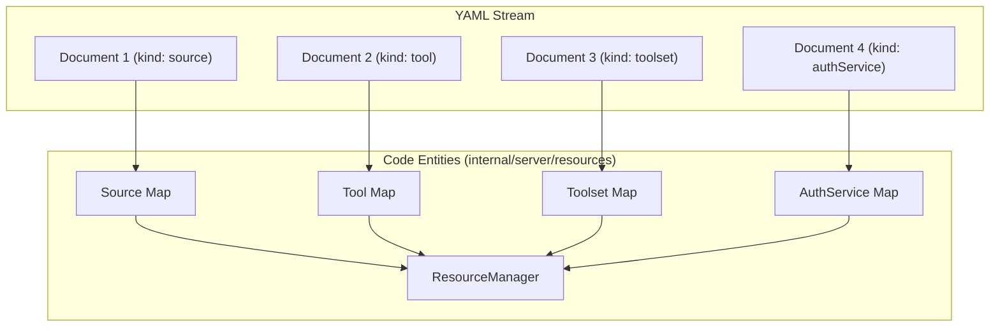
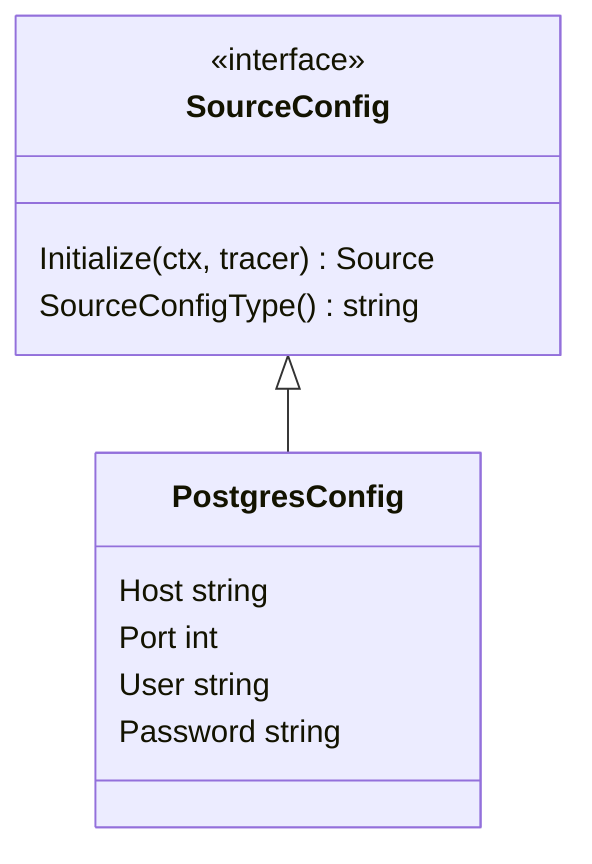
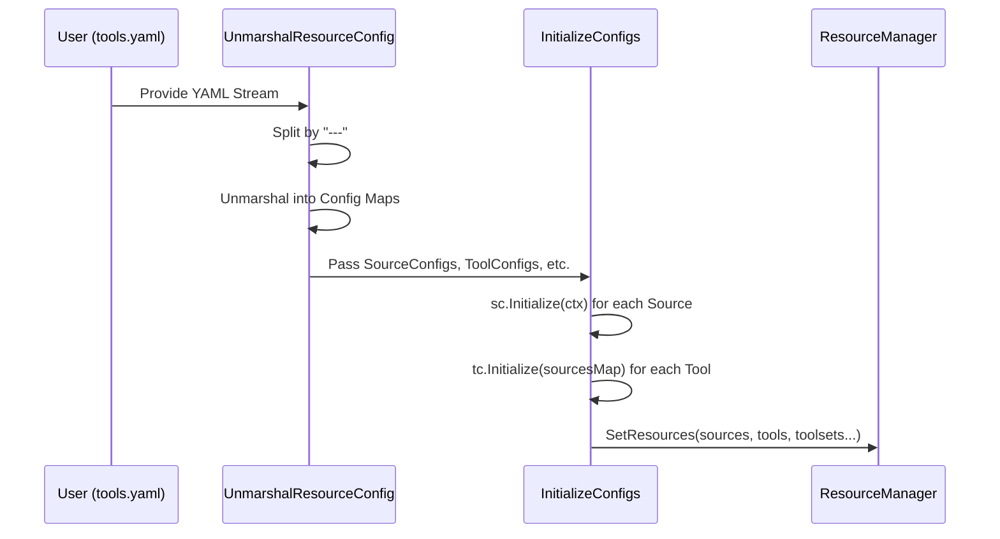

<!-- source: DeepWiki mcp.deepwiki.com · repo googleapis/genai-toolbox · page 3.1 Tools.yaml Format · fetched 2026-10-29 -->

# Tools.yaml Format

<details>
<summary>Relevant source files</summary>

The following files were used as context for generating this wiki page:

- [.ci/integration.cloudbuild.yaml](.ci/integration.cloudbuild.yaml)
- [.gemini/styleguide.md](.gemini/styleguide.md)
- [.gitignore](.gitignore)
- [AGENTS.md](AGENTS.md)
- [CLAUDE.md](CLAUDE.md)
- [CONTRIBUTING.md](CONTRIBUTING.md)
- [DEVELOPER.md](DEVELOPER.md)
- [GEMINI.md](GEMINI.md)
- [LICENSE](LICENSE)
- [cmd/internal/config.go](cmd/internal/config.go)
- [cmd/internal/config_test.go](cmd/internal/config_test.go)
- [cmd/internal/flags.go](cmd/internal/flags.go)
- [cmd/internal/imports.go](cmd/internal/imports.go)
- [cmd/root.go](cmd/root.go)
- [cmd/root_test.go](cmd/root_test.go)
- [docs/en/documentation/configuration/toolbox_mcp_auth.md](docs/en/documentation/configuration/toolbox_mcp_auth.md)
- [docs/en/integrations/cloud-sql-pg/tools/vector-assist-apply-spec.md](docs/en/integrations/cloud-sql-pg/tools/vector-assist-apply-spec.md)
- [docs/en/integrations/cloud-sql-pg/tools/vector-assist-define-spec.md](docs/en/integrations/cloud-sql-pg/tools/vector-assist-define-spec.md)
- [docs/en/integrations/cloud-sql-pg/tools/vector-assist-generate-query.md](docs/en/integrations/cloud-sql-pg/tools/vector-assist-generate-query.md)
- [docs/en/integrations/cloud-sql-pg/tools/vector-assist-modify-spec.md](docs/en/integrations/cloud-sql-pg/tools/vector-assist-modify-spec.md)
- [go.mod](go.mod)
- [go.sum](go.sum)
- [internal/prebuiltconfigs/prebuiltconfigs.go](internal/prebuiltconfigs/prebuiltconfigs.go)
- [internal/prebuiltconfigs/prebuiltconfigs_test.go](internal/prebuiltconfigs/prebuiltconfigs_test.go)
- [internal/server/config.go](internal/server/config.go)
- [internal/server/prm.go](internal/server/prm.go)
- [internal/server/server.go](internal/server/server.go)
- [internal/server/server_test.go](internal/server/server_test.go)
- [internal/telemetry/telemetry.go](internal/telemetry/telemetry.go)
- [internal/tools/cloudsqlpg/vectorassistapplyspec/vectorassistapplyspec.go](internal/tools/cloudsqlpg/vectorassistapplyspec/vectorassistapplyspec.go)
- [internal/tools/cloudsqlpg/vectorassistapplyspec/vectorassistapplyspec_test.go](internal/tools/cloudsqlpg/vectorassistapplyspec/vectorassistapplyspec_test.go)
- [internal/tools/cloudsqlpg/vectorassistdefinespec/vectorassistdefinespec.go](internal/tools/cloudsqlpg/vectorassistdefinespec/vectorassistdefinespec.go)

</details>


This document provides a detailed technical specification of the `tools.yaml` configuration file format used by MCP Toolbox for Databases. The `tools.yaml` file is the primary control plane for defining data sources, tools, toolsets, authentication services, and prompts that the Toolbox server exposes.

## Overall Structure and Kind Blocks

The `tools.yaml` format uses a Kubernetes-like `kind` and `name` structure. It supports multi-document YAML streams separated by `---`, allowing you to organize your configuration into logical blocks.



**Resource Mapping**

| Kind | Code Interface / Struct | Purpose |
| :--- | :--- | :--- |
| `source` | `sources.Source` [internal/server/config.go:181]() | Defines database connection parameters. |
| `tool` | `tools.Tool` [internal/server/config.go:199]() | Defines an executable action (e.g., SQL query). |
| `toolset` | `tools.Toolset` [internal/server/config.go:208]() | Groups tools for client-side loading. |
| `authService` | `auth.AuthService` [internal/server/config.go:190]() | Configures OAuth2 or OIDC providers. |
| `prompt` | `prompts.Prompt` [internal/server/config.go:217]() | Defines reusable LLM system prompts. |
| `embeddingModel` | `embeddingmodels.EmbeddingModel` [internal/server/config.go:226]() | Configures models for parameter embedding. |

Sources: [internal/server/config.go:149-236](), [internal/server/server.go:64-72]()

## Environment Variable Substitution

The configuration supports dynamic environment variable substitution to keep sensitive credentials out of version control. Substitution occurs at configuration load time.

*   **Syntax**: `${VAR_NAME}` or `${VAR_NAME:default_value}`.
*   **Implementation**: The `UnmarshalResourceConfig` function handles the raw YAML stream before initializing specific resource types [internal/server/config.go:149-160]().

```yaml
sources:
  my-db:
    kind: postgres
    host: ${DB_HOST:localhost}
    password: ${DB_PASSWORD}
```

## Field Semantics by Kind

### Source Configuration
Sources define how to connect to a database. Every source must have a `kind` that matches a registered source type (e.g., `postgres`, `mysql`, `bigquery`, `alloydb-postgres`).



Sources: [internal/server/server.go:91-110](), [internal/server/config.go:182-189]()

### Tool Configuration
Tools reference a `source` and define the logic to be executed.
*   **`source`**: Must match the `name` of a defined `kind: source`.
*   **`parameters`**: Defines the input schema for the LLM.
*   **`statement`**: For SQL tools, the query to execute.

Sources: [internal/server/server.go:175-194](), [internal/server/config.go:199-207]()

### Toolset Configuration
Toolsets are simple lists of tool names.
*   **Default Behavior**: If no toolsets are defined, the server automatically creates a default toolset named `""` (empty string) containing all initialized tools [internal/server/server.go:202-209]().

Sources: [internal/server/server.go:211-232](), [internal/server/config.go:208-216]()

## Data Flow and Initialization

The initialization process follows a strict dependency order:
1.  **Sources & AuthServices**: Initialized first as they have no dependencies.
2.  **Tools**: Initialized next, as they require a valid `SourceMap` to bind to.
3.  **Toolsets**: Initialized last, grouping the bound tools.



Sources: [internal/server/server.go:64-245](), [internal/server/config.go:149-168]()

## Multi-Document YAML and Dynamic Reloading

The Toolbox supports loading configuration from multiple sources simultaneously using the `--config` (or deprecated `--tools-file`) flag.

### Dynamic Reloading Implementation
When a watched file changes, the `handleDynamicReload` function is triggered:
1.  It calls `validateReloadEdits` to parse the new file [cmd/root.go:134-140]().
2.  It runs `server.InitializeConfigs` on the new data to ensure the new configuration is valid before applying it [cmd/root.go:182]().
3.  If valid, it calls `s.ResourceMgr.SetResources` to hot-swap the active tools and sources without restarting the server [cmd/root.go:147]().

Sources: [cmd/root.go:134-150](), [cmd/root.go:153-190](), [internal/server/resources/resources.go:73-81]()

## Prebuilt Configurations
Prebuilt tools (enabled via `--prebuilt`) are embedded YAML files that are merged with the user's `tools.yaml` at runtime.
*   **Conflict Resolution**: User-defined resources in `tools.yaml` take precedence over prebuilt configurations of the same name.
*   **Loading**: Prebuilt YAMLs are loaded via `loadPrebuiltToolYAMLs` [internal/prebuiltconfigs/prebuiltconfigs.go]().

Sources: [internal/prebuiltconfigs/prebuiltconfigs_test.go:76-80](), [internal/server/config.go:149-155]()

---

