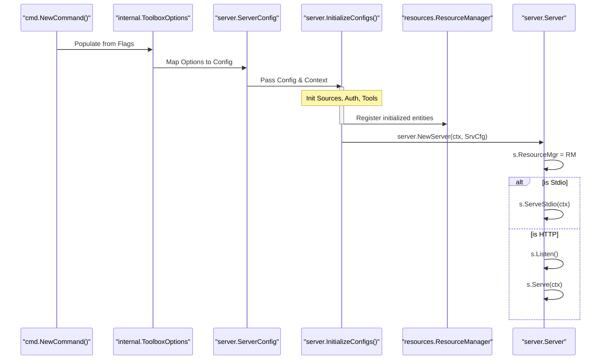
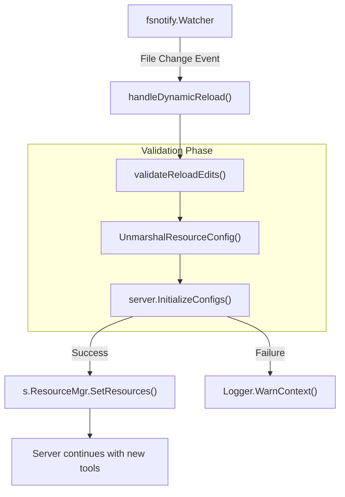
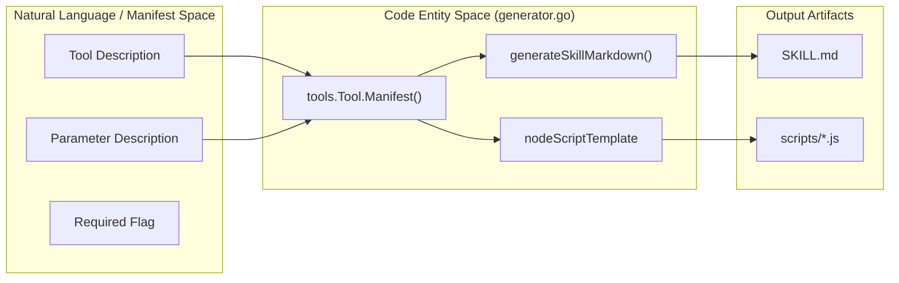

<!-- source: DeepWiki mcp.deepwiki.com · repo googleapis/genai-toolbox · page 3.2 Command Line Interface · fetched 2026-10-29 -->

# Command Line Interface

Relevant source files

The following files were used as context for generating this wiki page:

- [.ci/integration.cloudbuild.yaml](.ci/integration.cloudbuild.yaml)
- [cmd/internal/flags.go](cmd/internal/flags.go)
- [cmd/internal/invoke/command.go](cmd/internal/invoke/command.go)
- [cmd/internal/invoke/command_test.go](cmd/internal/invoke/command_test.go)
- [cmd/internal/options.go](cmd/internal/options.go)
- [cmd/internal/options_test.go](cmd/internal/options_test.go)
- [cmd/internal/skills/command.go](cmd/internal/skills/command.go)
- [cmd/internal/skills/command_test.go](cmd/internal/skills/command_test.go)
- [cmd/internal/skills/generator.go](cmd/internal/skills/generator.go)
- [cmd/internal/skills/generator_test.go](cmd/internal/skills/generator_test.go)
- [cmd/root.go](cmd/root.go)
- [cmd/root_test.go](cmd/root_test.go)
- [docs/en/documentation/configuration/skills/_index.md](docs/en/documentation/configuration/skills/_index.md)
- [docs/en/documentation/configuration/toolbox_mcp_auth.md](docs/en/documentation/configuration/toolbox_mcp_auth.md)
- [docs/en/reference/cli.md](docs/en/reference/cli.md)
- [go.mod](go.mod)
- [go.sum](go.sum)
- [internal/prebuiltconfigs/prebuiltconfigs.go](internal/prebuiltconfigs/prebuiltconfigs.go)
- [internal/prebuiltconfigs/prebuiltconfigs_test.go](internal/prebuiltconfigs/prebuiltconfigs_test.go)
- [internal/server/config.go](internal/server/config.go)
- [internal/server/prm.go](internal/server/prm.go)
- [internal/server/server.go](internal/server/server.go)
- [internal/server/server_test.go](internal/server/server_test.go)
- [internal/telemetry/telemetry.go](internal/telemetry/telemetry.go)

The Command Line Interface (CLI) for the `mcp-toolbox` is the primary entry point for starting and configuring the server. It handles flag parsing, configuration loading, resource initialization, and operational modes such as HTTP or MCP Stdio.

## Overview

The CLI is implemented using the `spf13/cobra` library [cmd/root.go:47](). The entry point is the `Execute()` function [cmd/root.go:85-93](), which initializes `ToolboxOptions` and runs the root command. The CLI provides a primary `toolbox` command and several subcommands for specific tasks like tool invocation and skill generation.

Key responsibilities of the CLI include:
- Parsing command-line flags into the `ServerConfig` struct [internal/server/config.go:36-87]().
- Loading tool configurations from files, folders, or prebuilt definitions [cmd/root.go:118-119]().
- Initializing the `server.Server` instance [internal/server/server.go:51-62]().
- Managing the server lifecycle, including graceful shutdown [cmd/root.go:24-29]().
- Supporting dynamic configuration reloading via file watching [cmd/root.go:134-150]().

Sources: [cmd/root.go:85-132](), [internal/server/config.go:36-87]()

## Subcommands

The CLI follows a modular structure where specific functionalities are delegated to subcommands.

| Subcommand | Implementation Package | Purpose |
| :--- | :--- | :--- |
| `serve` | `cmd/internal/serve` | Starts the Toolbox server (default behavior) [cmd/root.go:128](). |
| `invoke` | `cmd/internal/invoke` | Directly executes a specific tool from the CLI [cmd/root.go:126](). |
| `skills-generate` | `cmd/internal/skills` | Generates Agent Skill packages from toolsets [cmd/root.go:127](). |
| `migrate` | `cmd/internal/migrate` | Handles configuration migrations [cmd/root.go:129](). |

### Tool Invocation (`invoke`)
The `invoke` subcommand allows users to test tools directly without an MCP client. It takes a tool name and optional JSON parameters [docs/en/reference/cli.md:37-55]().

### Skill Generation (`skills-generate`)
This command converts toolsets into Node.js-based "Agent Skills" [cmd/internal/skills/generator.go:74-118](). It generates a `SKILL.md` file and individual `.js` scripts for each tool, supporting both `binary` and `npx` invocation modes [docs/en/reference/cli.md:57-78]().

Sources: [cmd/root.go:125-132](), [docs/en/reference/cli.md:35-78]()

## Configuration Flags

The CLI uses flags to populate the `ServerConfig` used during initialization.

### Server & Connectivity
- `--address` (`-a`): The interface address to listen on (default: `127.0.0.1`) [docs/en/reference/cli.md:13]().
- `--port` (`-p`): The port for the HTTP/SSE server (default: `5000`) [docs/en/reference/cli.md:19]().
- `--stdio`: Switches the server to MCP Stdio mode, communicating via stdin/stdout [docs/en/reference/cli.md:21]().
- `--ui`: Enables the built-in web UI for tool exploration [docs/en/reference/cli.md:28]().

### Configuration Loading
The CLI supports three primary ways to load custom YAML configurations, which are mutually exclusive [docs/en/reference/cli.md:25-27]():
- `--config`: Path to a single configuration file.
- `--configs`: Comma-separated list of multiple configuration files to be merged.
- `--config-folder`: A directory containing `.yaml` or `.yml` files to be merged.

Additionally, the `--prebuilt` flag allows loading of bundled configurations for specific sources like `bigquery`, `postgres`, or `alloydb-postgres` [docs/en/reference/cli.md:20]().

### Dynamic Reloading
- `--disable-reload`: Disables the automatic reloading of configuration files when changes are detected [cmd/root.go:120]().
- `--poll-interval`: Sets the frequency (in seconds) for polling file changes, useful for network file systems where events might not trigger [cmd/root.go:121]().

### Telemetry & Logging
- `--log-level`: Sets the minimum log level (`DEBUG`, `INFO`, `WARN`, `ERROR`) [internal/server/config.go:126-134]().
- `--logging-format`: Choice between `standard` or `JSON` [internal/server/config.go:100-108]().
- `--telemetry-gcp`: Enables exporting traces/metrics to Google Cloud [docs/en/reference/cli.md:22]().
- `--telemetry-otlp`: Exports telemetry to an OTLP-compatible collector [docs/en/reference/cli.md:23]().

Sources: [docs/en/reference/cli.md:11-33](), [internal/server/config.go:89-139](), [cmd/root.go:115-122]()

## Data Flow: CLI to Server Initialization

The following diagram illustrates how the CLI command and flags are transformed into a running `Server` instance with initialized resources.

**CLI Initialization Sequence**

Sources: [cmd/root.go:96-132](), [internal/server/server.go:64-73](), [internal/server/server.go:80-88]()

## Implementation Detail: Dynamic Reloading

When dynamic reloading is enabled, the CLI utilizes `fsnotify` to watch configuration files [cmd/root.go:32](). If a change is detected, the server does not restart; instead, it re-validates the new configuration and updates the `ResourceManager` in-place.

**Dynamic Reload Logic**

The `validateReloadEdits` function ensures that the new configuration is valid (e.g., database connections can be established, tool parameters are correct) before swapping the active resources [cmd/root.go:153-190]().

Sources: [cmd/root.go:134-150](), [cmd/root.go:153-190](), [internal/server/server_test.go:119-206]()

## Skill Generation Logic

The `skills-generate` command uses internal templates to produce executable packages. It maps `Tool` manifests to Node.js script parameters.

**Natural Language to Skill Package Mapping**

The `nodeScriptTemplate` [cmd/internal/skills/generator.go:120-240]() handles environment variable merging from various sources like `.env` files (for Gemini CLI) or `CLAUDE_PLUGIN_OPTION_` (for Claude Code).

Sources: [cmd/internal/skills/generator.go:74-118](), [cmd/internal/skills/generator.go:120-240]()

---

