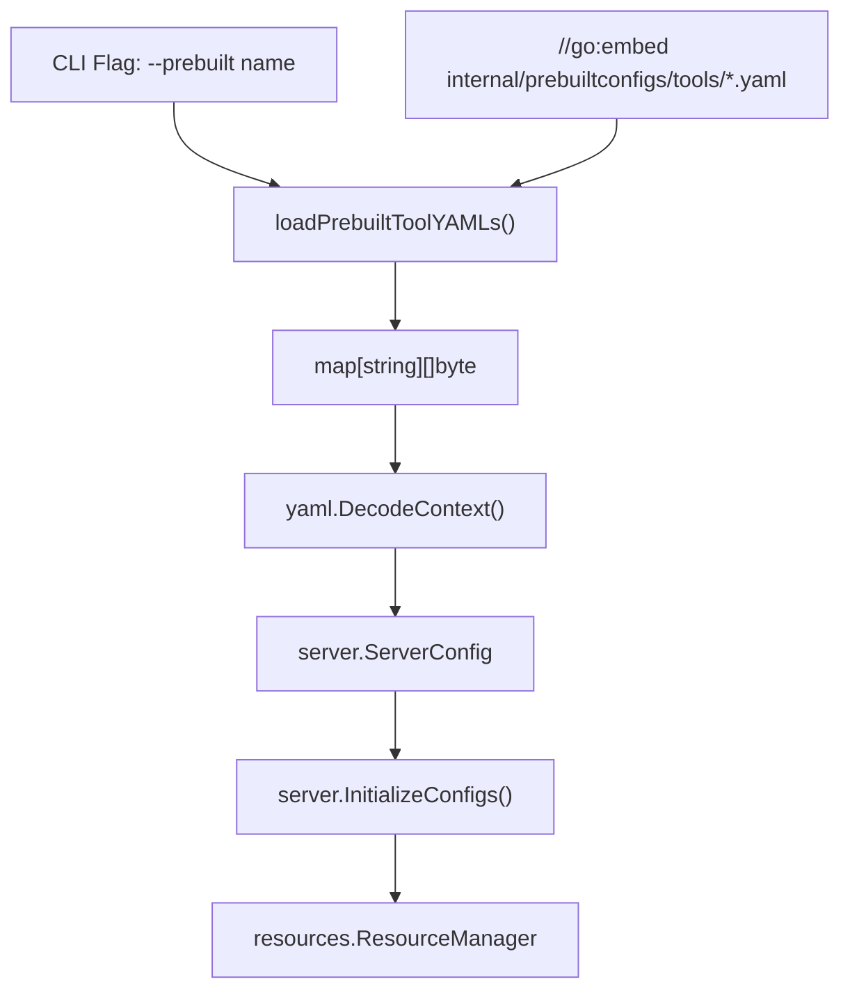
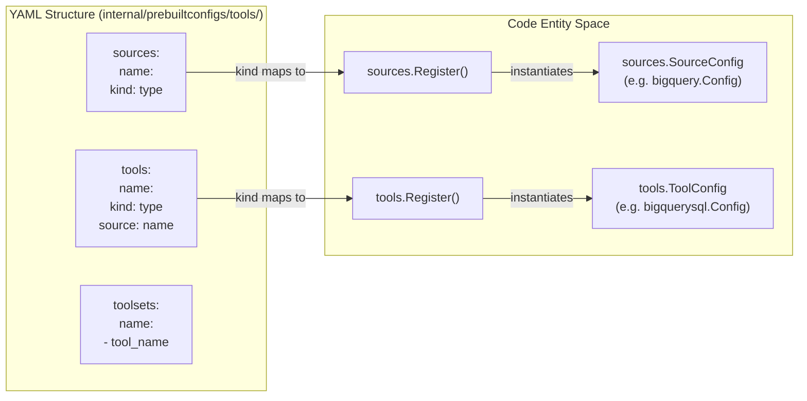

<!-- source: DeepWiki mcp.deepwiki.com · repo googleapis/genai-toolbox · page 3.3 Prebuilt Configurations · fetched 2026-10-29 -->

# Prebuilt Configurations

<details>
<summary>Relevant source files</summary>

The following files were used as context for generating this wiki page:

- [internal/prebuiltconfigs/tools/alloydb-postgres.yaml](internal/prebuiltconfigs/tools/alloydb-postgres.yaml)
- [internal/prebuiltconfigs/tools/bigquery.yaml](internal/prebuiltconfigs/tools/bigquery.yaml)
- [internal/prebuiltconfigs/tools/cloud-sql-mssql.yaml](internal/prebuiltconfigs/tools/cloud-sql-mssql.yaml)
- [internal/prebuiltconfigs/tools/cloud-sql-mysql.yaml](internal/prebuiltconfigs/tools/cloud-sql-mysql.yaml)
- [internal/prebuiltconfigs/tools/cloud-sql-postgres.yaml](internal/prebuiltconfigs/tools/cloud-sql-postgres.yaml)
- [internal/prebuiltconfigs/tools/mssql.yaml](internal/prebuiltconfigs/tools/mssql.yaml)
- [internal/prebuiltconfigs/tools/mysql.yaml](internal/prebuiltconfigs/tools/mysql.yaml)
- [internal/prebuiltconfigs/tools/postgres.yaml](internal/prebuiltconfigs/tools/postgres.yaml)
- [internal/prebuiltconfigs/tools/spanner-postgres.yaml](internal/prebuiltconfigs/tools/spanner-postgres.yaml)
- [internal/prebuiltconfigs/tools/spanner.yaml](internal/prebuiltconfigs/tools/spanner.yaml)
- [internal/sources/bigquery/bigquery.go](internal/sources/bigquery/bigquery.go)
- [internal/sources/bigquery/bigquery_test.go](internal/sources/bigquery/bigquery_test.go)
- [internal/sources/cloudsqlmssql/cloud_sql_mssql.go](internal/sources/cloudsqlmssql/cloud_sql_mssql.go)
- [internal/sources/cloudsqlmssql/cloud_sql_mssql_test.go](internal/sources/cloudsqlmssql/cloud_sql_mssql_test.go)
- [internal/sources/cloudsqlmysql/cloud_sql_mysql.go](internal/sources/cloudsqlmysql/cloud_sql_mysql.go)
- [internal/sources/cloudsqlmysql/cloud_sql_mysql_test.go](internal/sources/cloudsqlmysql/cloud_sql_mysql_test.go)
- [internal/sources/mssql/mssql.go](internal/sources/mssql/mssql.go)
- [internal/sources/mssql/mssql_test.go](internal/sources/mssql/mssql_test.go)
- [internal/sources/mysql/mysql.go](internal/sources/mysql/mysql.go)
- [internal/sources/mysql/mysql_test.go](internal/sources/mysql/mysql_test.go)
- [internal/tools/bigquery/bigquerycommon/util.go](internal/tools/bigquery/bigquerycommon/util.go)
- [internal/tools/bigquery/bigqueryconversationalanalytics/bigqueryconversationalanalytics.go](internal/tools/bigquery/bigqueryconversationalanalytics/bigqueryconversationalanalytics.go)
- [internal/tools/bigquery/bigqueryconversationalanalytics/bigqueryconversationalanalytics_test.go](internal/tools/bigquery/bigqueryconversationalanalytics/bigqueryconversationalanalytics_test.go)
- [internal/tools/bigquery/bigqueryexecutesql/bigqueryexecutesql.go](internal/tools/bigquery/bigqueryexecutesql/bigqueryexecutesql.go)
- [internal/tools/bigquery/bigqueryforecast/bigqueryforecast.go](internal/tools/bigquery/bigqueryforecast/bigqueryforecast.go)
- [internal/tools/bigquery/bigquerygetdatasetinfo/bigquerygetdatasetinfo.go](internal/tools/bigquery/bigquerygetdatasetinfo/bigquerygetdatasetinfo.go)
- [internal/tools/bigquery/bigquerygettableinfo/bigquerygettableinfo.go](internal/tools/bigquery/bigquerygettableinfo/bigquerygettableinfo.go)
- [internal/tools/bigquery/bigquerylistdatasetids/bigquerylistdatasetids.go](internal/tools/bigquery/bigquerylistdatasetids/bigquerylistdatasetids.go)
- [internal/tools/bigquery/bigquerylisttableids/bigquerylisttableids.go](internal/tools/bigquery/bigquerylisttableids/bigquerylisttableids.go)
- [internal/tools/bigquery/bigquerysql/bigquerysql.go](internal/tools/bigquery/bigquerysql/bigquerysql.go)
- [tests/bigquery/bigquery_integration_test.go](tests/bigquery/bigquery_integration_test.go)

</details>


This page covers the prebuilt configuration system: how YAML tool and source configurations are embedded into the Toolbox binary at compile time, how to activate them with the `--prebuilt` CLI flag, the available configurations, and how they interact with user-supplied configuration files.

---

## What Prebuilt Configurations Are

A prebuilt configuration is a YAML file stored in `internal/prebuiltconfigs/tools/` that defines a complete source and tool bundle for a specific database or cloud service. These YAML files are compiled directly into the binary via Go's `//go:embed` directive. Activating a prebuilt config with `--prebuilt` is equivalent to providing a pre-written `tools.yaml` for that service, without needing to author any YAML yourself.

Configuration via environment variables is still required to supply connection credentials (e.g., `POSTGRES_USER`, `BIGQUERY_PROJECT`).

---

## Compile-Time Embedding and Load Flow

All YAML files in `internal/prebuiltconfigs/tools/` are embedded at compile time. The `prebuiltconfigs` package manages these embedded assets and provides them to the server during initialization.

**Figure 1: Prebuilt Config Data Flow**



Sources: [internal/prebuiltconfigs/prebuiltconfigs_test.go:23-59](), [internal/server/server.go:57-103]()

---

## The `--prebuilt` Flag

The `--prebuilt` flag accepts one or more prebuilt config names. These names correspond to the filenames in the `internal/prebuiltconfigs/tools/` directory (minus the `.yaml` extension).

| Syntax | Example |
|---|---|
| Single value | `--prebuilt postgres` |
| Repeated flag | `--prebuilt postgres --prebuilt bigquery` |
| Comma-separated | `--prebuilt postgres,bigquery` |

**Example: Starting with Cloud SQL Postgres**
```bash
CLOUD_SQL_POSTGRES_PROJECT=my-project \
CLOUD_SQL_POSTGRES_REGION=us-central1 \
CLOUD_SQL_POSTGRES_INSTANCE=my-instance \
CLOUD_SQL_POSTGRES_DATABASE=mydb \
toolbox --prebuilt cloud-sql-postgres
```

Sources: [internal/prebuiltconfigs/tools/cloud-sql-postgres.yaml:15-25](), [internal/prebuiltconfigs/tools/postgres.yaml:15-23]()

---

## Prebuilt Config YAML Format

Prebuilt YAML files use a **consolidated map format** rather than the multi-document stream format used in custom `tools.yaml` files. They organize resources under top-level `sources:`, `tools:`, and `toolsets:` keys.

**Figure 2: Prebuilt YAML Structure to Code Entity Mapping**



Sources: [internal/prebuiltconfigs/tools/bigquery.yaml:15-64](), [internal/sources/bigquery/bigquery.go:67-71](), [internal/tools/bigquery/bigquerysql/bigquerysql.go:38-42]()

### Comparison of Formats

| Feature | Prebuilt YAML | Custom `tools.yaml` |
|---|---|---|
| **Structure** | Map-based (`sources:`, `tools:`) | Document stream (`---`) |
| **Type Identifier** | `kind:` | `type:` |
| **Resource Name** | Map Key | `name:` field |
| **Env Substitution** | `${VAR:default}` | `${VAR:default}` |

Sources: [internal/prebuiltconfigs/tools/postgres.yaml:15-30](), [internal/prebuiltconfigs/tools/mysql.yaml:15-33]()

---

## Available Prebuilt Configurations

The following table lists common prebuilt configurations and their primary environment variables.

| `--prebuilt` Value | Database / Service | Primary Environment Variables |
|---|---|---|
| `alloydb-postgres` | AlloyDB | `ALLOYDB_POSTGRES_PROJECT`, `ALLOYDB_POSTGRES_INSTANCE`, `ALLOYDB_POSTGRES_DATABASE` |
| `bigquery` | BigQuery | `BIGQUERY_PROJECT`, `BIGQUERY_LOCATION` |
| `cloud-sql-postgres`| Cloud SQL Postgres | `CLOUD_SQL_POSTGRES_PROJECT`, `CLOUD_SQL_POSTGRES_INSTANCE` |
| `cloud-sql-mysql` | Cloud SQL MySQL | `CLOUD_SQL_MYSQL_PROJECT`, `CLOUD_SQL_MYSQL_INSTANCE` |
| `postgres` | PostgreSQL | `POSTGRES_HOST`, `POSTGRES_PORT`, `POSTGRES_DATABASE` |
| `mysql` | MySQL | `MYSQL_HOST`, `MYSQL_PORT`, `MYSQL_DATABASE` |
| `spanner` | Cloud Spanner | `SPANNER_PROJECT`, `SPANNER_INSTANCE`, `SPANNER_DATABASE` |

Sources: [internal/prebuiltconfigs/tools/alloydb-postgres.yaml:16-25](), [internal/prebuiltconfigs/tools/bigquery.yaml:16-23](), [internal/prebuiltconfigs/tools/cloud-sql-mysql.yaml:16-24]()

---

## Conflict Detection and Custom Overrides

When using `--prebuilt`, the Toolbox server merges the embedded configurations with any custom configurations provided via `--tools-file`.

### Name Conflicts
Each prebuilt configuration defines specific names for its sources (e.g., `postgresql-source` in `postgres.yaml` or `bigquery-source` in `bigquery.yaml`). If a custom configuration defines a source or tool with the same name as one in a prebuilt config, the server will detect a conflict during the registration phase.

**Conflict Resolution Strategy:**
1. **Unique Naming**: Ensure custom tool/source names do not overlap with prebuilt names.
2. **Explicit Reference**: Custom tools can reference sources defined in prebuilt configs by using the prebuilt source name in their `source:` field.

### Tool Compatibility
Tools within prebuilt configs are often tied to specific source types via the `compatibleSource` interface. For example, BigQuery tools require a source that implements the BigQuery-specific methods defined in the `bigqueryexecutesql` package.

Sources: [internal/tools/bigquery/bigqueryexecutesql/bigqueryexecutesql.go:52-62](), [internal/tools/bigquery/bigquerysql/bigquerysql.go:53-59]()

---

## Dynamic Reloading and Prebuilt Configs

While custom YAML files can be monitored for changes (see [Dynamic Configuration Reloading](#3.4)), prebuilt configurations are **immutable** at runtime. Because they are embedded in the binary, changes to the underlying YAML files in the source code require a recompilation of the Toolbox.

If only `--prebuilt` flags are used (without `--tools-file`), the file watcher is typically disabled as there are no external files to monitor.

Sources: [internal/server/server.go:57-103]()

---

