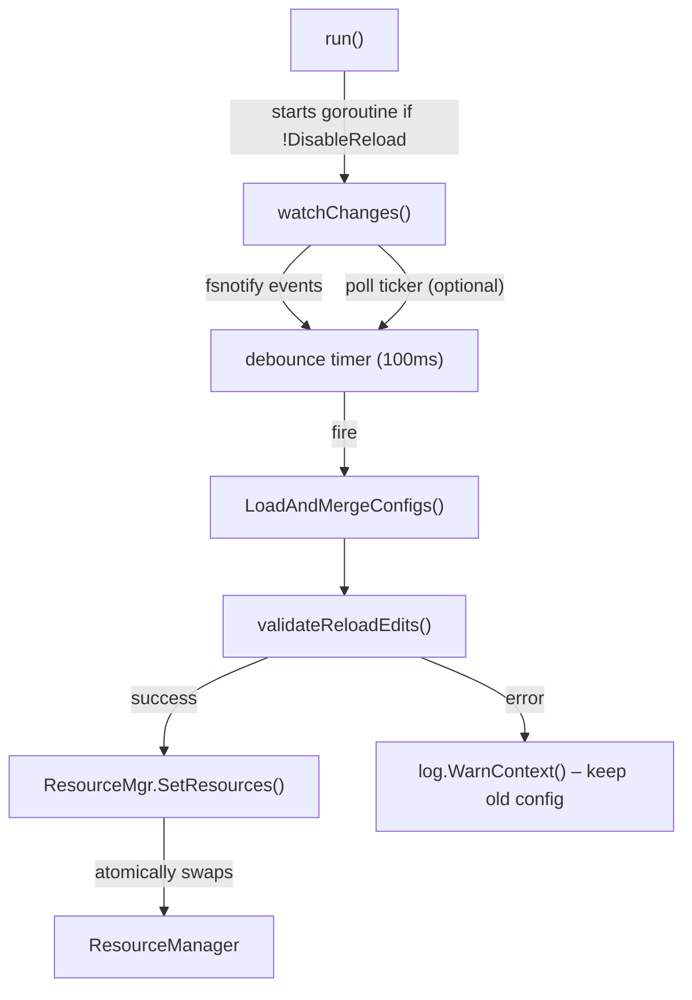
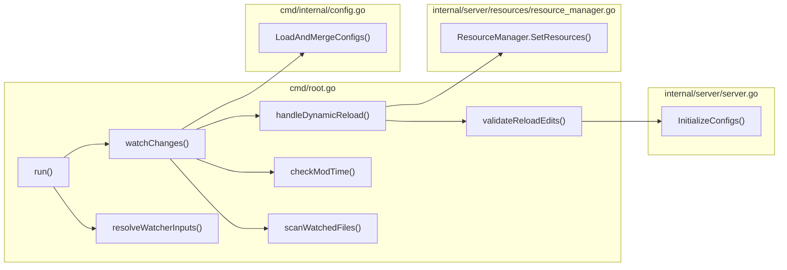
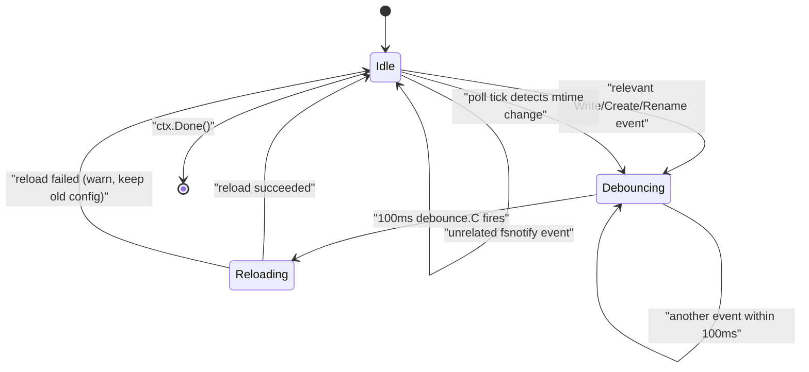
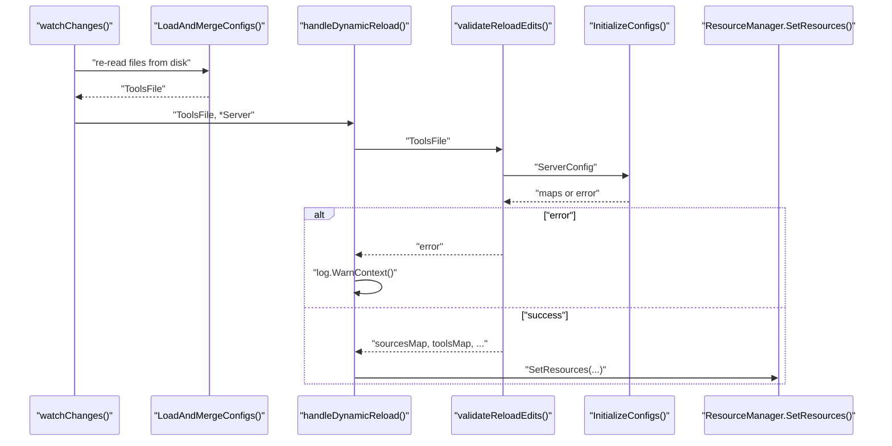

<!-- source: DeepWiki mcp.deepwiki.com · repo googleapis/genai-toolbox · page 3.4 Dynamic Configuration Reloading · fetched 2026-10-29 -->

# Dynamic Configuration Reloading

<details>
<summary>Relevant source files</summary>

The following files were used as context for generating this wiki page:

- [.ci/integration.cloudbuild.yaml](.ci/integration.cloudbuild.yaml)
- [cmd/internal/flags.go](cmd/internal/flags.go)
- [cmd/root.go](cmd/root.go)
- [cmd/root_test.go](cmd/root_test.go)
- [docs/en/documentation/configuration/toolbox_mcp_auth.md](docs/en/documentation/configuration/toolbox_mcp_auth.md)
- [go.mod](go.mod)
- [go.sum](go.sum)
- [internal/prebuiltconfigs/prebuiltconfigs.go](internal/prebuiltconfigs/prebuiltconfigs.go)
- [internal/prebuiltconfigs/prebuiltconfigs_test.go](internal/prebuiltconfigs/prebuiltconfigs_test.go)
- [internal/server/config.go](internal/server/config.go)
- [internal/server/prm.go](internal/server/prm.go)
- [internal/server/server.go](internal/server/server.go)
- [internal/server/server_test.go](internal/server/server_test.go)
- [internal/telemetry/telemetry.go](internal/telemetry/telemetry.go)

</details>


This page covers how Toolbox watches configuration files for changes and applies them to a running server without requiring a restart. It explains the watcher implementation, the validation pipeline, the `--disable-reload` flag, and the `--poll-interval` option for NFS environments.

For information about the structure of the YAML configuration files themselves, see **3.1 Tools.yaml Format**. For CLI flags in general, see **3.2 Command Line Interface**. For how resources are managed in memory at runtime, see **4.4 Resource Manager**.

---

## Overview

By default, whenever a tools configuration file (or folder) changes on disk, Toolbox re-reads the file, validates the new configuration, and atomically swaps it into the running `ResourceManager`. No restart is required. If the new configuration contains errors, the server logs a warning and continues serving the old configuration unchanged.

The reload path is only active when:
- A custom configuration was loaded via `--config` (or the deprecated `--tools-file`), `--configs` (`--tools-files`), or `--config-folder` (`--tools-folder`).
- `--disable-reload` was **not** passed.

Prebuilt-only configurations (loaded via `--prebuilt` with no user file) do not trigger the watcher [cmd/root.go:497-503]().

---

## CLI Flags

| Flag | Type | Default | Description |
|---|---|---|---|
| `--disable-reload` | bool | `false` | Disables the file watcher. The server reads config once at startup. |
| `--poll-interval` | int | `0` | Polling frequency in seconds. Set to a positive integer to enable NFS-safe polling. `0` means polling is disabled. |

These flags map to fields on `ServerConfig` in [internal/server/config.go:69-86]().

---

## Architecture

### High-Level Flow

**Title: Dynamic Reload – Component Relationships**



Sources: [cmd/root.go:497-525](), [cmd/root.go:306-393](), [cmd/root.go:134-150]()

---

### Code Entity Map

**Title: Function-to-File Map for Dynamic Reload**



Sources: [cmd/root.go:134-525](), [internal/server/server.go:64-73](), [internal/server/config.go:149-160]()

---

## Watcher Setup

### Determining What to Watch

`resolveWatcherInputs` ([cmd/root.go:397-422]()) converts the config input modes into maps for the watcher:

| Input mode | `watchedFiles` | `watchDirs` |
|---|---|---|
| `--config foo.yaml` | `{"foo.yaml": true}` | `{".": true}` (parent dir) |
| `--configs a.yaml,b.yaml` | `{"a.yaml": true, "b.yaml": true}` | parent dirs of each |
| `--config-folder ./conf/` | `{}` (empty) | `{"conf": true}` |

`fsnotify` watches directories because many editors write files by creating a temporary file and renaming it. Toolbox adds parent directories to the watcher and filters events against the `watchedFiles` map [cmd/root.go:410-422](). When `watchedFiles` is empty, the server is in **folder-watch mode**, where any `.yaml` or `.yml` file in the folder is relevant [cmd/root.go:271-273]().

Sources: [cmd/root.go:397-422](), [cmd/root.go:256-273]()

---

### Event Handling

Inside `watchChanges` ([cmd/root.go:242-395]()), a `select` loop handles file system events:



Events that trigger a reload are `fsnotify.Write`, `fsnotify.Create`, and `fsnotify.Rename` [cmd/root.go:343-345](). A **debounce timer** of 100ms prevents redundant reloads during rapid filesystem operations [cmd/root.go:302-304]().

Sources: [cmd/root.go:306-393]()

---

## Polling Mode (NFS)

NFS and network-mounted filesystems often fail to deliver `inotify` events reliably. The `--poll-interval N` flag enables a supplementary polling path.

When `PollInterval > 0`:
1. A `time.Ticker` fires every `N` seconds [cmd/root.go:287-290]().
2. `scanWatchedFiles` ([cmd/root.go:208-239]()) walks watched paths and compares `os.Stat` modification times against a `lastSeen` map [cmd/root.go:193-199]().
3. If a file's `ModTime` has advanced, the debounce timer is reset [cmd/root.go:312-316]().
4. `lastSeen` is pre-populated at startup to avoid spurious reloads on the first tick [cmd/root.go:293-297]().

Sources: [cmd/root.go:208-239](), [cmd/root.go:284-333]()

---

## Reload Execution

When the debounce timer fires, the watcher:
1. Re-reads and merges all YAML documents from disk.
2. Calls `handleDynamicReload` ([cmd/root.go:134-150]()).

`handleDynamicReload` calls `validateReloadEdits` ([cmd/root.go:153-190]()), which:
1. Builds a temporary `ServerConfig` from the reloaded file.
2. Calls `server.InitializeConfigs` ([internal/server/server.go:64-210]()) to initialize sources, auth services, embedding models, tools, and toolsets.
3. Returns initialized resource maps or an error if validation fails.

If validation succeeds, `s.ResourceMgr.SetResources(...)` atomically replaces the live resource maps [cmd/root.go:147](). If it fails, a `WARN` log is emitted and the old configuration remains active [cmd/root.go:142-144]().



Sources: [cmd/root.go:134-190](), [internal/server/server.go:64-210]()

---

## Disabling Reload

Pass `--disable-reload` to skip watcher initialization entirely. This is useful for:
- Externally managed configs where partial-write windows must be avoided.
- Constrained environments with limited `inotify` file descriptors.
- Stability-critical production deployments.

The check occurs in `run()` ([cmd/root.go:500-503]()):
```go
if isCustomConfigured && !opts.Cfg.DisableReload {
    // ...
    go watchChanges(ctx, watchDirs, watchedFiles, s, opts.Cfg.PollInterval)
}
```

Sources: [cmd/root.go:500-503](), [internal/server/config.go:69-70]()

---

## Lifecycle and Shutdown

The watcher goroutine receives the server's `context.Context`. When the context is cancelled (via `SIGINT` or `SIGTERM`), the `<-ctx.Done()` case in `watchChanges` returns cleanly [cmd/root.go:306-309](). The `fsnotify.Watcher` is closed via `defer w.Close()` [cmd/root.go:254]().

Sources: [cmd/root.go:242-255](), [cmd/root.go:306-309]()

---

