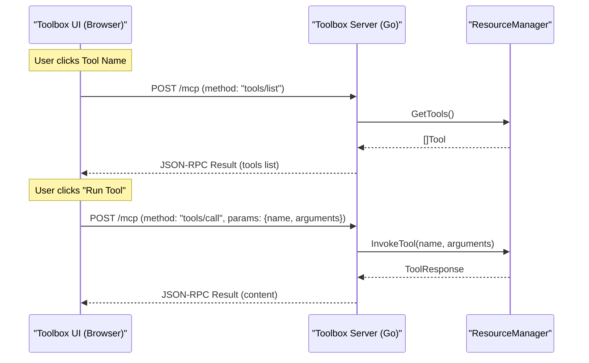
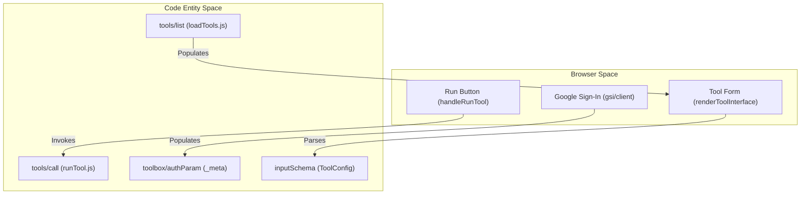

<!-- source: DeepWiki mcp.deepwiki.com · repo googleapis/genai-toolbox · page 3.5 Toolbox UI · fetched 2026-10-29 -->

# Toolbox UI

Relevant source files

The following files were used as context for generating this wiki page:

- [CHANGELOG.md](CHANGELOG.md)
- [README.md](README.md)
- [UPGRADING.md](UPGRADING.md)
- [cmd/version.txt](cmd/version.txt)
- [docs/en/documentation/introduction/_index.md](docs/en/documentation/introduction/_index.md)
- [gemini-extension.json](gemini-extension.json)
- [internal/server/static/css/style.css](internal/server/static/css/style.css)
- [internal/server/static/index.html](internal/server/static/index.html)
- [internal/server/static/js/auth.js](internal/server/static/js/auth.js)
- [internal/server/static/js/loadTools.js](internal/server/static/js/loadTools.js)
- [internal/server/static/js/mainContent.js](internal/server/static/js/mainContent.js)
- [internal/server/static/js/navbar.js](internal/server/static/js/navbar.js)
- [internal/server/static/js/resize.js](internal/server/static/js/resize.js)
- [internal/server/static/js/runTool.js](internal/server/static/js/runTool.js)
- [internal/server/static/js/sanitize.js](internal/server/static/js/sanitize.js)
- [internal/server/static/js/toolDisplay.js](internal/server/static/js/toolDisplay.js)
- [internal/server/static/tools.html](internal/server/static/tools.html)
- [internal/server/static/toolsets.html](internal/server/static/toolsets.html)
- [server.json](server.json)

The Toolbox UI is a built-in web interface that allows developers to discover, configure, and test tools and toolsets without writing code or using an external MCP client. It provides a visual playground for executing tools, managing parameters, and handling authentication.

The UI is enabled by passing the `--ui` flag to the toolbox binary [server.json:138-142](). When active, the server hosts a static web application that communicates with the toolbox backend via the standard MCP HTTP endpoint [internal/server/static/js/loadTools.js:30-41]().

## Navigation and Architecture

The interface is divided into two primary views: **Tools** and **Toolsets**. Navigation is handled by a common sidebar component [internal/server/static/js/navbar.js]().

| View | Purpose | Implementation |
| :--- | :--- | :--- |
| **Tools View** | Displays all tools currently registered in the `ResourceManager`. | `tools.html` + `js/tools.js` |
| **Toolsets View** | Allows searching for specific toolsets by name and viewing their contained tools. | `toolsets.html` + `js/toolsets.js` |

### Data Flow: UI to Backend
The UI acts as a specialized MCP client. It uses the `fetch` API to send JSON-RPC 2.0 messages to the `/mcp` endpoint [internal/server/static/js/loadTools.js:31-42]().

Sources: [internal/server/static/js/loadTools.js:27-42](), [internal/server/static/js/runTool.js:83-103](), [UPGRADING.md:28-32]()

## Tool Invocation and Parameters

When a tool is selected, the UI dynamically generates an input form based on the tool's `inputSchema` [internal/server/static/js/loadTools.js:144-147]().

### Parameter Handling
The UI maps JSON schema types to HTML input elements:
*   **string**: `<input type="text">` [internal/server/static/js/loadTools.js:150-152]()
*   **integer/number**: `<input type="number">` [internal/server/static/js/loadTools.js:155-157]()
*   **boolean**: `<input type="checkbox">` [internal/server/static/js/loadTools.js:158-160]()
*   **array**: `<textarea>` (expects JSON array format) [internal/server/static/js/loadTools.js:161-165]()

### Optional Parameters
The UI allows users to exclude optional parameters from the invocation. Each parameter has a checkbox; if unchecked, the parameter is omitted from the `arguments` object sent to the server [internal/server/static/js/runTool.js:36-43]().

### Header Management
Users can edit custom HTTP headers to be sent with the MCP request. This is useful for testing tools that require specific metadata or bypass tokens [internal/server/static/css/style.css:175-185]().

Sources: [internal/server/static/js/loadTools.js:143-174](), [internal/server/static/js/runTool.js:26-79]()

## Authentication and Google OAuth

The Toolbox UI integrates with Google Identity Services to support **Authenticated Parameters**—parameters that are automatically populated with a user's identity token.

### Implementation Details
1.  **Detection**: The UI checks the tool's `_meta` field for `toolbox/authParam` annotations [internal/server/static/js/loadTools.js:131-140]().
2.  **OAuth Flow**: If a tool requires authentication, the UI displays a "Sign in with Google" button [internal/server/static/tools.html:8-9]().
3.  **Token Injection**: Upon successful login, the resulting ID token is stored and automatically included in the `Authorization` header (or specified auth parameter) during the `tools/call` request [internal/server/static/js/auth.js]().

### UI Component Mapping
The following diagram bridges the visual UI components to the underlying logic and configuration.

Sources: [internal/server/static/js/loadTools.js:121-140](), [internal/server/static/js/runTool.js:26-50](), [internal/server/static/tools.html:22-30]()

## Usage Summary Table

| Feature | Action | Code Reference |
| :--- | :--- | :--- |
| **Enable UI** | Run with `--ui` flag | [server.json:138-142]() |
| **Search Toolsets** | Use search bar in "Toolsets" view | [internal/server/static/toolsets.html:16-21]() |
| **Execute Tool** | Fill parameters and click "Run Tool" | [internal/server/static/js/runTool.js:26-30]() |
| **Format Output** | Toggle "Prettify JSON" checkbox | [internal/server/static/js/runTool.js:184-187]() |
| **Resize Sidebar** | Drag the handle between nav and content | [internal/server/static/js/resize.js]() |

Sources: [internal/server/static/tools.html:13-20](), [internal/server/static/toolsets.html:14-25](), [internal/server/static/css/style.css:98-113]()

---

