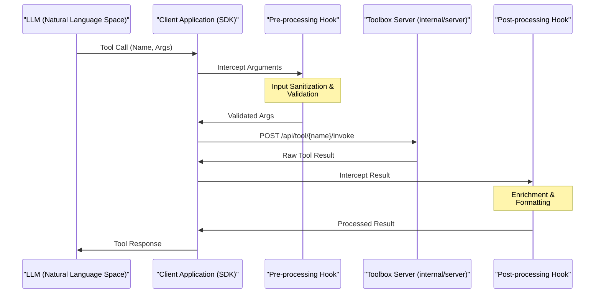
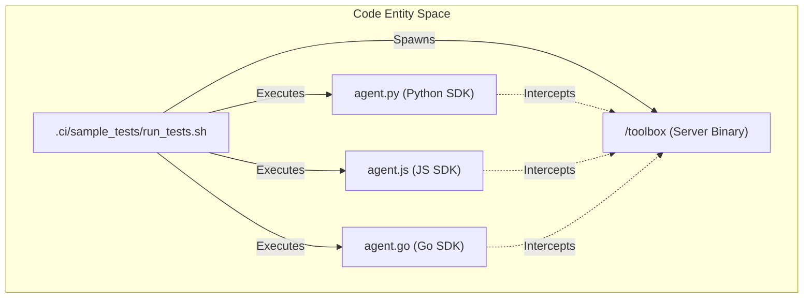

<!-- source: DeepWiki mcp.deepwiki.com · repo googleapis/genai-toolbox · page 3.6 Pre- and Post-Processing · fetched 2026-10-29 -->

# Pre- and Post-Processing

Relevant source files

The following files were used as context for generating this wiki page:

- [.ci/sample_tests/pre_post_processing/go.integration.cloudbuild.yaml](.ci/sample_tests/pre_post_processing/go.integration.cloudbuild.yaml)
- [.ci/sample_tests/pre_post_processing/js.integration.cloudbuild.yaml](.ci/sample_tests/pre_post_processing/js.integration.cloudbuild.yaml)
- [.ci/sample_tests/pre_post_processing/py.integration.cloudbuild.yaml](.ci/sample_tests/pre_post_processing/py.integration.cloudbuild.yaml)
- [.ci/sample_tests/quickstart/go.integration.cloudbuild.yaml](.ci/sample_tests/quickstart/go.integration.cloudbuild.yaml)
- [.ci/sample_tests/quickstart/js.integration.cloudbuild.yaml](.ci/sample_tests/quickstart/js.integration.cloudbuild.yaml)
- [.ci/sample_tests/quickstart/py.integration.cloudbuild.yaml](.ci/sample_tests/quickstart/py.integration.cloudbuild.yaml)
- [.ci/sample_tests/run_tests.sh](.ci/sample_tests/run_tests.sh)
- [.ci/sample_tests/setup_hotels.sql](.ci/sample_tests/setup_hotels.sql)
- [.github/header-checker-lint.yml](.github/header-checker-lint.yml)
- [.hugo/layouts/shortcodes/include.html](.hugo/layouts/shortcodes/include.html)
- [.hugo/layouts/shortcodes/regionInclude.html](.hugo/layouts/shortcodes/regionInclude.html)

Pre- and post-processing allow developers to intercept and modify tool interactions between an orchestration framework and the MCP Toolbox server. These hooks are essential for implementing input sanitization, business logic validation, response enrichment, and output formatting before data reaches the LLM or the database.

While the Toolbox server handles the execution of tools against data sources, the client-side SDKs provide the mechanism to wrap these calls with custom logic.

## Interception Lifecycle

The interaction follows a structured flow where the client application can intervene at two primary points:
1.  **Pre-processing**: Occurs after the LLM has generated tool arguments but before the request is sent to the Toolbox server.
2.  **Post-processing**: Occurs after the Toolbox server has returned a result but before that result is fed back to the LLM.

### Tool Interaction Data Flow

The following diagram illustrates how pre- and post-processing hooks bridge the gap between the Natural Language Space (LLM) and the Code Entity Space (Toolbox Server).

**Diagram: Interceptor Data Flow**

Sources: [.ci/sample_tests/run_tests.sh:65-85](), [.ci/sample_tests/pre_post_processing/go.integration.cloudbuild.yaml:48-54]()

## Implementation Patterns

Implementation varies by language SDK, but the core principle remains the same: wrapping the `invoke` or `call_tool` method.

### Pre-processing: Input Sanitization and Validation
Pre-processing is used to ensure that the LLM-generated parameters adhere to business constraints that cannot be expressed in a JSON schema.

*   **Sanitization**: Removing potentially harmful characters or SQL injection attempts (though Toolbox uses parameterized queries to mitigate this).
*   **Validation**: Checking if a requested `hotel_id` belongs to the authenticated user's organization.
*   **Defaulting**: Injecting environment-specific parameters that the LLM shouldn't manage.

### Post-processing: Response Enrichment and Formatting
Post-processing transforms raw database output into a format more suitable for LLM consumption or end-user display.

*   **Enrichment**: Adding metadata to a database row (e.g., calculating a "Total Price" from "Rate" and "Nights").
*   **Formatting**: Converting large JSON payloads into concise Markdown tables to save context window tokens.
*   **Filtering**: Removing sensitive columns (e.g., `password_hash`) that might have been returned by a broad SQL query.

## SDK Integration Examples

The Toolbox integration tests verify these patterns across different runtimes. The following diagram maps the test execution environment to the code entities responsible for processing.

**Diagram: Testing Interceptor Logic**

Sources: [.ci/sample_tests/run_tests.sh:93-170](), [.ci/sample_tests/pre_post_processing/py.integration.cloudbuild.yaml:48-54](), [.ci/sample_tests/pre_post_processing/js.integration.cloudbuild.yaml:48-54]()

### Cross-Language Support Table

The Toolbox supports pre- and post-processing across all major SDKs, as demonstrated in the integration test suites:

| Feature | Python | JavaScript | Go |
| :--- | :--- | :--- | :--- |
| **Test File Pattern** | `agent.py` | `agent.js` | `agent.go` |
| **Runtime Image** | `cloud-sdk:537.0.0` | `node:22` | `golang:1.25.7` |
| **Invocation Hook** | `load_toolset` callbacks | `@toolbox-sdk/core` wrappers | `tbadk` middleware |

Sources: [.ci/sample_tests/pre_post_processing/py.integration.cloudbuild.yaml:49-54](), [.ci/sample_tests/pre_post_processing/js.integration.cloudbuild.yaml:49-54](), [.ci/sample_tests/pre_post_processing/go.integration.cloudbuild.yaml:49-54]()

## Best Practices

### Security
1.  **Always Validate on the Client**: Do not rely solely on the LLM to provide valid IDs or constraints. Use pre-processing to verify that the `WHERE` clause parameters provided by the LLM are authorized for the current session.
2.  **Redact Post-Process**: If a tool returns more data than necessary (e.g., `SELECT *`), use post-processing to strip out PII before it is sent to the LLM provider's API.

### Observability
1.  **Log Interceptions**: When a pre-processor rejects a tool call, log the reason. This helps in debugging why an agent might be "stalling" or failing to perform an action.
2.  **Telemetry**: Use the built-in OpenTelemetry integration to track the latency added by custom processing hooks.

### Performance
1.  **Token Economy**: Use post-processing to summarize results. Instead of sending 100 rows of hotel data, send a summary: "Found 100 hotels in Basel; price range $150-$500."
2.  **Async Processing**: Ensure that hooks in JavaScript and Python are non-blocking to prevent bottlenecks in tool execution.

Sources: [.ci/sample_tests/run_tests.sh:172-178](), [.ci/sample_tests/setup_hotels.sql:15-28]()

---

