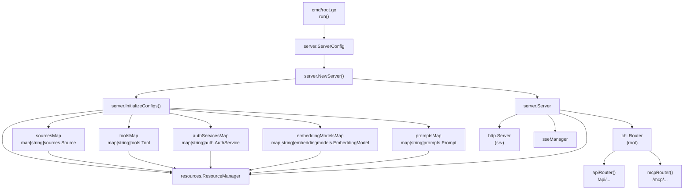
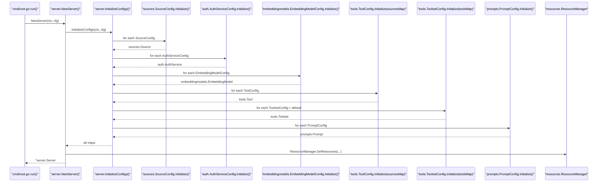
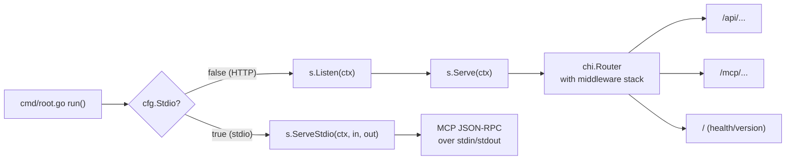
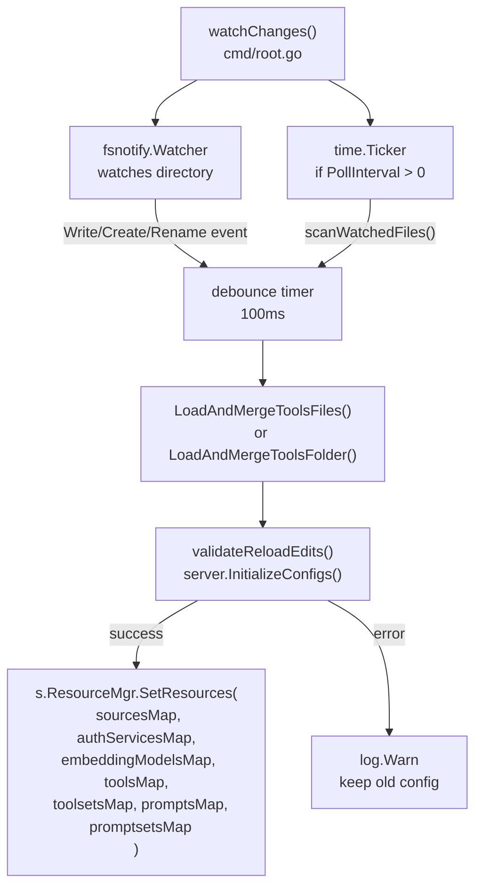

<!-- source: DeepWiki mcp.deepwiki.com · repo googleapis/genai-toolbox · page 4 Server Components · fetched 2026-10-29 -->

# Server Components

<details>
<summary>Relevant source files</summary>

The following files were used as context for generating this wiki page:

- [.ci/integration.cloudbuild.yaml](.ci/integration.cloudbuild.yaml)
- [cmd/internal/flags.go](cmd/internal/flags.go)
- [cmd/root.go](cmd/root.go)
- [cmd/root_test.go](cmd/root_test.go)
- [docs/en/documentation/configuration/toolbox_mcp_auth.md](docs/en/documentation/configuration/toolbox_mcp_auth.md)
- [go.mod](go.mod)
- [go.sum](go.sum)
- [internal/prebuiltconfigs/prebuiltconfigs.go](internal/prebuiltconfigs/prebuiltconfigs.go)
- [internal/prebuiltconfigs/prebuiltconfigs_test.go](internal/prebuiltconfigs/prebuiltconfigs_test.go)
- [internal/server/config.go](internal/server/config.go)
- [internal/server/mcp.go](internal/server/mcp.go)
- [internal/server/mcp/jsonrpc/jsonrpc.go](internal/server/mcp/jsonrpc/jsonrpc.go)
- [internal/server/mcp/mcp.go](internal/server/mcp/mcp.go)
- [internal/server/mcp/util/lifecycle.go](internal/server/mcp/util/lifecycle.go)
- [internal/server/mcp/v20241105/method.go](internal/server/mcp/v20241105/method.go)
- [internal/server/mcp/v20241105/types.go](internal/server/mcp/v20241105/types.go)
- [internal/server/mcp/v20250326/method.go](internal/server/mcp/v20250326/method.go)
- [internal/server/mcp/v20250326/types.go](internal/server/mcp/v20250326/types.go)
- [internal/server/mcp/v20250618/method.go](internal/server/mcp/v20250618/method.go)
- [internal/server/mcp/v20250618/types.go](internal/server/mcp/v20250618/types.go)
- [internal/server/mcp/v20251125/method.go](internal/server/mcp/v20251125/method.go)
- [internal/server/mcp_test.go](internal/server/mcp_test.go)
- [internal/server/prm.go](internal/server/prm.go)
- [internal/server/server.go](internal/server/server.go)
- [internal/server/server_test.go](internal/server/server_test.go)
- [internal/telemetry/instrumentation.go](internal/telemetry/instrumentation.go)
- [internal/telemetry/telemetry.go](internal/telemetry/telemetry.go)

</details>


This section covers the internal implementation of the Toolbox server: how it is constructed, how its components relate to each other, and what each subsystem is responsible for. It is the top-level reference for the Go packages under `internal/server/`.

For configuration file format, see [Tools.yaml Format](#3.1). For CLI flags that control server behavior, see [Command Line Interface](#3.2). For details on specific subsystems, see the child pages:
- [Server Initialization and Lifecycle](#4.1)
- [HTTP API](#4.2)
- [MCP Protocol Handler](#4.3)
- [Resource Manager](#4.4)

---

## Overview

The Toolbox server is a Go HTTP/MCP server that sits between AI client applications and data sources. The entry point is the `run` function in `cmd/root.go`, which constructs a `ServerConfig`, calls `server.NewServer()`, and then starts the server in either HTTP or stdio (MCP) mode.

**Server Components Architecture**



Sources: [internal/server/server.go:51-62](), [internal/server/config.go:36-87](), [cmd/root.go:424-525]()

---

## The `Server` Struct

The `Server` struct in [internal/server/server.go:51-62]() is the central object that holds all runtime state:

| Field | Type | Purpose |
|---|---|---|
| `version` | `string` | Server version string, embedded in API responses |
| `srv` | `*http.Server` | The underlying Go HTTP server |
| `listener` | `net.Listener` | The bound TCP listener |
| `root` | `chi.Router` | Root HTTP router (chi) |
| `logger` | `log.Logger` | Structured logger |
| `instrumentation` | `*telemetry.Instrumentation` | OTel tracer and metrics |
| `sseManager` | `*sseManager` | SSE session management for MCP over HTTP |
| `ResourceMgr` | `*resources.ResourceManager` | All initialized runtime resources |

The `ResourceMgr` field is the only exported field. It is the live store of sources, tools, toolsets, auth services, embedding models, and prompts, and is updated atomically during dynamic configuration reloads via `SetResources`.

Sources: [internal/server/server.go:51-62](), [cmd/root.go:147-147]()

---

## The `ServerConfig` Struct

`ServerConfig` in [internal/server/config.go:36-87]() is the input to `NewServer()`. It is populated from CLI flags in `cmd/root.go` and from YAML config parsing.

| Field | Type | Description |
|---|---|---|
| `Version` | `string` | Semantic version string |
| `Address` | `string` | Listen interface address (default `127.0.0.1`) |
| `Port` | `int` | Listen port (default `5000`) |
| `SourceConfigs` | `SourceConfigs` | Parsed source configurations |
| `AuthServiceConfigs` | `AuthServiceConfigs` | Parsed auth service configurations |
| `EmbeddingModelConfigs` | `EmbeddingModelConfigs` | Parsed embedding model configurations |
| `ToolConfigs` | `ToolConfigs` | Parsed tool configurations |
| `ToolsetConfigs` | `ToolsetConfigs` | Parsed toolset configurations |
| `PromptConfigs` | `PromptConfigs` | Parsed prompt configurations |
| `LoggingFormat` | `logFormat` | `"standard"` or `"json"` |
| `LogLevel` | `StringLevel` | `"debug"`, `"info"`, `"warn"`, `"error"` |
| `TelemetryGCP` | `bool` | Enable GCP OTel exporter |
| `TelemetryOTLP` | `string` | OTLP collector URL |
| `TelemetryServiceName` | `string` | OTel `service.name` attribute |
| `Stdio` | `bool` | Enable MCP stdio mode |
| `DisableReload` | `bool` | Disable dynamic config reload |
| `UI` | `bool` | Enable web UI endpoints |
| `AllowedOrigins` | `[]string` | CORS allowed origins (default `["*"]`) |
| `AllowedHosts` | `[]string` | Host-checking allowlist (default `["*"]`) |
| `UserAgentMetadata` | `[]string` | Extra metadata appended to User-Agent |
| `PollInterval` | `int` | Config file polling interval in seconds (0 = fsnotify only) |

The config type aliases in [internal/server/config.go:141-147]() map type strings to their config interfaces:

```go
type SourceConfigs map[string]sources.SourceConfig
type AuthServiceConfigs map[string]auth.AuthServiceConfig
type EmbeddingModelConfigs map[string]embeddingmodels.EmbeddingModelConfig
type ToolConfigs map[string]tools.ToolConfig
type ToolsetConfigs map[string]tools.ToolsetConfig
type PromptConfigs map[string]prompts.PromptConfig
```

Sources: [internal/server/config.go:36-147]()

---

## Initialization Sequence

`InitializeConfigs()` in [internal/server/server.go:64-73]() runs all resource initialization in dependency order: sources first, then auth services and embedding models, then tools (which reference sources), then toolsets (which reference tools), then prompts.

**Resource Initialization Flow**



Sources: [internal/server/server.go:64-290]()

A default toolset (keyed by the empty string `""`) is always created automatically from all initialized tools. See [internal/server/server.go:206-209]().

---

## Startup Modes

After `NewServer()`, the server runs in one of two modes determined by the `Stdio` field of `ServerConfig`:

**HTTP Mode** (default):
1. `s.Listen(ctx)` — binds the TCP listener at `Address:Port`.
2. `s.Serve(ctx)` — starts the HTTP server loop.

**stdio Mode** (`--stdio` flag):
1. `s.ServeStdio(ctx, in, out)` — processes MCP JSON-RPC messages directly over stdin/stdout, bypassing the HTTP stack.



Sources: [cmd/root.go:471-498](), [internal/server/server.go:51-62](), [internal/server/mcp.go:178-185]()

---

## Middleware Stack

In HTTP mode, the root chi router applies middleware before requests reach any handler. The middleware is set up during `NewServer()`:

| Middleware | Package | Purpose |
|---|---|---|
| `cors.Handler` | `github.com/go-chi/cors` | CORS policy using `AllowedOrigins` config |
| Host checking | (custom) | Validates `Host` header against `AllowedHosts` |
| `httplog.RequestLogger` | `github.com/go-chi/httplog/v3` | Structured HTTP request logging |
| `middleware.Recoverer` | `github.com/go-chi/chi/v5/middleware` | Panic recovery |
| `middleware.AllowContentType` | `github.com/go-chi/chi/v5/middleware` | Content-type enforcement (on /api subrouter) |
| `render.SetContentType` | `github.com/go-chi/render` | Sets response content-type JSON (on /api subrouter) |

Sources: [internal/server/server.go:31-35](), [go.mod:32-35]()

---

## Dynamic Configuration Reload

When `DisableReload` is false and a custom tools file is loaded, `cmd/root.go` starts a background goroutine running `watchChanges()`. This function uses `fsnotify` to watch the config file's parent directory (or a folder, if `--tools-folder` is used).

**Dynamic Reload Flow**



The reload is atomic at the `ResourceManager` level: if `InitializeConfigs()` fails on the new config, the existing resources remain in service and only a warning is logged.

Sources: [cmd/root.go:134-150](), [cmd/root.go:182-190](), [cmd/root.go:242-395]()

---

## Subsystem Summary

| Subsystem | Key Code Location | Responsibility |
|---|---|---|
| Server struct | [internal/server/server.go:51-62]() | Runtime state: HTTP server, router, logger, instrumentation, SSE manager, resource manager |
| ServerConfig | [internal/server/config.go:36-87]() | Input configuration from CLI and YAML |
| InitializeConfigs | [internal/server/server.go:64-290]() | Instantiates all resources in dependency order |
| HTTP API router | `internal/server/api.go` | REST endpoints under `/api/` |
| MCP handler | [internal/server/mcp.go:1-252]() | MCP JSON-RPC over SSE or stdio |
| ResourceManager | `internal/server/resources/` | Thread-safe store of runtime resources |
| Config watcher | [cmd/root.go:242-395]() | fsnotify + poll-based hot reload |
| Prebuilt configs | [internal/prebuiltconfigs/prebuiltconfigs.go:1-109]() | Embedded YAML configs for `--prebuilt` flag |

For complete documentation of each subsystem, see the child pages: [Server Initialization and Lifecycle](#4.1), [HTTP API](#4.2), [MCP Protocol Handler](#4.3), and [Resource Manager](#4.4).

---

