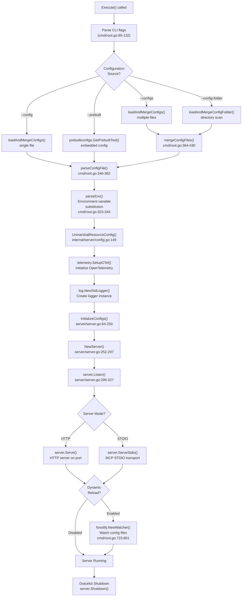
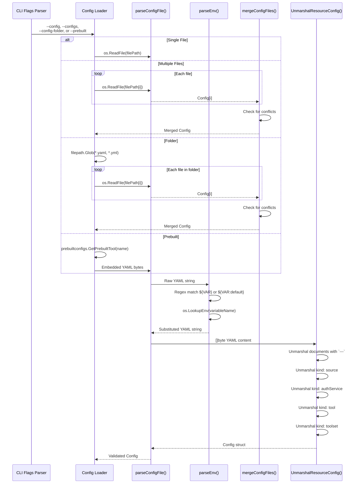
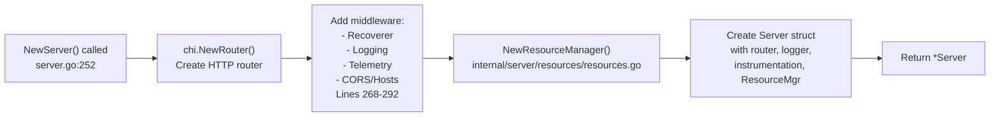
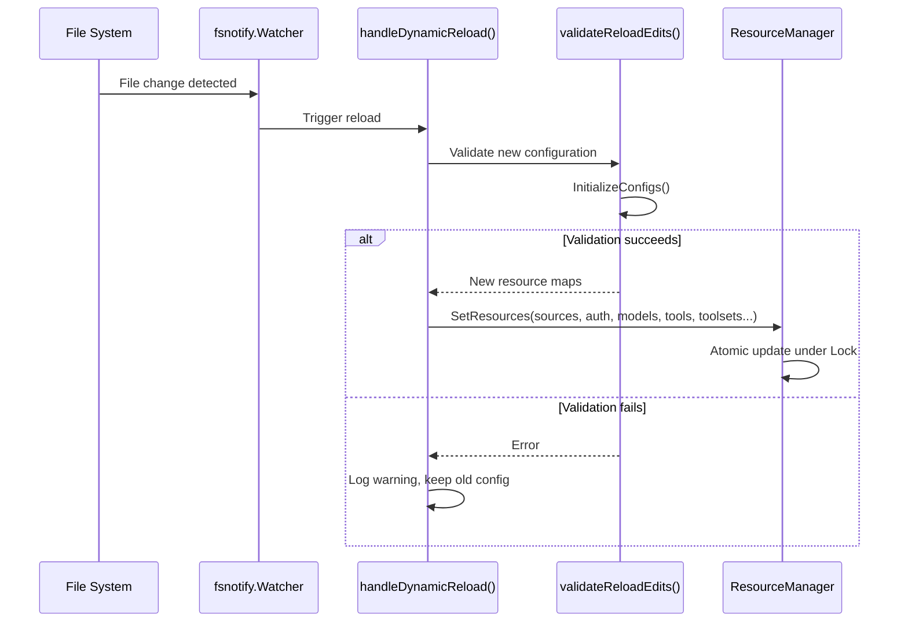
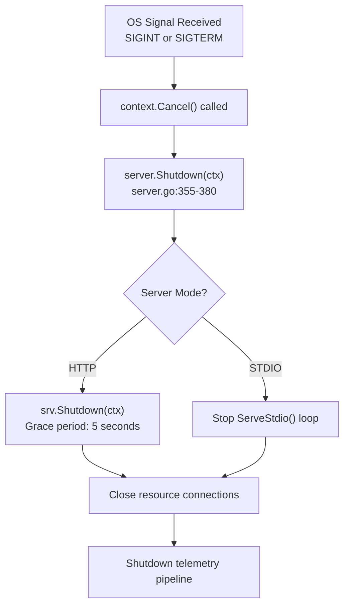

<!-- source: DeepWiki mcp.deepwiki.com · repo googleapis/genai-toolbox · page 4.1 Server Initialization and Lifecycle · fetched 2026-10-29 -->

# Server Initialization and Lifecycle

Relevant source files

The following files were used as context for generating this wiki page:

- [.ci/integration.cloudbuild.yaml](.ci/integration.cloudbuild.yaml)
- [cmd/internal/flags.go](cmd/internal/flags.go)
- [cmd/root.go](cmd/root.go)
- [cmd/root_test.go](cmd/root_test.go)
- [docs/en/documentation/configuration/toolbox_mcp_auth.md](docs/en/documentation/configuration/toolbox_mcp_auth.md)
- [go.mod](go.mod)
- [go.sum](go.sum)
- [internal/prebuiltconfigs/prebuiltconfigs.go](internal/prebuiltconfigs/prebuiltconfigs.go)
- [internal/prebuiltconfigs/prebuiltconfigs_test.go](internal/prebuiltconfigs/prebuiltconfigs_test.go)
- [internal/server/common_test.go](internal/server/common_test.go)
- [internal/server/config.go](internal/server/config.go)
- [internal/server/mocks.go](internal/server/mocks.go)
- [internal/server/prm.go](internal/server/prm.go)
- [internal/server/server.go](internal/server/server.go)
- [internal/server/server_test.go](internal/server/server_test.go)
- [internal/telemetry/telemetry.go](internal/telemetry/telemetry.go)
- [tests/mcp_types.go](tests/mcp_types.go)
- [tests/server.go](tests/server.go)

This page documents the complete server initialization process, from command invocation through configuration loading, resource initialization, startup, runtime operation, and graceful shutdown. It covers the `run()` function in [cmd/root.go:221-321](), the `InitializeConfigs()` and `NewServer()` functions in [internal/server/server.go:64-325](), and the configuration unmarshaling logic in [internal/server/config.go:149-300]().

For information about the HTTP API endpoints and request handling after initialization, see page 4.2. For details on the MCP protocol handler, see page 4.3. For configuration file format specifications, see page 3.1.

---

## Startup Overview

The server initialization follows a strict sequential process that transforms declarative YAML configurations into active, executable resources. The process is orchestrated by the `run()` function in [cmd/root.go:221-321]() and includes environment variable substitution, configuration validation, resource initialization with dependency resolution, and connection pool establishment.

**Startup Sequence Diagram**

**Sources:**
- [cmd/root.go:85-93]() - `Execute()` entry point.
- [cmd/root.go:221-321]() - `run()` main orchestration function.
- [cmd/root.go:346-362]() - `parseConfigFile()` YAML parsing with env vars.
- [cmd/root.go:323-344]() - `parseEnv()` environment variable substitution.
- [cmd/root.go:364-430]() - `mergeConfigFiles()` config merging logic.
- [internal/server/server.go:64-250]() - `InitializeConfigs()` resource initialization.
- [internal/server/server.go:252-297]() - `NewServer()` server construction.
- [internal/server/server.go:299-327]() - `Listen()` network listener setup.
- [internal/server/server.go:329-353]() - `Serve()` HTTP server startup.

---

## Configuration Loading

Configuration loading supports four distinct input methods: single file (`--config`), multiple files (`--configs`), directory of files (`--config-folder`), and prebuilt configurations (`--prebuilt`). All methods result in maps of resource configurations for sources, auth services, embedding models, tools, and toolsets.

### Environment Variable Substitution

The `parseEnv()` function in [cmd/root.go:323-344]() performs environment variable substitution before YAML parsing. It supports two syntaxes:

| Syntax | Behavior | Example |
|--------|----------|---------|
| `${VAR}` | Replace with environment variable value; error if not set | `${DATABASE_HOST}` |
| `${VAR:default}` | Replace with environment variable value or default | `${DATABASE_PORT:5432}` |

The substitution uses a regular expression `\$\{(\w+)(:(\w*))?\}` and processes the YAML string before unmarshaling.

### Configuration Merging

When multiple configuration files are provided (via `--configs` or `--config-folder`), the `mergeConfigFiles()` function in [cmd/root.go:364-430]() combines them with conflict detection. Each resource type (sources, authServices, tools, toolsets, etc.) must have globally unique names across all files. If a conflict is detected, the function returns an error listing all conflicting resource names and their file indices.

**Configuration Loading Flow**

**Sources:**
- [cmd/root.go:432-456]() - `loadAndMergeConfigs()` loads multiple files.
- [cmd/root.go:458-492]() - `loadAndMergeConfigFolder()` loads directory.
- [cmd/root.go:346-362]() - `parseConfigFile()` parses single YAML file.
- [cmd/root.go:323-344]() - `parseEnv()` environment variable substitution.
- [cmd/root.go:364-430]() - `mergeConfigFiles()` conflict detection and merging.
- [internal/server/config.go:149-300]() - `UnmarshalResourceConfig()` logic.

### Custom YAML Unmarshaling

Each resource type implements custom unmarshaling logic that uses a registry pattern to decode configurations based on their `kind` field:

1. **Sources** ([internal/server/config.go:181-189]()): Calls `UnmarshalYAMLSourceConfig()` which looks up the registered factory for the source type.
2. **AuthServices** ([internal/server/config.go:190-198]()): Calls `UnmarshalYAMLAuthServiceConfig()` for auth service kinds.
3. **Tools** ([internal/server/config.go:199-207]()): Calls `UnmarshalYAMLToolConfig()` which uses the tool registry.
4. **Toolsets** ([internal/server/config.go:208-216]()): Calls `UnmarshalYAMLToolsetConfig()` for toolset definitions.

---

## Resource Initialization

Resource initialization occurs in `InitializeConfigs()` in [internal/server/server.go:64-250]() and follows a strict dependency order. Each resource type is initialized completely before the next type begins, ensuring all dependencies are available.

**Initialization Dependency Order**

```mermaid
graph TD
    Start["InitializeConfigs() called<br/>server/server.go:64"] --> CtxSetup["Set user agent in context<br/>util.WithUserAgent()"]
    CtxSetup --> SourceLoop["Initialize Sources<br/>Lines 90-110"]
    
    SourceLoop --> S1["For each SourceConfig:"]
    S1 --> S2["sc.Initialize(ctx, tracer)"]
    S2 --> S3["Source-specific initialization:<br/>- connection setup<br/>- PingContext check"]
    S3 --> S4["Add to sourcesMap"]
    S4 --> S5{More sources?}
    S5 -->|Yes| S1
    S5 -->|No| LogSources["Log: 'Initialized N sources'<br/>Line 115"]
    
    LogSources --> AuthLoop["Initialize Auth Services<br/>Lines 118-138"]
    AuthLoop --> A1["For each AuthServiceConfig:"]
    A1 --> A2["sc.Initialize()"]
    A2 --> A3["Add to authServicesMap"]
    A3 --> A4{More auth services?}
    A4 -->|Yes| A1
    A4 -->|No| LogAuth["Log: 'Initialized N authServices'<br/>Line 143"]
    
    LogAuth --> ModelLoop["Initialize Embedding Models<br/>Lines 146-166"]
    ModelLoop --> M1["For each EmbeddingModelConfig:"]
    M1 --> M2["ec.Initialize(ctx)"]
    M2 --> M3["Add to embeddingModelsMap"]
    M3 --> M4{More models?}
    M4 -->|Yes| M1
    M4 -->|No| LogModels["Log: 'Initialized N embeddingModels'<br/>Line 171"]
    
    LogModels --> ToolLoop["Initialize Tools<br/>Lines 174-194"]
    ToolLoop --> T1["For each ToolConfig:"]
    T1 --> T2["tc.Initialize(sourcesMap)"]
    T2 --> T3["Validate source compatibility"]
    T3 --> T4["Add to toolsMap"]
    T4 --> T5{More tools?}
    T5 -->|Yes| T1
    T5 -->|No| LogTools["Log: 'Initialized N tools'<br/>Line 199"]
    
    LogTools --> ToolsetLoop["Initialize Toolsets<br/>Lines 211-230"]
    ToolsetLoop --> TS1["For each ToolsetConfig:"]
    TS1 --> TS2["tc.Initialize(version, toolsMap)"]
    TS2 --> TS3["Add to toolsetsMap"]
    TS3 --> TS4{More toolsets?}
    TS4 -->|Yes| TS1
    TS4 -->|No| LogToolsets["Log: 'Initialized N toolsets'<br/>Line 231"]
```

**Sources:**
- [internal/server/server.go:64-250]() - Complete `InitializeConfigs()` function.
- [internal/server/server.go:90-110]() - Source initialization loop.
- [internal/server/server.go:118-138]() - Auth service initialization loop.
- [internal/server/server.go:146-166]() - Embedding model initialization loop.
- [internal/server/server.go:174-194]() - Tool initialization loop.
- [internal/server/server.go:211-230]() - Toolset initialization loop.

---

## Server Construction and Startup

After resource initialization completes, `NewServer()` in [internal/server/server.go:252-297]() constructs the HTTP server infrastructure.

**Server Component Initialization**

**Sources:**
- [internal/server/server.go:252-297]() - `NewServer()` complete implementation.
- [internal/server/server.go:268-292]() - Middleware setup.
- [internal/server/resources/resources.go]() - `ResourceManager` implementation.

### Network Listener Setup

The `Listen()` method in [internal/server/server.go:299-327]() sets up the network listener:

1. **HTTP Mode** (`cfg.Stdio == false`): Creates `net.Listen("tcp", "address:port")` and wraps HTTP server with `httplog` middleware.
2. **STDIO Mode** (`cfg.Stdio == true`): Configures for MCP JSON-RPC communication over stdin/stdout, no network listener created.

### Server Serve Loop

The `Serve()` method in [internal/server/server.go:329-353]() starts the actual request handling:

- **HTTP Mode**: Calls `s.srv.Serve(s.listener)` which blocks until `Shutdown()` is called.
- **STDIO Mode**: Calls `s.ServeStdio(ctx)` which reads JSON-RPC messages from stdin and writes responses to stdout.

---

## Dynamic Configuration Reloading

When `--disable-reload` is not set, the server watches configuration files for changes using `fsnotify.NewWatcher()` in [cmd/root.go:723-801]().

**Dynamic Reload Mechanism**

**Sources:**
- [cmd/root.go:134-150]() - `handleDynamicReload()` reload handler.
- [cmd/root.go:153-190]() - `validateReloadEdits()` validation function.
- [cmd/root.go:723-801]() - File watcher goroutine setup.

---

## Graceful Shutdown

The server handles shutdown signals via context cancellation and explicit `Shutdown()` calls.

**Shutdown Sequence**

**Sources:**
- [internal/server/server.go:355-380]() - `Shutdown()` implementation.
- [cmd/root.go:548-556]() - Telemetry shutdown in `run()`.
- [internal/telemetry/telemetry.go:36-85]() - `SetupOTel()` and shutdown function.

The shutdown process includes a 5-second timeout in [internal/server/server.go:370]() to ensure the server exits even if requests hang.

---

