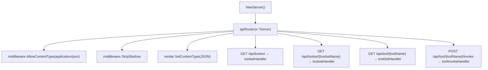
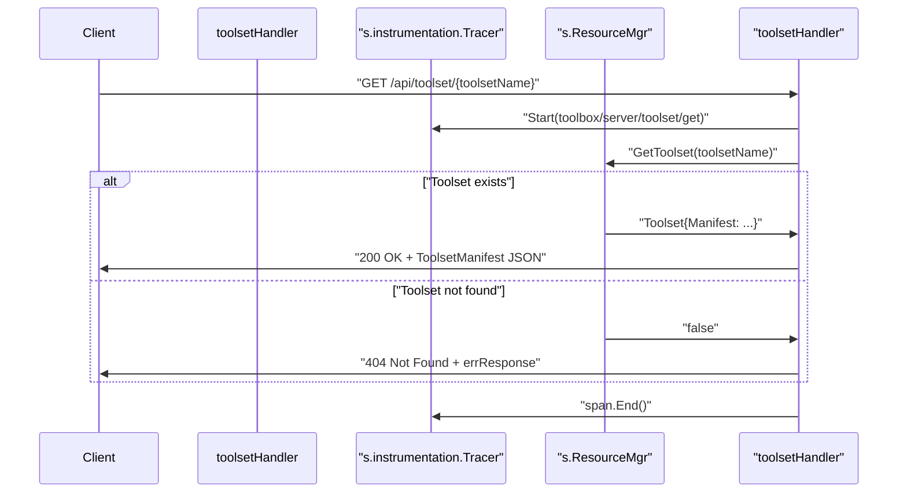
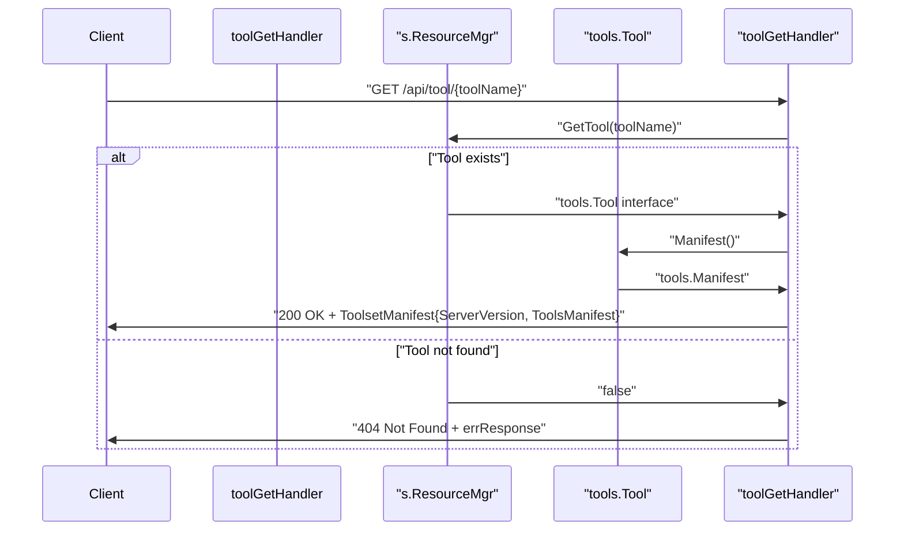
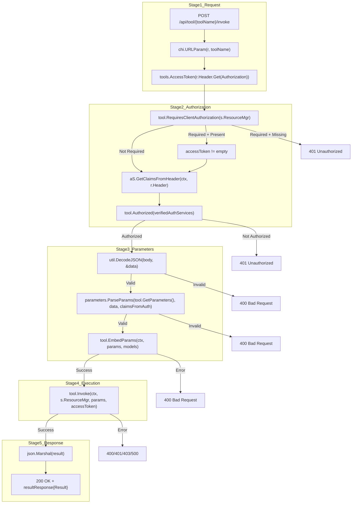
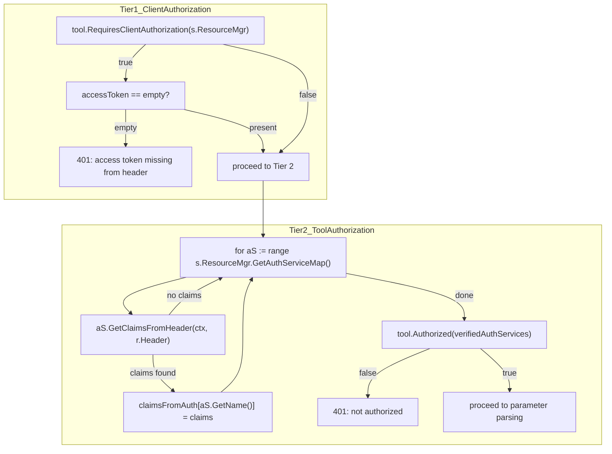
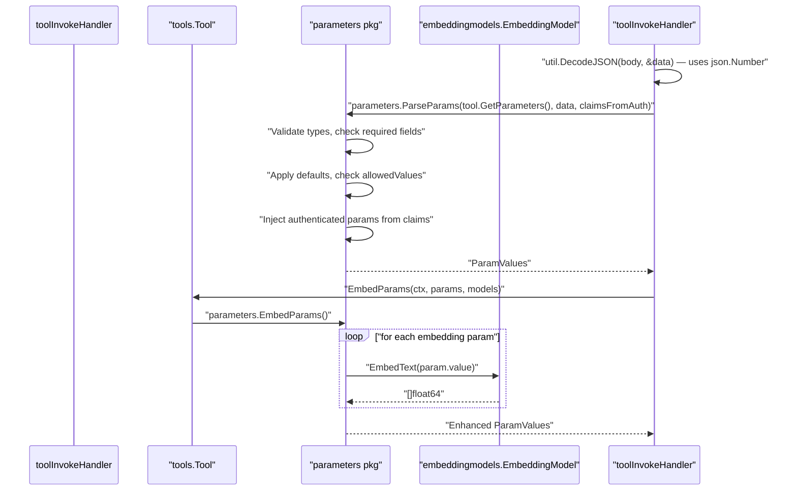
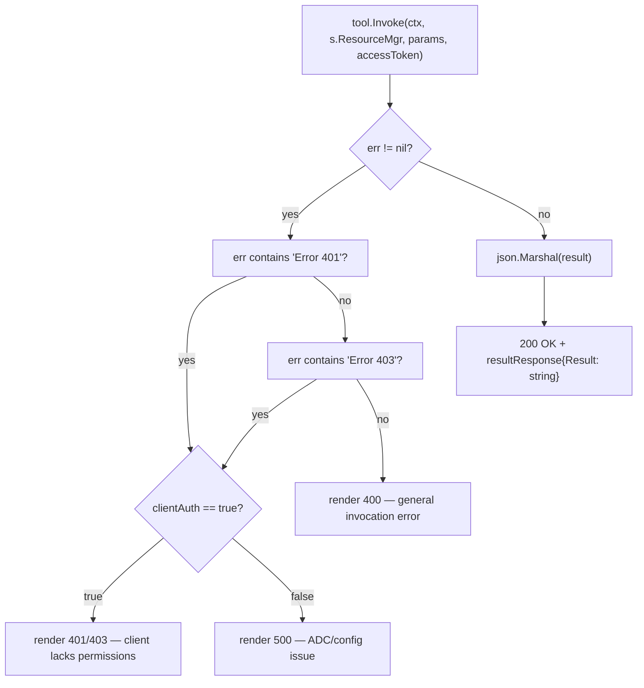
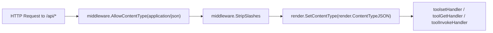
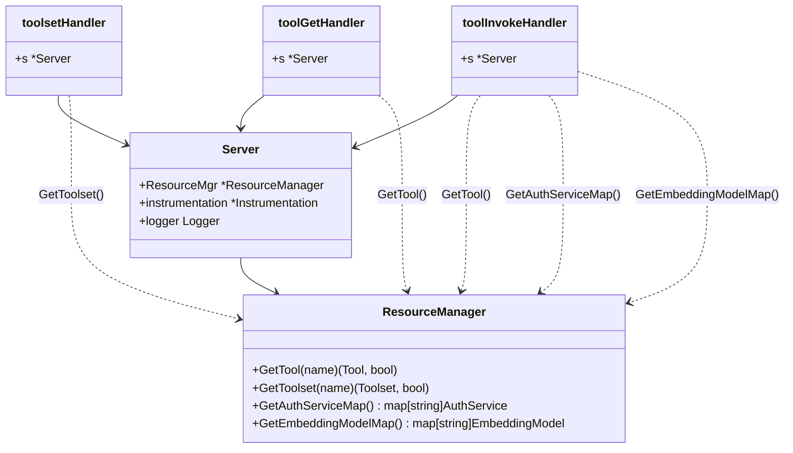

<!-- source: DeepWiki mcp.deepwiki.com · repo googleapis/genai-toolbox · page 4.2 HTTP API · fetched 2026-10-29 -->

# HTTP API

<details>
<summary>Relevant source files</summary>

The following files were used as context for generating this wiki page:

- [internal/server/api.go](internal/server/api.go)
- [internal/server/api_test.go](internal/server/api_test.go)
- [internal/server/common_test.go](internal/server/common_test.go)
- [internal/server/mocks.go](internal/server/mocks.go)
- [internal/sources/sources.go](internal/sources/sources.go)
- [internal/tools/looker/lookerconversationalanalytics/lookerconversationalanalytics.go](internal/tools/looker/lookerconversationalanalytics/lookerconversationalanalytics.go)
- [internal/tools/tools.go](internal/tools/tools.go)
- [internal/util/util.go](internal/util/util.go)
- [tests/mcp_types.go](tests/mcp_types.go)
- [tests/server.go](tests/server.go)

</details>


## Purpose and Scope

The HTTP API provides a RESTful interface for programmatic access to the Toolbox server. It enables client applications to discover available tools and toolsets, retrieve tool manifests, and invoke tools with parameters. This interface is designed for SDK integrations (Python, JavaScript, Go) and direct HTTP clients.

For MCP protocol-based integration (used by IDEs and AI assistants), see page 4.3. For server initialization and lifecycle management, see page 4.1.

## API Endpoints Overview

The Toolbox server exposes three primary HTTP endpoints under the `/api` prefix:

| Endpoint | Method | Purpose |
|----------|--------|---------|
| `/api/toolset` | GET | Retrieve the default toolset manifest (all tools) |
| `/api/toolset/{toolsetName}` | GET | Retrieve a specific toolset manifest |
| `/api/tool/{toolName}` | GET | Retrieve a single tool's manifest |
| `/api/tool/{toolName}/invoke` | POST | Invoke a tool with parameters |

All endpoints return JSON responses with `Content-Type: application/json`.

**API Router Initialization**



Sources: [internal/server/api.go:34-50]()

## Toolset Discovery Endpoints

### GET /api/toolset and /api/toolset/{toolsetName}

These endpoints retrieve toolset manifests containing metadata about available tools. The default toolset (empty name `""`) includes all configured tools.

**Request**: No body required

**Response**: `tools.ToolsetManifest` structure containing:
- `serverVersion` (string): Version of the Toolbox server
- `toolsManifest` (map): Tool name to manifest mapping

**toolsetHandler Request Flow**



Sources: [internal/server/api.go:53-76]()

**Example Response**:
```json
{
  "serverVersion": "0.1.0",
  "toolsManifest": {
    "postgres-query": {
      "description": "Execute SQL query on PostgreSQL",
      "parameters": [...],
      "authRequired": []
    }
  }
}
```

Sources: [internal/server/api_test.go:29-124]()

## Tool Discovery Endpoint

### GET /api/tool/{toolName}

Retrieves the manifest for a single tool. This provides detailed parameter schemas and descriptions for tool invocation.

**Path Parameters**:
- `toolName` (string): Name of the tool to retrieve

**Response**: `tools.ToolsetManifest` containing only the requested tool

**toolGetHandler Request Flow**



Sources: [internal/server/api.go:79-110]()

## Tool Invocation Endpoint

### POST /api/tool/{toolName}/invoke

Executes a tool with provided parameters. This endpoint implements multi-layer authentication and authorization.

**Path Parameters**:
- `toolName` (string): Name of the tool to invoke

**Request Headers**:
- `Authorization` (optional): Bearer token for client authorization (required if tool uses `useClientOAuth`)
- Custom auth headers (optional): Service-specific authentication headers

**Request Body**: JSON object containing tool parameters
```json
{
  "param1": "value1",
  "param2": 123
}
```

**Response**: JSON object containing the tool's execution result
```json
{
  "result": "{...tool output...}"
}
```

### Tool Invocation Pipeline

The tool invocation process follows a multi-stage pipeline with authentication, parameter processing, and execution:



Sources: [internal/server/api.go:113-300]()

### Authentication and Authorization Flow

Tool invocation implements a two-tier authorization model:

**Two-Tier Authorization in toolInvokeHandler**



Sources: [internal/server/api.go:142-191]()

**Client Authorization** (Line 142-156):
- Checks if tool requires client credentials via `RequiresClientAuthorization()`
- Validates presence of `Authorization` header when required
- Used primarily for BigQuery end-user credentials (OAuth2)
- Returns 401 if required but missing

**Tool Authorization** (Line 159-191):
- Extracts claims from auth service headers (e.g., Google OAuth ID tokens) via `aS.GetClaimsFromHeader(ctx, r.Header)`
- Builds `claimsFromAuth` map: `authServiceName -> claims`
- Verifies tool's `authRequired` list against available auth services via `tool.Authorized(verifiedAuthServices)`
- Returns 401 if tool requires auth but no valid claims found

Sources: [internal/server/api.go:142-191]()

### Parameter Processing

After authorization, parameters are parsed and enhanced:

**Parameter Processing in toolInvokeHandler**



Sources: [internal/server/api.go:193-256](), [internal/util/util.go:35-42]()

1. **JSON Decoding** (Line 193-199): Uses `util.DecodeJSON()` which preserves numeric types as `json.Number` via `d.UseNumber()` to avoid float64 conversion loss [internal/util/util.go:35-42]().
2. **Parameter Parsing** (Line 201-246): 
   - Calls `parameters.ParseParams` with tool parameters, request data, and extracted auth claims.
   - Validates parameter types and constraints.
   - Injects authenticated parameters from `claimsFromAuth` (e.g., `user_id` from ID token).
   - Returns 401 if an authentication error is encountered during parsing.
3. **Parameter Embedding** (Line 249-256): 
   - Calls `tool.EmbedParams()` to process parameters marked for embedding.
   - Converts text to vector embeddings using configured models.
   - Enhances parameters before invocation.

Sources: [internal/server/api.go:193-256](), [internal/util/util.go:35-42]()

### Tool Execution and Error Handling

After parameter processing, the tool is invoked with the `ResourceManager`, parameters, and access token:

**tool.Invoke() Error Classification**



Sources: [internal/server/api.go:257-300]()

**Error Handling Logic** (Line 259-289):
- Propagates upstream API errors (401/403) when using client OAuth.
- Converts unexpected auth errors to 500 when using Application Default Credentials (ADC).
- Returns 400 for general invocation errors.
- Logs errors at appropriate levels (Debug for expected, Error for unexpected).

**Success Response** (Line 291-300):
- Marshals result to JSON.
- Returns 200 with `resultResponse` containing the stringified result.

Sources: [internal/server/api.go:257-300]()

## HTTP Response Types

### Success Response

The `resultResponse` struct is returned on successful tool invocation:

| JSON field | Type | Description |
|------------|------|-------------|
| `result` | string | JSON-encoded output from the tool invocation |

Sources: [internal/server/api.go:302-307]()

### Error Response

The `errResponse` struct is returned on any failure. It implements `chi`'s `render.Renderer` interface:

| JSON field | Type | Description |
|------------|------|-------------|
| `status` | string | HTTP status text (e.g., `"Bad Request"`) |
| `error` | string | Detailed error message |

The HTTP status code is set in the response header (not the JSON body). The `StatusCode` field is tagged `json:"-"` and is used internally by `render.Render` to set the header.

Sources: [internal/server/api.go:314-327]()

## Middleware and Router Configuration

The API router (`apiRouter`) applies three middleware layers before routing to handlers:

**API Router Middleware Stack**



| Middleware | Package | Effect |
|------------|---------|--------|
| `AllowContentType("application/json")` | `github.com/go-chi/chi/v5/middleware` | Rejects requests whose `Content-Type` is not `application/json` |
| `StripSlashes` | `github.com/go-chi/chi/v5/middleware` | Strips trailing slashes from request paths before routing |
| `SetContentType(render.ContentTypeJSON)` | `github.com/go-chi/render` | Sets `Content-Type: application/json` on all responses |

Sources: [internal/server/api.go:37-39]()

## Integration with Resource Manager

The HTTP API handlers interact with the `ResourceManager` to access tools and toolsets:

**ResourceManager API Integration**



Sources: [internal/server/api.go:34-50](), [internal/server/common_test.go:153-161]()

**Handler Dependencies**:
- All handlers receive `*Server` instance containing `ResourceMgr`.
- `toolsetHandler`: Uses `GetToolset()` for toolset lookup [internal/server/api.go:68]().
- `toolGetHandler`: Uses `GetTool()` for single tool manifest [internal/server/api.go:94]().
- `toolInvokeHandler`: Uses `GetTool()` [internal/server/api.go:129](), `GetAuthServiceMap()` [internal/server/api.go:161](), and `GetEmbeddingModelMap()` [internal/server/api.go:250]() for complete invocation pipeline.

Sources: [internal/server/api.go:34-161](), [internal/server/common_test.go:153-161]()

## Telemetry and Observability

Each API handler emits OpenTelemetry spans:

| Handler | Span Name | Key Attributes |
|---------|-----------|----------------|
| `toolsetHandler` | `toolbox/server/toolset/get` | `toolset.name` |
| `toolGetHandler` | `toolbox/server/tool/get` | `tool_name` |
| `toolInvokeHandler` | `toolbox/server/tool/invoke` | `tool_name` |

**Span Lifecycle**:
1. Start span at handler entry with tool/toolset name attribute.
2. Execute handler logic.
3. Set span error status if operation fails via `span.SetStatus(codes.Error, err.Error())`.
4. End span in deferred function via `span.End()`.

Sources: [internal/server/api.go:54-66](), [internal/server/api.go:80-92](), [internal/server/api.go:114-127]()

## Example Usage

### Retrieve Default Toolset

```bash
curl http://127.0.0.1:5000/api/toolset
```

### Retrieve Specific Tool

```bash
curl http://127.0.0.1:5000/api/tool/postgres-query
```

### Invoke Tool

```bash
curl -X POST http://127.0.0.1:5000/api/tool/postgres-query/invoke \
  -H "Content-Type: application/json" \
  -d '{"query": "SELECT * FROM users LIMIT 10"}'
```

### Invoke Tool with Client Authorization

```bash
curl -X POST http://127.0.0.1:5000/api/tool/bigquery-sql/invoke \
  -H "Content-Type: application/json" \
  -H "Authorization: Bearer ya29.a0AfH6S..." \
  -d '{"query": "SELECT COUNT(*) FROM dataset.table"}'
```

Sources: [internal/server/api_test.go:89-297]()

---

