<!-- source: DeepWiki mcp.deepwiki.com · repo googleapis/genai-toolbox · page 4.3 MCP Protocol Handler · fetched 2026-10-29 -->

# MCP Protocol Handler

<details>
<summary>Relevant source files</summary>

The following files were used as context for generating this wiki page:

- [.ci/integration.cloudbuild.yaml](.ci/integration.cloudbuild.yaml)
- [cmd/internal/flags.go](cmd/internal/flags.go)
- [cmd/root.go](cmd/root.go)
- [cmd/root_test.go](cmd/root_test.go)
- [docs/en/documentation/configuration/toolbox_mcp_auth.md](docs/en/documentation/configuration/toolbox_mcp_auth.md)
- [go.mod](go.mod)
- [go.sum](go.sum)
- [internal/prebuiltconfigs/prebuiltconfigs.go](internal/prebuiltconfigs/prebuiltconfigs.go)
- [internal/prebuiltconfigs/prebuiltconfigs_test.go](internal/prebuiltconfigs/prebuiltconfigs_test.go)
- [internal/server/config.go](internal/server/config.go)
- [internal/server/mcp.go](internal/server/mcp.go)
- [internal/server/mcp/jsonrpc/jsonrpc.go](internal/server/mcp/jsonrpc/jsonrpc.go)
- [internal/server/mcp/mcp.go](internal/server/mcp/mcp.go)
- [internal/server/mcp/util/lifecycle.go](internal/server/mcp/util/lifecycle.go)
- [internal/server/mcp/v20241105/method.go](internal/server/mcp/v20241105/method.go)
- [internal/server/mcp/v20241105/types.go](internal/server/mcp/v20241105/types.go)
- [internal/server/mcp/v20250326/method.go](internal/server/mcp/v20250326/method.go)
- [internal/server/mcp/v20250326/types.go](internal/server/mcp/v20250326/types.go)
- [internal/server/mcp/v20250618/method.go](internal/server/mcp/v20250618/method.go)
- [internal/server/mcp/v20250618/types.go](internal/server/mcp/v20250618/types.go)
- [internal/server/mcp/v20251125/method.go](internal/server/mcp/v20251125/method.go)
- [internal/server/mcp_test.go](internal/server/mcp_test.go)
- [internal/server/prm.go](internal/server/prm.go)
- [internal/server/server.go](internal/server/server.go)
- [internal/server/server_test.go](internal/server/server_test.go)
- [internal/telemetry/instrumentation.go](internal/telemetry/instrumentation.go)
- [internal/telemetry/telemetry.go](internal/telemetry/telemetry.go)

</details>


## Purpose and Scope

The MCP Protocol Handler implements the Model Context Protocol (MCP) server functionality in Toolbox, enabling AI assistants and IDEs to discover and invoke tools via a standardized protocol. This document covers protocol version negotiation, transport mechanisms (stdio, HTTP, SSE), message routing, and request processing.

For information about the HTTP API endpoints that serve SDK clients, see [HTTP API](#4.2). For the overall server architecture and initialization, see [Server Initialization and Lifecycle](#4.1). For details on tool invocation and resource management, see [Resource Manager](#4.4).

## Supported Protocol Versions

Toolbox implements four versions of the MCP specification, maintaining backward compatibility while supporting newer protocol features:

| Protocol Version | Constant | Primary Features |
|-----------------|----------|------------------|
| 2024-11-05 | `protocolVersion20241105` | SSE transport, basic tool/prompt operations |
| 2025-03-26 | `protocolVersion20250326` | Streamable HTTP, session headers |
| 2025-06-18 | `protocolVersion20250618` | Enhanced error handling |
| 2025-11-25 | `protocolVersion20251125` | Latest features (default) |

The system negotiates protocol versions during initialization, defaulting to the latest version when the client supports it.

Sources: [internal/server/mcp_test.go:37-40](), [internal/server/mcp.go:37-38]()

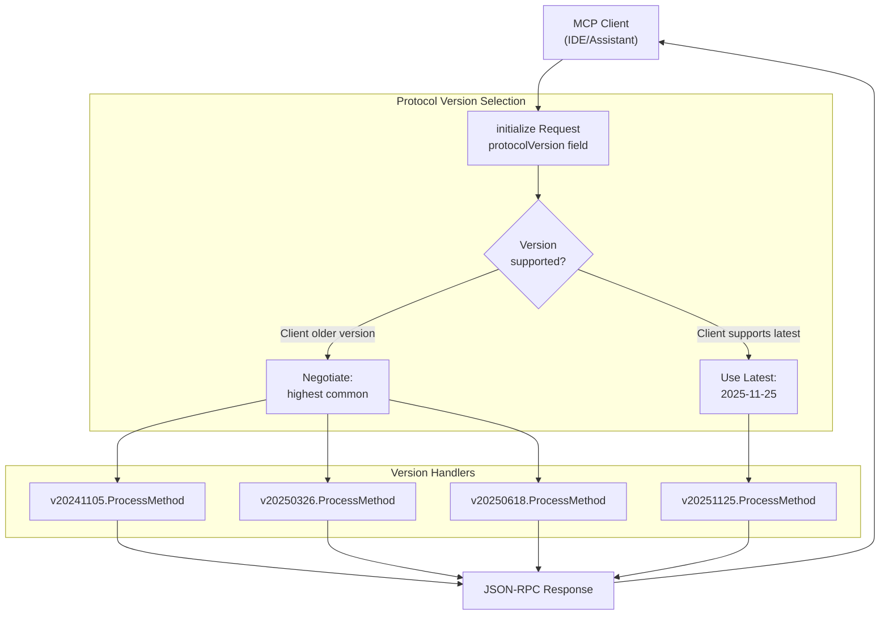

**Diagram: Protocol version negotiation flow**

Sources: [internal/server/mcp.go:251-270](), [internal/server/mcp_test.go:37-40]()

## Transport Mechanisms

The MCP Protocol Handler supports three transport mechanisms for client connectivity, each optimized for different use cases.

### stdio Transport

stdio transport enables direct process-to-process communication where the MCP client launches Toolbox as a subprocess and communicates through standard input/output streams.

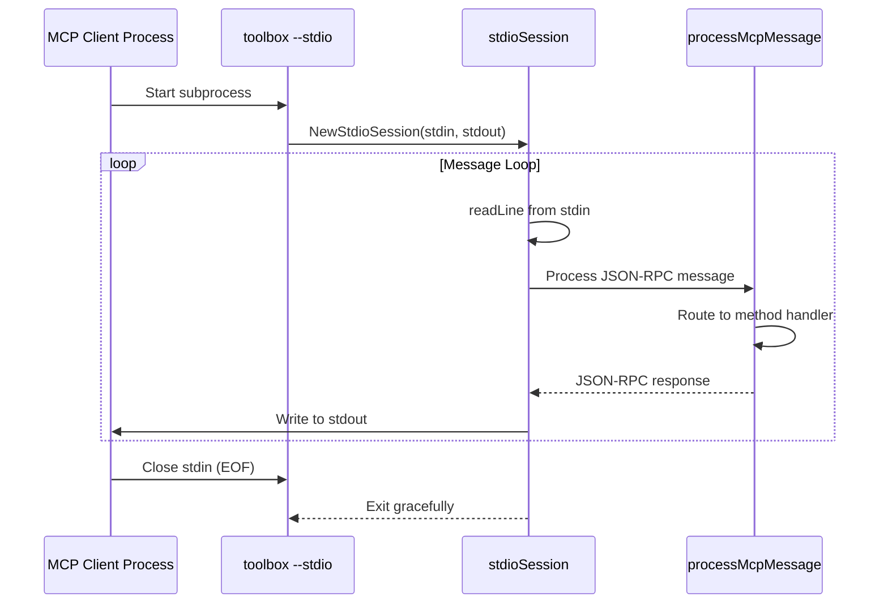

**Diagram: stdio transport message flow**

The `stdioSession` struct manages bidirectional communication through buffered readers and writers:

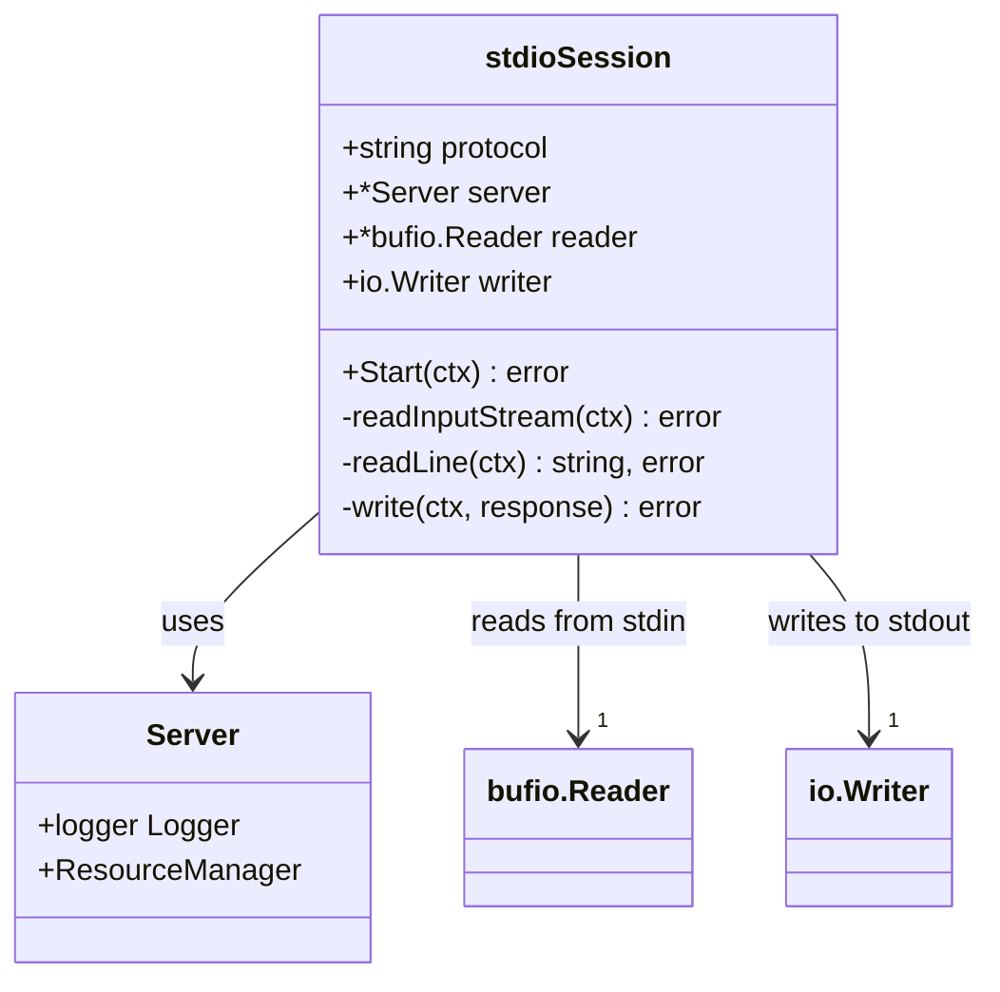

**Diagram: stdio session structure**

Sources: [internal/server/mcp.go:122-185]()

> **Note:** When running with `--stdio`, Toolbox suppresses standard log output to avoid polluting the JSON-RPC stream. This behavior is triggered by the `Stdio` flag in `ServerConfig`.

Sources: [internal/server/config.go:67-68]()

### HTTP Transport

HTTP transport supports streamable HTTP connections where clients send POST requests to the `/mcp` endpoint. Version negotiation occurs via the `MCP-Protocol-Version` header or `Mcp-Session-Id` header.

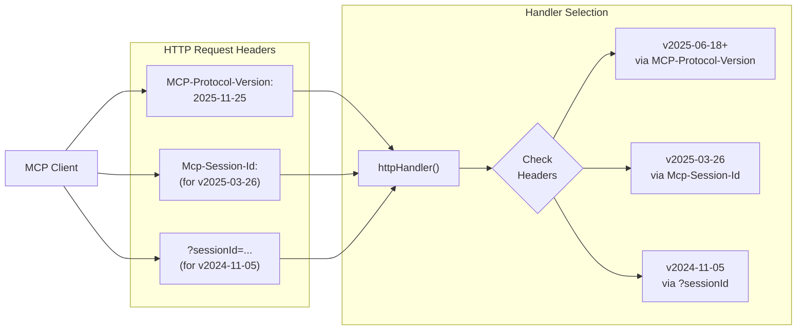

**Diagram: HTTP transport protocol version detection**

Sources: [internal/server/mcp.go:336-377]()

### SSE Sessions

Server-Sent Events (SSE) transport provides a long-lived connection for bidirectional communication. The client first establishes an SSE connection to receive the message endpoint URL, then sends POST requests to that endpoint.

The `sseManager` maintains a registry of active SSE sessions with automatic cleanup:

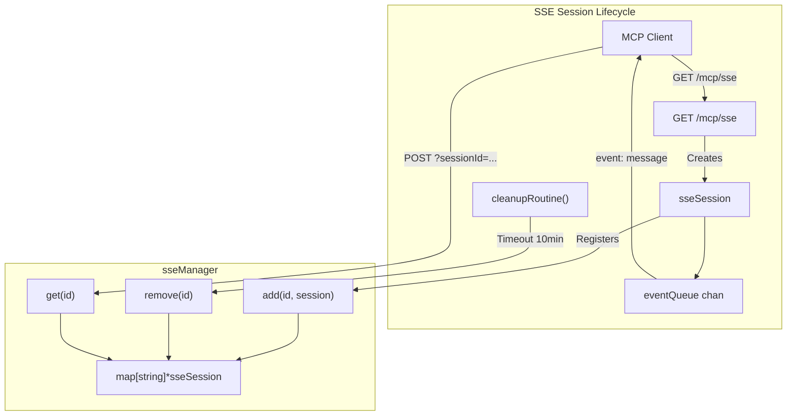

**Diagram: SSE session management**

The `sseSession` struct manages event queuing and client disconnection:

| Field | Type | Purpose |
|-------|------|---------|
| `writer` | `http.ResponseWriter` | HTTP response writer for sending events |
| `flusher` | `http.Flusher` | Flushes buffered data to client |
| `done` | `chan struct{}` | Signals session termination |
| `eventQueue` | `chan string` | Queues events for delivery |
| `lastActive` | `time.Time` | Tracks activity for cleanup |

Sources: [internal/server/mcp.go:47-120]()

## Message Processing Pipeline

All MCP messages flow through the `processMcpMessage` function, which handles JSON-RPC parsing, protocol version routing, and error handling.

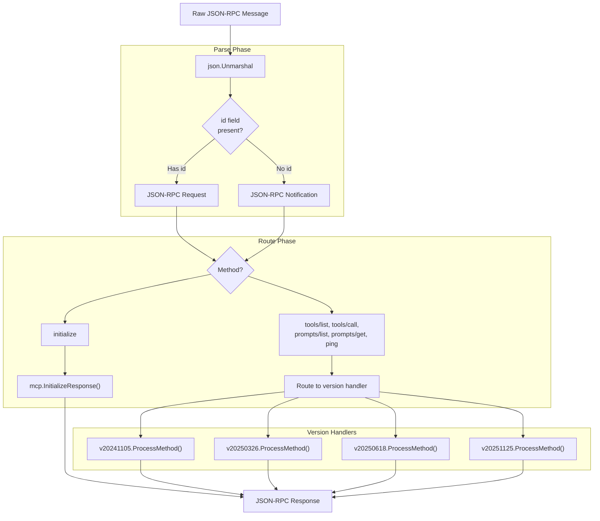

**Diagram: Message processing pipeline from raw bytes to response**

Sources: [internal/server/mcp.go:432-522]()

## Protocol Initialization

The initialization sequence establishes protocol version, server capabilities, and client information.

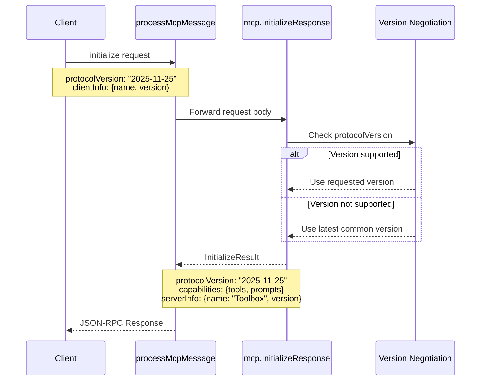

**Diagram: MCP initialization handshake**

The `InitializeResponse` function returns an `InitializeResult` containing the negotiated `protocolVersion`, `capabilities` advertising `tools` and `prompts` support, and `serverInfo`.

Sources: [internal/server/mcp/mcp.go:50-78]()

## Method Handlers

Each protocol version implements the same set of method handlers with version-specific types.

### Method Routing

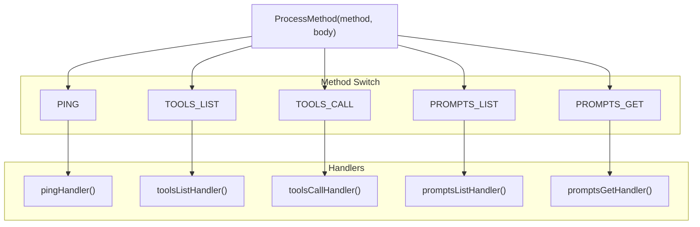

**Diagram: Method routing in version-specific handlers**

Sources: [internal/server/mcp/v20251125/method.go:34-50](), [internal/server/mcp/v20250618/method.go:34-50]()

### tools/call Handler

The `toolsCallHandler` executes tool invocations by delegating to the Tool's `Invoke` method:

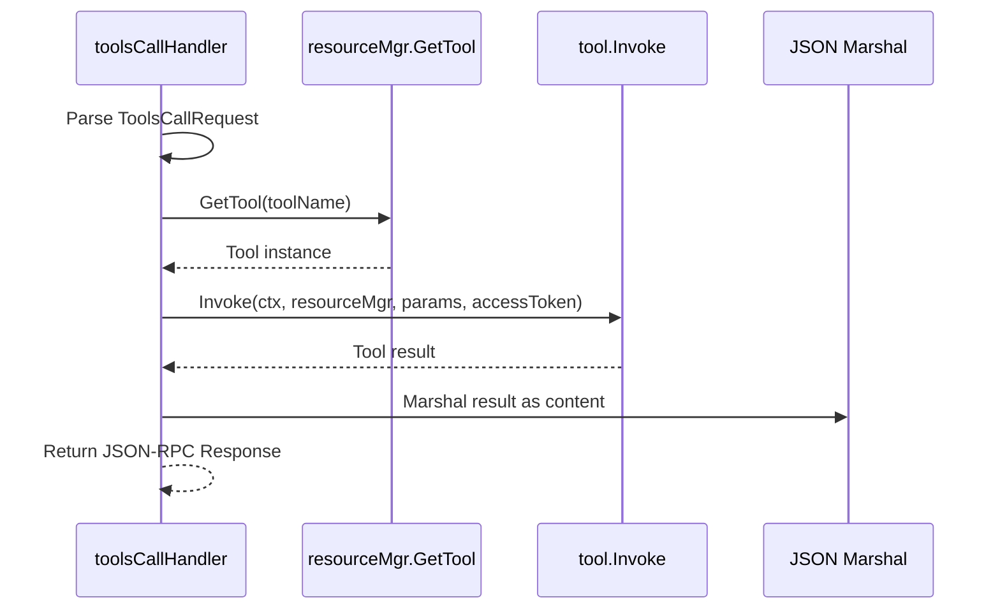

**Diagram: tools/call execution flow**

The handler extracts the access token from the `Authorization` request header for client OAuth scenarios.

Sources: [internal/server/mcp/v20251125/method.go:111-195](), [internal/server/mcp/v20250618/method.go:111-195]()

## Trace Context Propagation

The MCP handler supports W3C Trace Context propagation, allowing distributed tracing from MCP clients. The `traceContextCarrier` type implements `propagation.TextMapCarrier` and extracts trace context from the `_meta` field of incoming MCP request `params`.

The `extractTraceContext` function reads `params._meta.traceparent` and `params._meta.tracestate` from the raw JSON body.

```mermaid
sequenceDiagram
    participant "MCP Client" as client
    participant "extractTraceContext" as extract
    participant "otel.GetTextMapPropagator()" as propagator
    participant "processMcpMessage" as handler

    client->>"extractTraceContext": "JSON body with params._meta.traceparent"
    "extractTraceContext"->>"otel.GetTextMapPropagator()": "Extract(ctx, traceContextCarrier)"
    "otel.GetTextMapPropagator()">>"extractTraceContext": "ctx with parent span"
    "extractTraceContext">>"processMcpMessage": "enriched ctx"
```

**Diagram: W3C Trace Context extraction from MCP `_meta` field**

Sources: [internal/server/mcp.go:130-176]()

## Error Handling

The MCP Protocol Handler uses JSON-RPC 2.0 error codes for standardized error reporting:

| Error Code | Constant | Description |
|-----------|----------|-------------|
| -32700 | `PARSE_ERROR` | Invalid JSON in request |
| -32600 | `INVALID_REQUEST` | Malformed JSON-RPC structure |
| -32601 | `METHOD_NOT_FOUND` | Unknown method or tool |
| -32602 | `INVALID_PARAMS` | Parameter validation failed |
| -32603 | `INTERNAL_ERROR` | Server-side execution error |

Sources: [internal/server/mcp/jsonrpc/jsonrpc.go:20-26](), [internal/server/mcp.go:405-410]()

## Session Management

### SSE Session Cleanup

The `sseManager` runs a background cleanup routine that removes inactive sessions after 10 minutes:

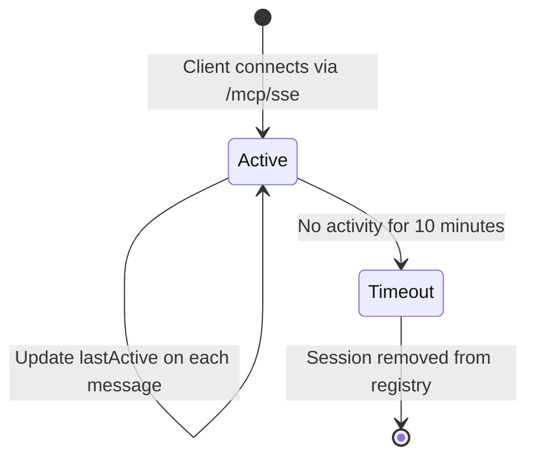

**Diagram: SSE session state transitions**

Sources: [internal/server/mcp.go:98-120]()

### stdio Session Lifecycle

stdio sessions persist for the lifetime of the subprocess, terminating when stdin receives EOF:

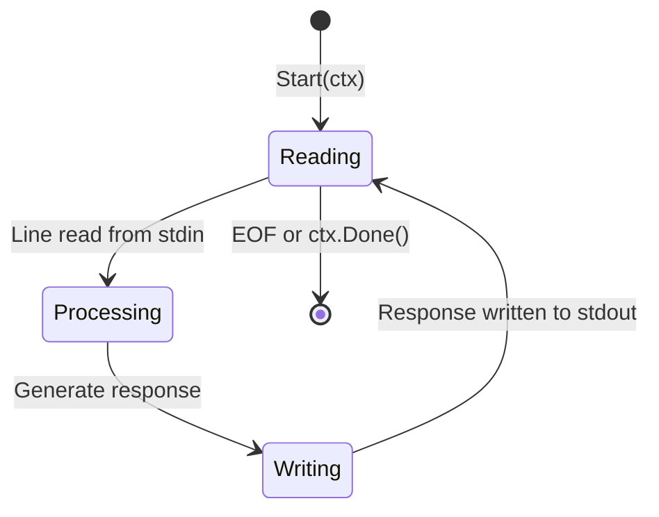

**Diagram: stdio session state machine**

Sources: [internal/server/mcp.go:192-240]()

## Router Configuration

The MCP router is mounted at `/mcp` with optional toolset-specific endpoints:

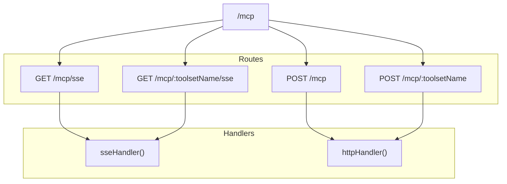

**Diagram: MCP router endpoint structure**

The toolset name parameter filters available tools to a specific toolset defined in the configuration.

Sources: [internal/server/mcp.go:219-239]()

---

