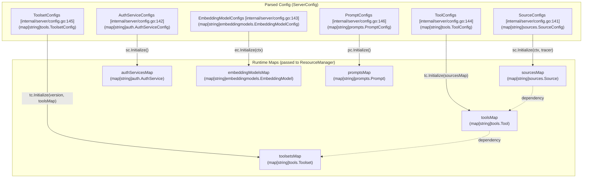
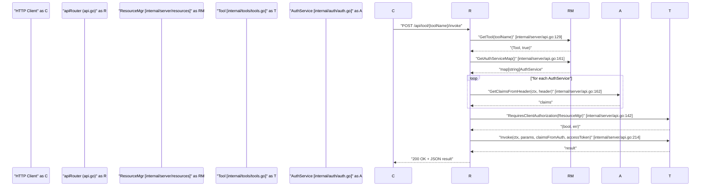
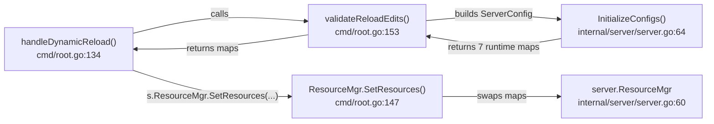
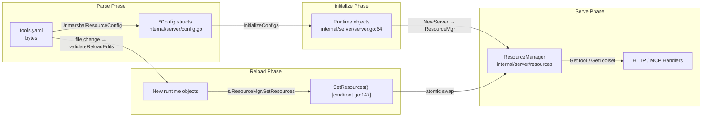

<!-- source: DeepWiki mcp.deepwiki.com · repo googleapis/genai-toolbox · page 4.4 Resource Manager · fetched 2026-10-29 -->

# Resource Manager

<details>
<summary>Relevant source files</summary>

The following files were used as context for generating this wiki page:

- [.ci/integration.cloudbuild.yaml](.ci/integration.cloudbuild.yaml)
- [cmd/internal/flags.go](cmd/internal/flags.go)
- [cmd/root.go](cmd/root.go)
- [cmd/root_test.go](cmd/root_test.go)
- [docs/en/documentation/configuration/toolbox_mcp_auth.md](docs/en/documentation/configuration/toolbox_mcp_auth.md)
- [go.mod](go.mod)
- [go.sum](go.sum)
- [internal/prebuiltconfigs/prebuiltconfigs.go](internal/prebuiltconfigs/prebuiltconfigs.go)
- [internal/prebuiltconfigs/prebuiltconfigs_test.go](internal/prebuiltconfigs/prebuiltconfigs_test.go)
- [internal/server/api.go](internal/server/api.go)
- [internal/server/api_test.go](internal/server/api_test.go)
- [internal/server/config.go](internal/server/config.go)
- [internal/server/prm.go](internal/server/prm.go)
- [internal/server/server.go](internal/server/server.go)
- [internal/server/server_test.go](internal/server/server_test.go)
- [internal/sources/sources.go](internal/sources/sources.go)
- [internal/telemetry/telemetry.go](internal/telemetry/telemetry.go)
- [internal/tools/looker/lookerconversationalanalytics/lookerconversationalanalytics.go](internal/tools/looker/lookerconversationalanalytics/lookerconversationalanalytics.go)
- [internal/tools/tools.go](internal/tools/tools.go)
- [internal/util/util.go](internal/util/util.go)

</details>


## Purpose and Scope

The Resource Manager is the central runtime registry inside the Toolbox server. It holds the fully initialized, runtime-ready instances of every resource type—sources, tools, toolsets, auth services, embedding models, and prompts—and provides thread-safe read access to them for the HTTP API and MCP handler. It is also the target of atomic updates during dynamic configuration reloading.

This page covers:
- What the `ResourceManager` holds and how it is structured.
- How `InitializeConfigs` builds resources from parsed YAML config.
- How `ResourceManager` is used by request handlers.
- How `SetResources` enables hot reload without a server restart.

For the YAML configuration format that produces the input config structs, see [3.1](). For how dynamic config reloading triggers `SetResources`, see [3.4](). For how the HTTP API and MCP handler consume the `ResourceManager`, see [4.2]() and [4.3]().

---

## Location in the Server

The `ResourceManager` is defined in the `internal/server/resources` package and is embedded in the `Server` struct as an exported field named `ResourceMgr` [internal/server/server.go:60]().

```
internal/server/resources/   ← ResourceManager definition
internal/server/server.go    ← Server struct, InitializeConfigs
internal/server/api.go       ← API handlers calling ResourceMgr methods
cmd/root.go                  ← SetResources called on hot reload
```

The `Server` struct holds a pointer so that both the HTTP/MCP handlers and the file-watcher goroutine can reference the same instance [internal/server/server.go:51-62]().

Sources: [internal/server/server.go:51-62]()

---

## Resource Types Managed

The `ResourceManager` stores one map per resource kind. Each map is keyed by the resource's string name as declared in `tools.yaml` [internal/server/server.go:64-72]().

| Map key type | Value type | Source of value |
|---|---|---|
| `string` | `sources.Source` | `SourceConfig.Initialize(ctx, tracer)` [internal/server/server.go:100]() |
| `string` | `auth.AuthService` | `AuthServiceConfig.Initialize()` [internal/server/server.go:128]() |
| `string` | `embeddingmodels.EmbeddingModel` | `EmbeddingModelConfig.Initialize(ctx)` [internal/server/server.go:156]() |
| `string` | `tools.Tool` | `ToolConfig.Initialize(sourcesMap)` [internal/server/server.go:184]() |
| `string` | `tools.Toolset` | `ToolsetConfig.Initialize(version, toolsMap)` [internal/server/server.go:225]() |
| `string` | `prompts.Prompt` | `PromptConfig.Initialize()` [internal/server/server.go:244]() |
| `string` | `prompts.Promptset` | `PromptsetConfig.Initialize(promptsMap)` [internal/server/server.go:270]() |

The config-layer types (`SourceConfigs`, `ToolConfigs`, etc.) are defined in `internal/server/config.go` [internal/server/config.go:141-147]() and their concrete implementations live in the source and tool sub-packages. The `ResourceManager` only holds the post-initialization runtime objects.

Sources: [internal/server/config.go:141-147](), [internal/server/server.go:64-72]()

---

## `InitializeConfigs`: Building Resources from Config

`InitializeConfigs` is the function that converts parsed `ServerConfig` data into the runtime maps that the `ResourceManager` holds. It is called once at startup (inside `NewServer`) and once per reload cycle (inside `validateReloadEdits` [cmd/root.go:182]()).

**Initialization diagram — config types to runtime types**



Sources: [internal/server/server.go:64-280]()

### Initialization Order and Dependencies

The order in `InitializeConfigs` is deterministic and dependency-driven:

1.  **Sources** — initialized first, with no dependencies on other resource types. Each `SourceConfig.Initialize(childCtx, instrumentation.Tracer)` returns a live `Source` [internal/server/server.go:100]().
2.  **Auth services** — independent of sources. Each `AuthServiceConfig.Initialize()` returns an `AuthService` [internal/server/server.go:128]().
3.  **Embedding models** — independent of sources. Each `EmbeddingModelConfig.Initialize(ctx)` returns an `EmbeddingModel` [internal/server/server.go:156]().
4.  **Tools** — depend on sources. `ToolConfig.Initialize(sourcesMap)` receives the already-initialized source map so a tool can reference its backing source by name [internal/server/server.go:184]().
5.  **Toolsets** — depend on tools. A default toolset (keyed by the empty string `""`) containing all tool names is always injected before processing user-defined toolsets [internal/server/server.go:209](). `ToolsetConfig.Initialize(cfg.Version, toolsMap)` validates that every declared tool name exists in `toolsMap` [internal/server/server.go:225]().
6.  **Prompts** — independent of all other types. `PromptConfig.Initialize()` returns a `Prompt` [internal/server/server.go:244]().
7.  **Promptsets** — depend on prompts [internal/server/server.go:270]().

Sources: [internal/server/server.go:89-280]()

---

## `ResourceManager` API

The `ResourceManager` (defined in `internal/server/resources`) exposes the following public interface used across the codebase:

| Method | Called by | Purpose |
|---|---|---|
| `GetToolset(name string)` | `api.go` toolset handler [internal/server/api.go:68]() | Fetch a named toolset for the API response. |
| `GetTool(name string)` | `api.go` handlers [internal/server/api.go:94](), [internal/server/api.go:129]() | Fetch a named tool for manifest retrieval or invocation. |
| `GetAuthServiceMap()` | `api.go` invocation handler [internal/server/api.go:161]() | Iterate auth services to extract claims from request headers. |
| `SetResources(...)` | `cmd/root.go` hot-reload path [cmd/root.go:147]() | Atomically swap all resource maps. |

The `SetResources` signature takes all seven maps simultaneously, allowing the swap to be treated as a single atomic unit. This prevents a window where new tools reference old (or missing) sources.

Sources: [internal/server/api.go:68](), [internal/server/api.go:129](), [internal/server/api.go:161](), [cmd/root.go:147]()

---

## How Request Handlers Use the `ResourceManager`

**Request-to-resource lookup flow**



Sources: [internal/server/api.go:113-214]()

The `toolInvokeHandler` passes the `ResourceMgr` itself to `tool.RequiresClientAuthorization(s.ResourceMgr)` [internal/server/api.go:142], because certain tool types need to resolve references to their auth service configuration at invocation time.

---

## Hot Reload and `SetResources`

When the file watcher detects a change to `tools.yaml` [cmd/root.go:134](), `validateReloadEdits` is called to parse and fully initialize the new configuration into fresh runtime maps [cmd/root.go:140](). If initialization succeeds, `SetResources` is called on the existing `ResourceManager` [cmd/root.go:147]().

**Hot reload flow**



Sources: [cmd/root.go:134-150](), [cmd/root.go:153-190]()

If `validateReloadEdits` fails (e.g., a new source cannot initialize), `SetResources` is **not** called and the server continues operating with the previous resource set. A warning is logged [cmd/root.go:143]().

---

## Config Parsing: `UnmarshalResourceConfig`

Before `InitializeConfigs` is called, `UnmarshalResourceConfig` in `internal/server/config.go` parses the raw YAML bytes into typed config structs [internal/server/config.go:149](). It decodes multi-document YAML streams (documents separated by `---`) and dispatches each document based on the `kind` field [internal/server/config.go:180]().

```mermaid
flowchart TD
    RAW["raw []byte (YAML)"]
    UD["UnmarshalResourceConfig()\ninternal/server/config.go:149"]
    K{{"kind field [internal/server/config.go:171]"}}
    S["UnmarshalYAMLSourceConfig()"]
    A["UnmarshalYAMLAuthServiceConfig()"]
    E["UnmarshalYAMLEmbeddingModelConfig()"]
    T["UnmarshalYAMLToolConfig()"]
    TS["UnmarshalYAMLToolsetConfig()"]
    P["UnmarshalYAMLPromptConfig()"]
    OUT["SourceConfigs, AuthServiceConfigs,\nEmbeddingModelConfigs, ToolConfigs,\nToolsetConfigs, PromptConfigs"]

    RAW --> UD
    UD --> K
    K -->|"source"| S [internal/server/config.go:181]
    K -->|"authService"| A [internal/server/config.go:190]
    K -->|"tool"| T [internal/server/config.go:199]
    K -->|"toolset"| TS [internal/server/config.go:208]
    K -->|"prompt"| P [internal/server/config.go:217]
    K -->|"embeddingModel"| E [internal/server/config.go:226]
    S & A & E & T & TS & P --> OUT
```

Sources: [internal/server/config.go:149-233]()

---

## Summary: Lifecycle of a Resource



Sources: [internal/server/server.go:64-280](), [cmd/root.go:134-190](), [internal/server/api.go:34-110]()

---

