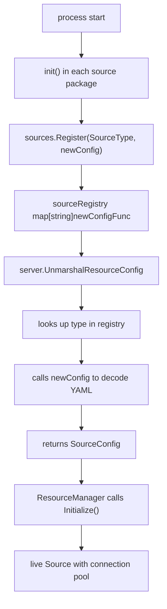
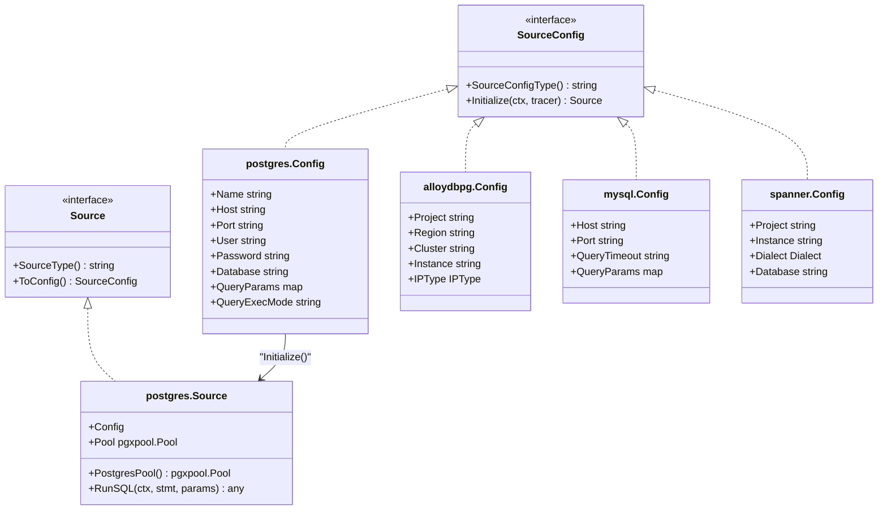
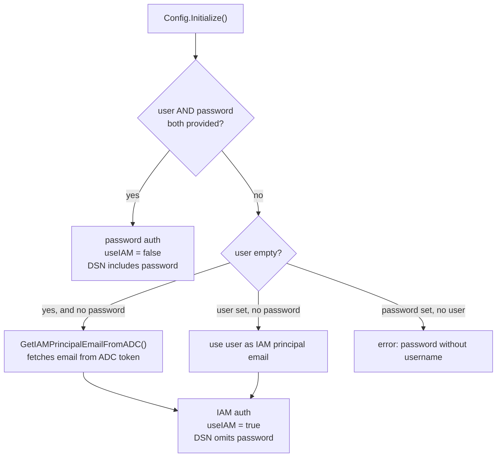
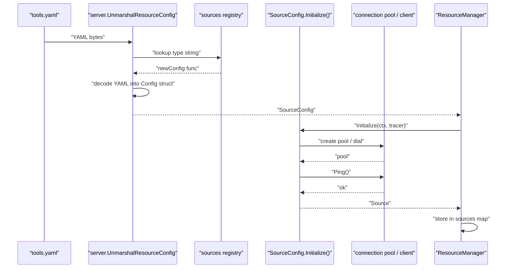

<!-- source: DeepWiki mcp.deepwiki.com · repo googleapis/genai-toolbox · page 5 Data Sources · fetched 2026-10-29 -->

# Data Sources

<details>
<summary>Relevant source files</summary>

The following files were used as context for generating this wiki page:

- [internal/prebuiltconfigs/tools/cloud-sql-mysql.yaml](internal/prebuiltconfigs/tools/cloud-sql-mysql.yaml)
- [internal/prebuiltconfigs/tools/mysql.yaml](internal/prebuiltconfigs/tools/mysql.yaml)
- [internal/sources/alloydbpg/alloydb_pg.go](internal/sources/alloydbpg/alloydb_pg.go)
- [internal/sources/alloydbpg/alloydb_pg_test.go](internal/sources/alloydbpg/alloydb_pg_test.go)
- [internal/sources/cloudsqlmssql/cloud_sql_mssql.go](internal/sources/cloudsqlmssql/cloud_sql_mssql.go)
- [internal/sources/cloudsqlmssql/cloud_sql_mssql_test.go](internal/sources/cloudsqlmssql/cloud_sql_mssql_test.go)
- [internal/sources/cloudsqlmysql/cloud_sql_mysql.go](internal/sources/cloudsqlmysql/cloud_sql_mysql.go)
- [internal/sources/cloudsqlmysql/cloud_sql_mysql_test.go](internal/sources/cloudsqlmysql/cloud_sql_mysql_test.go)
- [internal/sources/cloudsqlpg/cloud_sql_pg.go](internal/sources/cloudsqlpg/cloud_sql_pg.go)
- [internal/sources/cloudsqlpg/cloud_sql_pg_test.go](internal/sources/cloudsqlpg/cloud_sql_pg_test.go)
- [internal/sources/ip_type.go](internal/sources/ip_type.go)
- [internal/sources/mssql/mssql.go](internal/sources/mssql/mssql.go)
- [internal/sources/mssql/mssql_test.go](internal/sources/mssql/mssql_test.go)
- [internal/sources/mysql/mysql.go](internal/sources/mysql/mysql.go)
- [internal/sources/mysql/mysql_test.go](internal/sources/mysql/mysql_test.go)
- [internal/sources/neo4j/neo4j_test.go](internal/sources/neo4j/neo4j_test.go)
- [internal/sources/postgres/postgres.go](internal/sources/postgres/postgres.go)
- [internal/sources/postgres/postgres_test.go](internal/sources/postgres/postgres_test.go)
- [internal/sources/spanner/spanner.go](internal/sources/spanner/spanner.go)
- [internal/sources/util.go](internal/sources/util.go)

</details>


This section covers how data sources are defined and configured in MCP Toolbox for Databases. A source represents a database connection that tools can query. This page provides an overview of how sources work, lists all supported source types, and links to detailed documentation for each category.

For information about the internal interfaces and registration system, see [Source Architecture](#5.1). For information about how tools reference sources, see [Tools](#6).

---

## What Is a Source?

A **source** is a named, configured database connection managed by the Toolbox server. Each source corresponds to one connection pool or client. Sources are declared in `tools.yaml` under `kind: sources` blocks and are referenced by name from tool definitions.

At startup, the `ResourceManager` reads all source configurations, calls `Initialize()` on each, and keeps the resulting live connection pools available for tool invocations.

Sources: [docs/en/resources/sources/_index.md:1-35]()

---

## Common Configuration Pattern

All sources share the same YAML declaration shape:

```yaml
kind: sources
name: <source-name>
type: <source-type>
# ... type-specific fields
```

The `type` field determines which registered source implementation handles the configuration. Environment variable substitution is available for secrets:

```yaml
kind: sources
name: my-pg-source
type: postgres
host: 127.0.0.1
port: 5432
database: my_db
user: ${DB_USER}
password: ${DB_PASSWORD}
```

Sources: [docs/en/resources/sources/_index.md:19-29]()

---

## Source Type Registry

Every source type is registered at process startup via an `init()` function in its package. The registration maps the string type identifier to a constructor function.

**Source Registration Flow**



Sources: [internal/sources/postgres/postgres.go:37-41](), [internal/sources/alloydbpg/alloydb_pg.go:37-41](), [internal/sources/mysql/mysql.go:38-42](), [internal/sources/spanner/spanner.go:36-40](), [internal/sources/cloudsqlmysql/cloud_sql_mysql.go:38-42]()

---

## Source Interface Hierarchy

**SourceConfig and Source Interfaces in Code**



Sources: [internal/sources/postgres/postgres.go:51-61](), [internal/sources/alloydbpg/alloydb_pg.go:51-62](), [internal/sources/mysql/mysql.go:51-61](), [internal/sources/spanner/spanner.go:50-57]()

---

## Supported Source Types

The table below lists all source type identifiers recognized by the server, grouped by category, and indicates where each is documented in detail.

### Google Cloud — Managed Sources

| Source Type | Go Package | Description | Detail Page |
|---|---|---|---|
| `alloydb-postgres` | `internal/sources/alloydbpg` | AlloyDB for PostgreSQL via AlloyDB Go Connector | [PostgreSQL-Compatible Sources](#5.2) |
| `cloud-sql-postgres` | `internal/sources/cloudsqlpg` | Cloud SQL for PostgreSQL via Cloud SQL Go Connector | [PostgreSQL-Compatible Sources](#5.2) |
| `cloud-sql-mysql` | `internal/sources/cloudsqlmysql` | Cloud SQL for MySQL via Cloud SQL Go Connector | [MySQL and SQL Server Sources](#5.3) |
| `cloud-sql-mssql` | `internal/sources/cloudsqlmssql` | Cloud SQL for SQL Server via Cloud SQL Go Connector | [MySQL and SQL Server Sources](#5.3) |
| `bigquery` | `internal/sources/bigquery` | Google BigQuery analytics warehouse | [BigQuery and Analytics Sources](#5.4) |
| `spanner` | `internal/sources/spanner` | Cloud Spanner distributed database | [Other Database Sources](#5.5) |
| `bigtable` | `internal/sources/bigtable` | Cloud Bigtable wide-column store | [Other Database Sources](#5.5) |
| `firestore` | `internal/sources/firestore` | Firestore document database | [Other Database Sources](#5.5) |
| `cloud-sql-admin` | `internal/sources/cloudsqladmin` | Cloud SQL Admin API for instance management | [Cloud SQL Admin Source](#5.6) |
| `cloud-monitoring` | `internal/sources/cloudmonitoring` | Cloud Monitoring for metrics and timeseries | [Google Cloud Service Sources](#5.7) |

### Self-Managed Relational Sources

| Source Type | Go Package | Description | Detail Page |
|---|---|---|---|
| `postgres` | `internal/sources/postgres` | Standard PostgreSQL via pgxpool | [PostgreSQL-Compatible Sources](#5.2) |
| `mysql` | `internal/sources/mysql` | Standard MySQL via go-sql-driver/mysql | [MySQL and SQL Server Sources](#5.3) |
| `mssql` | `internal/sources/mssql` | Microsoft SQL Server via go-mssqldb | [MySQL and SQL Server Sources](#5.3) |
| `sqlite` | `internal/sources/sqlite` | SQLite embedded database | [Other Database Sources](#5.5) |
| `oracle` | `internal/sources/oracle` | Oracle Database | [Other Database Sources](#5.5) |
| `cockroachdb` | `internal/sources/cockroachdb` | CockroachDB (PostgreSQL-compatible) | [Other Database Sources](#5.5) |
| `firebird` | `internal/sources/firebird` | Firebird RDBMS | [Other Database Sources](#5.5) |

### Analytical and Warehouse Sources

| Source Type | Go Package | Description | Detail Page |
|---|---|---|---|
| `trino` | `internal/sources/trino` | Trino distributed query engine | [Other Database Sources](#5.5) |
| `duckdb` | `internal/sources/duckdb` | DuckDB in-process analytical database | [Other Database Sources](#5.5) |
| `clickhouse` | `internal/sources/clickhouse` | ClickHouse column-oriented database | [Other Database Sources](#5.5) |

### NoSQL and Graph Sources

| Source Type | Go Package | Description | Detail Page |
|---|---|---|---|
| `neo4j` | `internal/sources/neo4j` | Neo4j graph database | [Other Database Sources](#5.5) |
| `mongodb` | `internal/sources/mongodb` | MongoDB document database | [Other Database Sources](#5.5) |
| `dgraph` | `internal/sources/dgraph` | DGraph distributed graph database | [Other Database Sources](#5.5) |

### Key-Value and Cache Sources

| Source Type | Go Package | Description | Detail Page |
|---|---|---|---|
| `valkey` | `internal/sources/valkey` | Valkey in-memory key-value store | [Other Database Sources](#5.5) |
| `redis` | `internal/sources/redis` | Redis in-memory data store | [Other Database Sources](#5.5) |
| `couchbase` | `internal/sources/couchbase` | Couchbase multi-model NoSQL | [Other Database Sources](#5.5) |

---

## The `ipType` Field

Cloud-managed sources (`alloydb-postgres`, `cloud-sql-postgres`, `cloud-sql-mysql`, `cloud-sql-mssql`) accept an `ipType` field that controls which network endpoint the Cloud SQL or AlloyDB Go Connector uses to dial.

| Value | Meaning |
|---|---|
| `public` | Use the instance's public IP (default) |
| `private` | Use the instance's private (VPC) IP |
| `psc` | Use Private Service Connect endpoint |

The `IPType` type is defined in [internal/sources/ip_type.go:23-44](). Its `UnmarshalYAML` method validates the value at parse time and returns an error for any value that is not `public`, `private`, or `psc` (case-insensitive).

```yaml
kind: sources
name: my-private-pg
type: cloud-sql-postgres
project: my-project
region: us-central1
instance: my-instance
ipType: private     # one of: public, private, psc
database: my_db
user: ${DB_USER}
password: ${DB_PASSWORD}
```

Sources: [internal/sources/ip_type.go:23-44](), [internal/sources/alloydbpg/alloydb_pg.go:44](), [internal/sources/cloudsqlpg/cloud_sql_pg.go:43](), [internal/sources/cloudsqlmysql/cloud_sql_mysql.go:45]()

---

## Authentication Modes

Sources support two authentication modes: password-based and IAM-based. The mode is determined automatically at initialization by examining whether `user` and `password` are provided.

**Authentication Decision Logic (PostgreSQL and MySQL sources)**



The `GetIAMPrincipalEmailFromADC` function in [internal/sources/util.go:51-111]() fetches the email from the Application Default Credentials token info endpoint. It formats the username differently based on database type:

- **PostgreSQL**: strips the `.gserviceaccount.com` suffix from service account emails.
- **MySQL**: takes only the local part before `@`.

The `GetCloudSQLOpts` function in [internal/sources/util.go:31-48]() assembles `cloudsqlconn.Option` values for IP type and IAM auth, used by both Cloud SQL Postgres and Cloud SQL MySQL sources.

Sources: [internal/sources/util.go:31-111](), [internal/sources/alloydbpg/alloydb_pg.go:151-182](), [internal/sources/cloudsqlpg/cloud_sql_pg.go:138-169](), [internal/sources/cloudsqlmysql/cloud_sql_mysql.go:163-187]()

---

## Connection Pooling

Most SQL sources use a managed connection pool rather than a single connection. The pool type depends on the driver:

| Source family | Pool type | Library |
|---|---|---|
| `postgres`, `cloud-sql-postgres`, `alloydb-postgres` | `pgxpool.Pool` | `jackc/pgx/v5/pgxpool` |
| `mysql`, `cloud-sql-mysql` | `sql.DB` | `database/sql` + `go-sql-driver/mysql` |
| `mssql`, `cloud-sql-mssql` | `sql.DB` | `database/sql` + `microsoft/go-mssqldb` |
| `spanner` | `spanner.Client` | `cloud.google.com/go/spanner` |

Each source's `Initialize()` method creates the pool and immediately calls `Ping` (or `PingContext`) to verify connectivity before returning.

Sources: [internal/sources/postgres/postgres.go:67-83](), [internal/sources/alloydbpg/alloydb_pg.go:68-84](), [internal/sources/mysql/mysql.go:67-83](), [internal/sources/spanner/spanner.go:63-74](), [internal/sources/cloudsqlmysql/cloud_sql_mysql.go:68-84]()

---

## Source Initialization Sequence

**Lifecycle from YAML to Ready Source**



Sources: [internal/sources/postgres/postgres.go:67-83](), [internal/sources/alloydbpg/alloydb_pg.go:68-84](), [internal/sources/cloudsqlpg/cloud_sql_pg.go:66-82](), [internal/sources/cloudsqlmysql/cloud_sql_mysql.go:68-84]()

---

## Child Pages

The following sub-pages document each source group in detail, including all configuration fields, authentication options, and available prebuilt tools:

- [Source Architecture](#5.1): `SourceConfig`/`Source` interfaces, registry internals, `RunSQL` conventions, and utility functions.
- [PostgreSQL-Compatible Sources](#5.2): `postgres`, `alloydb-postgres`, `cloud-sql-postgres`.
- [MySQL and SQL Server Sources](#5.3): `mysql`, `cloud-sql-mysql`, `mssql`, `cloud-sql-mssql`.
- [BigQuery and Analytics Sources](#5.4): `bigquery` with write modes, dataset restrictions, and session management.
- [Other Database Sources](#5.5): MongoDB, Neo4j, SQLite, Bigtable, Spanner, Oracle, Trino, DuckDB, Firebird, Firestore, ClickHouse, CockroachDB, Valkey, Redis, Couchbase, DGraph.
- [Cloud SQL Admin Source](#5.6): `cloud-sql-admin` for instance-level admin operations.
- [Google Cloud Service Sources](#5.7): Dataplex, Cloud Healthcare, Cloud Monitoring, Cloud Logging, and others.

---

