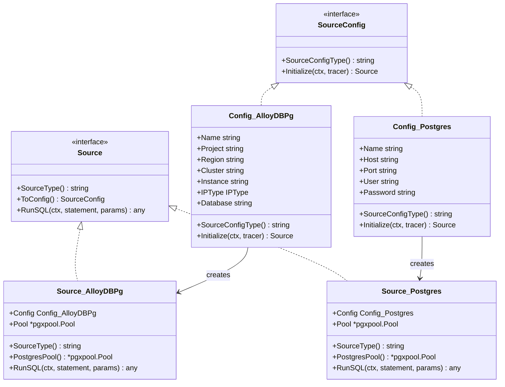
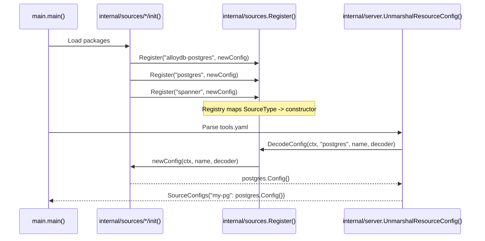
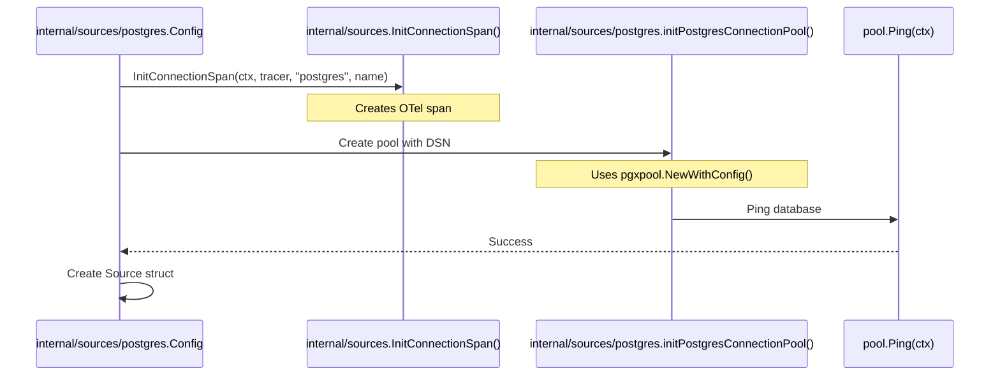
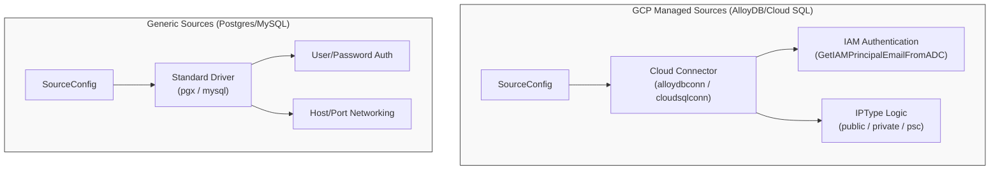

<!-- source: DeepWiki mcp.deepwiki.com · repo googleapis/genai-toolbox · page 5.1 Source Architecture · fetched 2026-10-29 -->

# Source Architecture

<details>
<summary>Relevant source files</summary>

The following files were used as context for generating this wiki page:

- [.gemini/styleguide.md](.gemini/styleguide.md)
- [.gitignore](.gitignore)
- [AGENTS.md](AGENTS.md)
- [CLAUDE.md](CLAUDE.md)
- [CONTRIBUTING.md](CONTRIBUTING.md)
- [DEVELOPER.md](DEVELOPER.md)
- [GEMINI.md](GEMINI.md)
- [LICENSE](LICENSE)
- [internal/sources/alloydbpg/alloydb_pg.go](internal/sources/alloydbpg/alloydb_pg.go)
- [internal/sources/alloydbpg/alloydb_pg_test.go](internal/sources/alloydbpg/alloydb_pg_test.go)
- [internal/sources/cloudsqlpg/cloud_sql_pg.go](internal/sources/cloudsqlpg/cloud_sql_pg.go)
- [internal/sources/cloudsqlpg/cloud_sql_pg_test.go](internal/sources/cloudsqlpg/cloud_sql_pg_test.go)
- [internal/sources/ip_type.go](internal/sources/ip_type.go)
- [internal/sources/neo4j/neo4j_test.go](internal/sources/neo4j/neo4j_test.go)
- [internal/sources/postgres/postgres.go](internal/sources/postgres/postgres.go)
- [internal/sources/postgres/postgres_test.go](internal/sources/postgres/postgres_test.go)
- [internal/sources/spanner/spanner.go](internal/sources/spanner/spanner.go)
- [internal/sources/util.go](internal/sources/util.go)

</details>


## Purpose and Scope

This document explains the internal architecture of the Source abstraction layer in the Toolbox system. Sources provide database connectivity to Tools through a unified interface that handles connection pooling, authentication, and lifecycle management.

For information about configuring individual source types, see [5.2](), [5.3](), [5.4](), [5.5](), and [5.6](). For information about how Tools use Sources, see [6.1]().

---

## The Source Interface

Sources in Toolbox follow a two-interface pattern that separates configuration from runtime representation:

**Source Interface Hierarchy**


**Two-Phase Pattern**

1.  **Configuration Phase**: `SourceConfig` instances are created during YAML parsing and validation. They contain user-provided parameters but no active connections [internal/sources/alloydbpg/alloydb_pg.go:51-62]().
2.  **Initialization Phase**: When the server starts, each `SourceConfig.Initialize()` is called to establish connections and create a `Source` instance [internal/sources/alloydbpg/alloydb_pg.go:68-84]().

This separation allows validation to occur without establishing connections and enables configuration reloading without disrupting active connections until validation passes.

**Sources:**
- [internal/sources/alloydbpg/alloydb_pg.go:34-104]()
- [internal/sources/postgres/postgres.go:34-129]()

---

## Source Registration and Discovery

Sources use an init-time registration pattern that allows new source types to be added without modifying central dispatch code.

**Registration Sequence**


**Registration Mechanism**

Each source package contains an `init()` function that registers its constructor:

[internal/sources/alloydbpg/alloydb_pg.go:37-41]()
```go
func init() {
	if !sources.Register(SourceType, newConfig) {
		panic(fmt.Sprintf("source type %q already registered", SourceType))
	}
}
```

The `newConfig` function serves as the constructor, often setting default values like `IPType: "public"` [internal/sources/alloydbpg/alloydb_pg.go:43-49]().

**Sources:**
- [internal/sources/alloydbpg/alloydb_pg.go:37-49]()
- [internal/sources/postgres/postgres.go:37-49]()
- [internal/sources/spanner/spanner.go:36-48]()

---

## Configuration Parsing and Validation

Configuration parsing transforms YAML into type-safe `SourceConfig` instances through custom unmarshaling and validation.

**Validation Logic**

Each source type validates its required fields during unmarshaling using struct tags. For example, `alloydb-postgres` requires `project`, `region`, `cluster`, `instance`, and `database` [internal/sources/alloydbpg/alloydb_pg.go:51-62]().

Tests verify that missing required fields or invalid values (like an incorrect `ipType`) trigger immediate parsing errors [internal/sources/alloydbpg/alloydb_pg_test.go:179-192]().

**Sources:**
- [internal/sources/alloydbpg/alloydb_pg.go:51-62]()
- [internal/sources/alloydbpg/alloydb_pg_test.go:138-206]()
- [internal/sources/postgres/postgres_test.go:133-195]()

---

## Source Initialization Flow

The initialization flow transforms validated `SourceConfig` instances into active `Source` instances with live database connections.

**Initialization Sequence**


**Initialization Implementation - AlloyDB Example**

[internal/sources/alloydbpg/alloydb_pg.go:68-84]()
```go
func (r Config) Initialize(ctx context.Context, tracer trace.Tracer) (sources.Source, error) {
	pool, err := initAlloyDBPgConnectionPool(ctx, tracer, r.Name, r.Project, r.Region, r.Cluster, r.Instance, r.IPType.String(), r.User, r.Password, r.Database)
	if err != nil {
		return nil, fmt.Errorf("unable to create pool: %w", err)
	}

	err = pool.Ping(ctx)
	if err != nil {
		return nil, fmt.Errorf("unable to connect successfully: %w", err)
	}

	s := &Source{
		Config: r,
		Pool:   pool,
	}
	return s, nil
}
```

**Sources:**
- [internal/sources/alloydbpg/alloydb_pg.go:68-84]()
- [internal/sources/postgres/postgres.go:67-83]()

---

## Dual-Mode Architecture: GCP vs Generic Sources

Toolbox sources implement two distinct connection patterns: one optimized for Google Cloud managed services and one for generic database instances.

**Connectivity Architecture**


### GCP IAM Authentication

GCP sources use `GetIAMPrincipalEmailFromADC` to automatically fetch the service account or user email from Application Default Credentials if no password is provided [internal/sources/alloydbpg/alloydb_pg.go:167-177]().

### IPType and Cloud SQL Options

GCP sources support three networking modes via the `IPType` abstraction: `public`, `private`, and `psc` [internal/sources/ip_type.go:37-43](). The utility `GetCloudSQLOpts` maps these strings to internal connector options [internal/sources/cloudsqlpg/cloud_sql_pg.go:192-195]().

**Sources:**
- [internal/sources/alloydbpg/alloydb_pg.go:132-182]()
- [internal/sources/cloudsqlpg/cloud_sql_pg.go:138-213]()
- [internal/sources/ip_type.go:23-44]()

---

## RunSQL Conventions

Sources provide a `RunSQL` method to execute queries. This method typically returns a slice of `orderedmap.Row` to maintain column order for LLM consumption.

**Postgres Implementation**
[internal/sources/postgres/postgres.go:104-129]()
```go
func (s *Source) RunSQL(ctx context.Context, statement string, params []any) (any, error) {
	results, err := s.PostgresPool().Query(ctx, statement, params...)
	if err != nil {
		return nil, fmt.Errorf("unable to execute query: %w", err)
	}
	defer results.Close()

	fields := results.FieldDescriptions()
	var out []any
	for results.Next() {
		values, err := results.Values()
		// ... mapping to orderedmap.Row ...
		row := orderedmap.Row{}
		for i, f := range fields {
			row.Add(f.Name, values[i])
		}
		out = append(out, row)
	}
	return out, nil
}
```

**Spanner Implementation**
Spanner's `RunSQL` distinguishes between read-only and read-write transactions [internal/sources/spanner/spanner.go:140-170]().

**Sources:**
- [internal/sources/postgres/postgres.go:104-129]()
- [internal/sources/spanner/spanner.go:140-170]()

---

## Common Utility Functions

| Function | Purpose | Location |
| :--- | :--- | :--- |
| `GetIAMPrincipalEmailFromADC` | Fetches email from Google credentials for IAM DB auth. | [internal/sources/alloydbpg/alloydb_pg.go:172]() |
| `GetCloudSQLOpts` | Configures Cloud SQL dialer with IP type and IAM settings. | [internal/sources/cloudsqlpg/cloud_sql_pg.go:192]() |
| `InitConnectionSpan` | Creates an OpenTelemetry span for source initialization. | [internal/sources/alloydbpg/alloydb_pg.go:186]() |
| `ConvertParamMapToRawQuery` | Converts a map of strings to a URL query string for DSNs. | [internal/sources/postgres/postgres.go:174-180]() |

**Sources:**
- [internal/sources/alloydbpg/alloydb_pg.go:151-182]()
- [internal/sources/cloudsqlpg/cloud_sql_pg.go:171-213]()
- [internal/sources/postgres/postgres.go:174-180]()

---

