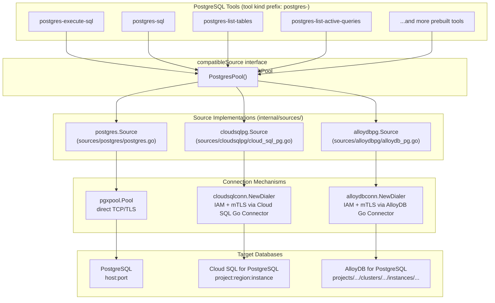
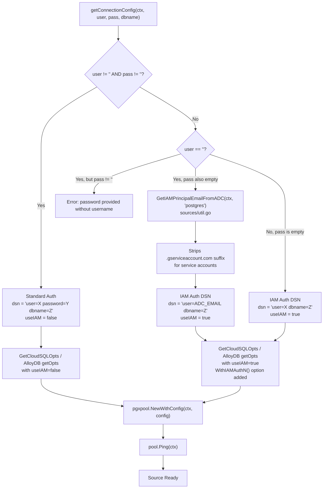

<!-- source: DeepWiki mcp.deepwiki.com · repo googleapis/genai-toolbox · page 5.2 PostgreSQL-Compatible Sources · fetched 2026-10-29 -->

# PostgreSQL-Compatible Sources

<details>
<summary>Relevant source files</summary>

The following files were used as context for generating this wiki page:

- [internal/prebuiltconfigs/tools/alloydb-postgres.yaml](internal/prebuiltconfigs/tools/alloydb-postgres.yaml)
- [internal/prebuiltconfigs/tools/cloud-sql-postgres.yaml](internal/prebuiltconfigs/tools/cloud-sql-postgres.yaml)
- [internal/prebuiltconfigs/tools/postgres.yaml](internal/prebuiltconfigs/tools/postgres.yaml)
- [internal/sources/alloydbpg/alloydb_pg.go](internal/sources/alloydbpg/alloydb_pg.go)
- [internal/sources/alloydbpg/alloydb_pg_test.go](internal/sources/alloydbpg/alloydb_pg_test.go)
- [internal/sources/cloudsqlpg/cloud_sql_pg.go](internal/sources/cloudsqlpg/cloud_sql_pg.go)
- [internal/sources/cloudsqlpg/cloud_sql_pg_test.go](internal/sources/cloudsqlpg/cloud_sql_pg_test.go)
- [internal/sources/ip_type.go](internal/sources/ip_type.go)
- [internal/sources/neo4j/neo4j_test.go](internal/sources/neo4j/neo4j_test.go)
- [internal/sources/postgres/postgres.go](internal/sources/postgres/postgres.go)
- [internal/sources/postgres/postgres_test.go](internal/sources/postgres/postgres_test.go)
- [internal/sources/spanner/spanner.go](internal/sources/spanner/spanner.go)
- [internal/sources/util.go](internal/sources/util.go)

</details>


This page documents the three PostgreSQL-compatible source types supported by Toolbox: `postgres`, `cloud-sql-postgres`, and `alloydb-postgres`. These sources share a common tool ecosystem while using different connection mechanisms suited to their deployment environments.

For information about the general `SourceConfig` and `Source` interfaces and registration patterns, see page 5.1. For MySQL and SQL Server sources, see page 5.3. For BigQuery, see page 5.4. For other databases including Spanner, see page 5.5.

## Source Types Overview

Toolbox supports three PostgreSQL-compatible source types, each optimized for a different deployment scenario:

| Source Kind | Use Case | Connection Mechanism | IAM Auth | mTLS | IP Type Options |
|-------------|----------|---------------------|----------|------|----------------|
| `postgres` | Self-hosted or any direct-access PostgreSQL | Direct `pgx` connection | No | Optional via `queryParams` | N/A |
| `cloud-sql-postgres` | Google Cloud SQL for PostgreSQL | Cloud SQL Go Connector (`cloudsqlconn`) | Yes | Yes (automatic) | `public`, `private`, `psc` |
| `alloydb-postgres` | Google AlloyDB for PostgreSQL | AlloyDB Go Connector (`alloydbconn`) | Yes | Yes (automatic) | `public`, `private`, `psc` |

Sources: [internal/sources/postgres/postgres.go:32-32](), [internal/sources/cloudsqlpg/cloud_sql_pg.go:31-31](), [internal/sources/alloydbpg/alloydb_pg.go:32-32]()

## PostgreSQL-Compatible Source Architecture

The following diagram shows how PostgreSQL tools connect to each source type through a shared interface. Tools discover their compatible source via `PostgresPool() *pgxpool.Pool`.

**Source and Connection Hierarchy**



Sources: [internal/sources/postgres/postgres.go:100-102](), [internal/sources/cloudsqlpg/cloud_sql_pg.go:107-109](), [internal/sources/alloydbpg/alloydb_pg.go:101-103]()

## Generic PostgreSQL Source

The `postgres` source provides direct connectivity to any PostgreSQL-compatible database using the `pgx` driver. It is suitable for self-hosted PostgreSQL instances, PostgreSQL-compatible databases, or environments where direct TCP connection is available.

### Configuration Structure

```yaml
sources:
    my-pg-source:
        kind: postgres
        host: 127.0.0.1
        port: 5432
        database: my_db
        user: ${USER_NAME}
        password: ${PASSWORD}
        queryParams:
            sslmode: require
            connect_timeout: "10"
```

### Configuration Fields

| Field | Type | Required | Description |
|-------|------|----------|-------------|
| `kind` | string | Yes | Must be `"postgres"` |
| `host` | string | Yes | IP address or hostname (e.g., `"127.0.0.1"`) |
| `port` | string | Yes | Port number (e.g., `"5432"`) |
| `database` | string | Yes | Database name to connect to |
| `user` | string | Yes | PostgreSQL username |
| `password` | string | Yes | PostgreSQL password |
| `queryParams` | map[string]string | No | Raw key/value pairs appended to the connection string (e.g., `sslmode`, `sslrootcert`) |
| `queryExecMode` | string | No | pgx query execution mode. One of: `cache_statement` (default), `cache_describe`, `describe_exec`, `exec`, `simple_protocol`. |

Sources: [internal/sources/postgres/postgres.go:51-61](), [internal/prebuiltconfigs/tools/postgres.yaml:15-23]()

### Authentication

The `postgres` source supports standard username/password authentication. IAM authentication is not available for this source type. Standard connection parameters are handled by `initPostgresConnectionPool` [internal/sources/postgres/postgres.go:131-172]().

## Cloud SQL for PostgreSQL Source

The `cloud-sql-postgres` source uses the [Cloud SQL Go Connector](https://github.com/GoogleCloudPlatform/cloud-sql-go-connector) to establish secure, encrypted connections to Cloud SQL for PostgreSQL instances. The connector handles automatic IAM authentication, mTLS encryption, and connection pooling.

### Configuration Structure

```yaml
sources:
    cloudsql-pg-source:
        kind: cloud-sql-postgres
        project: my-project-id
        region: us-central1
        instance: my-instance
        database: my_db
        user: ${USER_NAME}          # Optional for IAM auth
        password: ${PASSWORD}        # Optional for IAM auth
        ipType: public              # or private, psc
```

### Configuration Fields

| Field | Type | Required | Description |
|-------|------|----------|-------------|
| `kind` | string | Yes | Must be `"cloud-sql-postgres"` |
| `project` | string | Yes | GCP project ID (e.g., `"my-project-id"`) |
| `region` | string | Yes | GCP region (e.g., `"us-central1"`) |
| `instance` | string | Yes | Cloud SQL instance name |
| `database` | string | Yes | Database name |
| `user` | string | No | PostgreSQL user or IAM email. If omitted, Toolbox fetches the ADC email automatically |
| `password` | string | No | Password for user/password auth. If omitted, attempts IAM authentication |
| `ipType` | string | No | IP connectivity type: `"public"`, `"private"`, or `"psc"`. Default: `"public"` |

Sources: [internal/sources/cloudsqlpg/cloud_sql_pg.go:50-60](), [internal/prebuiltconfigs/tools/cloud-sql-postgres.yaml:15-24]()

### IAM Requirements

The Cloud SQL Go Connector (`cloudsqlconn`) requires the following IAM role assigned to the service account used by ADC:
- `roles/cloudsql.client`

Toolbox utilizes `GetCloudSQLOpts` to configure the dialer with IAM authentication enabled via `cloudsqlconn.WithIAMAuthN()` [internal/sources/util.go:44-46]().

## AlloyDB for PostgreSQL Source

The `alloydb-postgres` source uses the [AlloyDB Go Connector](https://github.com/GoogleCloudPlatform/alloydb-go-connector) to connect to AlloyDB for PostgreSQL instances. Like Cloud SQL, it provides automatic IAM authentication and mTLS encryption.

### Configuration Structure

```yaml
sources:
    alloydb-pg-source:
        kind: alloydb-postgres
        project: my-project-id
        region: us-central1
        cluster: my-cluster
        instance: my-instance
        database: my_db
        user: ${USER_NAME}          # Optional for IAM auth
        password: ${PASSWORD}        # Optional for IAM auth
        ipType: public              # or private, psc
```

### Configuration Fields

| Field | Type | Required | Description |
|-------|------|----------|-------------|
| `kind` | string | Yes | Must be `"alloydb-postgres"` |
| `project` | string | Yes | GCP project ID |
| `region` | string | Yes | GCP region (e.g., `"us-central1"`) |
| `cluster` | string | Yes | AlloyDB cluster name |
| `instance` | string | Yes | AlloyDB instance name within cluster |
| `database` | string | Yes | Database name |
| `user` | string | No | PostgreSQL user or IAM email. If omitted, Toolbox fetches the ADC email automatically |
| `password` | string | No | Password for user/password auth. If omitted, attempts IAM authentication |
| `ipType` | string | No | IP connectivity type: `"public"`, `"private"`, or `"psc"`. Default: `"public"` |

Sources: [internal/sources/alloydbpg/alloydb_pg.go:51-62](), [internal/prebuiltconfigs/tools/alloydb-postgres.yaml:15-25]()

## Authentication Decision Flow

For `cloud-sql-postgres` and `alloydb-postgres`, the authentication mode is determined by which of `user` and `password` are present in the config. The logic is implemented in the `getConnectionConfig` function in each source package.

**Authentication mode selection for GCP PostgreSQL sources**



Sources: [internal/sources/cloudsqlpg/cloud_sql_pg.go:138-169](), [internal/sources/alloydbpg/alloydb_pg.go:151-182](), [internal/sources/util.go:51-111]()

## Connection Initialization Implementation

### AlloyDB Connection Initialization

The AlloyDB source initialization demonstrates the typical flow for GCP PostgreSQL sources:

[internal/sources/alloydbpg/alloydb_pg.go:184-222]()

Key steps:
1. **Configuration parsing**: `getConnectionConfig()` determines authentication method (user/password vs IAM) and constructs DSN [internal/sources/alloydbpg/alloydb_pg.go:151-182]().
2. **Option setup**: `getOpts()` configures IP type (public/private/psc) and IAM authentication [internal/sources/alloydbpg/alloydb_pg.go:132-149]().
3. **Dialer creation**: `alloydbconn.NewDialer()` creates the connector with proper options [internal/sources/alloydbpg/alloydb_pg.go:207-210]().
4. **Custom DialFunc**: Connection pool configured with custom dial function using the connector [internal/sources/alloydbpg/alloydb_pg.go:214-216]().
5. **Connection validation**: `pool.Ping(ctx)` ensures connectivity before returning [internal/sources/alloydbpg/alloydb_pg.go:74-77]().

Sources: [internal/sources/alloydbpg/alloydb_pg.go:68-84](), [internal/sources/util.go:31-48]()

## IP Type Configuration

GCP PostgreSQL sources support three IP connectivity types via the `ipType` field, implemented via the `IPType` custom type [internal/sources/ip_type.go:23-23]().

| IP Type | Description | Use Case |
|---------|-------------|----------|
| `public` | Connect via external public IP over internet | Development, external access |
| `private` | Connect via internal VPC private IP | Production, VPC-based architecture |
| `psc` | Connect via Private Service Connect endpoint | Advanced private connectivity |

The `IPType` struct provides:
- Default value of `"public"` when unspecified [internal/sources/ip_type.go:25-30]().
- Validation against allowed values during YAML unmarshaling [internal/sources/ip_type.go:37-42]().

Sources: [internal/sources/ip_type.go:15-44](), [internal/sources/util.go:31-48]()

## Available PostgreSQL Tools

All three PostgreSQL-compatible sources share the same tool ecosystem. Prebuilt configurations define a standard set of tools for these sources.

### Built-in Tool Kinds

| Tool Kind | Description |
|-----------|-------------|
| `postgres-execute-sql` | Execute parameterized SQL statements [internal/prebuiltconfigs/tools/postgres.yaml:26-28]() |
| `postgres-list-tables` | List detailed schema information [internal/prebuiltconfigs/tools/postgres.yaml:29-32]() |
| `postgres-list-active-queries` | List currently running queries from `pg_stat_activity` [internal/prebuiltconfigs/tools/postgres.yaml:33-36]() |
| `postgres-list-available-extensions` | Discover extensions available for installation [internal/prebuiltconfigs/tools/postgres.yaml:37-40]() |
| `postgres-list-installed-extensions` | List currently installed extensions [internal/prebuiltconfigs/tools/postgres.yaml:41-44]() |
| `postgres-long-running-transactions` | Identifies database transactions exceeding a time limit [internal/prebuiltconfigs/tools/postgres.yaml:45-48]() |
| `postgres-list-locks` | Identifies all locks held by active processes [internal/prebuiltconfigs/tools/postgres.yaml:49-52]() |
| `postgres-replication-stats` | Lists replica sync and lag statistics [internal/prebuiltconfigs/tools/postgres.yaml:53-56]() |

### SQL-based Prebuilt Tools

Prebuilt configs also define tools using the `postgres-sql` kind to execute specific diagnostic queries:

| Prebuilt Tool | Description |
|---------------|-------------|
| `list_autovacuum_configurations` | List autovacuum settings from `pg_settings` [internal/prebuiltconfigs/tools/postgres.yaml:57-65]() |
| `list_memory_configurations` | List memory-related configurations [internal/prebuiltconfigs/tools/postgres.yaml:66-86]() |
| `list_top_bloated_tables` | List tables by approximate bloat signal [internal/prebuiltconfigs/tools/postgres.yaml:87-110]() |
| `list_replication_slots` | List details and size of outstanding WAL for replication slots [internal/prebuiltconfigs/tools/postgres.yaml:111-128]() |
| `list_invalid_indexes` | List unusable indexes taking up disk space [internal/prebuiltconfigs/tools/postgres.yaml:129-145]() |
| `get_query_plan` | Generate an EXPLAIN plan in JSON format [internal/prebuiltconfigs/tools/postgres.yaml:146-153]() |

Sources: [internal/prebuiltconfigs/tools/postgres.yaml:24-153](), [internal/prebuiltconfigs/tools/cloud-sql-postgres.yaml:30-155](), [internal/prebuiltconfigs/tools/alloydb-postgres.yaml:31-156]()

## Managed Connection Pooling

All three PostgreSQL-compatible sources use `pgxpool.Pool` for client-side connection pooling. The pool is initialized during the `Initialize` phase of the source lifecycle [internal/sources/postgres/postgres.go:67-71]().

For Cloud SQL and AlloyDB, the `DialFunc` of the pool is overridden to use the Google Cloud connectors [internal/sources/cloudsqlpg/cloud_sql_pg.go:203-205](), [internal/sources/alloydbpg/alloydb_pg.go:214-216](). This ensures that even within a connection pool, every new connection is established securely via the connector's dialer.

Sources: [internal/sources/postgres/postgres.go:131-172](), [internal/sources/cloudsqlpg/cloud_sql_pg.go:171-213](), [internal/sources/alloydbpg/alloydb_pg.go:184-222]()

---

