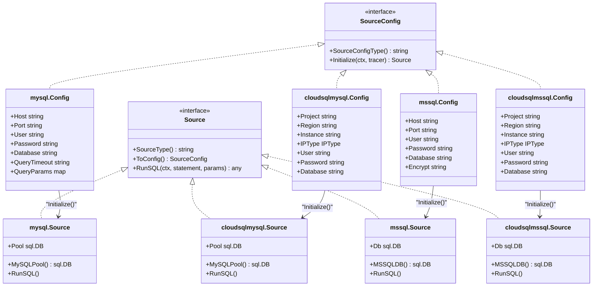
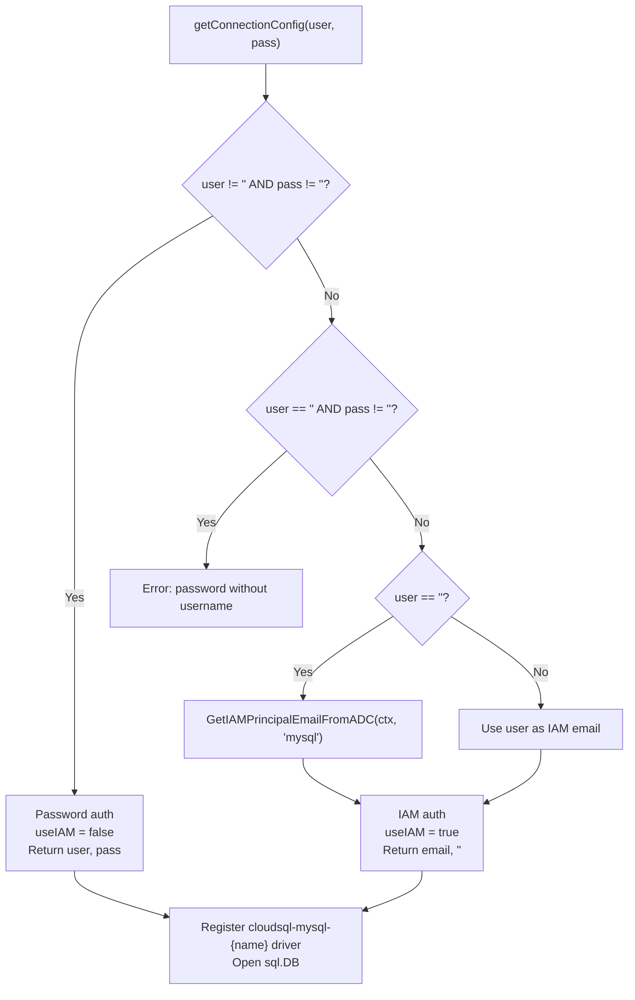
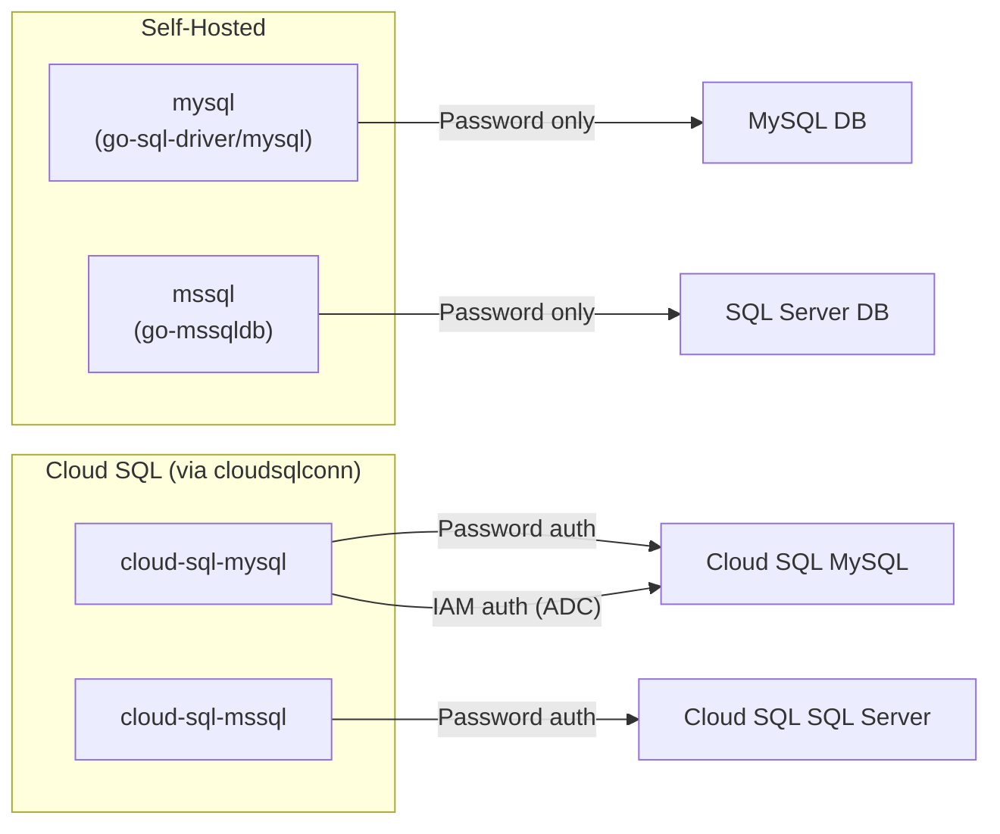

<!-- source: DeepWiki mcp.deepwiki.com · repo googleapis/genai-toolbox · page 5.3 MySQL and SQL Server Sources · fetched 2026-10-29 -->

# MySQL and SQL Server Sources

Relevant source files

The following files were used as context for generating this wiki page:

- [internal/prebuiltconfigs/tools/cloud-sql-mssql.yaml](internal/prebuiltconfigs/tools/cloud-sql-mssql.yaml)
- [internal/prebuiltconfigs/tools/cloud-sql-mysql.yaml](internal/prebuiltconfigs/tools/cloud-sql-mysql.yaml)
- [internal/prebuiltconfigs/tools/mssql.yaml](internal/prebuiltconfigs/tools/mssql.yaml)
- [internal/prebuiltconfigs/tools/mysql.yaml](internal/prebuiltconfigs/tools/mysql.yaml)
- [internal/prebuiltconfigs/tools/spanner-postgres.yaml](internal/prebuiltconfigs/tools/spanner-postgres.yaml)
- [internal/prebuiltconfigs/tools/spanner.yaml](internal/prebuiltconfigs/tools/spanner.yaml)
- [internal/sources/cloudsqlmssql/cloud_sql_mssql.go](internal/sources/cloudsqlmssql/cloud_sql_mssql.go)
- [internal/sources/cloudsqlmssql/cloud_sql_mssql_test.go](internal/sources/cloudsqlmssql/cloud_sql_mssql_test.go)
- [internal/sources/cloudsqlmysql/cloud_sql_mysql.go](internal/sources/cloudsqlmysql/cloud_sql_mysql.go)
- [internal/sources/cloudsqlmysql/cloud_sql_mysql_test.go](internal/sources/cloudsqlmysql/cloud_sql_mysql_test.go)
- [internal/sources/mssql/mssql.go](internal/sources/mssql/mssql.go)
- [internal/sources/mssql/mssql_test.go](internal/sources/mssql/mssql_test.go)
- [internal/sources/mysql/mysql.go](internal/sources/mysql/mysql.go)
- [internal/sources/mysql/mysql_test.go](internal/sources/mysql/mysql_test.go)

This page documents the four source types that connect to MySQL and SQL Server databases: `mysql`, `cloud-sql-mysql`, `mssql`, and `cloud-sql-mssql`. It covers their configuration fields, authentication mechanisms, connection pooling, and available prebuilt tools.

For the general source interface and registry that these types plug into, see [Source Architecture](#5.1). For PostgreSQL-based sources, see [PostgreSQL-Compatible Sources](#5.2). For BigQuery and other analytics sources, see [BigQuery and Analytics Sources](#5.4).

---

## Source Type Overview

| Source type | Package | Database | Cloud-managed |
|---|---|---|---|
| `mysql` | `internal/sources/mysql` | MySQL (self-hosted) | No |
| `cloud-sql-mysql` | `internal/sources/cloudsqlmysql` | Cloud SQL for MySQL | Yes (Google Cloud) |
| `mssql` | `internal/sources/mssql` | SQL Server (self-hosted) | No |
| `cloud-sql-mssql` | `internal/sources/cloudsqlmssql` | Cloud SQL for SQL Server | Yes (Google Cloud) |

Each type registers itself via its `init()` function into the global source registry.

Sources: [internal/sources/mysql/mysql.go:32-42](), [internal/sources/cloudsqlmysql/cloud_sql_mysql.go:33-42](), [internal/sources/mssql/mssql.go:31-40](), [internal/sources/cloudsqlmssql/cloud_sql_mssql.go:32-41]()

---

**Diagram: Source Type Hierarchy and Interface Implementation**

Sources: [internal/sources/mysql/mysql.go:51-61](), [internal/sources/cloudsqlmysql/cloud_sql_mysql.go:52-62](), [internal/sources/mssql/mssql.go:50-60](), [internal/sources/cloudsqlmssql/cloud_sql_mssql.go:51-62]()

---

## MySQL Source (`mysql`)

The `mysql` source connects to a self-hosted or network-accessible MySQL server using the `go-sql-driver/mysql` driver.

### Configuration Fields

| Field | Type | Required | Default | Description |
|---|---|---|---|---|
| `kind` | string | true | — | Must be `"mysql"` |
| `host` | string | true | — | IP address or hostname |
| `port` | string | true | — | TCP port (default `3306`) |
| `database` | string | true | — | Database name |
| `user` | string | false | — | MySQL username |
| `password` | string | false | — | MySQL password |
| `queryTimeout` | string | false | none | Max query duration (e.g. `"30s"`) |
| `queryParams` | map[string]string | false | nil | Additional DSN parameters |

Sources: [internal/sources/mysql/mysql.go:51-61](), [internal/prebuiltconfigs/tools/mysql.yaml:16-28]()

### `queryTimeout` and `queryParams`

`queryTimeout` is parsed as a Go `time.Duration` string. If provided, it is translated to the `ReadTimeout` field on the MySQL driver config.

[internal/sources/mysql/mysql.go:180-186]()

`queryParams` is a `map[string]string` appended to the DSN. The `parseTime=true` parameter is always added automatically.

[internal/sources/mysql/mysql.go:189-196]()

---

## Cloud SQL for MySQL Source (`cloud-sql-mysql`)

The `cloud-sql-mysql` source connects to Google Cloud SQL for MySQL instances using the Cloud SQL Go Connector.

### Configuration Fields

| Field | Type | Required | Default | Description |
|---|---|---|---|---|
| `kind` | string | true | — | Must be `"cloud-sql-mysql"` |
| `project` | string | true | — | GCP project ID |
| `region` | string | true | — | GCP region |
| `instance` | string | true | — | Cloud SQL instance name |
| `database` | string | true | — | Database name |
| `user` | string | false | (ADC email) | MySQL username; if omitted, IAM auth is used |
| `password` | string | false | (IAM auth) | MySQL password; if omitted, IAM auth is used |
| `ipType` | string | false | `"public"` | IP connectivity type |

Sources: [internal/sources/cloudsqlmysql/cloud_sql_mysql.go:52-62]()

### Authentication

**Diagram: cloud-sql-mysql Authentication Decision Flow**

Sources: [internal/sources/cloudsqlmysql/cloud_sql_mysql.go:163-187]()

---

## SQL Server Source (`mssql`)

The `mssql` source connects to a self-hosted or network-accessible SQL Server instance using the `github.com/microsoft/go-mssqldb` driver.

### Configuration Fields

| Field | Type | Required | Default | Description |
|---|---|---|---|---|
| `kind` | string | true | — | Must be `"mssql"` |
| `host` | string | true | — | IP address or hostname |
| `port` | string | true | — | TCP port (default `1433`) |
| `database` | string | true | — | Database name |
| `user` | string | true | — | SQL Server username |
| `password` | string | true | — | SQL Server password |
| `encrypt` | string | false | — | Encryption level (e.g. `"strict"`) |

Sources: [internal/sources/mssql/mssql.go:51-60](), [internal/prebuiltconfigs/tools/mssql.yaml:16-22]()

---

## Cloud SQL for SQL Server Source (`cloud-sql-mssql`)

The `cloud-sql-mssql` source connects to Google Cloud SQL for SQL Server instances using the Cloud SQL Go Connector.

### Configuration Fields

| Field | Type | Required | Default | Description |
|---|---|---|---|---|
| `kind` | string | true | — | Must be `"cloud-sql-mssql"` |
| `project` | string | true | — | GCP project ID |
| `region` | string | true | — | GCP region |
| `instance` | string | true | — | Cloud SQL instance name |
| `database` | string | true | — | Database name |
| `user` | string | true | — | SQL Server username |
| `password` | string | true | — | SQL Server password |
| `ipType` | string | true | `"public"` | IP connectivity type |

Sources: [internal/sources/cloudsqlmssql/cloud_sql_mssql.go:51-62]()

### Authentication

Unlike `cloud-sql-mysql`, `cloud-sql-mssql` requires both `user` and `password` for database-level access. The Cloud SQL connector handles the secure tunnel, but standard SQL Server logins are used.

[internal/sources/cloudsqlmssql/cloud_sql_mssql.go:162-172]()

---

## Available Prebuilt Tools

The following tool kinds are available and compatible with the sources described above.

### MySQL Prebuilt Tools
Compatible with `mysql` and `cloud-sql-mysql`.

| Tool Kind | Description |
|---|---|
| `mysql-execute-sql` | Execute arbitrary SQL queries. |
| `mysql-list-active-queries` | Lists ongoing queries and transaction details. |
| `mysql-get-query-plan` | Provides `EXPLAIN` information for performance analysis. |
| `mysql-list-tables` | Lists detailed schema information for user tables. |
| `mysql-list-table-stats` | Displays size and latency statistics. |
| `mysql-list-tables-missing-unique-indexes` | Finds tables lacking primary or unique keys. |
| `mysql-list-table-fragmentation` | Lists fragmentation percentage per table. |

Sources: [internal/prebuiltconfigs/tools/mysql.yaml:30-57](), [internal/prebuiltconfigs/tools/cloud-sql-mysql.yaml:30-58]()

### SQL Server Prebuilt Tools
Compatible with `mssql` and `cloud-sql-mssql`.

| Tool Kind | Description |
|---|---|
| `mssql-execute-sql` | Execute arbitrary SQL queries. |
| `mssql-list-tables` | Lists detailed schema information for user tables. |

Sources: [internal/prebuiltconfigs/tools/mssql.yaml:24-31](), [internal/prebuiltconfigs/tools/cloud-sql-mssql.yaml:31-38]()

---

## Authentication Summary

**Diagram: Authentication Method by Source Type**

Sources: [internal/sources/cloudsqlmysql/cloud_sql_mysql.go:163-187](), [internal/sources/cloudsqlmssql/cloud_sql_mssql.go:152-197](), [internal/sources/mysql/mysql.go:162-211](), [internal/sources/mssql/mssql.go:150-187]()

---

