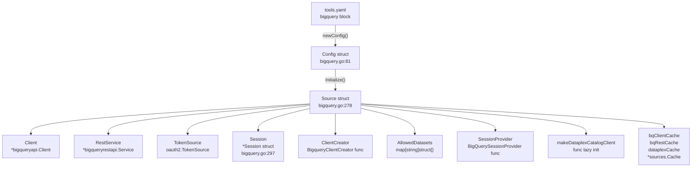
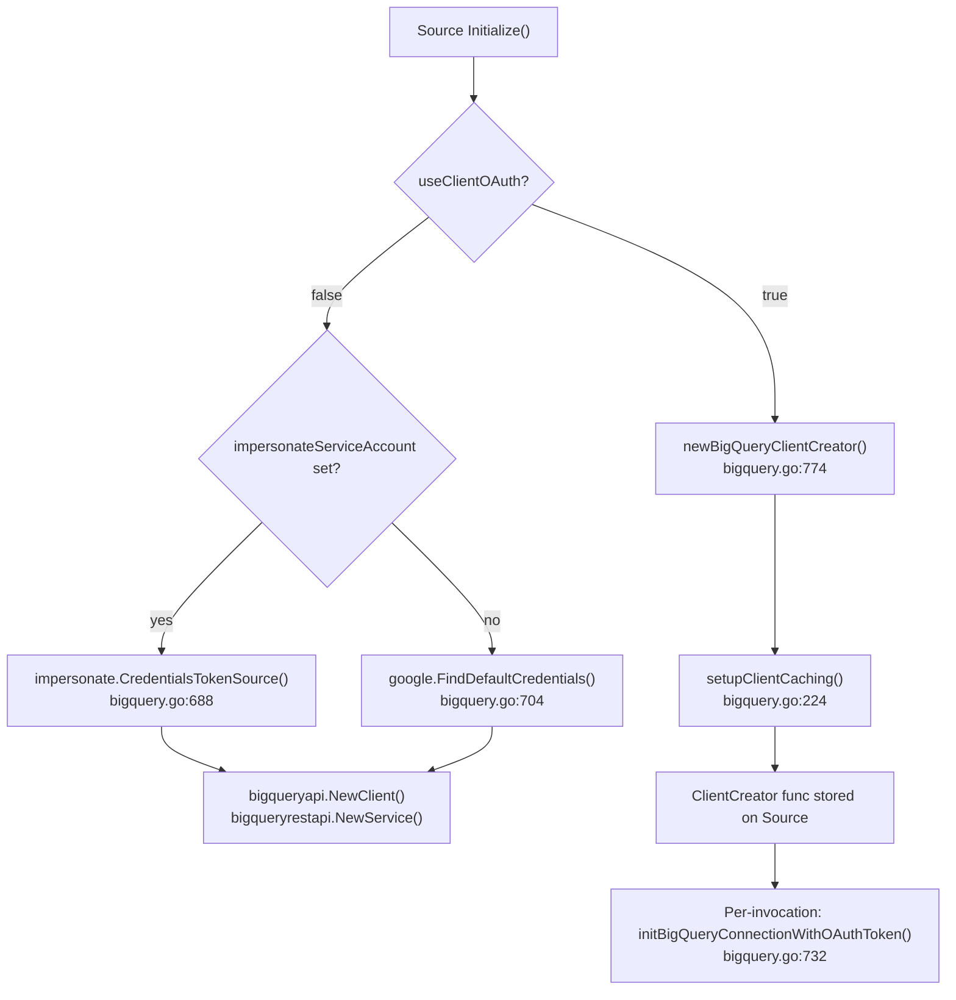
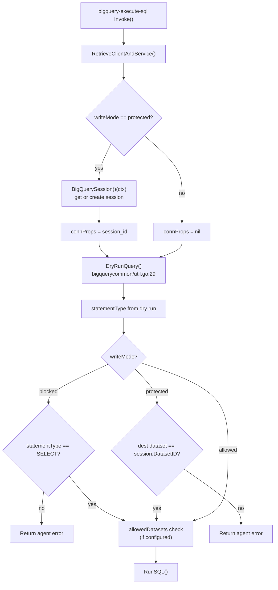

<!-- source: DeepWiki mcp.deepwiki.com · repo googleapis/genai-toolbox · page 5.4 BigQuery and Analytics Sources · fetched 2026-10-29 -->

# BigQuery and Analytics Sources

<details>
<summary>Relevant source files</summary>

The following files were used as context for generating this wiki page:

- [internal/prebuiltconfigs/tools/bigquery.yaml](internal/prebuiltconfigs/tools/bigquery.yaml)
- [internal/sources/bigquery/bigquery.go](internal/sources/bigquery/bigquery.go)
- [internal/sources/bigquery/bigquery_test.go](internal/sources/bigquery/bigquery_test.go)
- [internal/tools/bigquery/bigquerycommon/util.go](internal/tools/bigquery/bigquerycommon/util.go)
- [internal/tools/bigquery/bigqueryconversationalanalytics/bigqueryconversationalanalytics.go](internal/tools/bigquery/bigqueryconversationalanalytics/bigqueryconversationalanalytics.go)
- [internal/tools/bigquery/bigqueryconversationalanalytics/bigqueryconversationalanalytics_test.go](internal/tools/bigquery/bigqueryconversationalanalytics/bigqueryconversationalanalytics_test.go)
- [internal/tools/bigquery/bigqueryexecutesql/bigqueryexecutesql.go](internal/tools/bigquery/bigqueryexecutesql/bigqueryexecutesql.go)
- [internal/tools/bigquery/bigqueryforecast/bigqueryforecast.go](internal/tools/bigquery/bigqueryforecast/bigqueryforecast.go)
- [internal/tools/bigquery/bigquerygetdatasetinfo/bigquerygetdatasetinfo.go](internal/tools/bigquery/bigquerygetdatasetinfo/bigquerygetdatasetinfo.go)
- [internal/tools/bigquery/bigquerygettableinfo/bigquerygettableinfo.go](internal/tools/bigquery/bigquerygettableinfo/bigquerygettableinfo.go)
- [internal/tools/bigquery/bigquerylistdatasetids/bigquerylistdatasetids.go](internal/tools/bigquery/bigquerylistdatasetids/bigquerylistdatasetids.go)
- [internal/tools/bigquery/bigquerylisttableids/bigquerylisttableids.go](internal/tools/bigquery/bigquerylisttableids/bigquerylisttableids.go)
- [internal/tools/bigquery/bigquerysql/bigquerysql.go](internal/tools/bigquery/bigquerysql/bigquerysql.go)
- [tests/bigquery/bigquery_integration_test.go](tests/bigquery/bigquery_integration_test.go)

</details>


This page documents the `bigquery` source type: its configuration fields, authentication modes, write mode controls, dataset restrictions, session management, and the client infrastructure it provides to BigQuery tools. For documentation on the tools that use this source (e.g. `bigquery-sql`, `bigquery-execute-sql`, `bigquery-forecast`), see [BigQuery Tools](#6.3). For the general source registration and interface model, see [Source Architecture](#5.1).

---

## Overview

The `bigquery` source type connects Toolbox to Google Cloud BigQuery. Unlike connection-pool-based relational sources, it wraps the BigQuery Go client library and REST API directly. A single source instance can serve multiple tools with different authorization strategies, write permissions, and dataset scopes.

The source is implemented in `internal/sources/bigquery/bigquery.go` and registered at startup via `init()` [internal/sources/bigquery/bigquery.go:67-71]().

```go
const SourceType string = "bigquery"
```
Sources: [internal/sources/bigquery/bigquery.go:44-44](), [internal/sources/bigquery/bigquery.go:67-71]()

---

## Source Struct Hierarchy

The following diagram shows the major code entities involved in the `bigquery` source, from config to runtime state.

**BigQuery Source Code Entities**



Sources: [internal/sources/bigquery/bigquery.go:81-93](), [internal/sources/bigquery/bigquery.go:278-295](), [internal/sources/bigquery/bigquery.go:297-303]()

---

## Configuration Fields

The `Config` struct defines all fields parsed from `tools.yaml` [internal/sources/bigquery/bigquery.go:81-93]().

| Field | Type | Required | Default | Description |
|---|---|---|---|---|
| `type` | string | yes | — | Must be `"bigquery"` |
| `project` | string | yes | — | GCP project ID for billing and default resource resolution |
| `location` | string | no | `"US"` | Location for query jobs (e.g. `"US"`, `"asia-northeast1"`) |
| `writeMode` | string | no | `"allowed"` | One of `allowed`, `blocked`, `protected`. See [Write Modes](#write-modes) below |
| `allowedDatasets` | `[]string` | no | none | Restricts tool access to a specific set of datasets |
| `useClientOAuth` | string/bool | no | `false` | Forward client's OAuth token. Can be `"true"`, `"false"`, or a custom header name. |
| `impersonateServiceAccount` | string | no | none | Service account email to impersonate |
| `scopes` | `[]string` | no | default BigQuery scopes | OAuth 2.0 scopes for credentials |
| `maxQueryResultRows` | int | no | `50` | Maximum rows returned per query |

Both `allowedDatasets` and `scopes` use the `StringOrStringSlice` custom type which accepts either a YAML sequence or a comma-separated string [internal/sources/bigquery/bigquery.go:97-120]().

Dataset entries in `allowedDatasets` accept two formats [internal/sources/bigquery/bigquery.go:192-211]():
- `"my_dataset"` — uses the source's `project`.
- `"other_project.my_dataset"` — explicit project qualification.

Existence of each listed dataset is verified at startup by calling `dataset.Metadata()` [internal/sources/bigquery/bigquery.go:200-211]().

---

## Authentication

Two authentication strategies are available, selected via `useClientOAuth`.

**Authentication Flow**



Sources: [internal/sources/bigquery/bigquery.go:126-222](), [internal/sources/bigquery/bigquery.go:659-730](), [internal/sources/bigquery/bigquery.go:732-789]()

### Application Default Credentials (ADC)

The default mode. `initBigQueryConnection()` calls `google.FindDefaultCredentials()` and constructs both a high-level `bigqueryapi.Client` and a low-level `bigqueryrestapi.Service` [internal/sources/bigquery/bigquery.go:659-730]().

If `impersonateServiceAccount` is set, `impersonate.CredentialsTokenSource()` is used to obtain credentials before client creation [internal/sources/bigquery/bigquery.go:688-700]().

### Client OAuth (`useClientOAuth: true`)

When enabled, Toolbox does not create a shared client at startup. Instead, a `BigqueryClientCreator` function is stored on the `Source`. At tool invocation time, `RetrieveClientAndService()` parses the bearer token from the configured header (defaulting to `Authorization`) and calls this function [internal/sources/bigquery/bigquery.go:534-550]().

Clients are cached in `bqClientCache` and `bqRestCache` (keyed by token string) using `sources.Cache` to avoid redundant client creation [internal/sources/bigquery/bigquery.go:224-274]().

**Constraints:**
- `writeMode: protected` cannot be used with `useClientOAuth` [internal/sources/bigquery/bigquery.go:136-141]().
- `useClientOAuth` cannot be used with `impersonateServiceAccount` [internal/sources/bigquery/bigquery.go:144-146]().

---

## Write Modes

The `writeMode` field controls permitted SQL operations [internal/sources/bigquery/bigquery.go:49-56]():

| Mode | Constant | Effect |
|---|---|---|
| `allowed` | `WriteModeAllowed` | All queries permitted. Default. |
| `blocked` | `WriteModeBlocked` | Only `SELECT` statements allowed in `bigquery-execute-sql`. |
| `protected` | `WriteModeProtected` | Enables a shared BigQuery session. Writes are restricted to the session's temporary dataset. |

The `bigquery-execute-sql` tool uses a dry run to detect the statement type before enforcing the mode [internal/tools/bigquery/bigqueryexecutesql/bigqueryexecutesql.go:196-208]().

**Write Mode Enforcement in `bigquery-execute-sql`**



Sources: [internal/tools/bigquery/bigqueryexecutesql/bigqueryexecutesql.go:156-287]()

---

## Dataset Restrictions

Setting `allowedDatasets` restricts which BigQuery datasets tools can access.

1. `bigquery-list-dataset-ids` returns the pre-configured list directly [internal/tools/bigquery/bigquerylistdatasetids/bigquerylistdatasetids.go:134-136]().
2. `bigquery-get-dataset-info`, `bigquery-list-table-ids`, and `bigquery-get-table-info` call `IsDatasetAllowed()` before proceeding [internal/tools/bigquery/bigquerygetdatasetinfo/bigquerygetdatasetinfo.go:151-153]().
3. `bigquery-execute-sql` validates every table reference in the dry run result. Dataset-level DDL and `CALL` are blocked entirely [internal/tools/bigquery/bigqueryexecutesql/bigqueryexecutesql.go:210-262]().
4. `bigquery-forecast` validates the `history_data` parameter using a dry run or table ID parsing [internal/tools/bigquery/bigqueryforecast/bigqueryforecast.go:185-237]().

`IsDatasetAllowed()` checks against the `AllowedDatasets` map on `Source` using canonical `"project.dataset"` keys [internal/sources/bigquery/bigquery.go:477-486]().

---

## Session Management (`writeMode: protected`)

In `protected` mode, all tools sharing the source operate within a single BigQuery session, enabling temporary table usage.

The `Session` struct tracks state [internal/sources/bigquery/bigquery.go:297-303]():
- `ID`: BigQuery session ID.
- `DatasetID`: Anonymous dataset for temp tables.
- `CreationTime` / `LastUsed`: Used for lifecycle management.

`newBigQuerySessionProvider()` returns a closure that validates existing sessions with a dry-run `SELECT 1` or creates new ones using `CreateSession: true` [internal/sources/bigquery/bigquery.go:330-416]().

---

## Query Execution and Result Handling

All SQL execution routes through `Source.RunSQL()` [internal/sources/bigquery/bigquery.go:552-606]().

- **Row Limit**: Results are iterated up to `MaxQueryResultRows` (default 50) [internal/sources/bigquery/bigquery.go:131-134]().
- **Normalization**: `NormalizeValue()` converts BigQuery types like `*big.Rat` (NUMERIC) and `*big.Float` (FLOAT64) to JSON-compatible types [internal/sources/bigquery/bigquery.go:612-657]().
- **Output**: Results use `orderedmap.Row` to preserve column order in JSON.

---

## Prebuilt Configuration

The prebuilt `bigquery` configuration is defined in `internal/prebuiltconfigs/tools/bigquery.yaml` [internal/prebuiltconfigs/tools/bigquery.yaml:15-77]().

**Key Toolsets**:
- `data`: Includes `execute_sql`, `list_dataset_ids`, `list_table_ids`, `get_dataset_info`, `get_table_info`, `search_catalog`.
- `analytics`: Includes `analyze_contribution`, `ask_data_insights` (Conversational Analytics), `forecast`, `search_catalog`.

**Environment Variables**:
- `BIGQUERY_PROJECT`: Required.
- `BIGQUERY_LOCATION`: Optional.
- `BIGQUERY_USE_CLIENT_OAUTH`: Defaults to `false`.
- `BIGQUERY_MAX_QUERY_RESULT_ROWS`: Defaults to `50`.

Sources: [internal/prebuiltconfigs/tools/bigquery.yaml:15-77](), [internal/sources/bigquery/bigquery.go:81-93]()

---

