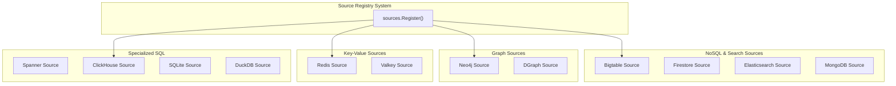
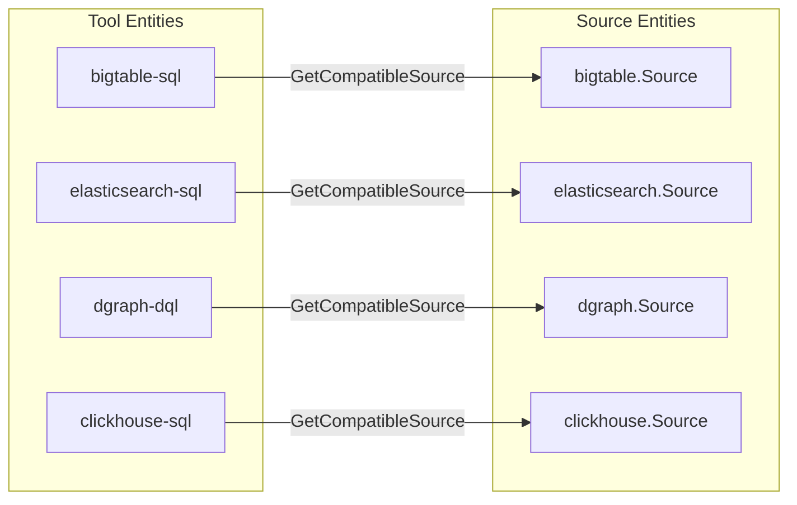

<!-- source: DeepWiki mcp.deepwiki.com · repo googleapis/genai-toolbox · page 5.5 Other Database Sources · fetched 2026-10-29 -->

# Other Database Sources

<details>
<summary>Relevant source files</summary>

The following files were used as context for generating this wiki page:

- [.hugo/package-lock.json](.hugo/package-lock.json)
- [internal/prebuiltconfigs/tools/mindsdb.yaml](internal/prebuiltconfigs/tools/mindsdb.yaml)
- [internal/sources/bigtable/bigtable.go](internal/sources/bigtable/bigtable.go)
- [internal/sources/bigtable/bigtable_test.go](internal/sources/bigtable/bigtable_test.go)
- [internal/sources/cassandra/cassandra.go](internal/sources/cassandra/cassandra.go)
- [internal/sources/clickhouse/clickhouse.go](internal/sources/clickhouse/clickhouse.go)
- [internal/sources/couchbase/couchbase.go](internal/sources/couchbase/couchbase.go)
- [internal/sources/couchbase/couchbase_test.go](internal/sources/couchbase/couchbase_test.go)
- [internal/sources/dgraph/dgraph.go](internal/sources/dgraph/dgraph.go)
- [internal/sources/dgraph/dgraph_test.go](internal/sources/dgraph/dgraph_test.go)
- [internal/sources/elasticsearch/elasticsearch.go](internal/sources/elasticsearch/elasticsearch.go)
- [internal/sources/elasticsearch/elasticsearch_test.go](internal/sources/elasticsearch/elasticsearch_test.go)
- [internal/sources/firebird/firebird.go](internal/sources/firebird/firebird.go)
- [internal/sources/mindsdb/mindsdb.go](internal/sources/mindsdb/mindsdb.go)
- [internal/sources/mindsdb/mindsdb_test.go](internal/sources/mindsdb/mindsdb_test.go)
- [internal/sources/redis/redis.go](internal/sources/redis/redis.go)
- [internal/sources/redis/redis_test.go](internal/sources/redis/redis_test.go)
- [internal/sources/valkey/valkey_test.go](internal/sources/valkey/valkey_test.go)
- [internal/tools/bigtable/bigtable.go](internal/tools/bigtable/bigtable.go)
- [internal/tools/bigtable/bigtable_test.go](internal/tools/bigtable/bigtable_test.go)
- [internal/tools/cassandra/cassandracql/cassandracql.go](internal/tools/cassandra/cassandracql/cassandracql.go)
- [internal/tools/clickhouse/clickhouseexecutesql/clickhouseexecutesql.go](internal/tools/clickhouse/clickhouseexecutesql/clickhouseexecutesql.go)
- [internal/tools/clickhouse/clickhouselistdatabases/clickhouselistdatabases.go](internal/tools/clickhouse/clickhouselistdatabases/clickhouselistdatabases.go)
- [internal/tools/clickhouse/clickhouselisttables/clickhouselisttables.go](internal/tools/clickhouse/clickhouselisttables/clickhouselisttables.go)
- [internal/tools/clickhouse/clickhousesql/clickhousesql.go](internal/tools/clickhouse/clickhousesql/clickhousesql.go)
- [internal/tools/clickhouse/clickhousesql/clickhousesql_test.go](internal/tools/clickhouse/clickhousesql/clickhousesql_test.go)
- [internal/tools/dgraph/dgraph.go](internal/tools/dgraph/dgraph.go)
- [internal/tools/dgraph/dgraph_test.go](internal/tools/dgraph/dgraph_test.go)
- [internal/tools/elasticsearch/elasticsearchesql/elasticsearchesql_test.go](internal/tools/elasticsearch/elasticsearchesql/elasticsearchesql_test.go)
- [internal/tools/firebird/firebirdexecutesql/firebirdexecutesql.go](internal/tools/firebird/firebirdexecutesql/firebirdexecutesql.go)
- [internal/tools/firebird/firebirdsql/firebirdsql.go](internal/tools/firebird/firebirdsql/firebirdsql.go)
- [internal/tools/valkey/valkey_test.go](internal/tools/valkey/valkey_test.go)
- [tests/cassandra/cassandra_integration_test.go](tests/cassandra/cassandra_integration_test.go)

</details>


This page documents the specialized database sources supported by the GenAI Toolbox that fall outside the traditional relational (PostgreSQL, MySQL, SQL Server) or BigQuery categories. These include NoSQL databases (MongoDB, Firestore, Bigtable), Graph databases (Neo4j, DGraph), Search engines (Elasticsearch), Key-Value stores (Redis, Valkey), and specialized SQL engines (SQLite, Spanner, ClickHouse, CockroachDB, DuckDB, Trino, Firebird, Oracle).

## Overview

The toolbox uses a modular architecture where each database type implements the `sources.Source` interface and registers itself via `sources.Register` [internal/sources/redis/redis.go:34-37](). This allows the `ResourceManager` to dynamically initialize connections based on the `kind` field in `tools.yaml`.

**Diagram: Extended Database Source Architecture**


Sources: [internal/sources/bigtable/bigtable.go:35-39](), [internal/sources/redis/redis.go:33-37](), [internal/sources/elasticsearch/elasticsearch.go:38-42]()

---

## Google Cloud Bigtable

Bigtable is a sparsely populated table that can scale to billions of rows and thousands of columns. The toolbox provides a `bigtable` source and a `bigtable-sql` tool for executing PartiQL-like SQL statements.

### Configuration
```yaml
sources:
  my-bigtable:
    kind: bigtable
    project: "my-gcp-project"
    instance: "my-instance"
```

### Implementation Details
The Bigtable source initializes a `*bigtable.Client` using `bigtable.NewClient` [internal/sources/bigtable/bigtable.go:192-192](). It implements `RunSQL` by preparing statements and binding parameters mapped from the tool's `parameters` [internal/sources/bigtable/bigtable.go:131-150]().

Sources: [internal/sources/bigtable/bigtable.go:49-54](), [internal/tools/bigtable/bigtable.go:31-31]()

---

## Redis and Valkey

The toolbox supports Redis and its open-source alternative, Valkey. Both sources support standalone and cluster modes, along with TLS and GCP IAM authentication.

### Configuration (Redis)
```yaml
sources:
  cache-db:
    kind: redis
    address: ["localhost:6379"]
    password: "secure-password"
    database: 0
    clusterEnabled: false
    tls:
      enabled: true
      insecureSkipVerify: false
```

### Data Flow
The `RunCommand` function executes a batch of commands. It converts `map[any]any` results (common in Redis) into `map[string]any` to ensure they are JSON-marshallable for the AI application [internal/sources/redis/redis.go:172-200]().

Sources: [internal/sources/redis/redis.go:47-62](), [internal/sources/redis/redis.go:110-131]()

---

## Elasticsearch

The `elasticsearch` source allows AI agents to perform complex search and analytics using ESQL (Elasticsearch Query Language).

### Configuration
```yaml
sources:
  search-engine:
    kind: elasticsearch
    addresses: ["https://my-es-cluster:9200"]
    username: "elastic"
    password: "password"
    # Or use apikey: "..."
```

### Tooling
The source uses `esapi.EsqlQueryRequest` to execute queries [internal/sources/elasticsearch/elasticsearch.go:178-183](). Results are automatically transformed from the ESQL columnar format into a list of maps for easier consumption by LLMs [internal/sources/elasticsearch/elasticsearch.go:212-230]().

Sources: [internal/sources/elasticsearch/elasticsearch.go:52-59](), [internal/sources/elasticsearch/elasticsearch.go:165-209]()

---

## DGraph (Graph Database)

DGraph is a native GraphQL database with a graph backend. The toolbox supports the DQL (DGraph Query Language).

### Configuration Example
```yaml
tools:
  - name: query_users
    kind: tool
    type: dgraph-dql
    source: my-dgraph
    isQuery: true
    statement: |
      query { q(func: eq(email, "user@example.com")) { email } }
```

### Implementation
The `dgraph-dql` tool invokes the source's `RunSQL` method, which handles both queries and mutations [internal/tools/dgraph/dgraph.go:98-107](). It supports configurable timeouts for long-running graph traversals [internal/tools/dgraph/dgraph.go:53-60]().

Sources: [internal/tools/dgraph/dgraph.go:31-31](), [internal/tools/dgraph/dgraph_test.go:38-61]()

---

## ClickHouse

ClickHouse is a fast open-source column-oriented database management system for online analytical processing (OLAP).

### Available Tools
1. **`clickhouse-sql`**: Execute a predefined SQL statement [internal/tools/clickhouse/clickhousesql/clickhousesql.go:30-30]().
2. **`clickhouse-execute-sql`**: Execute arbitrary SQL provided as a parameter [internal/tools/clickhouse/clickhouseexecutesql/clickhouseexecutesql.go:31-31]().
3. **`clickhouse-list-tables`**: Metadata tool to discover schema [internal/tools/clickhouse/clickhouselisttables/clickhouselisttables.go:30-30]().

### Metadata Discovery
The `clickhouse-list-tables` tool executes `SHOW TABLES FROM <database>` and enriches the result set with the database name for context [internal/tools/clickhouse/clickhouselisttables/clickhouselisttables.go:111-132]().

Sources: [internal/tools/clickhouse/clickhouselisttables/clickhouselisttables.go:51-59](), [internal/tools/clickhouse/clickhousesql/clickhousesql.go:50-60]()

---

## Firebird

Firebird is a relational database offering many ANSI SQL standard features.

### Configuration
```yaml
sources:
  legacy-db:
    kind: firebird
    host: "localhost"
    port: "3050"
    user: "sysdba"
    password: "masterkey"
    database: "/path/to/db.fdb"
```

### Connection Management
The source initializes a connection pool using `sql.Open("firebirdsql", ...)` [internal/sources/firebird/firebird.go:153-156](). It configures `MaxOpenConns` (default 5) and `MaxIdleConns` (default 2) to prevent deadlocks in the Firebird engine [internal/sources/firebird/firebird.go:159-164]().

Sources: [internal/sources/firebird/firebird.go:48-56](), [internal/tools/firebird/firebirdexecutesql/firebirdexecutesql.go:31-31]()

---

## MindsDB

MindsDB allows you to query AI models and external data as if they were tables.

### Implementation
The MindsDB source leverages the MySQL protocol. It uses `mysqlcommon.ConvertToType` to handle data type mapping between MindsDB's MySQL-compatible output and Go types [internal/sources/mindsdb/mindsdb.go:145-148]().

Sources: [internal/sources/mindsdb/mindsdb.go:49-58](), [internal/sources/mindsdb/mindsdb.go:105-158]()

---

## Cassandra

Cassandra is a distributed NoSQL database. The toolbox supports CQL (Cassandra Query Language).

### Implementation
The source uses the `gocql` driver [internal/sources/cassandra/cassandra.go:21-21](). It supports SSL/TLS via `CAPath`, `CertPath`, and `KeyPath` fields [internal/sources/cassandra/cassandra.go:52-54](). Results are scanned into a slice of maps using `iter.MapScan(row)` [internal/sources/cassandra/cassandra.go:105-112]().

Sources: [internal/sources/cassandra/cassandra.go:44-56](), [internal/sources/cassandra/cassandra.go:97-117]()

---

## Configuration Reference Summary

| Source Kind | Key Fields | Authentication |
| :--- | :--- | :--- |
| `bigtable` | `project`, `instance` | GCP ADC / IAM |
| `redis` / `valkey` | `address` (list), `clusterEnabled` | Password or GCP IAM |
| `elasticsearch` | `addresses` (list) | Username/Password or API Key |
| `firebird` | `host`, `port`, `database` | Username/Password |
| `cassandra` | `hosts` (list), `keyspace` | Username/Password + SSL |
| `mindsdb` | `host`, `port`, `user` | Password (optional) |
| `clickhouse` | `host`, `port`, `database` | Username/Password |

**Diagram: Tool to Source Compatibility**


Sources: [internal/tools/bigtable/bigtable.go:104-104](), [internal/tools/dgraph/dgraph.go:99-99](), [internal/tools/clickhouse/clickhousesql/clickhousesql.go:96-96]()

---

