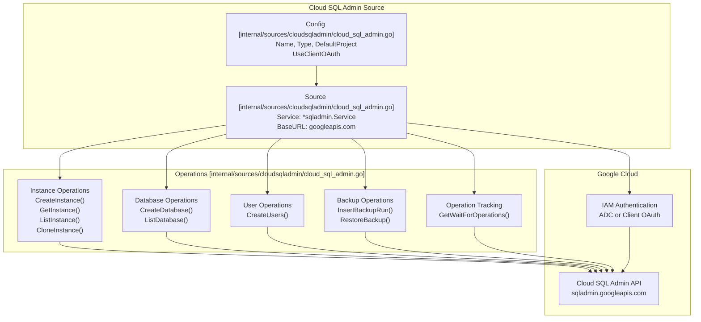
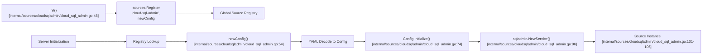
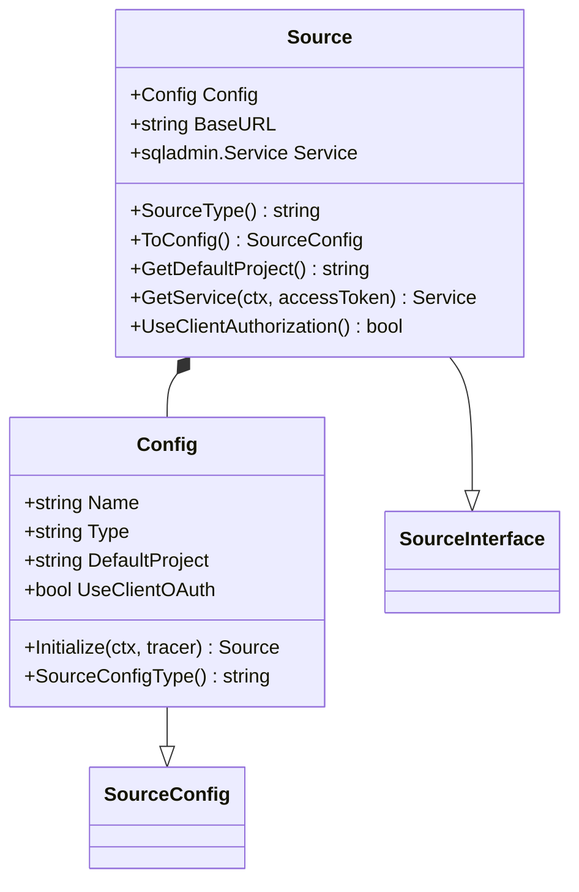
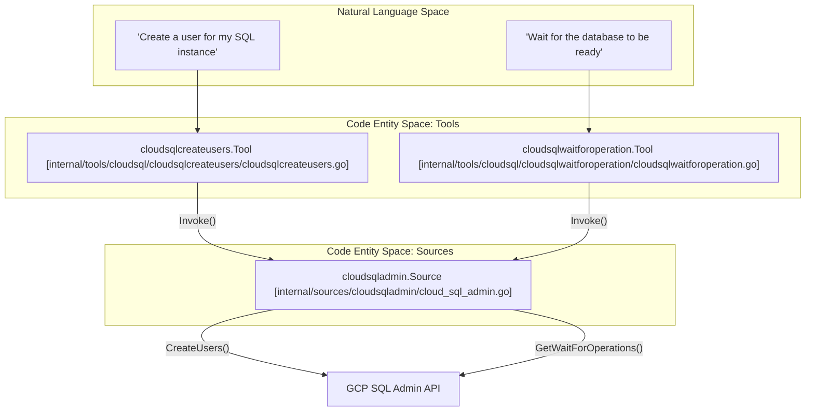

<!-- source: DeepWiki mcp.deepwiki.com · repo googleapis/genai-toolbox · page 5.6 Cloud SQL Admin Source · fetched 2026-10-29 -->

# Cloud SQL Admin Source

<details>
<summary>Relevant source files</summary>

The following files were used as context for generating this wiki page:

- [internal/sources/cloudsqladmin/cloud_sql_admin.go](internal/sources/cloudsqladmin/cloud_sql_admin.go)
- [internal/sources/cloudsqladmin/cloud_sql_admin_test.go](internal/sources/cloudsqladmin/cloud_sql_admin_test.go)
- [internal/sources/firebird/firebird_test.go](internal/sources/firebird/firebird_test.go)
- [internal/sources/oceanbase/oceanbase_test.go](internal/sources/oceanbase/oceanbase_test.go)
- [internal/tools/cloudsql/cloudsqlcreatedatabase/cloudsqlcreatedatabase.go](internal/tools/cloudsql/cloudsqlcreatedatabase/cloudsqlcreatedatabase.go)
- [internal/tools/cloudsql/cloudsqlcreateusers/cloudsqlcreateusers.go](internal/tools/cloudsql/cloudsqlcreateusers/cloudsqlcreateusers.go)
- [internal/tools/cloudsql/cloudsqlgetinstances/cloudsqlgetinstances.go](internal/tools/cloudsql/cloudsqlgetinstances/cloudsqlgetinstances.go)
- [internal/tools/cloudsql/cloudsqllistdatabases/cloudsqllistdatabases.go](internal/tools/cloudsql/cloudsqllistdatabases/cloudsqllistdatabases.go)
- [internal/tools/cloudsql/cloudsqllistinstances/cloudsqllistinstances.go](internal/tools/cloudsql/cloudsqllistinstances/cloudsqllistinstances.go)
- [internal/tools/cloudsql/cloudsqlwaitforoperation/cloudsqlwaitforoperation.go](internal/tools/cloudsql/cloudsqlwaitforoperation/cloudsqlwaitforoperation.go)
- [internal/tools/cloudsqlmssql/cloudsqlmssqlcreateinstance/cloudsqlmssqlcreateinstance.go](internal/tools/cloudsqlmssql/cloudsqlmssqlcreateinstance/cloudsqlmssqlcreateinstance.go)
- [internal/tools/cloudsqlmysql/cloudsqlmysqlcreateinstance/cloudsqlmysqlcreateinstance.go](internal/tools/cloudsqlmysql/cloudsqlmysqlcreateinstance/cloudsqlmysqlcreateinstance.go)
- [internal/tools/cloudsqlpg/cloudsqlpgcreateinstances/cloudsqlpgcreateinstances.go](internal/tools/cloudsqlpg/cloudsqlpgcreateinstances/cloudsqlpgcreateinstances.go)
- [tests/cloudsql/cloud_sql_create_users_test.go](tests/cloudsql/cloud_sql_create_users_test.go)
- [tests/cloudsql/cloud_sql_get_instances_test.go](tests/cloudsql/cloud_sql_get_instances_test.go)
- [tests/cloudsql/cloudsql_list_instances_test.go](tests/cloudsql/cloudsql_list_instances_test.go)
- [tests/cloudsql/cloudsql_wait_for_operation_test.go](tests/cloudsql/cloudsql_wait_for_operation_test.go)

</details>


The Cloud SQL Admin Source provides administrative operations for Google Cloud SQL instances through the Cloud SQL Admin API. Unlike data query sources (documented in [PostgreSQL-Compatible Sources](#5.2), [MySQL and SQL Server Sources](#5.3)), this source manages Cloud SQL infrastructure including instance creation, database management, user provisioning, and backup/restore operations.

## Overview

The `cloud-sql-admin` source type implements the Cloud SQL Admin API client for managing Cloud SQL resources across PostgreSQL, MySQL, and SQL Server database types. It operates at the control plane level rather than the data plane, enabling tools to create and configure Cloud SQL infrastructure programmatically.



**Cloud SQL Admin Source Architecture**

Sources: [internal/sources/cloudsqladmin/cloud_sql_admin.go:1-140]()

## Configuration

### Source Configuration Schema

The `cloud-sql-admin` source accepts the following configuration fields in `tools.yaml`:

| Field | Type | Required | Description |
|-------|------|----------|-------------|
| `name` | string | Yes | Unique identifier for the source instance |
| `type` | string | Yes | Must be `"cloud-sql-admin"` |
| `defaultProject` | string | No | Default GCP project ID for operations |
| `useClientOAuth` | bool | No | Enable client OAuth forwarding (default: false) |

### Configuration Example

```yaml
sources:
  cloud-sql-admin-source:
    type: cloud-sql-admin
    defaultProject: my-project-id
    useClientOAuth: false
```

Sources: [internal/sources/cloudsqladmin/cloud_sql_admin.go:62-67]()

## Source Implementation

### Registration and Initialization

The source self-registers during package initialization using the registry pattern:



**Source Registration and Initialization Flow**

The initialization sequence:

1. **Registration**: `init()` calls `sources.Register()` with type `"cloud-sql-admin"` and factory function [internal/sources/cloudsqladmin/cloud_sql_admin.go:48-52]().
2. **Configuration Decoding**: `newConfig()` decodes YAML into `Config` struct [internal/sources/cloudsqladmin/cloud_sql_admin.go:54-60]().
3. **Service Creation**: `Initialize()` creates `sqladmin.Service` client using either ADC or Client OAuth [internal/sources/cloudsqladmin/cloud_sql_admin.go:74-107]().

Sources: [internal/sources/cloudsqladmin/cloud_sql_admin.go:48-107]()

### Source Struct

The `Source` struct embeds configuration and maintains API client state:



**Config and Source Type Relationships**

Key fields:
- `Service`: `*sqladmin.Service` - persistent API client for ADC mode [internal/sources/cloudsqladmin/cloud_sql_admin.go:114]().
- `BaseURL`: hardcoded to `"https://sqladmin.googleapis.com"` [internal/sources/cloudsqladmin/cloud_sql_admin.go:103]().
- `Config`: embedded configuration struct [internal/sources/cloudsqladmin/cloud_sql_admin.go:112]().

Sources: [internal/sources/cloudsqladmin/cloud_sql_admin.go:62-67](), [internal/sources/cloudsqladmin/cloud_sql_admin.go:111-127]()

## Authentication Modes

The source supports two authentication patterns determined by the `UseClientOAuth` configuration field:

### Application Default Credentials (ADC)

When `UseClientOAuth` is `false` (default), the source uses ADC with the scope `sqladmin.SqlserviceAdminScope` [internal/sources/cloudsqladmin/cloud_sql_admin.go:86-94]().

### Client OAuth Mode

When `UseClientOAuth` is `true`, the source forwards the client's OAuth access token for each operation. The `GetService()` method creates a new service client per-request using the provided access token [internal/sources/cloudsqladmin/cloud_sql_admin.go:129-140]().

Sources: [internal/sources/cloudsqladmin/cloud_sql_admin.go:80-94](), [internal/sources/cloudsqladmin/cloud_sql_admin.go:129-144]()

## Operations

The source exposes methods that tools can invoke to perform administrative operations:

### Instance Operations

| Method | Parameters | Return Type | Description |
|--------|------------|-------------|-------------|
| `GetInstance` | projectId, instanceId, accessToken | any, error | Retrieves instance details [internal/sources/cloudsqladmin/cloud_sql_admin.go:222-233](). |
| `ListInstance` | project, accessToken | any, error | Lists instances in project [internal/sources/cloudsqladmin/cloud_sql_admin.go:267-295](). |
| `CloneInstance` | project, sourceInstanceName, destinationInstanceName, pointInTime, preferredZone, preferredSecondaryZone, accessToken | any, error | Clones existing instance [internal/sources/cloudsqladmin/cloud_sql_admin.go:146-173](). |

### Database and User Operations

| Method | Parameters | Return Type | Description |
|--------|------------|-------------|-------------|
| `CreateDatabase` | name, project, instance, accessToken | any, error | Creates database in instance [internal/sources/cloudsqladmin/cloud_sql_admin.go:175-192](). |
| `ListDatabase` | project, instance, accessToken | any, error | Lists databases [internal/sources/cloudsqladmin/cloud_sql_admin.go:235-265](). |
| `CreateUsers` | project, instance, name, password, iamUser, accessToken | any, error | Creates database user (IAM or built-in) [internal/sources/cloudsqladmin/cloud_sql_admin.go:194-220](). |

The `CreateUsers` method supports both IAM users (`"CLOUD_IAM_USER"`) and built-in users (`"BUILT_IN"`) [internal/sources/cloudsqladmin/cloud_sql_admin.go:194-220]().

Sources: [internal/sources/cloudsqladmin/cloud_sql_admin.go:175-265]()

## Prebuilt Admin Tools

The Toolbox provides several prebuilt tools that leverage the `cloud-sql-admin` source.

### User Management: `cloud-sql-create-users`

This tool allows creating both built-in and IAM users. IAM is the recommended way to manage users for security [internal/tools/cloudsql/cloudsqlcreateusers/cloudsqlcreateusers.go:100]().

- **Tool Type**: `cloud-sql-create-users` [internal/tools/cloudsql/cloudsqlcreateusers/cloudsqlcreateusers.go:30]()
- **Parameters**: `project`, `instance`, `name`, `password` (required for non-IAM), `iamUser` (boolean) [internal/tools/cloudsql/cloudsqlcreateusers/cloudsqlcreateusers.go:89-95]().
- **Implementation**: Invokes `source.CreateUsers()` [internal/tools/cloudsql/cloudsqlcreateusers/cloudsqlcreateusers.go:153]().

Sources: [internal/tools/cloudsql/cloudsqlcreateusers/cloudsqlcreateusers.go:1-158]()

### Operation Tracking: `cloud-sql-wait-for-operation`

Polls the Cloud SQL Operations API until a long-running operation (like instance creation) is complete [internal/tools/cloudsql/cloudsqlwaitforoperation/cloudsqlwaitforoperation.go:149]().

- **Tool Type**: `cloud-sql-wait-for-operation` [internal/tools/cloudsql/cloudsqlwaitforoperation/cloudsqlwaitforoperation.go:32]()
- **Polling Logic**: Implements retry logic with configurable delay and multiplier [internal/tools/cloudsql/cloudsqlwaitforoperation/cloudsqlwaitforoperation.go:154-195]().
- **Post-Operation Guidance**: Once an instance is created, it provides a formatted message with environment variables for connecting to the new data plane [internal/tools/cloudsql/cloudsqlwaitforoperation/cloudsqlwaitforoperation.go:34-73]().

Sources: [internal/tools/cloudsql/cloudsqlwaitforoperation/cloudsqlwaitforoperation.go:1-209]()

### Inventory Tools

| Tool Type | Source Method | Description |
|-----------|---------------|-------------|
| `cloud-sql-get-instance` | `GetInstance` | Retrieves a specific instance's details [internal/tools/cloudsql/cloudsqlgetinstances/cloudsqlgetinstances.go:30](). |
| `cloud-sql-list-instances` | `ListInstance` | Lists all instances in a project [internal/tools/cloudsql/cloudsqllistinstances/cloudsqllistinstances.go:30](). |
| `cloud-sql-list-databases` | `ListDatabase` | Lists all databases for an instance [internal/tools/cloudsql/cloudsqllistdatabases/cloudsqllistdatabases.go:30](). |

Sources: [internal/tools/cloudsql/cloudsqlgetinstances/cloudsqlgetinstances.go:1-145](), [internal/tools/cloudsql/cloudsqllistinstances/cloudsqllistinstances.go:1-139](), [internal/tools/cloudsql/cloudsqllistdatabases/cloudsqllistdatabases.go:1-144]()

## Implementation Mapping



**Mapping User Intent to Code Entities**

Sources: [internal/sources/cloudsqladmin/cloud_sql_admin.go:1-509](), [internal/tools/cloudsql/cloudsqlcreateusers/cloudsqlcreateusers.go:1-158](), [internal/tools/cloudsql/cloudsqlwaitforoperation/cloudsqlwaitforoperation.go:1-209]()

---

