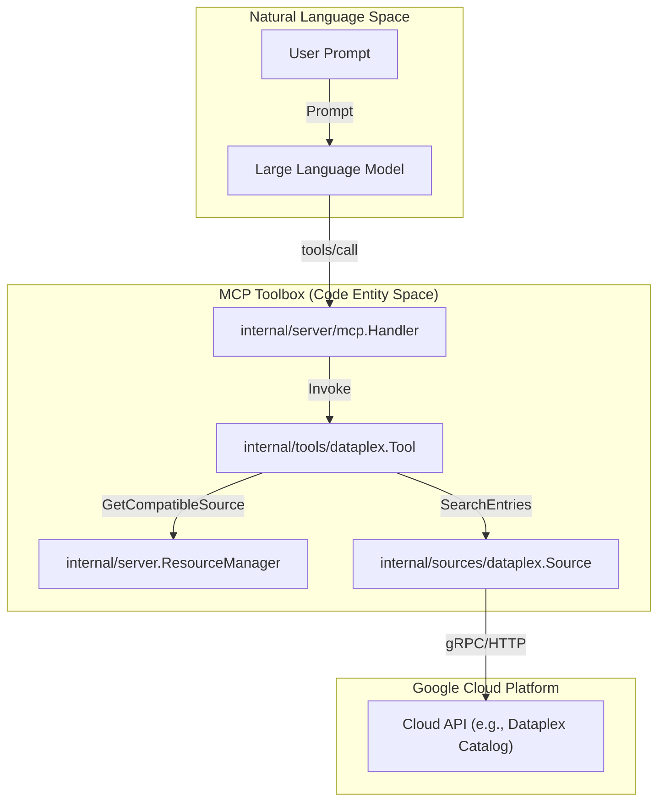
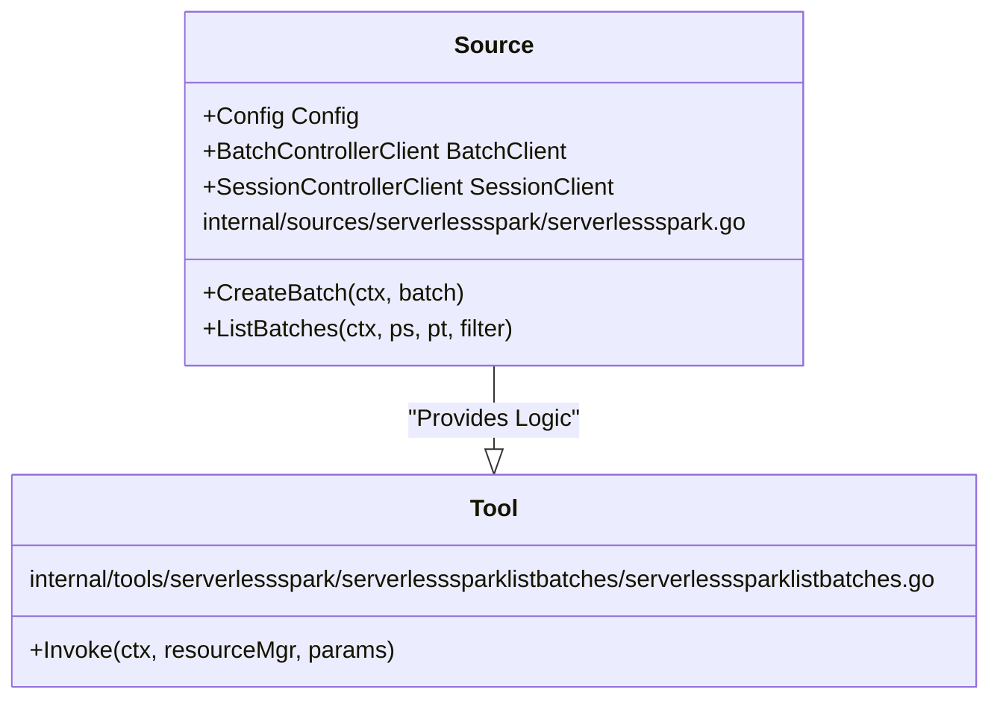

<!-- source: DeepWiki mcp.deepwiki.com · repo googleapis/genai-toolbox · page 5.7 Google Cloud Service Sources · fetched 2026-10-29 -->

# Google Cloud Service Sources

<details>
<summary>Relevant source files</summary>

The following files were used as context for generating this wiki page:

- [MCP-TOOLBOX-EXTENSION.md](MCP-TOOLBOX-EXTENSION.md)
- [docs/KNOWLEDGE_CATALOG_README.md](docs/KNOWLEDGE_CATALOG_README.md)
- [docs/en/documentation/connect-to/gemini-cli/_index.md](docs/en/documentation/connect-to/gemini-cli/_index.md)
- [docs/en/integrations/bigquery/tools/bigquery-search-catalog.md](docs/en/integrations/bigquery/tools/bigquery-search-catalog.md)
- [docs/en/integrations/knowledge-catalog/_index.md](docs/en/integrations/knowledge-catalog/_index.md)
- [docs/en/integrations/knowledge-catalog/prebuilt-configs/_index.md](docs/en/integrations/knowledge-catalog/prebuilt-configs/_index.md)
- [docs/en/integrations/knowledge-catalog/prebuilt-configs/dataplex.md](docs/en/integrations/knowledge-catalog/prebuilt-configs/dataplex.md)
- [internal/prebuiltconfigs/tools/dataplex.yaml](internal/prebuiltconfigs/tools/dataplex.yaml)
- [internal/prebuiltconfigs/tools/serverless-spark.yaml](internal/prebuiltconfigs/tools/serverless-spark.yaml)
- [internal/sources/cloudgda/cloud_gda.go](internal/sources/cloudgda/cloud_gda.go)
- [internal/sources/cloudgda/cloud_gda_test.go](internal/sources/cloudgda/cloud_gda_test.go)
- [internal/sources/dataplex/dataplex.go](internal/sources/dataplex/dataplex.go)
- [internal/sources/serverlessspark/serverlessspark.go](internal/sources/serverlessspark/serverlessspark.go)
- [internal/sources/serverlessspark/url.go](internal/sources/serverlessspark/url.go)
- [internal/sources/serverlessspark/url_test.go](internal/sources/serverlessspark/url_test.go)
- [internal/testutils/testutils.go](internal/testutils/testutils.go)
- [internal/tools/cloudgda/cloudgda.go](internal/tools/cloudgda/cloudgda.go)
- [internal/tools/cloudgda/cloudgda_test.go](internal/tools/cloudgda/cloudgda_test.go)
- [internal/tools/dataplex/dataplexlookupcontext/dataplexlookupcontext.go](internal/tools/dataplex/dataplexlookupcontext/dataplexlookupcontext.go)
- [internal/tools/dataplex/dataplexlookupcontext/dataplexlookupcontext_test.go](internal/tools/dataplex/dataplexlookupcontext/dataplexlookupcontext_test.go)
- [internal/tools/dataplex/dataplexlookupentry/dataplexlookupentry.go](internal/tools/dataplex/dataplexlookupentry/dataplexlookupentry.go)
- [internal/tools/dataplex/dataplexlookupentry/dataplexlookupentry_test.go](internal/tools/dataplex/dataplexlookupentry/dataplexlookupentry_test.go)
- [internal/tools/dataplex/dataplexsearchaspecttypes/dataplexsearchaspecttypes.go](internal/tools/dataplex/dataplexsearchaspecttypes/dataplexsearchaspecttypes.go)
- [internal/tools/dataplex/dataplexsearchaspecttypes/dataplexsearchaspecttypes_test.go](internal/tools/dataplex/dataplexsearchaspecttypes/dataplexsearchaspecttypes_test.go)
- [internal/tools/dataplex/dataplexsearchentries/dataplexsearchentries.go](internal/tools/dataplex/dataplexsearchentries/dataplexsearchentries.go)
- [internal/tools/serverlessspark/serverlesssparkcancelbatch/serverlesssparkcancelbatch.go](internal/tools/serverlessspark/serverlesssparkcancelbatch/serverlesssparkcancelbatch.go)
- [internal/tools/serverlessspark/serverlesssparklistbatches/serverlesssparklistbatches.go](internal/tools/serverlessspark/serverlesssparklistbatches/serverlesssparklistbatches.go)
- [tests/alloydbainl/alloydb_ai_nl_integration_test.go](tests/alloydbainl/alloydb_ai_nl_integration_test.go)
- [tests/auth.go](tests/auth.go)
- [tests/cloudgda/cloud_gda_integration_test.go](tests/cloudgda/cloud_gda_integration_test.go)
- [tests/cloudhealthcare/cloud_healthcare_integration_test.go](tests/cloudhealthcare/cloud_healthcare_integration_test.go)
- [tests/cloudloggingadmin/cloud_logging_admin_integration_test.go](tests/cloudloggingadmin/cloud_logging_admin_integration_test.go)
- [tests/dataplex/dataplex_integration_test.go](tests/dataplex/dataplex_integration_test.go)
- [tests/dataproc/dataproc_integration_test.go](tests/dataproc/dataproc_integration_test.go)
- [tests/serverlessspark/serverless_spark_integration_test.go](tests/serverlessspark/serverless_spark_integration_test.go)

</details>


The MCP Toolbox provides specialized source types for integrating with various Google Cloud managed services beyond standard relational databases. These sources enable AI applications to interact with data catalogs, analytics engines, healthcare APIs, and infrastructure monitoring tools using the Model Context Protocol (MCP).

## System Architecture

Google Cloud service sources follow a consistent implementation pattern where a `Source` struct wraps a specific Google Cloud API client (e.g., `CatalogClient` for Dataplex or `BatchControllerClient` for Serverless Spark).

### Data Flow: Natural Language to Cloud API

The following diagram illustrates how a natural language request is translated into a Google Cloud service call.

**Cloud Service Tool Execution Flow**

Sources: [internal/tools/dataplex/dataplexsearchentries/dataplexsearchentries.go:106-133](), [internal/sources/dataplex/dataplex.go:223-231]()

## Dataplex (Knowledge Catalog)

The `dataplex` source type allows AI agents to discover and understand data assets across a Google Cloud organization by interacting with the Dataplex Catalog API.

### Configuration
The source requires a project ID and uses Application Default Credentials (ADC) for authentication.

```yaml
sources:
  my-catalog:
    type: "dataplex"
    project: "my-gcp-project"
```
Sources: [internal/sources/dataplex/dataplex.go:53-58]()

### Available Tools
The Dataplex source supports several prebuilt tools for metadata discovery:
*   `dataplex-search-entries`: Searches for data assets (tables, datasets, views) using Dataplex search syntax [internal/tools/dataplex/dataplexsearchentries/dataplexsearchentries.go:31]().
*   `dataplex-lookup-entry`: Retrieves specific metadata for a single data asset [internal/prebuiltconfigs/tools/dataplex.yaml:26]().
*   `dataplex-search-aspect-types`: Finds relevant aspect types (metadata schemas) [internal/tools/dataplex/dataplexsearchaspecttypes/dataplexsearchaspecttypes.go:32]().
*   `dataplex-lookup-context`: Retrieves rich metadata and relationships for multiple assets [internal/tools/dataplex/dataplexlookupcontext/dataplexlookupcontext.go:32]().

## Cloud Gemini Data Analytics (GDA)

The `cloud-gemini-data-analytics` source type provides a natural language interface to database queries using Google's Gemini-powered analytics engine.

### Configuration
```yaml
sources:
  gda-source:
    type: "cloud-gemini-data-analytics"
    projectId: "my-gcp-project"
```
Sources: [tests/cloudgda/cloud_gda_integration_test.go:82-85]()

### Implementation
The source initializes a `DataChatClient` from the `cloud.google.com/go/geminidataanalytics/apiv1beta` package [tests/cloudgda/cloud_gda_integration_test.go:32-33](). It supports the `cloud-gemini-data-analytics-query` tool, which takes a natural language string and returns both a generated SQL query and a natural language answer [tests/cloudgda/cloud_gda_integration_test.go:67-77]().

## Serverless Spark (Dataproc)

The `serverless-spark` source type enables management of Spark batches and interactive sessions without managing infrastructure.

### Configuration
```yaml
sources:
  spark-source:
    type: "serverless-spark"
    project: "my-project"
    location: "us-central1"
```
Sources: [internal/sources/serverlessspark/serverlessspark.go:56-61]()

### Key Functions and Clients
The `serverless-spark` source initializes multiple controllers to handle different Spark lifecycles:
*   `BatchControllerClient`: For managing Spark batch jobs [internal/sources/serverlessspark/serverlessspark.go:73]().
*   `SessionControllerClient`: For interactive Spark sessions [internal/sources/serverlessspark/serverlessspark.go:85]().
*   `OperationsClient`: For tracking long-running operations [internal/sources/serverlessspark/serverlessspark.go:81]().

**Serverless Spark Entity Mapping**

Sources: [internal/sources/serverlessspark/serverlessspark.go:102-108](), [internal/tools/serverlessspark/serverlesssparklistbatches/serverlesssparklistbatches.go:15-29]()

## Cloud Healthcare

The `cloud-healthcare` source provides tools for interacting with FHIR and DICOM data stores.

### Available Tools
*   **FHIR**: `cloud-healthcare-get-fhir-resource`, `cloud-healthcare-fhir-patient-search`, and `cloud-healthcare-get-fhir-store-metrics` [tests/cloudhealthcare/cloud_healthcare_integration_test.go:51-54]().
*   **DICOM**: `cloud-healthcare-search-dicom-studies` and `cloud-healthcare-retrieve-rendered-dicom-instance` [tests/cloudhealthcare/cloud_healthcare_integration_test.go:58-61]().

## Cloud Logging and Monitoring

These sources provide administrative and observability capabilities for GCP infrastructure.

### Cloud Logging Admin
The `cloud-logging-admin` source type uses the `logadmin.Client` [tests/cloudloggingadmin/cloud_logging_admin_integration_test.go:58-69]() to provide tools for:
*   `cloud-logging-admin-list-log-names`: Lists available logs in a project [tests/cloudloggingadmin/cloud_logging_admin_integration_test.go:183-187]().
*   `cloud-logging-admin-query-logs`: Executes queries against log entries [tests/cloudloggingadmin/cloud_logging_admin_integration_test.go:193-197]().

### Cloud Monitoring
Provides integration with Cloud Monitoring (formerly Stackdriver) for retrieving metrics and dashboard information.

## Authentication and Security

All Google Cloud service sources rely on the `internal/util.UserAgentFromContext` to identify requests [internal/sources/dataplex/dataplex.go:117-120](). Authentication is typically handled via:
1.  **Application Default Credentials (ADC)**: The default for server-to-service communication [internal/sources/dataplex/dataplex.go:112-115]().
2.  **OAuth Services**: Sources can be configured with `authRequired` blocks to enforce user-level authorization via OIDC/Google OAuth [tests/serverlessspark/serverless_spark_integration_test.go:82-87]().

Sources: [internal/sources/dataplex/dataplex.go:112-126](), [tests/serverlessspark/serverless_spark_integration_test.go:82-87]()

---

