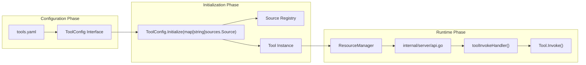

<!-- source: DeepWiki mcp.deepwiki.com · repo googleapis/genai-toolbox · page 6 Tools · fetched 2026-10-29 -->

# Tools

Relevant source files

The following files were used as context for generating this wiki page:

- [.gemini/styleguide.md](.gemini/styleguide.md)
- [.gitignore](.gitignore)
- [AGENTS.md](AGENTS.md)
- [CLAUDE.md](CLAUDE.md)
- [CONTRIBUTING.md](CONTRIBUTING.md)
- [DEVELOPER.md](DEVELOPER.md)
- [GEMINI.md](GEMINI.md)
- [LICENSE](LICENSE)
- [internal/server/api.go](internal/server/api.go)
- [internal/server/api_test.go](internal/server/api_test.go)
- [internal/sources/sources.go](internal/sources/sources.go)
- [internal/tools/looker/lookerconversationalanalytics/lookerconversationalanalytics.go](internal/tools/looker/lookerconversationalanalytics/lookerconversationalanalytics.go)
- [internal/tools/tools.go](internal/tools/tools.go)
- [internal/util/util.go](internal/util/util.go)

Tools define the actions that AI agents can take within the genai-toolbox system, such as executing SQL queries, running natural language queries, or making HTTP requests. This page covers the tool architecture, parameter system, built-in tool types, and the plugin registration mechanism.

For information about configuring tools in `tools.yaml`, see [Configuration](#3). For details about data sources that tools operate on, see [Data Sources](#5).

## Core Tool Architecture

The tool system is built around a plugin architecture where all tools implement the `Tool` interface and are registered through a factory pattern. Tools are configured in the `tools.yaml` file and initialized at server startup.

### Tool Interface and Lifecycle

The `Tool` interface defines the standard contract for all executable actions in the toolbox. This includes methods for invocation, parameter embedding, and generating manifests for both internal SDKs and the Model Context Protocol (MCP).

```mermaid
graph TB
    subgraph "Code Entity: internal/tools/tools.go"
        TI["Tool Interface"]
        TI --> invoke["Invoke(ctx, SourceProvider, ParamValues, AccessToken)"]
        TI --> embed["EmbedParams(ctx, ParamValues, map[string]EmbeddingModel)"]
        TI --> manifest["Manifest() Manifest"]
        TI --> mcpManifest["McpManifest() McpManifest"]
        TI --> authorized["Authorized([]string) bool"]
        TI --> requiresAuth["RequiresClientAuthorization(SourceProvider) (bool, error)"]
    end
    
    subgraph "Implementation Patterns"
        SQL["SQL Tools (postgres-sql, mysql-sql, etc.)"]
        BQ["BigQuery Tools (bigquery-sql, bigquery-forecast, etc.)"]
        LOOKER["Looker Tools (looker-query, looker-conversational-analytics, etc.)"]
        UTIL["Utility Tools (http-request, alloydb-wait-for-operation)"]
    end
    
    TI -.-> SQL
    TI -.-> BQ
    TI -.-> LOOKER
    TI -.-> UTIL
    
    subgraph "Registration: internal/tools/tools.go"
        TR["Register(resourceType, ToolConfigFactory)"]
        TM["toolRegistry (map[string]ToolConfigFactory)"]
        TR --> TM
    end
```

**Sources:** [internal/tools/tools.go:116-126](), [internal/tools/tools.go:36-50](), [DEVELOPER.md:83-93]()

### Tool Configuration and Initialization

Tools follow a two-phase initialization pattern. First, a `ToolConfig` is created from YAML configuration using a `ToolConfigFactory`. Then, the `Initialize` method is called to produce the functional `Tool` instance, linking it to its required data sources.

**Sources:** [internal/tools/tools.go:66-69](), [internal/tools/tools.go:54-64](), [internal/server/api.go:113-220]()

## Tool Parameter System

The parameter system provides type-safe input validation and supports both regular parameters and authenticated parameters that are auto-populated from user claims.

### Parameter Types and Parsing

The system supports several primitive and complex types, defined in the `parameters` package.

| Parameter Type | Implementation | Description |
|-----------------|----------------|-------------|
| `string` | `NewStringParameter` | Standard text input. Supports template parameters for SQL. |
| `integer` | `NewIntParameter` | Numeric integer input. |
| `float` | `NewFloatParameter` | Floating point numeric input. |
| `boolean` | `NewBooleanParameter` | True/False flags. |
| `array` | `NewArrayParameter` | List of values (can be nested). |
| `map` | `NewMapParameter` | Key-value pairs (can be nested). |

**Sources:** [internal/tools/tools.go:28-28](), [internal/tools/looker/lookerconversationalanalytics/lookerconversationalanalytics.go:160-173]()

### Error Handling during Invocation

Toolbox distinguishes between errors the agent can fix (e.g., SQL syntax) and errors that require developer intervention (e.g., database down).

*   **Agent Error (`AgentError`)**: Input/Execution logic errors. The LLM sees `isError: true` and can attempt to self-correct.
*   **Server Error (`ClientServerError`)**: Infrastructure failures. Results in a JSON-RPC Error or HTTP 500.

**Sources:** [DEVELOPER.md:128-140](), [DEVELOPER.md:155-162]()

## Child Pages Overview

### [Tool Architecture](#6.1)
Deep dive into the `ToolConfig` and `Tool` interfaces, the global tool registry, and the `compatibleSource` pattern used to ensure tools are paired with the correct database types. Covers `Manifest` and `McpManifest` structures and `ToolAnnotations` (e.g., `ReadOnlyHint`).

### [SQL Tools](#6.2)
Documentation for standard SQL execution tools across PostgreSQL, MySQL, MSSQL, and Spanner. Includes prebuilt observability tools like `list-tables` and `get-query-plan`.

### [BigQuery Tools](#6.3)
Details on the extensive BigQuery toolset, including standard SQL execution, forecasting, conversational analytics, and catalog search.

### [Looker Tools](#6.4)
Covers Looker-specific tools for running queries, managing models/explores, and LookML testing. Includes the `looker-conversational-analytics` tool for natural language data interaction.

### [HTTP and Utility Tools](#6.5)
Documentation for the generic `http-request` tool and specific utility operations like `alloydb-wait-for-operation`.

### [Tool Parameters](#6.6)
In-depth guide to the parameter system, including dynamic template parameters for SQL and authenticated parameters populated from ID tokens.

### [Prebuilt Tools Reference](#6.7)
A comprehensive list of all prebuilt tool configurations available via the `--prebuilt` CLI flag for various database engines.

### [Agent Skills Generation](#6.8)
Details on the `skills-generate` command, which converts toolsets into Agent Skills compliant packages for use with the Gemini CLI.

**Sources:** [internal/tools/tools.go:72-104](), [internal/tools/looker/lookerconversationalanalytics/lookerconversationalanalytics.go:37-48](), [DEVELOPER.md:83-116]()

---

