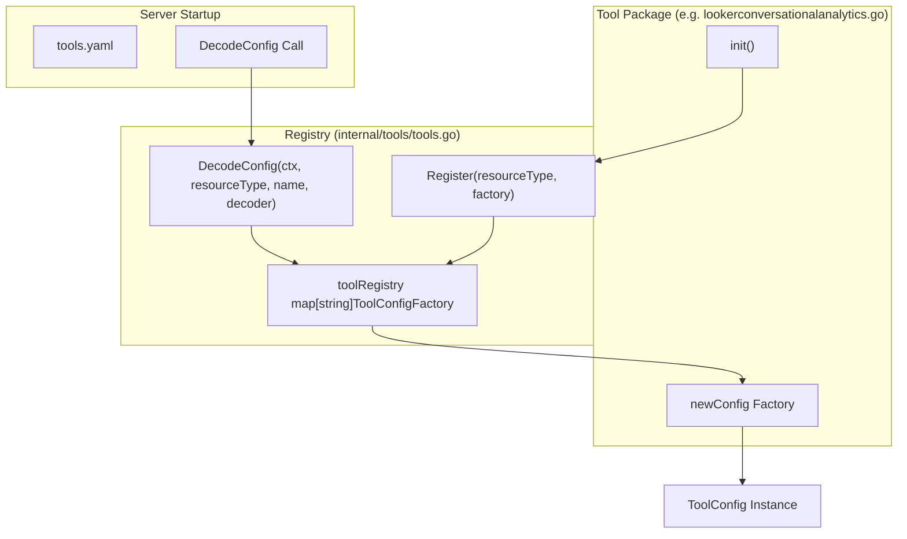
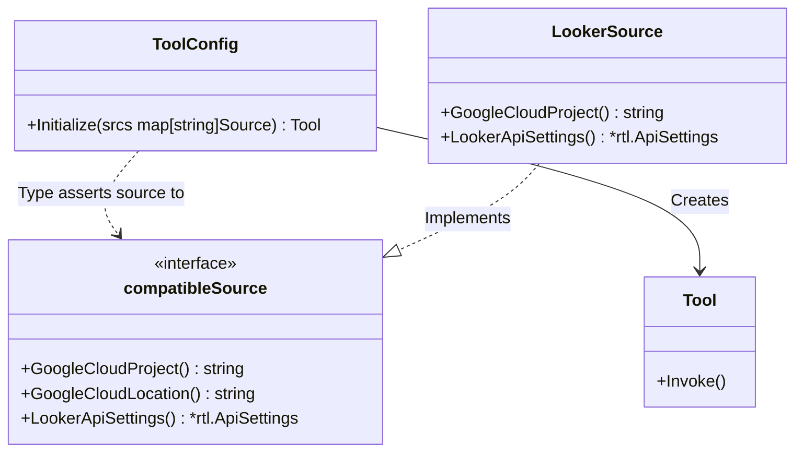
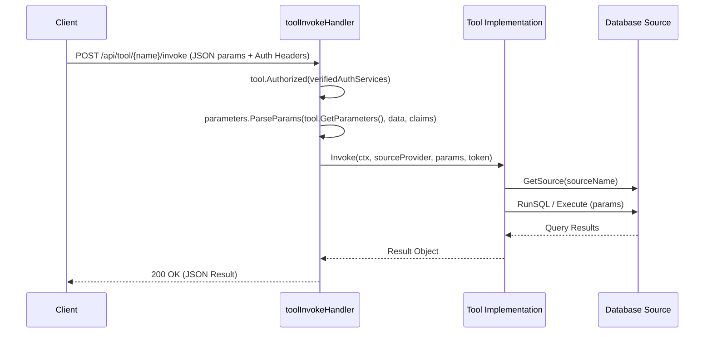

<!-- source: DeepWiki mcp.deepwiki.com · repo googleapis/genai-toolbox · page 6.1 Tool Architecture · fetched 2026-10-29 -->

# Tool Architecture

<details>
<summary>Relevant source files</summary>

The following files were used as context for generating this wiki page:

- [.gemini/styleguide.md](.gemini/styleguide.md)
- [.gitignore](.gitignore)
- [AGENTS.md](AGENTS.md)
- [CLAUDE.md](CLAUDE.md)
- [CONTRIBUTING.md](CONTRIBUTING.md)
- [DEVELOPER.md](DEVELOPER.md)
- [GEMINI.md](GEMINI.md)
- [LICENSE](LICENSE)
- [internal/server/api.go](internal/server/api.go)
- [internal/server/api_test.go](internal/server/api_test.go)
- [internal/sources/sources.go](internal/sources/sources.go)
- [internal/tools/looker/lookerconversationalanalytics/lookerconversationalanalytics.go](internal/tools/looker/lookerconversationalanalytics/lookerconversationalanalytics.go)
- [internal/tools/tools.go](internal/tools/tools.go)
- [internal/util/util.go](internal/util/util.go)

</details>


## Purpose and Scope

This document describes the architecture of the Tool system in MCP Toolbox, which enables extensible database operations through a plugin-based design. It covers the `Tool` and `ToolConfig` interfaces, the registration pattern, initialization lifecycle, parameter handling, manifest structures (`Manifest` and `McpManifest`), and the `compatibleSource` interface pattern.

For information about configuring tools in YAML files, see [Tools.yaml Format](#3.1). For details on specific tool implementations, see [SQL Tools](#6.2) and [BigQuery Tools](#6.3).

---

## Core Interfaces

The tool system is built around two primary interfaces that separate static configuration from runtime behavior.

### Tool Interface

The `Tool` interface defines the runtime behavior of a tool. It provides methods for invocation, parameter embedding, manifest generation, and authorization checks.

```go
type Tool interface {
	Invoke(context.Context, SourceProvider, parameters.ParamValues, AccessToken) (any, util.ToolboxError)
	EmbedParams(context.Context, parameters.ParamValues, map[string]embeddingmodels.EmbeddingModel) (parameters.ParamValues, error)
	Manifest() Manifest
	McpManifest() McpManifest
	Authorized([]string) bool
	RequiresClientAuthorization(SourceProvider) (bool, error)
	ToConfig() ToolConfig
	GetAuthTokenHeaderName(SourceProvider) (string, error)
	GetParameters() parameters.Parameters
}
```

Sources: [internal/tools/tools.go:116-126]()

### ToolConfig Interface

The `ToolConfig` interface represents a tool's configuration and is responsible for creating `Tool` instances during initialization.

```go
type ToolConfig interface {
	ToolConfigType() string
	Initialize(map[string]sources.Source) (Tool, error)
}
```

Sources: [internal/tools/tools.go:66-69]()

---

## Tool Registry and Registration Pattern

The system uses a registry pattern to enable extensibility. Individual tool packages register themselves using `init()` functions, associating a "type" string (e.g., `postgres-sql`) with a factory function.

### Registry Implementation

**Title: Tool Registration and Decoding Flow**



Sources: [internal/tools/tools.go:31-64](), [internal/tools/looker/lookerconversationalanalytics/lookerconversationalanalytics.go:44-56]()

### Registration Function

Tools register themselves by calling `Register()` with their type string and a `ToolConfigFactory`:

```go
type ToolConfigFactory func(ctx context.Context, name string, decoder *yaml.Decoder) (ToolConfig, error)

func Register(resourceType string, factory ToolConfigFactory) bool {
	if _, exists := toolRegistry[resourceType]; exists {
		return false
	}
	toolRegistry[resourceType] = factory
	return true
}
```

Sources: [internal/tools/tools.go:31-50]()

---

## Initialization and the compatibleSource Pattern

When the server starts, it calls `Initialize()` on each `ToolConfig`. A key pattern used during initialization is the `compatibleSource` interface. This allows tools to define exactly what capabilities they require from a source without depending on concrete source implementations.

### compatibleSource Interface Pattern

Instead of a tool depending on a `PostgresSource` struct, it defines a local interface. This prevents import cycles and allows the same tool to work with any source providing the required methods.

**Title: Tool to Source Compatibility via Interface**



Sources: [internal/tools/looker/lookerconversationalanalytics/lookerconversationalanalytics.go:58-65](), [internal/tools/looker/lookerconversationalanalytics/lookerconversationalanalytics.go:151-154]()

### Initialization Logic

During `Initialize`, the tool:
1. Retrieves the raw source from the provided map.
2. Performs a type assertion to its local `compatibleSource` interface.
3. Configures its internal parameters and generates manifests.

Sources: [internal/tools/looker/lookerconversationalanalytics/lookerconversationalanalytics.go:143-201]()

---

## Manifest Structures

Tools generate two distinct manifest types to support both internal SDKs and the Model Context Protocol.

### Manifest (Internal/SDK)

The `Manifest` struct is the representation sent to Client SDKs (Python, JS, Go). It includes descriptions, parameter manifests, and required authentication services.

```go
type Manifest struct {
	Description  string                         `json:"description"`
	Parameters   []parameters.ParameterManifest `json:"parameters"`
	AuthRequired []string                       `json:"authRequired"`
}
```

Sources: [internal/tools/tools.go:136-140]()

### McpManifest (MCP Protocol)

The `McpManifest` follows the [Model Context Protocol specification](https://modelcontextprotocol.io). It uses a JSON Schema (`InputSchema`) to define parameters.

```go
type McpManifest struct {
	Name        string           `json:"name"`
	Description string           `json:"description,omitempty"`
	Annotations *ToolAnnotations `json:"annotations,omitempty"`
	InputSchema parameters.McpToolsSchema `json:"inputSchema,omitempty"`
	Metadata    map[string]any            `json:"_meta,omitempty"`
}
```

Sources: [internal/tools/tools.go:143-152]()

### ToolAnnotations

Annotations provide hints to LLMs about the tool's behavior, such as whether it is read-only or destructive.

```go
type ToolAnnotations struct {
	DestructiveHint *bool `json:"destructiveHint,omitempty" yaml:"destructiveHint,omitempty"`
	IdempotentHint  *bool `json:"idempotentHint,omitempty" yaml:"idempotentHint,omitempty"`
	OpenWorldHint   *bool `json:"openWorldHint,omitempty" yaml:"openWorldHint,omitempty"`
	ReadOnlyHint    *bool `json:"readOnlyHint,omitempty" yaml:"readOnlyHint,omitempty"`
}
```

Helper functions like `NewReadOnlyAnnotations()` and `NewDestructiveAnnotations()` are provided to standardize these hints.

Sources: [internal/tools/tools.go:72-95]()

---

## Data Flow: Invocation

When a tool is invoked via the `toolInvokeHandler` in the HTTP API, the following data flow occurs:

1. **Authorization Check**: The handler calls `tool.Authorized()` using verified auth services from the request headers. [internal/server/api.go:183-189]()
2. **Parameter Parsing**: `parameters.ParseParams()` is called to validate input against the tool's defined parameters and inject claims from auth services. [internal/server/api.go:201-202]()
3. **Tool Execution**: The handler calls `tool.Invoke()`, passing the `SourceProvider` (to look up the database connection), parsed parameters, and any client access tokens. [internal/server/api.go:257]()
4. **Error Mapping**: Errors are categorized as `AgentError` (LLM-fixable) or `ClientServerError` (infrastructure failure) to guide LLM behavior. [DEVELOPER.md:132-139]()

### Invocation Data Flow Diagram

**Title: Tool Invocation Data Flow**



Sources: [internal/server/api.go:113-264](), [internal/tools/tools.go:117]()

---

## Summary of Key Components

| Component | File Path | Role |
|-----------|-----------|------|
| `Tool` | [internal/tools/tools.go]() | Runtime interface for tool execution and metadata. |
| `ToolConfig` | [internal/tools/tools.go]() | Configuration interface for tool instantiation. |
| `toolRegistry` | [internal/tools/tools.go]() | Global map of tool types to factory functions. |
| `Manifest` | [internal/tools/tools.go]() | Data structure for Client SDK tool discovery. |
| `McpManifest` | [internal/tools/tools.go]() | Data structure for MCP protocol tool discovery. |
| `ToolboxError` | [internal/util/errors.go]() | Error wrapper distinguishing Agent vs. Server errors. |

Sources: [internal/tools/tools.go](), [DEVELOPER.md:132-140]()

---

