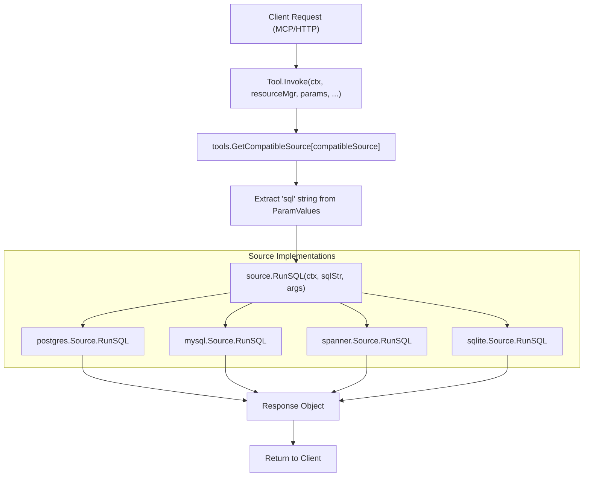
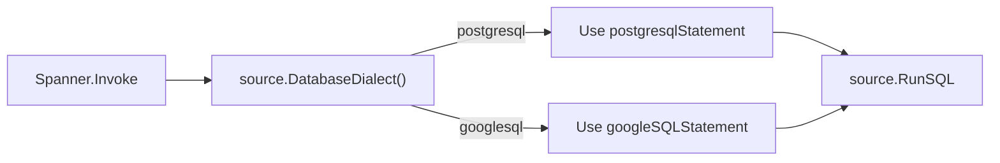
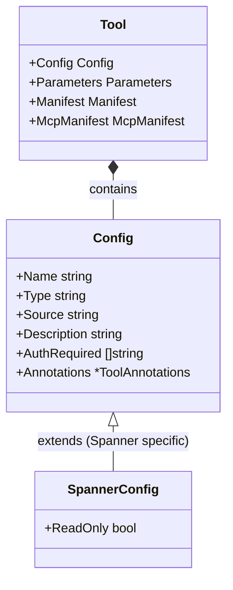

<!-- source: DeepWiki mcp.deepwiki.com · repo googleapis/genai-toolbox · page 6.2 SQL Tools · fetched 2026-10-29 -->

# SQL Tools

<details>
<summary>Relevant source files</summary>

The following files were used as context for generating this wiki page:

- [internal/sources/dialect.go](internal/sources/dialect.go)
- [internal/sources/spanner/spanner_test.go](internal/sources/spanner/spanner_test.go)
- [internal/tools/couchbase/couchbase.go](internal/tools/couchbase/couchbase.go)
- [internal/tools/couchbase/couchbase_test.go](internal/tools/couchbase/couchbase_test.go)
- [internal/tools/mssql/mssqlexecutesql/mssqlexecutesql.go](internal/tools/mssql/mssqlexecutesql/mssqlexecutesql.go)
- [internal/tools/mssql/mssqllisttables/mssqllisttables.go](internal/tools/mssql/mssqllisttables/mssqllisttables.go)
- [internal/tools/mssql/mssqllisttables/mssqllisttables_test.go](internal/tools/mssql/mssqllisttables/mssqllisttables_test.go)
- [internal/tools/mssql/mssqlsql/mssqlsql.go](internal/tools/mssql/mssqlsql/mssqlsql.go)
- [internal/tools/mysql/mysqlcommon/mysqlcommon.go](internal/tools/mysql/mysqlcommon/mysqlcommon.go)
- [internal/tools/mysql/mysqlexecutesql/mysqlexecutesql.go](internal/tools/mysql/mysqlexecutesql/mysqlexecutesql.go)
- [internal/tools/mysql/mysqllistactivequeries/mysqllistactivequeries.go](internal/tools/mysql/mysqllistactivequeries/mysqllistactivequeries.go)
- [internal/tools/mysql/mysqllisttablefragmentation/mysqllisttablefragmentation.go](internal/tools/mysql/mysqllisttablefragmentation/mysqllisttablefragmentation.go)
- [internal/tools/mysql/mysqllisttables/mysqllisttables.go](internal/tools/mysql/mysqllisttables/mysqllisttables.go)
- [internal/tools/mysql/mysqllisttables/mysqllisttables_test.go](internal/tools/mysql/mysqllisttables/mysqllisttables_test.go)
- [internal/tools/mysql/mysqllisttablesmissinguniqueindexes/mysqllisttablesmissinguniqueindexes.go](internal/tools/mysql/mysqllisttablesmissinguniqueindexes/mysqllisttablesmissinguniqueindexes.go)
- [internal/tools/mysql/mysqlsql/mysqlsql.go](internal/tools/mysql/mysqlsql/mysqlsql.go)
- [internal/tools/postgres/postgresdatabaseoverview/postgresdatabaseoverview.go](internal/tools/postgres/postgresdatabaseoverview/postgresdatabaseoverview.go)
- [internal/tools/postgres/postgresexecutesql/postgresexecutesql.go](internal/tools/postgres/postgresexecutesql/postgresexecutesql.go)
- [internal/tools/postgres/postgreslistindexes/postgreslistindexes.go](internal/tools/postgres/postgreslistindexes/postgreslistindexes.go)
- [internal/tools/postgres/postgreslistschemas/postgreslistschemas.go](internal/tools/postgres/postgreslistschemas/postgreslistschemas.go)
- [internal/tools/postgres/postgreslistsequences/postgreslistsequences.go](internal/tools/postgres/postgreslistsequences/postgreslistsequences.go)
- [internal/tools/postgres/postgreslisttables/postgreslisttables.go](internal/tools/postgres/postgreslisttables/postgreslisttables.go)
- [internal/tools/postgres/postgreslisttriggers/postgreslisttriggers.go](internal/tools/postgres/postgreslisttriggers/postgreslisttriggers.go)
- [internal/tools/postgres/postgreslistviews/postgreslistviews.go](internal/tools/postgres/postgreslistviews/postgreslistviews.go)
- [internal/tools/postgres/postgressql/postgressql.go](internal/tools/postgres/postgressql/postgressql.go)
- [internal/tools/spanner/spannerexecutesql/spannerexecutesql.go](internal/tools/spanner/spannerexecutesql/spannerexecutesql.go)
- [internal/tools/spanner/spannerlisttables/spannerlisttables.go](internal/tools/spanner/spannerlisttables/spannerlisttables.go)
- [internal/tools/spanner/spannerlisttables/spannerlisttables_test.go](internal/tools/spanner/spannerlisttables/spannerlisttables_test.go)
- [internal/tools/sqlite/sqliteexecutesql/sqliteexecutesql.go](internal/tools/sqlite/sqliteexecutesql/sqliteexecutesql.go)
- [internal/tools/sqlite/sqliteexecutesql/sqliteexecutesql_test.go](internal/tools/sqlite/sqliteexecutesql/sqliteexecutesql_test.go)
- [internal/tools/sqlite/sqlitesql/sqlitesql_test.go](internal/tools/sqlite/sqlitesql/sqlitesql_test.go)
- [internal/tools/tidb/tidbexecutesql/tidbexecutesql.go](internal/tools/tidb/tidbexecutesql/tidbexecutesql.go)
- [internal/util/orderedmap/orderedmap.go](internal/util/orderedmap/orderedmap.go)
- [internal/util/orderedmap/orderedmap_test.go](internal/util/orderedmap/orderedmap_test.go)
- [tests/mariadb/mariadb_integration_test.go](tests/mariadb/mariadb_integration_test.go)

</details>


This page documents the standard SQL tool types available in MCP Toolbox for Databases — covering `postgres-sql`, `postgres-execute-sql`, `mysql-sql`, `mysql-execute-sql`, `mssql-sql`, `mssql-execute-sql`, `spanner-sql`, `spanner-execute-sql`, `sqlite-execute-sql`, `tidb-execute-sql`, and the prebuilt observability tools built on top of them (such as `postgres-list-tables`, `mysql-list-tables`, and `spanner-list-tables`).

For the tool architecture shared by all tool types (interfaces, registry, `Manifest`, `McpManifest`), see [Tool Architecture](#6.1). For BigQuery-specific tools, see [BigQuery Tools](#6.3). For how parameters are declared and resolved, see [Tool Parameters](#6.6). For a full listing of prebuilt toolsets by database, see [Prebuilt Tools Reference](#6.7).

---

## Overview of SQL Tool Families

Each SQL tool type is tied to a specific database family via the `compatibleSource` pattern: a tool can only be invoked against a source that implements the required interface methods. This allows the same tool kind to work across multiple source types (e.g., `postgres-sql` works with `postgres`, `alloydb-postgres`, and `cloud-sql-postgres`).

**Tool-to-source compatibility:**

| Tool kind prefix | Compatible source types | Implementation File |
|---|---|---|
| `postgres-*` | `postgres`, `alloydb-postgres`, `cloud-sql-postgres` | [internal/tools/postgres/postgresexecutesql/postgresexecutesql.go:31-31]() |
| `mysql-*` | `mysql`, `cloud-sql-mysql` | [internal/tools/mysql/mysqlexecutesql/mysqlexecutesql.go:31-31]() |
| `mssql-*` | `mssql`, `cloud-sql-mssql` | [internal/tools/mssql/mssqlexecutesql/mssqlexecutesql.go:31-31]() |
| `spanner-*` | `spanner` | [internal/tools/spanner/spannerexecutesql/spannerexecutesql.go:32-32]() |
| `sqlite-*` | `sqlite` | [internal/tools/sqlite/sqliteexecutesql/sqliteexecutesql.go:31-31]() |
| `tidb-*` | `tidb` | [internal/tools/tidb/tidbexecutesql/tidbexecutesql.go:31-31]() |

**Two categories of SQL tools exist:**

1. **Generic query tools** (`-sql`, `-execute-sql`): You supply a `statement` in `tools.yaml` (for `-sql`) or the LLM provides the `sql` string at runtime (for `-execute-sql`).
2. **Prebuilt observability tools** (`-list-tables`, `-list-active-queries`, etc.): The SQL is hardcoded in the tool implementation. You only supply the `source` field.

Sources: [internal/tools/postgres/postgresexecutesql/postgresexecutesql.go:47-50](), [internal/tools/mysql/mysqlexecutesql/mysqlexecutesql.go:47-50](), [internal/tools/mssql/mssqlexecutesql/mssqlexecutesql.go:47-50](), [internal/tools/spanner/spannerexecutesql/spannerexecutesql.go:47-51]()

---

## Generic Query Tools

These tools allow for the definition or runtime execution of arbitrary SQL statements.

### `postgres-sql` / `postgres-execute-sql`

Implemented in [internal/tools/postgres/postgresexecutesql/postgresexecutesql.go]().

`postgres-sql` uses a static `statement` field, while `postgres-execute-sql` accepts a dynamic `sql` parameter from the caller. The `compatibleSource` interface requires:

```go
type compatibleSource interface {
    PostgresPool() *pgxpool.Pool
    RunSQL(context.Context, string, []any) (any, error)
}
```
[internal/tools/postgres/postgresexecutesql/postgresexecutesql.go:47-50]()

**Config fields for `postgres-execute-sql`:**

| Field | Type | Required | Description |
|---|---|---|---|
| `source` | string | yes | Name of the source defined in `sources:` block |
| `description` | string | yes | Description exposed to LLM |
| `authRequired` | list | no | Auth service names required to invoke this tool |

Sources: [internal/tools/postgres/postgresexecutesql/postgresexecutesql.go:52-59]()

---

### `mysql-sql` / `mysql-execute-sql`

Implemented in [internal/tools/mysql/mysqlexecutesql/mysqlexecutesql.go]().

The `compatibleSource` interface requires:

```go
type compatibleSource interface {
    MySQLPool() *sql.DB
    RunSQL(context.Context, string, []any) (any, error)
}
```
[internal/tools/mysql/mysqlexecutesql/mysqlexecutesql.go:47-50]()

MySQL parameters are passed positionally as a `[]any` slice via the `RunSQL` method.

Sources: [internal/tools/mysql/mysqlexecutesql/mysqlexecutesql.go:113-113]()

---

### `mssql-sql` / `mssql-execute-sql`

Implemented in [internal/tools/mssql/mssqlexecutesql/mssqlexecutesql.go]().

The `compatibleSource` interface requires:

```go
type compatibleSource interface {
    MSSQLDB() *sql.DB
    RunSQL(context.Context, string, []any) (any, error)
}
```
[internal/tools/mssql/mssqlexecutesql/mssqlexecutesql.go:47-50]()

Sources: [internal/tools/mssql/mssqlexecutesql/mssqlexecutesql.go:113-113]()

---

### `spanner-sql` / `spanner-execute-sql`

Implemented in [internal/tools/spanner/spannerexecutesql/spannerexecutesql.go]().

Spanner tools have a unique `readOnly` field in their configuration. Setting `readOnly: true` ensures the query is executed in a read-only transaction.

**The `compatibleSource` interface for Spanner:**
```go
type compatibleSource interface {
    SpannerClient() *spanner.Client
    DatabaseDialect() string
    RunSQL(context.Context, bool, string, map[string]any) (any, error)
}
```
[internal/tools/spanner/spannerexecutesql/spannerexecutesql.go:47-51]()

**Additional `spanner-execute-sql` config field:**

| Field | Type | Required | Default | Description |
|---|---|---|---|---|
| `readOnly` | bool | no | `false` | When `true`, executes in a read-only Spanner transaction |

Sources: [internal/tools/spanner/spannerexecutesql/spannerexecutesql.go:53-61]()

---

## Tool Invocation Flow

**Tool invocation data flow diagram:**

This diagram illustrates the bridge between the high-level `Tool.Invoke` call and the specific database driver implementations via the `compatibleSource` interface.



Sources: [internal/tools/postgres/postgresexecutesql/postgresexecutesql.go:92-114](), [internal/tools/mysql/mysqlexecutesql/mysqlexecutesql.go:95-118](), [internal/tools/spanner/spannerexecutesql/spannerexecutesql.go:97-120](), [internal/tools/sqlite/sqliteexecutesql/sqliteexecutesql.go:94-119]()

---

## Prebuilt Observability Tools

Toolbox includes prebuilt tools that use hardcoded, complex SQL queries to provide database introspection and observability.

### `postgres-list-tables`
Returns detailed schema information including columns, constraints, indexes, and triggers as a JSON object. It supports an `output_format` parameter which can be `simple` (names only) or `detailed`.

Sources: [internal/tools/postgres/postgreslisttables/postgreslisttables.go:33-109]()

### `mysql-list-tables`
Similar to the Postgres variant, it queries the `INFORMATION_SCHEMA` to build a comprehensive JSON representation of table structures, including `TABLE_COMMENT`, column types, and foreign key relationships.

Sources: [internal/tools/mysql/mysqllisttables/mysqllisttables.go:33-126]()

### `spanner-list-tables`
Supports both `googlesql` and `postgresql` dialects of Spanner. It dynamically selects the SQL statement based on the `source.DatabaseDialect()` return value.

Sources: [internal/tools/spanner/spannerlisttables/spannerlisttables.go:112-122](), [internal/tools/spanner/spannerlisttables/spannerlisttables.go:150-165]()

**Dialect selection logic:**


Sources: [internal/tools/spanner/spannerlisttables/spannerlisttables.go:124-172]()

---

## Config Struct Anatomy

The following diagram maps the YAML configuration fields to the Go internal structures used during initialization.



Sources: [internal/tools/postgres/postgresexecutesql/postgresexecutesql.go:52-59](), [internal/tools/mysql/mysqlexecutesql/mysqlexecutesql.go:52-59](), [internal/tools/spanner/spannerexecutesql/spannerexecutesql.go:53-61](), [internal/tools/sqlite/sqliteexecutesql/sqliteexecutesql.go:52-59]()

---

## Other SQL Dialects

### `sqlite-execute-sql`
Supports local SQLite databases. The `compatibleSource` requires `SQLiteDB() *sql.DB`.

Sources: [internal/tools/sqlite/sqliteexecutesql/sqliteexecutesql.go:47-50]()

### `tidb-execute-sql`
Supports TiDB clusters. The `compatibleSource` requires `TiDBPool() *sql.DB`.

Sources: [internal/tools/tidb/tidbexecutesql/tidbexecutesql.go:47-50]()

### `couchbase-sql`
Supports N1QL (SQL for Couchbase). Unlike standard relational tools, it interacts with a `CouchbaseScope`.

Sources: [internal/tools/couchbase/couchbase.go:47-50]()

---

## Registering Tool Kinds

Each tool kind is registered in the global tool registry via its package-level `init()` function.

- `postgres-execute-sql` → [internal/tools/postgres/postgresexecutesql/postgresexecutesql.go:33-37]()
- `mysql-execute-sql` → [internal/tools/mysql/mysqlexecutesql/mysqlexecutesql.go:33-37]()
- `mssql-execute-sql` → [internal/tools/mssql/mssqlexecutesql/mssqlexecutesql.go:33-37]()
- `spanner-execute-sql` → [internal/tools/spanner/spannerexecutesql/spannerexecutesql.go:33-37]()
- `sqlite-execute-sql` → [internal/tools/sqlite/sqliteexecutesql/sqliteexecutesql.go:33-37]()
- `tidb-execute-sql` → [internal/tools/tidb/tidbexecutesql/tidbexecutesql.go:33-37]()

Each `init()` calls `tools.Register(resourceType, newConfig)`, storing the tool's config factory under its `resourceType` string constant.

Sources: [internal/tools/postgres/postgresexecutesql/postgresexecutesql.go:31-37](), [internal/tools/mysql/mysqlexecutesql/mysqlexecutesql.go:31-37]()

---

