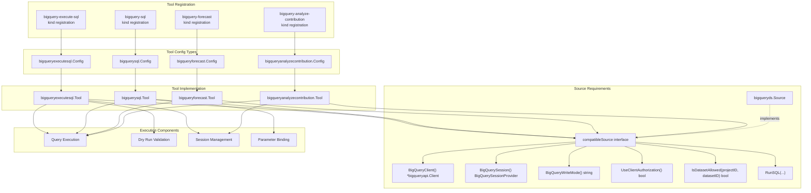
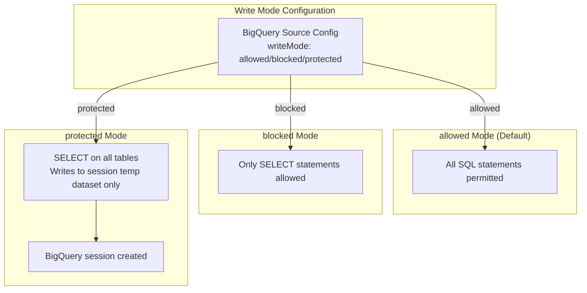

<!-- source: DeepWiki mcp.deepwiki.com · repo googleapis/genai-toolbox · page 6.3 BigQuery Tools · fetched 2026-10-29 -->

# BigQuery Tools

<details>
<summary>Relevant source files</summary>

The following files were used as context for generating this wiki page:

- [internal/prebuiltconfigs/tools/bigquery.yaml](internal/prebuiltconfigs/tools/bigquery.yaml)
- [internal/sources/bigquery/bigquery.go](internal/sources/bigquery/bigquery.go)
- [internal/sources/bigquery/bigquery_test.go](internal/sources/bigquery/bigquery_test.go)
- [internal/tools/bigquery/bigqueryanalyzecontribution/bigqueryanalyzecontribution.go](internal/tools/bigquery/bigqueryanalyzecontribution/bigqueryanalyzecontribution.go)
- [internal/tools/bigquery/bigquerycommon/util.go](internal/tools/bigquery/bigquerycommon/util.go)
- [internal/tools/bigquery/bigqueryconversationalanalytics/bigqueryconversationalanalytics.go](internal/tools/bigquery/bigqueryconversationalanalytics/bigqueryconversationalanalytics.go)
- [internal/tools/bigquery/bigqueryconversationalanalytics/bigqueryconversationalanalytics_test.go](internal/tools/bigquery/bigqueryconversationalanalytics/bigqueryconversationalanalytics_test.go)
- [internal/tools/bigquery/bigqueryexecutesql/bigqueryexecutesql.go](internal/tools/bigquery/bigqueryexecutesql/bigqueryexecutesql.go)
- [internal/tools/bigquery/bigqueryforecast/bigqueryforecast.go](internal/tools/bigquery/bigqueryforecast/bigqueryforecast.go)
- [internal/tools/bigquery/bigquerygetdatasetinfo/bigquerygetdatasetinfo.go](internal/tools/bigquery/bigquerygetdatasetinfo/bigquerygetdatasetinfo.go)
- [internal/tools/bigquery/bigquerygettableinfo/bigquerygettableinfo.go](internal/tools/bigquery/bigquerygettableinfo/bigquerygettableinfo.go)
- [internal/tools/bigquery/bigquerylistdatasetids/bigquerylistdatasetids.go](internal/tools/bigquery/bigquerylistdatasetids/bigquerylistdatasetids.go)
- [internal/tools/bigquery/bigquerylisttableids/bigquerylisttableids.go](internal/tools/bigquery/bigquerylisttableids/bigquerylisttableids.go)
- [internal/tools/bigquery/bigquerysql/bigquerysql.go](internal/tools/bigquery/bigquerysql/bigquerysql.go)
- [tests/bigquery/bigquery_integration_test.go](tests/bigquery/bigquery_integration_test.go)

</details>


## Purpose and Scope

This document covers the BigQuery-specific tool implementations in the Toolbox system. These tools provide specialized capabilities for interacting with Google Cloud BigQuery, including SQL execution, ML-powered analytics, time series forecasting, and metadata management.

For information about configuring BigQuery sources, see [BigQuery and Analytics Sources](5.4). For general tool architecture concepts, see [Tool Architecture](6.1). For SQL tools across other database types, see [SQL Tools](6.2).

---

## Tool Categories

BigQuery tools are organized into three functional categories:

| Category | Tool Kinds | Purpose |
|----------|-----------|---------|
| **Query Execution** | `bigquery-execute-sql`, `bigquery-sql` | Execute SQL queries with parameterization and validation |
| **ML/AI Analytics** | `bigquery-forecast`, `bigquery-analyze-contribution`, `bigquery-conversational-analytics` | Leverage BigQuery ML for forecasting, contribution analysis, and natural language queries |
| **Metadata & Catalog** | `bigquery-list-dataset-ids`, `bigquery-get-dataset-info`, `bigquery-list-table-ids`, `bigquery-get-table-info`, `bigquery-search-catalog` | Discover and inspect BigQuery resources |

Sources:
- [internal/prebuiltconfigs/tools/bigquery.yaml:24-76]()
- [internal/tools/bigquery/bigqueryexecutesql/bigqueryexecutesql.go:36-36]()
- [internal/tools/bigquery/bigquerysql/bigquerysql.go:37-37]()

---

## BigQuery Tool Architecture



**BigQuery Tool Architecture**: This diagram illustrates how BigQuery tools register themselves, their configuration types, and how they interact with the BigQuery source through the `compatibleSource` interface defined within each tool package.

Sources:
- [internal/tools/bigquery/bigqueryexecutesql/bigqueryexecutesql.go:38-62]()
- [internal/tools/bigquery/bigquerysql/bigquerysql.go:39-59]()
- [internal/tools/bigquery/bigqueryforecast/bigqueryforecast.go:37-60]()
- [internal/tools/bigquery/bigqueryanalyzecontribution/bigqueryanalyzecontribution.go:34-59]()

---

## Query Execution Tools

### bigquery-execute-sql

The `bigquery-execute-sql` tool executes arbitrary SQL statements against BigQuery with runtime parameter binding and validation.

**Configuration**:

```yaml
tools:
  my-exec-sql-tool:
    kind: bigquery-execute-sql
    source: my-bigquery-source
    description: Execute SQL statements against BigQuery
```

**Parameters**:
- `sql` (string, required): The GoogleSQL statement to execute.
- `dry_run` (boolean, optional, default: false): If set to true, the query will be validated without running it. [internal/tools/bigquery/bigqueryexecutesql/bigqueryexecutesql.go:125-130]()

**Key Features**:

1. **Write Mode Enforcement**: The description of the `sql` parameter is dynamically generated based on the source's `writeMode` (`blocked`, `protected`, or `allowed`). [internal/tools/bigquery/bigqueryexecutesql/bigqueryexecutesql.go:94-101]()
2. **Dataset Restrictions**: If the source has `allowedDatasets` configured, the tool injects requirements into the parameter description and validates access at runtime. [internal/tools/bigquery/bigqueryexecutesql/bigqueryexecutesql.go:103-122]()
3. **Session Support**: In `protected` mode, it uses BigQuery sessions to allow temporary table creation while blocking permanent writes. [internal/tools/bigquery/bigqueryexecutesql/bigqueryexecutesql.go:182-189]()

Sources:
- [internal/tools/bigquery/bigqueryexecutesql/bigqueryexecutesql.go:1-153]()
- [internal/sources/bigquery/bigquery.go:49-56]()

---

### bigquery-sql

The `bigquery-sql` tool executes predefined SQL statements with parameterized values.

**Configuration**:

```yaml
tools:
  search_users:
    kind: bigquery-sql
    source: my-bigquery-source
    statement: |
      SELECT id, name FROM `my-project.my-dataset.users`
      WHERE id = @id
    description: Search for users by ID
    parameters:
      - name: id
        type: integer
        description: User ID
```

**Parameter Binding**:
The tool supports complex parameter types, including arrays. It performs type conversion from Toolbox generic types to BigQuery-specific types for both execution and dry runs. [internal/tools/bigquery/bigquerysql/bigquerysql.go:133-144]()

Sources:
- [internal/tools/bigquery/bigquerysql/bigquerysql.go:1-112]()
- [internal/tools/bigquery/bigquerysql/bigquerysql.go:154-219]()

---

## ML and AI Tools

### bigquery-forecast

The `bigquery-forecast` tool performs time series forecasting using BigQuery's `AI.FORECAST` capability.

**Parameters**:
- `history_data` (string): Table ID or query for history data. [internal/tools/bigquery/bigqueryforecast/bigqueryforecast.go:101-101]()
- `timestamp_col` (string): Time series timestamp column. [internal/tools/bigquery/bigqueryforecast/bigqueryforecast.go:102-103]()
- `data_col` (string): Time series data column. [internal/tools/bigquery/bigqueryforecast/bigqueryforecast.go:104-105]()
- `id_cols` (array): Identifying columns for multiple time series. [internal/tools/bigquery/bigqueryforecast/bigqueryforecast.go:106-108]()
- `horizon` (integer): Number of forecasting steps. [internal/tools/bigquery/bigqueryforecast/bigqueryforecast.go:109-109]()

Sources:
- [internal/tools/bigquery/bigqueryforecast/bigqueryforecast.go:1-140]()

---

### bigquery-conversational-analytics

The `bigquery-conversational-analytics` tool leverages the Gemini Data Analytics API to answer natural language questions about BigQuery tables.

**Implementation**:
It constructs a request to the `geminidataanalytics.googleapis.com` service, passing the user query and specific table references as context. [internal/tools/bigquery/bigqueryconversationalanalytics/bigqueryconversationalanalytics.go:39-44]()

**Rules**:
The tool enforces strict output rules: plain text only, no charts, and no visualizations. [internal/tools/bigquery/bigqueryconversationalanalytics/bigqueryconversationalanalytics.go:41-44]()

Sources:
- [internal/tools/bigquery/bigqueryconversationalanalytics/bigqueryconversationalanalytics.go:1-180]()

---

## Metadata and Catalog Tools

These tools provide discovery capabilities for BigQuery resources.

| Tool Kind | Purpose | Implementation File |
|-----------|---------|---------------------|
| `bigquery-list-dataset-ids` | List datasets in a project. | [internal/tools/bigquery/bigquerylistdatasetids/bigquerylistdatasetids.go]() |
| `bigquery-get-dataset-info` | Get metadata for a specific dataset. | [internal/tools/bigquery/bigquerygetdatasetinfo/bigquerygetdatasetinfo.go]() |
| `bigquery-list-table-ids` | List tables within a dataset. | [internal/tools/bigquery/bigquerylisttableids/bigquerylisttableids.go]() |
| `bigquery-get-table-info` | Get schema and metadata for a table. | [internal/tools/bigquery/bigquerygettableinfo/bigquerygettableinfo.go]() |
| `bigquery-search-catalog` | Search for resources using Dataplex Catalog. | [internal/prebuiltconfigs/tools/bigquery.yaml:60-63]() |

### Dataset Restriction Handling

Metadata tools automatically adjust parameter descriptions and defaults when `allowedDatasets` is configured on the source. For example, `bigquery-list-dataset-ids` will return the pre-configured list directly instead of querying the project if restrictions are in place. [internal/tools/bigquery/bigquerylistdatasetids/bigquerylistdatasetids.go:134-136]()

Sources:
- [internal/tools/bigquery/bigquerylistdatasetids/bigquerylistdatasetids.go:1-112]()
- [internal/tools/bigquery/bigquerylisttableids/bigquerylisttableids.go:1-116]()
- [internal/tools/bigquery/bigquerygetdatasetinfo/bigquerygetdatasetinfo.go:1-113]()

---

## Write Mode System

BigQuery sources support three write modes that control query execution behavior.



### Write Mode Behaviors

**1. allowed (Default)**:
All SQL statements execute without restriction. [internal/sources/bigquery/bigquery.go:54-55]()

**2. blocked**:
No write operations are allowed. For `bigquery-execute-sql`, only `SELECT` statements are permitted. [internal/sources/bigquery/bigquery.go:50-51]()

**3. protected**:
Only protected write operations are allowed in a BigQuery session (e.g., `CREATE TEMP TABLE`). [internal/sources/bigquery/bigquery.go:52-53]()

Sources:
- [internal/sources/bigquery/bigquery.go:49-56]()
- [internal/tools/bigquery/bigqueryexecutesql/bigqueryexecutesql.go:94-101]()

---

## Authentication Patterns

BigQuery tools support both Application Default Credentials (ADC) and client-side OAuth tokens.

### Mode Selection

1. **ADC Mode**: The server uses its own identity (or impersonated service account) to call BigQuery. [internal/sources/bigquery/bigquery.go:164-173]()
2. **Client OAuth Mode**: The server uses a token provided in the request header (e.g., `Authorization`) to create a scoped BigQuery client for that specific invocation. [internal/sources/bigquery/bigquery.go:178-188]()

### Compatibility Constraints

**Protected Mode Restriction**: `writeMode: protected` cannot be used with `useClientOAuth`. This is because protected mode relies on persistent sessions, which cannot be preserved when a new client is created for every invocation. [internal/sources/bigquery/bigquery.go:136-142]()

Sources:
- [internal/sources/bigquery/bigquery.go:88-93]()
- [internal/sources/bigquery/bigquery.go:136-146]()
- [internal/tools/bigquery/bigqueryexecutesql/bigqueryexecutesql.go:190-201]()

---

## Implementation Patterns

### Compatible Source Interface

Each BigQuery tool defines a `compatibleSource` interface. This ensures that the tool can only be initialized with a source that provides the necessary BigQuery capabilities (like `RetrieveClientAndService` or `BigQuerySession`). [internal/tools/bigquery/bigqueryexecutesql/bigqueryexecutesql.go:52-62]()

### Parameter Type Conversion

Tools use `bqutil.BQTypeStringFromToolType` to map internal parameter types to BigQuery's SQL types during dry runs and query construction. [internal/tools/bigquery/bigquerysql/bigquerysql.go:172-176]()

Sources:
- [internal/tools/bigquery/bigquerysql/bigquerysql.go:154-219]()
- [internal/tools/bigquery/bigquerycommon/util.go:1-120]()

---

