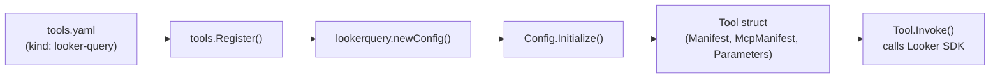
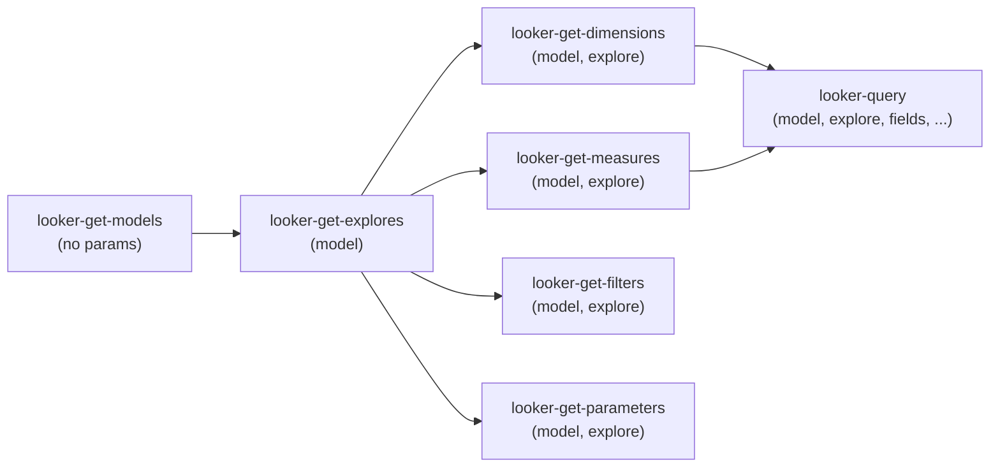
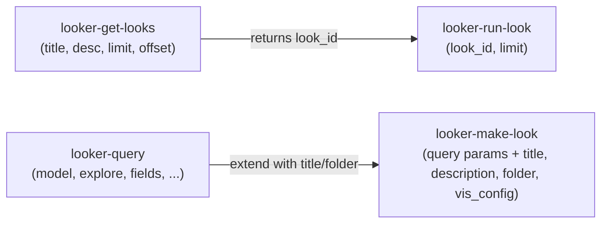
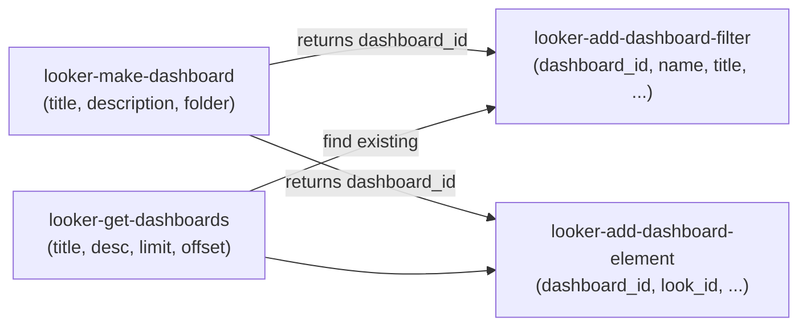
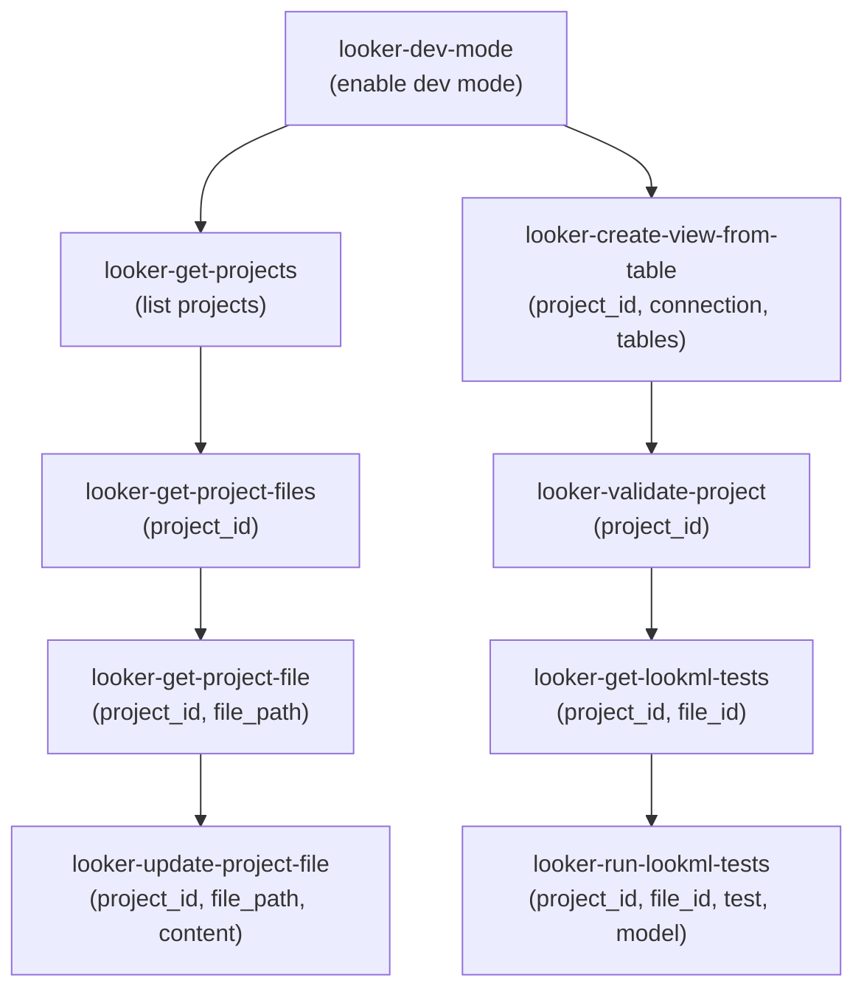

<!-- source: DeepWiki mcp.deepwiki.com · repo googleapis/genai-toolbox · page 6.4 Looker Tools · fetched 2026-10-29 -->

# Looker Tools

<details>
<summary>Relevant source files</summary>

The following files were used as context for generating this wiki page:

- [docs/en/integrations/cockroachdb/source.md](docs/en/integrations/cockroachdb/source.md)
- [docs/en/integrations/looker/source.md](docs/en/integrations/looker/source.md)
- [docs/en/integrations/looker/tools/looker-validate-project.md](docs/en/integrations/looker/tools/looker-validate-project.md)
- [internal/prebuiltconfigs/tools/looker-conversational-analytics.yaml](internal/prebuiltconfigs/tools/looker-conversational-analytics.yaml)
- [internal/prebuiltconfigs/tools/looker-dev.yaml](internal/prebuiltconfigs/tools/looker-dev.yaml)
- [internal/prebuiltconfigs/tools/looker.yaml](internal/prebuiltconfigs/tools/looker.yaml)
- [internal/tools/looker/lookeradddashboardelement/lookeradddashboardelement.go](internal/tools/looker/lookeradddashboardelement/lookeradddashboardelement.go)
- [internal/tools/looker/lookeradddashboardelement/lookeradddashboardelement_test.go](internal/tools/looker/lookeradddashboardelement/lookeradddashboardelement_test.go)
- [internal/tools/looker/lookercommon/lookercommon.go](internal/tools/looker/lookercommon/lookercommon.go)
- [internal/tools/looker/lookercommon/lookercommon_test.go](internal/tools/looker/lookercommon/lookercommon_test.go)
- [internal/tools/looker/lookergetdashboards/lookergetdashboards.go](internal/tools/looker/lookergetdashboards/lookergetdashboards.go)
- [internal/tools/looker/lookergetdimensions/lookergetdimensions.go](internal/tools/looker/lookergetdimensions/lookergetdimensions.go)
- [internal/tools/looker/lookergetexplores/lookergetexplores.go](internal/tools/looker/lookergetexplores/lookergetexplores.go)
- [internal/tools/looker/lookergetfilters/lookergetfilters.go](internal/tools/looker/lookergetfilters/lookergetfilters.go)
- [internal/tools/looker/lookergetlooks/lookergetlooks.go](internal/tools/looker/lookergetlooks/lookergetlooks.go)
- [internal/tools/looker/lookergetmeasures/lookergetmeasures.go](internal/tools/looker/lookergetmeasures/lookergetmeasures.go)
- [internal/tools/looker/lookergetmodels/lookergetmodels.go](internal/tools/looker/lookergetmodels/lookergetmodels.go)
- [internal/tools/looker/lookergetparameters/lookergetparameters.go](internal/tools/looker/lookergetparameters/lookergetparameters.go)
- [internal/tools/looker/lookermakedashboard/lookermakedashboard.go](internal/tools/looker/lookermakedashboard/lookermakedashboard.go)
- [internal/tools/looker/lookermakelook/lookermakelook.go](internal/tools/looker/lookermakelook/lookermakelook.go)
- [internal/tools/looker/lookerquery/lookerquery.go](internal/tools/looker/lookerquery/lookerquery.go)
- [internal/tools/looker/lookerquerysql/lookerquerysql.go](internal/tools/looker/lookerquerysql/lookerquerysql.go)
- [internal/tools/looker/lookerqueryurl/lookerqueryurl.go](internal/tools/looker/lookerqueryurl/lookerqueryurl.go)
- [internal/tools/looker/lookerrunlook/lookerrunlook.go](internal/tools/looker/lookerrunlook/lookerrunlook.go)
- [tests/looker/looker_integration_test.go](tests/looker/looker_integration_test.go)

</details>


This page documents all Looker tool types available in MCP Toolbox for Databases. These tools expose Looker's API surface as invokable tools for AI agents, covering schema discovery, data querying, Look and Dashboard management, LookML development, connection introspection, and instance health.

For information about the Looker **source** type (connection configuration), see the Data Sources section ([5.5]()). For the general tool architecture (how `ToolConfig`, `Tool`, and `compatibleSource` work), see [6.1](). For the prebuilt `looker` and `looker-dev` toolset configurations, see [6.7]().

---

## Source Compatibility

All Looker tools require a `looker` source. Each tool defines a local `compatibleSource` interface that the source must satisfy. The base interface, used by most tools, is:

```go
type compatibleSource interface {
    UseClientAuthorization() bool
    GetAuthTokenHeaderName() string
    LookerApiSettings() *rtl.ApiSettings
    GetLookerSDK(string) (*v4.LookerSDK, error)
}
```

Some tools extend this with visibility-control methods:

| Additional method | Used by |
|---|---|
| `LookerShowHiddenModels() bool` | `looker-get-models` |
| `LookerShowHiddenExplores() bool` | `looker-get-explores` |
| `LookerShowHiddenFields() bool` | `looker-get-dimensions`, `looker-get-measures`, `looker-get-filters`, `looker-get-parameters` |

Sources: [internal/tools/looker/lookergetmodels/lookergetmodels.go:48-54](), [internal/tools/looker/lookergetexplores/lookergetexplores.go:48-54](), [internal/tools/looker/lookergetdimensions/lookergetdimensions.go:49-55]()

---

## Common Shared Logic (`lookercommon`)

The package `internal/tools/looker/lookercommon/lookercommon.go` centralizes parameter definitions and query execution shared across multiple tools.

**Shared parameter builders:**

| Function | Returns | Used by |
|---|---|---|
| `GetFieldParameters()` | `model` (required string), `explore` (required string) | `get-dimensions`, `get-measures`, `get-filters`, `get-parameters` |
| `GetQueryParameters()` | Full query param set (see below) | `query`, `query-sql`, `query-url`, `make-look` |

**Query parameters** returned by `GetQueryParameters()`:

| Parameter | Type | Required | Default |
|---|---|---|---|
| `model` | string | yes | — |
| `explore` | string | yes | — |
| `fields` | array of strings | yes | — |
| `filters` | object (map) | no | `{}` |
| `pivots` | array of strings | no | `[]` |
| `sorts` | array of strings | no | `[]` |
| `limit` | integer | no | `500` |
| `tz` | string | no | local system timezone |

**Key shared functions:**

- `ProcessFieldArgs()` — extracts `model` and `explore` strings from `ParamValues` [internal/tools/looker/lookercommon/lookercommon.go:149-160]()
- `ProcessQueryArgs()` — builds a `v4.WriteQuery` from `ParamValues` [internal/tools/looker/lookercommon/lookercommon.go:162-212]()
- `RunInlineQuery()` — calls the Looker `/queries/run_inline` endpoint [internal/tools/looker/lookercommon/lookercommon.go:243-267]()
- `ExtractLookerFieldProperties()` — converts `[]v4.LookmlModelExploreField` into a `[]any` map slice, filtering `_raw` suffix fields and optionally hidden fields [internal/tools/looker/lookercommon/lookercommon.go:37-96]()
- `CheckLookerExploreFields()` — validates that a `v4.LookmlModelExplore` response has a non-nil `Fields` object [internal/tools/looker/lookercommon/lookercommon.go:99-104]()

**Field selector constants:**

```go
DimensionsFields = "fields(dimensions(name,type,label,label_short,description,synonyms,tags,hidden,suggestable,suggestions,suggest_dimension,suggest_explore))"
FiltersFields    = "fields(filters(...))"
MeasuresFields   = "fields(measures(...))"
ParametersFields = "fields(parameters(...))"
```

Sources: [internal/tools/looker/lookercommon/lookercommon.go:29-34](), [internal/tools/looker/lookercommon/lookercommon.go:106-147]()

---

## Tool Inventory

**Tool registration flow:**

Title: Tool Registration Sequence


Sources: [internal/tools/looker/lookerquery/lookerquery.go:36-40](), [internal/tools/looker/lookerquery/lookerquery.go:73-97]()

---

### Schema Discovery Tools

These tools expose the LookML metadata hierarchy: Models → Explores → Fields.

**Typical discovery workflow:**

Title: Discovery Workflow


Sources: [internal/prebuiltconfigs/tools/looker.yaml:29-119]()

#### `looker-get-models`

- **Package:** `internal/tools/looker/lookergetmodels`
- **Parameters:** none
- **Behavior:** Calls `sdk.AllLookmlModels("name,label")`. Filters hidden models if `LookerShowHiddenModels()` returns false.
- **Returns:** Array of `{name, label}` objects.

#### `looker-get-explores`

- **Package:** `internal/tools/looker/lookergetexplores`
- **Parameters:** `model` (required string)
- **Behavior:** Calls `sdk.LookmlModel(model, "explores(name,description,label,group_label,hidden)")`. Filters hidden explores if `LookerShowHiddenExplores()` returns false. [internal/tools/looker/lookergetexplores/lookergetexplores.go:133-159]()
- **Returns:** Array of `{name, description, label, group_label}` objects.

Sources: [internal/tools/looker/lookergetexplores/lookergetexplores.go:113-163]()

#### `looker-get-dimensions`, `looker-get-measures`, `looker-get-filters`, `looker-get-parameters`

- **Packages:** `lookergetdimensions`, `lookergetmeasures`, `lookergetfilters`, `lookergetparameters`
- **Parameters:** `model` (required), `explore` (required) — from `lookercommon.GetFieldParameters()`
- **Behavior:** Each calls `sdk.LookmlModelExplore()` with the corresponding field selector constant, then calls `ExtractLookerFieldProperties()`.
- **Returns:** Array of field objects with properties: `name`, `type`, `label`, `label_short`, `description`, `tags`, `synonyms`, and (when `suggestable` is true) `suggestions`, `suggest_explore`, `suggest_dimension`.

Sources: [internal/tools/looker/lookergetdimensions/lookergetdimensions.go:123-153](), [internal/tools/looker/lookergetfilters/lookergetfilters.go:113-154]()

---

### Query Execution Tools

These three tools share the same parameter set from `GetQueryParameters()` and all ultimately construct a `v4.WriteQuery`.

| Tool type | Package | Behavior | Returns |
|---|---|---|---|
| `looker-query` | `lookerquery` | Calls `RunInlineQuery(..., "json", ...)` | `[]any` (parsed JSON rows) |
| `looker-query-sql` | `lookerquerysql` | Calls `RunInlineQuery(..., "sql", ...)` | Raw SQL string |
| `looker-query-url` | `lookerqueryurl` | Calls `sdk.CreateQuery()` with `vis_config` | `{id, slug, url, long_url}` |

`looker-query-url` adds one extra parameter:

| Parameter | Type | Required | Default |
|---|---|---|---|
| `vis_config` | object (map) | no | `{}` |

The `vis_config` object controls Looker visualization settings (chart type, axis config, colors, etc.).

Sources: [internal/tools/looker/lookerquery/lookerquery.go:113-147](), [internal/tools/looker/lookerquerysql/lookerquerysql.go:112-137](), [internal/tools/looker/lookerqueryurl/lookerqueryurl.go:119-168]()

---

### Look Management Tools

**Tool relationship diagram:**

Title: Look Management Tools


#### `looker-get-looks`

- **Package:** `internal/tools/looker/lookergetlooks`
- **Parameters:** `title`, `desc`, `limit` (default 100), `offset` (default 0).
- **Behavior:** Calls `sdk.SearchLooks()`.
- **Returns:** Array of `{id, title, description}` objects.

#### `looker-run-look`

- **Package:** `internal/tools/looker/lookerrunlook`
- **Parameters:** `look_id` (required), `limit` (default 500).
- **Behavior:** Fetches the Look via `sdk.Look()`, reconstructs a `v4.WriteQuery` from its stored query, then calls `RunInlineQuery(..., "json", ...)`. [internal/tools/looker/lookerrunlook/lookerrunlook.go:141-157]()
- **Returns:** `[]any` (parsed JSON rows).

Sources: [internal/tools/looker/lookerrunlook/lookerrunlook.go:73-103](), [internal/tools/looker/lookerrunlook/lookerrunlook.go:119-171]()

#### `looker-make-look`

- **Package:** `internal/tools/looker/lookermakelook`
- **Parameters:** All parameters from `GetQueryParameters()` plus `title`, `description`, `folder`, and `vis_config`.
- **Returns:** `{id, slug, url}` of the created Look.

---

### Dashboard Management Tools

Title: Dashboard Management Tools


#### `looker-get-dashboards`

- **Package:** `internal/tools/looker/lookergetdashboards`
- **Parameters:** `title`, `desc`, `limit` (default 100), `offset` (default 0). [internal/tools/looker/lookergetdashboards/lookergetdashboards.go:72-80]()
- **Behavior:** Calls `sdk.SearchDashboards()`. [internal/tools/looker/lookergetdashboards/lookergetdashboards.go:155]()
- **Returns:** Array of `{id, title, description}` objects.

#### `looker-make-dashboard`

- **Package:** `internal/tools/looker/lookermakedashboard`
- **Parameters:** `title` (required), `description` (optional, default `""`), `folder` (optional, default `""`)
- **Returns:** `{id, title, url}` of the created Dashboard.

#### `looker-add-dashboard-filter`

- **Package:** `internal/tools/looker/lookeradddashboardfilter`
- **Parameters:** `dashboard_id`, `name`, `title`, `filter_type`, `default_value`, `model`, `explore`, `dimension`, `allow_multiple_values`, `required`.

#### `looker-add-dashboard-element`

- **Package:** `internal/tools/looker/lookeradddashboardelement`
- Creates a new tile within an existing dashboard, linking it to a Look.

---

### LookML Development Tools

These tools support authoring and validating LookML code. Many require the Looker session to be in **Development Mode** first (use `looker-dev-mode`).

Title: LookML Development Workflow


Sources: [internal/prebuiltconfigs/tools/looker-dev.yaml:88-180](), [tests/looker/looker_integration_test.go:191-289]()

#### `looker-get-lookml-tests`

- **Package:** `internal/tools/looker/lookergetlookmltests`
- **Parameters:** `project_id` (required), `file_id` (optional).
- **Returns:** List of available tests for the project/file.

#### `looker-run-lookml-tests`

- **Package:** `internal/tools/looker/lookerrunlookmltests`
- **Parameters:** `project_id` (required), `file_id`, `test`, `model`.
- **Returns:** Array of test result objects: `{model_name, test_name, assertions_count, assertions_failed, success, errors, warnings}`.

#### `looker-create-view-from-table`

- **Package:** `internal/tools/looker/lookercreateviewfromtable`
- **Parameters:** `project_id`, `connection`, `tables` (array of objects), `folder_name`.
- **Behavior:** Calls `CreateViewsFromTables()` in `lookercommon`, which posts to `/projects/{project_id}/generate`. [internal/tools/looker/lookercommon/lookercommon.go:334-374]()

#### File and Directory Management Tools

| Tool type | Package | Operation |
|---|---|---|
| `looker-get-projects` | `lookergetprojects` | List all LookML projects [internal/prebuiltconfigs/tools/looker-dev.yaml:101-114]() |
| `looker-get-project-files` | `lookergetprojectfiles` | List files in a project [internal/prebuiltconfigs/tools/looker-dev.yaml:116-130]() |
| `looker-get-project-file` | `lookergetprojectfile` | Read file content [internal/prebuiltconfigs/tools/looker-dev.yaml:131-145]() |
| `looker-create-project-file` | `lookercreateprojectfile` | Create a new file [internal/prebuiltconfigs/tools/looker-dev.yaml:146-163]() |
| `looker-update-project-file` | `lookerupdateprojectfile` | Update a file's content [internal/prebuiltconfigs/tools/looker-dev.yaml:164-180]() |
| `looker-delete-project-file` | `lookerdeleteprojectfile` | Delete a file |
| `looker-validate-project` | `lookervalidateproject` | Validate LookML in a project |
| `looker-dev-mode` | `lookerdevmode` | Toggle development mode on/off [internal/prebuiltconfigs/tools/looker-dev.yaml:88-99]() |

---

### Instance Management and Analytics

#### `looker-conversational-analytics`

- **Package:** `internal/tools/looker/lookerconversationalanalytics`
- Provides a conversational interface to Looker data using Gemini Data Analytics.
- **Requirements:** Requires GCP API enablement (`geminidataanalytics.googleapis.com`) and IAM roles (`roles/looker.instanceUser`, `roles/geminidataanalytics.dataAgentStatelessUser`). [docs/en/integrations/looker/source.md:40-58]()

#### Health Tools (`looker-dev` prebuilt only)

Available via `--prebuilt looker-dev`. These are defined in `internal/prebuiltconfigs/tools/looker-dev.yaml`.

| Tool type | Description |
|---|---|
| `looker-health-pulse` | Runs health checks: DB connections, dashboard performance, schedule failures. [internal/prebuiltconfigs/tools/looker-dev.yaml:28-49]() |
| `looker-health-analyze` | Calculates usage stats for projects, models, and explores. [internal/prebuiltconfigs/tools/looker-dev.yaml:50-67]() |
| `looker-health-vacuum` | Identifies low-usage models or explores for deletion. [internal/prebuiltconfigs/tools/looker-dev.yaml:68-86]() |

Sources: [internal/prebuiltconfigs/tools/looker-dev.yaml:28-86]()

---

## Configuration Reference

All Looker tool configurations share the same base fields in `tools.yaml`:

| Field | Type | Required | Description |
|---|---|---|---|
| `kind` | string | yes | The tool type identifier (e.g., `looker-query`) |
| `source` | string | yes | Name of the `looker` source to connect to |
| `description` | string | yes | Description passed to the LLM |
| `authRequired` | list of strings | no | Auth service names required to invoke this tool |

**Source Example:**

```yaml
kind: source
name: looker-source
type: looker
base_url: ${LOOKER_BASE_URL}
client_id: ${LOOKER_CLIENT_ID:}
client_secret: ${LOOKER_CLIENT_SECRET:}
verify_ssl: ${LOOKER_VERIFY_SSL:true}
project: ${LOOKER_PROJECT:} # Required for conversational-analytics
location: ${LOOKER_LOCATION:} # Required for conversational-analytics
```

Sources: [internal/prebuiltconfigs/tools/looker.yaml:15-27](), [docs/en/integrations/looker/source.md:83-97]()

---

