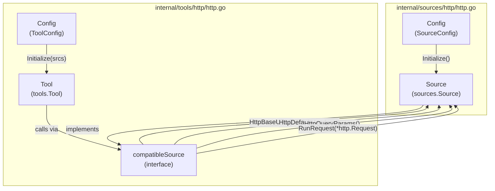
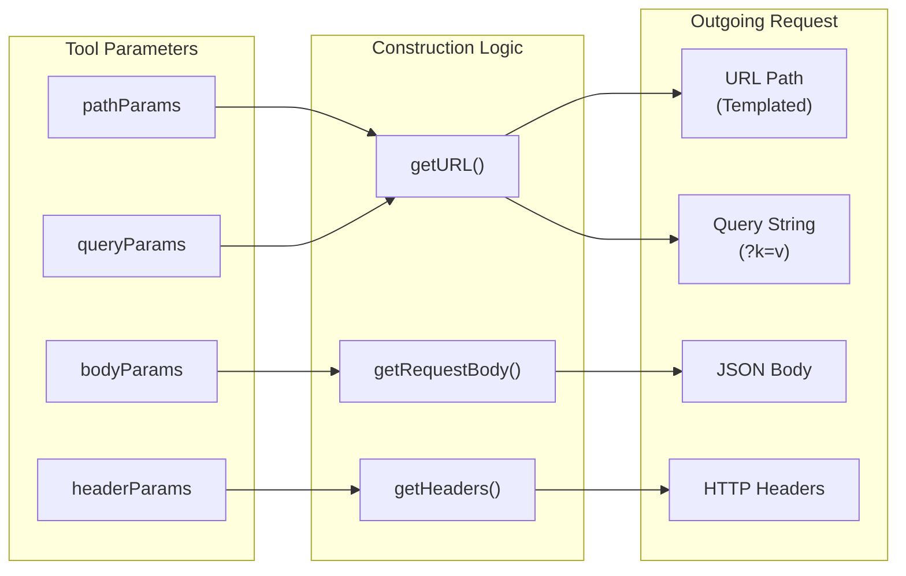

<!-- source: DeepWiki mcp.deepwiki.com · repo googleapis/genai-toolbox · page 6.5 HTTP and Utility Tools · fetched 2026-10-29 -->

# HTTP and Utility Tools

Relevant source files

The following files were used as context for generating this wiki page:

- [internal/sources/http/http.go](internal/sources/http/http.go)
- [internal/sources/http/http_test.go](internal/sources/http/http_test.go)
- [internal/tools/http/http.go](internal/tools/http/http.go)
- [internal/tools/http/http_test.go](internal/tools/http/http_test.go)
- [internal/tools/http/http_url_test.go](internal/tools/http/http_url_test.go)
- [internal/tools/http_method.go](internal/tools/http_method.go)

This page documents the `http` source type and the `http` tool type, which together allow the Toolbox to make arbitrary HTTP requests to external APIs or web services. It also covers utility tools such as `alloydb-wait-for-operation`.

The HTTP integration includes configuration for base URLs, default headers, SSL settings, and four parameter categories: path, query, body, and header parameters.

---

## Architecture Overview

The HTTP integration is split across two packages: a **source** that holds connection configuration and an HTTP client, and a **tool** that describes a specific endpoint and how to invoke it.

**Diagram: HTTP Source and Tool — Code Entity Relationships**

Sources: [internal/sources/http/http.go:52-151](), [internal/tools/http/http.go:51-56]()

---

## HTTP Source

The `http` source (type `"http"`) configures a reusable HTTP client. All tools using this source share these defaults.

**Source — `Config` Fields**

| Field | Type | Required | Default | Description |
|---|---|---|---|---|
| `name` | string | yes | — | Unique identifier for the source [internal/sources/http/http.go:53]() |
| `type` | string | yes | — | Must be `"http"` [internal/sources/http/http.go:54]() |
| `baseUrl` | string | yes | — | Base URL prepended to all tool paths [internal/sources/http/http.go:55]() |
| `timeout` | string | no | `"30s"` | Request timeout (e.g., `"10s"`, `"1m"`) [internal/sources/http/http.go:56]() |
| `headers` | `map[string]string` | no | — | Default headers sent with every request [internal/sources/http/http.go:57]() |
| `queryParams` | `map[string]string` | no | — | Default query parameters appended to every request [internal/sources/http/http.go:58]() |
| `returnFullError` | bool | no | `false` | If true, includes the response body in error messages [internal/sources/http/http.go:59]() |
| `disableSslVerification` | bool | no | `false` | Skips TLS certificate verification [internal/sources/http/http.go:60]() |

Sources: [internal/sources/http/http.go:52-61]()

### Source Initialization

When `Initialize()` is called [internal/sources/http/http.go:68-118]():
1. Parses `timeout` into a `time.Duration`.
2. Creates an `http.Transport`. If `disableSslVerification` is `true`, it sets `InsecureSkipVerify: true` and logs a warning [internal/sources/http/http.go:81-87]().
3. Validates the `BaseURL` format [internal/sources/http/http.go:95-98]().
4. Appends the Toolbox `User-Agent` to any existing `User-Agent` header [internal/sources/http/http.go:100-110]().

### Response Handling

`RunRequest()` [internal/sources/http/http.go:151-188]() executes the request. It returns an error for non-2xx status codes. If `returnFullError` is enabled, the response body is included in the error message [internal/sources/http/http.go:165-167](). Otherwise, it attempts to unmarshal the body as JSON; if unmarshalling fails, it returns the raw string [internal/sources/http/http.go:182-187]().

Sources: [internal/sources/http/http.go:68-188]()

---

## HTTP Tool

The `http` tool type (type `"http"`) describes a specific HTTP endpoint.

**Tool — `Config` Fields**

| Field | Type | Required | Description |
|---|---|---|---|
| `name` | string | yes | Unique identifier for the tool [internal/tools/http/http.go:59]() |
| `source` | string | yes | Name of an `http` source [internal/tools/http/http.go:61]() |
| `method` | string | yes | HTTP method (e.g., `GET`, `POST`) [internal/tools/http/http.go:65]() |
| `path` | string | yes | Path appended to `baseUrl`; supports Go template syntax [internal/tools/http/http.go:64]() |
| `requestBody` | string | no | Go template for the request body [internal/tools/http/http.go:67]() |
| `pathParams` | `Parameters` | no | Params substituted into the `path` [internal/tools/http/http.go:68]() |
| `queryParams` | `Parameters` | no | Params appended to the query string [internal/tools/http/http.go:69]() |
| `bodyParams` | `Parameters` | no | Params substituted into the `requestBody` [internal/tools/http/http.go:70]() |
| `headerParams` | `Parameters` | no | Params set as request headers [internal/tools/http/http.go:71]() |

Sources: [internal/tools/http/http.go:58-73]()

### HTTP Method Validation

The `HTTPMethod` type [internal/tools/http_method.go:24-49]() normalizes the method to uppercase and validates it against standard methods (GET, POST, etc.). Invalid methods like `GOT` cause a configuration error [internal/tools/http_method.go:44-46]().

---

## Parameter Processing

HTTP tools support four parameter categories. All parameter names must be unique across these categories for a single tool [internal/tools/http/http.go:104-108]().

**Diagram: Data Flow from Parameters to HTTP Request**

Sources: [internal/tools/http/http.go:147-227]()

### Path and Query Parameters

`getURL()` [internal/tools/http/http.go:162-209]() handles URL construction:
- **Path**: Uses `text/template` to substitute `pathParams` into the `path` string [internal/tools/http/http.go:170-178]().
- **Query**: Merges source-level `queryParams`, static query params in the tool `path`, and dynamic `queryParams` from the invocation [internal/tools/http/http.go:201-209]().

### Body Parameters

`getRequestBody()` [internal/tools/http/http.go:147-159]() uses `parameters.PopulateTemplateWithJSON` to substitute `bodyParams` into the `requestBody` template [internal/tools/http/http.go:154](). This allows for complex JSON structures and array serialization.

### Header Parameters

`getHeaders()` [internal/tools/http/http.go:212-227]() sets dynamic headers. If a `headerParam` value is not a string, an error is returned [internal/tools/http/http.go:222-224]().

---

## Invocation Flow

When a tool is invoked, the following sequence occurs:

1. **URL Construction**: `getURL` resolves the final endpoint [internal/tools/http/http.go:237]().
2. **Body Generation**: `getRequestBody` generates the payload [internal/tools/http/http.go:242]().
3. **Request Creation**: A new `http.Request` is initialized with the resolved URL and body [internal/tools/http/http.go:247]().
4. **Header Merging**: `getHeaders` combines source headers, tool headers, and dynamic header params [internal/tools/http/http.go:253]().
5. **Execution**: The request is passed to the source's `RunRequest` method [internal/tools/http/http.go:264]().

Sources: [internal/tools/http/http.go:229-268]()

---

## Utility Tools

The Toolbox includes utility tools for specialized cloud operations.

### AlloyDB Wait For Operation

The `alloydb-wait-for-operation` tool is typically used in administrative workflows (like creating clusters or users) to poll the status of a long-running LRO (Long Running Operation). It ensures that dependent steps in an agentic workflow do not execute until the database operation is complete.

---

## Security and Validation

- **SSL Verification**: `disableSslVerification` should only be used for local development [internal/sources/http/http.go:86]().
- **Path Traversal**: `getURL` validates that the templated path is relative and does not attempt to override the base host [internal/tools/http/http.go:193-195]().
- **Error Sanitization**: By default, upstream error bodies are truncated and logged rather than returned to the user to prevent leaking sensitive API details [internal/sources/http/http.go:169-180]().

Sources: [internal/sources/http/http.go:81-87](), [internal/sources/http/http.go:164-180](), [internal/tools/http/http.go:193-195]()

---

